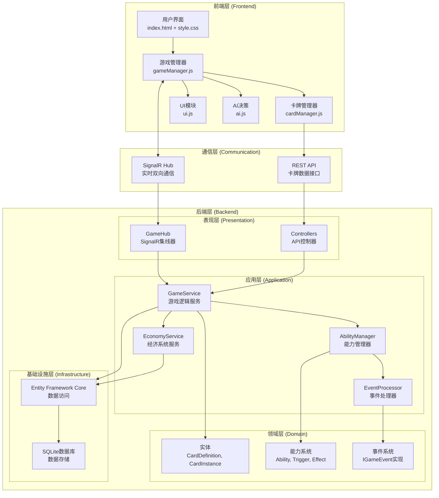
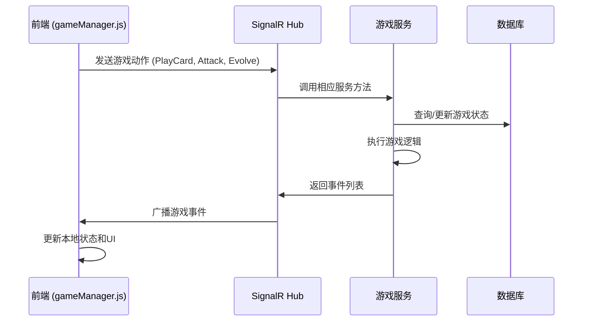
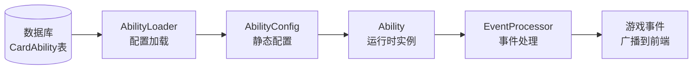

# 01-架构总览 [COMPLETED]

## 目的与范围

本文档提供Shadowverse-beyond项目的完整架构概览，涵盖前后端分离设计、核心技术栈、系统间交互模式以及关键设计原则。作为技术文档的入口点，为开发者提供项目整体理解的基础。

## 核心概念

### 技术架构模式
- **前后端分离**: 清晰的职责边界，前端负责UI渲染和用户交互，后端负责游戏逻辑和数据管理
- **事件驱动架构**: 基于SignalR的实时事件广播机制，确保游戏状态同步
- **领域驱动设计**: 后端采用DDD模式，清晰的领域边界和业务逻辑封装
- **权威服务器**: 后端作为游戏状态的唯一权威源，前端进行乐观更新

### 关键术语
- **CardDefinition**: 静态卡牌定义，存储在数据库中的卡牌模板
- **CardInstance**: 运行时卡牌实例，包含动态状态和位置信息
- **AbilityConfig**: 静态能力配置，从数据库或DSL解析得到
- **Ability**: 运行时能力实例，包含执行状态和触发逻辑
- **GameEventDto**: 游戏事件数据传输对象，用于前后端通信
- **EP (Evolution Point)**: 进化点数，用于单位进化的资源

## 架构概览

### 系统架构图



### 技术栈详解

#### 前端技术栈
- **HTML5/CSS3**: 基础页面结构和样式系统
- **JavaScript ES6+**: 原生JavaScript，无框架依赖的轻量级实现
- **SignalR Client**: 实时通信客户端库
- **原生DOM API**: 直接操作DOM，确保性能和控制精度

#### 后端技术栈
- **ASP.NET Core 8**: 现代化的Web框架
- **SignalR**: 实时双向通信框架
- **Entity Framework Core**: ORM数据访问层
- **SQLite**: 轻量级关系数据库
- **Serilog**: 结构化日志记录

#### 开发工具链
- **Visual Studio Code**: 主要开发环境
- **Vite**: 前端开发服务器和代理配置
- **xUnit**: 后端单元测试框架
- **.NET CLI**: 项目构建和管理工具

## 实现细节

### 前端架构模式

<augment_code_snippet path="src/main.js" mode="EXCERPT">
````javascript
// 前端应用入口 - 协调各模块初始化
import * as signalR from "@microsoft/signalr";
import { gameState, initializeGame, setSignalRConnection } from './gameManager.js';
import { loadCards } from './cardManager.js';

// SignalR连接建立和事件注册
connection = new signalR.HubConnectionBuilder()
    .withUrl(hubUrlWithParams)
    .withAutomaticReconnect()
    .configureLogging(signalR.LogLevel.Trace)
    .build();
````
</augment_code_snippet>

### 后端服务注册模式

<augment_code_snippet path="Server/Program.cs" mode="EXCERPT">
````csharp
// 依赖注入配置 - 遵循SOLID原则
builder.Services.AddSingleton<IGameService, GameService>();
builder.Services.AddScoped<IEconomyService, EconomyService>();
builder.Services.AddScoped<AbilityLoader>();
builder.Services.AddScoped<ITransactionService, TransactionService>();
````
</augment_code_snippet>

### 领域实体设计

<augment_code_snippet path="Server/Domain/Entities/CardInstance.cs" mode="EXCERPT">
````csharp
/// <summary>
/// 统一的卡牌实例实体，替代原有的CardState和BoardEntityState
/// </summary>
public class CardInstance : ICard
{
    public string InstanceId { get; set; } = string.Empty;
    public int DefinitionId { get; set; }
    public string OwnerPlayerId { get; set; } = string.Empty;
    public CardZone CurrentZone { get; set; } = CardZone.Deck;
    public int CurrentAttack { get; set; }
    public int CurrentHealth { get; set; }
    public bool IsEvolved { get; set; }
}
````
</augment_code_snippet>

## 集成点

### 前后端通信流程



### 能力系统集成



## 使用模式

### 游戏动作处理模式
1. **前端触发**: 用户操作触发JavaScript函数
2. **SignalR传输**: 动作DTO通过SignalR发送到后端
3. **服务处理**: GameService验证并执行游戏逻辑
4. **事件生成**: 生成相应的游戏事件DTO
5. **状态同步**: 事件广播到所有客户端更新状态

### 能力触发模式
1. **事件监听**: AbilityManager监听游戏事件
2. **条件检查**: 评估能力触发条件
3. **效果执行**: 执行能力效果并生成新事件
4. **链式处理**: EventProcessor处理事件链

### 数据持久化模式
1. **实体映射**: Entity Framework Core管理实体关系
2. **事务处理**: TransactionService确保数据一致性
3. **迁移管理**: 数据库结构版本控制

## 状态标识

**[COMPLETED]** - 当前架构已稳定实现，支持完整的游戏流程包括卡牌出牌、单位攻击、进化机制、能力系统和经济系统。

### 已实现核心功能
- ✅ 前后端分离架构
- ✅ SignalR实时通信
- ✅ 卡牌能力管理系统
- ✅ 进化机制 (EP管理)
- ✅ 经济系统 (金币、卡包、任务)
- ✅ 事件驱动状态同步
- ✅ 领域模型重构 (CardInstance统一)

### 技术债务
- 前端状态管理可进一步优化
- 能力系统DSL解析器需要完善错误处理
- 单元测试覆盖率需要提升
