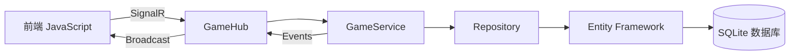

# 02-技术栈 [COMPLETED]

## 目的与范围

本文档详细说明Shadowverse-beyond项目使用的技术栈，包括前端、后端、数据库、开发工具等各层技术选型的原因、版本要求、配置方式和最佳实践。

## 核心概念

### 技术选型原则
- **现代化**: 使用最新稳定版本的技术栈
- **轻量级**: 避免过度工程化，选择简洁高效的解决方案
- **可维护性**: 优先选择有良好社区支持和文档的技术
- **性能优先**: 确保游戏实时性和响应速度

## 技术栈详解

### 前端技术栈

#### 核心技术
```json
{
  "runtime": "浏览器原生 JavaScript ES6+",
  "ui_framework": "原生 HTML5/CSS3",
  "module_system": "ES Modules",
  "communication": "SignalR Client Library",
  "build_tool": "Vite (开发环境)"
}
```

#### JavaScript 运行时环境
- **版本要求**: ES6+ (支持现代浏览器)
- **模块系统**: ES Modules (import/export)
- **异步处理**: async/await + Promise
- **无框架依赖**: 直接使用原生DOM API

<augment_code_snippet path="src/main.js" mode="EXCERPT">
````javascript
// ES6+ 模块导入示例
import * as signalR from "@microsoft/signalr";
import { gameState, initializeGame } from './gameManager.js';
import { loadCards } from './cardManager.js';
````
</augment_code_snippet>

#### SignalR 客户端
- **版本**: @microsoft/signalr ^8.0.0
- **功能**: 实时双向通信
- **配置**: 自动重连、日志级别控制

<augment_code_snippet path="src/main.js" mode="EXCERPT">
````javascript
// SignalR 连接配置
connection = new signalR.HubConnectionBuilder()
    .withUrl(hubUrlWithParams)
    .withAutomaticReconnect()
    .configureLogging(signalR.LogLevel.Trace)
    .build();
````
</augment_code_snippet>

#### 开发工具
- **Vite**: 开发服务器和代理配置
- **代理配置**: API和SignalR请求代理到后端

<augment_code_snippet path="vite.config.js" mode="EXCERPT">
````javascript
export default defineConfig({
  server: {
    proxy: {
      '/api': {
        target: 'http://localhost:5100',
        changeOrigin: true,
      },
      '/gamehub': {
        target: 'http://localhost:5100',
        ws: true,
        changeOrigin: true,
      }
    }
  }
});
````
</augment_code_snippet>

### 后端技术栈

#### 核心框架
```json
{
  "framework": "ASP.NET Core 8.0",
  "language": "C# 12",
  "runtime": ".NET 8",
  "architecture": "Clean Architecture + DDD"
}
```

#### ASP.NET Core 配置
- **版本**: .NET 8.0
- **项目类型**: Web API + SignalR Hub
- **依赖注入**: 内置DI容器
- **中间件**: 自定义异常处理、日志记录

<augment_code_snippet path="Server/Program.cs" mode="EXCERPT">
````csharp
// ASP.NET Core 服务注册
builder.Services.AddSignalR();
builder.Services.AddDbContext<ApplicationDbContext>(options =>
    options.UseSqlite("Data Source=Data/shadowverse.db"));

// 业务服务注册
builder.Services.AddSingleton<IGameService, GameService>();
builder.Services.AddScoped<IEconomyService, EconomyService>();
````
</augment_code_snippet>

#### SignalR Hub
- **实时通信**: 游戏状态同步
- **连接管理**: 自动重连和错误处理
- **事件广播**: 多客户端状态同步

<augment_code_snippet path="Server/Hubs/GameHub.cs" mode="EXCERPT">
````csharp
public class GameHub : Hub<IGameClient>
{
    private readonly IGameService _gameService;
    
    public async Task PerformPlayCard(PlayCardActionDto actionDto)
    {
        // 处理出牌动作并广播事件
        var context = new GameActionContext();
        await _gameService.PlayCardAsync(gameId, playerId, actionDto, context);
    }
}
````
</augment_code_snippet>

### 数据层技术栈

#### ORM 框架
- **Entity Framework Core 8.0**: 主要ORM框架
- **Code First**: 代码优先的数据库设计
- **迁移管理**: 自动化数据库结构更新

<augment_code_snippet path="Server/Infrastructure/Data/ApplicationDbContext.cs" mode="EXCERPT">
````csharp
public class ApplicationDbContext : DbContext
{
    public DbSet<CardDefinition> CardDefinitions { get; set; }
    public DbSet<CardInstance> CardInstances { get; set; }
    public DbSet<UserEconomy> UserEconomies { get; set; }
    public DbSet<CardAbility> CardAbilities { get; set; }
}
````
</augment_code_snippet>

#### 数据库
- **SQLite**: 轻量级关系数据库
- **连接字符串**: Data Source=Data/shadowverse.db
- **事务支持**: 完整的ACID特性

### 日志系统

#### Serilog 配置
- **结构化日志**: JSON格式输出
- **多重输出**: 控制台 + 文件
- **日志级别**: Debug/Information/Warning/Error

<augment_code_snippet path="Server/Program.cs" mode="EXCERPT">
````csharp
// Serilog 配置
Log.Logger = new LoggerConfiguration()
    .MinimumLevel.Debug()
    .WriteTo.Console()
    .WriteTo.File("logs/shadowverse-.txt", rollingInterval: RollingInterval.Day)
    .CreateLogger();
````
</augment_code_snippet>

## 实现细节

### 依赖注入模式

#### 服务生命周期管理
```csharp
// Singleton: 游戏状态管理
builder.Services.AddSingleton<IGameService, GameService>();
builder.Services.AddSingleton<IGameStateManager, InMemoryGameStateManager>();

// Scoped: 数据库相关服务
builder.Services.AddScoped<ICardRepository, EFCardRepository>();
builder.Services.AddScoped<IEconomyService, EconomyService>();

// Transient: 轻量级服务
builder.Services.AddTransient<DslExpressionParser>();
```

### 配置管理

#### 应用程序配置
```json
{
  "ConnectionStrings": {
    "DefaultConnection": "Data Source=Data/shadowverse.db"
  },
  "Logging": {
    "LogLevel": {
      "Default": "Information",
      "Microsoft.AspNetCore.SignalR": "Debug"
    }
  }
}
```

### 性能优化

#### Entity Framework 优化
- **AsNoTracking**: 只读查询性能优化
- **批量操作**: 减少数据库往返次数
- **连接池**: 自动连接管理

<augment_code_snippet path="Server/Infrastructure/Persistence/EFCardRepository.cs" mode="EXCERPT">
````csharp
public async Task<IEnumerable<CardDefinition>> GetAllAsync()
{
    // 使用 AsNoTracking 提高只读查询性能
    return await _context.CardDefinitions
        .AsNoTracking()
        .ToListAsync();
}
````
</augment_code_snippet>

## 集成点

### 前后端通信协议

#### REST API
- **卡牌数据**: GET /api/cards
- **静态资源**: 文件服务
- **健康检查**: GET /health

#### SignalR 协议
- **连接**: /gamehub?gameId={id}&playerId={id}
- **方法调用**: PerformPlayCard, PerformAttack, PerformEvolve
- **事件接收**: ReceiveGameState, ReceiveGameEvent

### 数据流架构



## 使用模式

### 开发环境设置

#### 前端开发
```bash
# 安装依赖
npm install

# 启动开发服务器
npm run dev

# 访问地址
http://localhost:5173
```

#### 后端开发
```bash
# 恢复包
dotnet restore

# 数据库迁移
dotnet ef database update

# 启动服务
dotnet run

# 访问地址
http://localhost:5100
```

### 部署配置

#### 生产环境要求
- **.NET 8 Runtime**: 服务器运行时
- **现代浏览器**: Chrome 90+, Firefox 88+, Safari 14+
- **SQLite**: 无需额外数据库服务器

## 状态标识

**[COMPLETED]** - 技术栈已完全确定并在生产环境中稳定运行。

### 版本兼容性
- ✅ .NET 8.0 LTS
- ✅ Entity Framework Core 8.0
- ✅ SignalR 8.0
- ✅ 现代浏览器 ES6+ 支持

### 技术债务
- 考虑引入前端状态管理库 (Redux/Zustand)
- 评估数据库升级到 PostgreSQL 的可行性
- 完善单元测试和集成测试覆盖率
