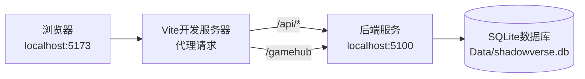

# 03-开发环境设置 [COMPLETED]

## 目的与范围

本文档提供Shadowverse-beyond项目的完整开发环境设置指南，包括环境要求、安装步骤、配置说明和常见问题解决方案。确保新开发者能够快速搭建可用的开发环境。

## 核心概念

### 开发环境架构
- **前端开发**: Vite开发服务器 + 浏览器调试
- **后端开发**: .NET CLI + Visual Studio Code/Visual Studio
- **数据库**: SQLite本地文件数据库
- **通信**: 本地代理配置实现前后端联调

## 环境要求

### 系统要求
```yaml
操作系统:
  - Windows 10/11 (推荐)
  - macOS 12+ 
  - Ubuntu 20.04+

硬件要求:
  - RAM: 8GB+ (推荐16GB)
  - 存储: 5GB可用空间
  - CPU: 双核以上
```

### 必需软件

#### .NET 开发环境
- **.NET 8 SDK**: 后端开发和运行时
- **版本**: 8.0.100 或更高
- **下载**: https://dotnet.microsoft.com/download/dotnet/8.0

```bash
# 验证安装
dotnet --version
# 应输出: 8.0.xxx
```

#### Node.js 环境
- **Node.js**: 18.0+ (推荐LTS版本)
- **npm**: 9.0+ (随Node.js安装)
- **下载**: https://nodejs.org/

```bash
# 验证安装
node --version  # v18.x.x+
npm --version   # 9.x.x+
```

#### 开发工具
- **Visual Studio Code**: 主要开发IDE
- **扩展推荐**:
  - C# Dev Kit
  - JavaScript (ES6) code snippets
  - Live Server
  - SQLite Viewer

## 安装步骤

### 1. 克隆项目
```bash
git clone [项目仓库地址]
cd Shadowverse-beyond
```

### 2. 后端环境设置

#### 安装依赖包
```bash
cd Server
dotnet restore
```

#### 数据库初始化
```bash
# 创建数据库迁移 (如果需要)
dotnet ef migrations add InitialCreate

# 应用数据库迁移
dotnet ef database update

# 验证数据库文件创建
ls Data/shadowverse.db
```

#### 配置文件设置
<augment_code_snippet path="Server/appsettings.Development.json" mode="EXCERPT">
````json
{
  "ConnectionStrings": {
    "DefaultConnection": "Data Source=Data/shadowverse.db"
  },
  "Logging": {
    "LogLevel": {
      "Default": "Information",
      "Microsoft.AspNetCore.SignalR": "Debug",
      "ShadowverseBeyond": "Debug"
    }
  },
  "AllowedHosts": "*"
}
````
</augment_code_snippet>

#### 启动后端服务
```bash
# 开发模式启动
dotnet run

# 或使用监视模式 (自动重启)
dotnet watch run

# 验证服务运行
# 浏览器访问: http://localhost:5100
```

### 3. 前端环境设置

#### 安装依赖包
```bash
# 返回项目根目录
cd ..

# 安装前端依赖
npm install
```

#### Vite配置验证
<augment_code_snippet path="vite.config.js" mode="EXCERPT">
````javascript
import { defineConfig } from 'vite';

export default defineConfig({
  server: {
    proxy: {
      '/api': {
        target: 'http://localhost:5100',
        changeOrigin: true,
      },
      '/gamehub': {
        target: 'http://localhost:5100',
        ws: true,
        changeOrigin: true,
      }
    }
  }
});
````
</augment_code_snippet>

#### 启动前端开发服务器
```bash
# 启动Vite开发服务器
npm run dev

# 访问地址: http://localhost:5173
```

### 4. 验证环境设置

#### 完整启动流程
```bash
# 终端1: 启动后端
cd Server
dotnet watch run

# 终端2: 启动前端
npm run dev

# 浏览器访问: http://localhost:5173
```

#### 功能验证清单
- [ ] 页面正常加载
- [ ] SignalR连接成功 (检查浏览器控制台)
- [ ] 卡牌数据加载成功
- [ ] 游戏界面渲染正常
- [ ] 基本游戏操作可用

## 实现细节

### 开发工作流

#### 前端开发
```bash
# 启动开发服务器
npm run dev

# 代码修改自动热重载
# 浏览器开发者工具调试
# F12 -> Console/Network/Sources
```

#### 后端开发
```bash
# 监视模式开发
dotnet watch run

# 代码修改自动重启
# 查看日志输出
# 使用断点调试 (VS Code)
```

### 数据库管理

#### Entity Framework 命令
```bash
# 添加新迁移
dotnet ef migrations add [MigrationName]

# 更新数据库
dotnet ef database update

# 回滚到指定迁移
dotnet ef database update [MigrationName]

# 删除最后一个迁移
dotnet ef migrations remove
```

#### 数据库查看
- **SQLite Viewer扩展**: VS Code中直接查看
- **DB Browser for SQLite**: 独立数据库管理工具
- **命令行**: sqlite3 Data/shadowverse.db

### 调试配置

#### VS Code 调试配置
```json
{
  "version": "0.2.0",
  "configurations": [
    {
      "name": ".NET Core Launch (web)",
      "type": "coreclr",
      "request": "launch",
      "preLaunchTask": "build",
      "program": "${workspaceFolder}/Server/bin/Debug/net8.0/Server.dll",
      "args": [],
      "cwd": "${workspaceFolder}/Server",
      "stopAtEntry": false,
      "serverReadyAction": {
        "action": "openExternally",
        "pattern": "\\bNow listening on:\\s+(https?://\\S+)"
      },
      "env": {
        "ASPNETCORE_ENVIRONMENT": "Development"
      }
    }
  ]
}
```

## 集成点

### 前后端联调

#### 网络配置


#### 代理规则说明
- **API请求**: `/api/*` → `http://localhost:5100/api/*`
- **SignalR**: `/gamehub` → `http://localhost:5100/gamehub` (WebSocket)
- **静态文件**: 直接由Vite服务

### 日志配置

#### 后端日志
```csharp
// Program.cs 中的日志配置
Log.Logger = new LoggerConfiguration()
    .MinimumLevel.Debug()
    .WriteTo.Console()
    .WriteTo.File("logs/shadowverse-.txt", 
        rollingInterval: RollingInterval.Day)
    .CreateLogger();
```

#### 前端调试
```javascript
// 浏览器控制台查看SignalR日志
connection = new signalR.HubConnectionBuilder()
    .withUrl(hubUrlWithParams)
    .configureLogging(signalR.LogLevel.Trace)
    .build();
```

## 使用模式

### 日常开发流程
1. **启动后端**: `dotnet watch run`
2. **启动前端**: `npm run dev`
3. **代码修改**: 自动热重载
4. **测试功能**: 浏览器验证
5. **查看日志**: 控制台输出
6. **数据库检查**: SQLite工具

### 常见开发任务

#### 添加新功能
1. 后端: 创建DTO → 实现服务方法 → 添加Hub方法
2. 前端: 添加UI → 实现事件处理 → 测试交互

#### 数据库变更
1. 修改实体类
2. 添加迁移: `dotnet ef migrations add [Name]`
3. 更新数据库: `dotnet ef database update`
4. 验证数据结构

## 状态标识

**[COMPLETED]** - 开发环境设置流程已完善，支持快速搭建和高效开发。

### 已验证环境
- ✅ Windows 11 + VS Code
- ✅ macOS + VS Code  
- ✅ Ubuntu 22.04 + VS Code
- ✅ Visual Studio 2022 (Windows)

### 故障排除
- 端口冲突: 修改appsettings.json中的端口配置
- 数据库锁定: 重启开发服务器
- SignalR连接失败: 检查代理配置和防火墙设置
- 包依赖问题: 清理缓存后重新安装
