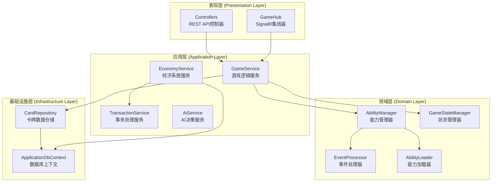
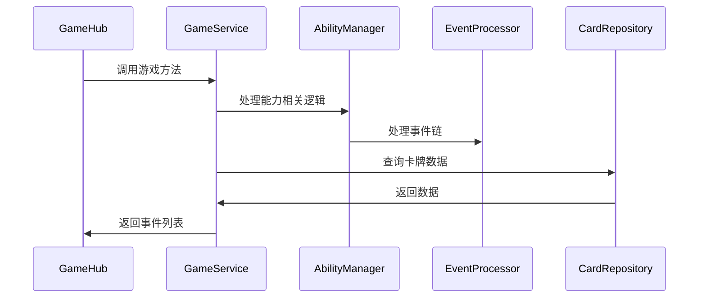

# 01-服务层设计 [COMPLETED]

## 目的与范围

本文档详细说明Shadowverse-beyond后端服务层的设计架构，包括Clean Architecture实现、依赖注入模式、服务生命周期管理以及各服务层的职责划分。为后端开发提供架构指导和最佳实践。

## 核心概念

### Clean Architecture 原则
- **依赖倒置**: 高层模块不依赖低层模块，都依赖抽象
- **单一职责**: 每个服务类只负责一个业务领域
- **开闭原则**: 对扩展开放，对修改关闭
- **接口隔离**: 客户端不应依赖它不使用的接口

### 服务层分层
- **表现层 (Presentation)**: Controllers, SignalR Hubs
- **应用层 (Application)**: 业务服务, 应用逻辑协调
- **领域层 (Domain)**: 核心业务逻辑, 实体, 领域服务
- **基础设施层 (Infrastructure)**: 数据访问, 外部服务

## 架构概览

### 服务层架构图



### 依赖注入配置

<augment_code_snippet path="Server/Program.cs" mode="EXCERPT">
````csharp
// 服务注册 - 遵循依赖注入原则
// Singleton: 游戏状态管理 (跨请求共享)
builder.Services.AddSingleton<IGameService, GameService>();
builder.Services.AddSingleton<IGameStateManager, InMemoryGameStateManager>();
builder.Services.AddSingleton<IAiService, AiService>();

// Scoped: 数据库相关服务 (请求生命周期)
builder.Services.AddScoped<ICardRepository, EFCardRepository>();
builder.Services.AddScoped<IEconomyService, EconomyService>();
builder.Services.AddScoped<ITransactionService, TransactionService>();

// Transient: 轻量级服务 (每次创建新实例)
builder.Services.AddScoped<AbilityLoader>();
builder.Services.AddScoped<DslExpressionParser>();
````
</augment_code_snippet>

## 实现细节

### 核心服务设计

#### GameService - 游戏逻辑核心
**职责**: 游戏状态管理、动作处理、事件生成

<augment_code_snippet path="Server/Services/IGameService.cs" mode="EXCERPT">
````csharp
public interface IGameService
{
    Task<bool> PlayCardAsync(string gameId, string playerId, 
        PlayCardActionDto actionDto, GameActionContext context);
    Task<bool> AttackAsync(string gameId, string playerId, 
        AttackActionDto actionDto, GameActionContext context);
    Task<bool> EvolveAsync(string gameId, string playerId, 
        EvolveActionDto actionDto, GameActionContext context);
    Task<bool> EndTurnAsync(string gameId, string playerId, 
        GameActionContext context);
}
````
</augment_code_snippet>

**设计特点**:
- **Singleton生命周期**: 维护全局游戏状态
- **事件驱动**: 所有操作生成事件而非直接修改状态
- **异步处理**: 支持高并发游戏会话

#### EconomyService - 经济系统服务
**职责**: 金币管理、卡包系统、任务奖励

<augment_code_snippet path="Server/Services/EconomyService.cs" mode="EXCERPT">
````csharp
public class EconomyService : IEconomyService
{
    public async Task<bool> AddCoinsAsync(Guid userId, int amount, 
        CoinTransactionType type, string? description = null)
    {
        using var transaction = await _context.Database.BeginTransactionAsync();
        try
        {
            var userEconomy = await GetOrCreateUserEconomyAsync(userId);
            userEconomy.Coins += amount;
            
            var coinTransaction = new CoinTransaction
            {
                UserId = userId,
                Amount = amount,
                Type = type,
                Description = description
            };
            
            await _context.SaveChangesAsync();
            await transaction.CommitAsync();
            return true;
        }
        catch
        {
            await transaction.RollbackAsync();
            throw;
        }
    }
}
````
</augment_code_snippet>

#### TransactionService - 事务处理服务
**职责**: 数据库事务管理、一致性保证

<augment_code_snippet path="Server/Services/TransactionService.cs" mode="EXCERPT">
````csharp
public async Task<TResult> ExecuteInTransactionAsync<TResult>(
    Func<Task<TResult>> operation)
{
    if (IsInTransaction())
    {
        return await operation();
    }

    using var transaction = await _context.Database.BeginTransactionAsync();
    try
    {
        var result = await operation();
        await _context.SaveChangesAsync();
        await transaction.CommitAsync();
        return result;
    }
    catch
    {
        await transaction.RollbackAsync();
        throw;
    }
}
````
</augment_code_snippet>

### 领域服务设计

#### AbilityManager - 能力管理器
**职责**: 能力实例管理、事件监听、效果执行

<augment_code_snippet path="Server/Domain/Abilities/AbilityManager.cs" mode="EXCERPT">
````csharp
public class AbilityManager
{
    private readonly List<Ability> _allAbilities = new();
    private readonly EventProcessor _eventProcessor;

    public async Task<List<GameEventDto>> ProcessEventAsync(
        IGameEvent gameEvent, GameContext context)
    {
        var eventProcessor = new EventProcessor(_logger, this);
        
        foreach (var ability in _allAbilities)
        {
            eventProcessor.RegisterAbility(ability);
        }
        
        return await eventProcessor.ProcessEventAsync(gameEvent, context);
    }
}
````
</augment_code_snippet>

#### EventProcessor - 事件处理器
**职责**: 事件队列管理、能力触发、事件链处理

<augment_code_snippet path="Server/Domain/Events/EventProcessor.cs" mode="EXCERPT">
````csharp
public async Task<List<GameEventDto>> ProcessEventAsync(
    IGameEvent initialEvent, GameContext context)
{
    var processedEvents = new List<GameEventDto>();
    _eventQueue.Clear();
    _eventQueue.Enqueue(initialEvent);

    while (_eventQueue.Count > 0)
    {
        var currentEvent = _eventQueue.Dequeue();
        
        // 1. 执行事件本身
        var newEvents = await currentEvent.ExecuteAsync(context);
        
        // 2. 转换为DTO并记录
        var eventDto = ConvertEventToDto(currentEvent);
        if (eventDto != null)
        {
            processedEvents.Add(eventDto);
        }
        
        // 3. 检查触发的能力
        var triggeredAbilities = await GetTriggeredAbilitiesAsync(
            currentEvent, context);
        
        // 4. 执行能力并生成新事件
        foreach (var ability in triggeredAbilities)
        {
            var abilityEvents = await ProcessAbilityAsync(
                ability, currentEvent, context);
            foreach (var abilityEvent in abilityEvents)
            {
                _eventQueue.Enqueue(abilityEvent);
            }
        }
    }
    
    return processedEvents;
}
````
</augment_code_snippet>

## 集成点

### 服务间通信模式

#### 依赖注入解析


#### 事务边界管理
- **GameService**: 游戏逻辑事务边界
- **EconomyService**: 经济操作事务边界
- **TransactionService**: 跨服务事务协调

### 错误处理策略

#### 异常处理层次
```csharp
// 1. 业务逻辑异常
public class GameLogicException : Exception
{
    public GameLogicException(string message) : base(message) { }
}

// 2. 数据访问异常
public class DataAccessException : Exception
{
    public DataAccessException(string message, Exception innerException) 
        : base(message, innerException) { }
}

// 3. 全局异常处理
public class GlobalExceptionMiddleware
{
    public async Task InvokeAsync(HttpContext context, RequestDelegate next)
    {
        try
        {
            await next(context);
        }
        catch (GameLogicException ex)
        {
            await HandleGameLogicExceptionAsync(context, ex);
        }
        catch (Exception ex)
        {
            await HandleGenericExceptionAsync(context, ex);
        }
    }
}
```

## 使用模式

### 服务调用模式

#### 标准服务调用
```csharp
// 在Controller或Hub中
public class GameHub : Hub<IGameClient>
{
    private readonly IGameService _gameService;
    
    public async Task PerformPlayCard(PlayCardActionDto actionDto)
    {
        var context = new GameActionContext();
        var success = await _gameService.PlayCardAsync(
            gameId, playerId, actionDto, context);
            
        if (success)
        {
            await BroadcastEventsAsync(context.Events);
        }
    }
}
```

#### 跨服务协调
```csharp
// 在GameService中调用其他服务
public async Task<bool> CompleteGameAsync(string gameId, string winnerId)
{
    // 1. 更新游戏状态
    var gameState = await GetGameStateAsync(gameId);
    gameState.IsGameOver = true;
    gameState.WinnerId = winnerId;
    
    // 2. 发放奖励 (调用EconomyService)
    using var scope = _serviceScopeFactory.CreateScope();
    var economyService = scope.ServiceProvider.GetRequiredService<IEconomyService>();
    
    await economyService.AddCoinsAsync(
        Guid.Parse(winnerId), 
        100, 
        CoinTransactionType.GameVictory,
        "游戏胜利奖励");
    
    return true;
}
```

### 性能优化模式

#### 异步处理
- **async/await**: 所有I/O操作异步化
- **ConfigureAwait(false)**: 避免死锁
- **批量操作**: 减少数据库往返

#### 缓存策略
- **内存缓存**: 卡牌定义数据
- **分布式缓存**: 游戏状态 (未来扩展)
- **查询优化**: AsNoTracking只读查询

## 状态标识

**[COMPLETED]** - 服务层架构已完全实现，支持完整的游戏功能和扩展需求。

### 已实现服务
- ✅ GameService (游戏逻辑核心)
- ✅ EconomyService (经济系统)
- ✅ TransactionService (事务管理)
- ✅ AbilityManager (能力管理)
- ✅ EventProcessor (事件处理)
- ✅ AiService (AI决策)

### 架构优势
- **高内聚低耦合**: 清晰的服务边界
- **可测试性**: 接口驱动设计
- **可扩展性**: 开闭原则实现
- **性能优化**: 合理的生命周期管理
