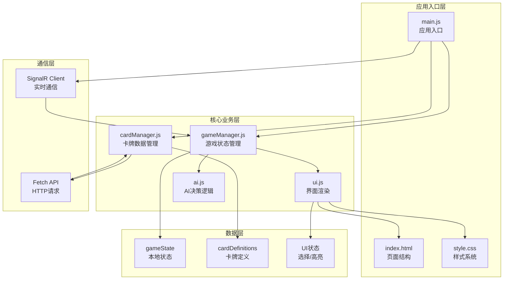
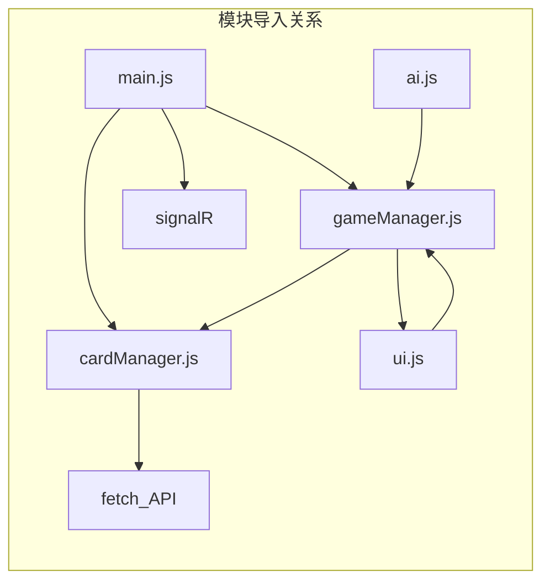
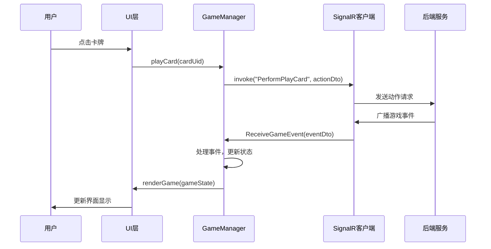

# 01-组件结构 [COMPLETED]

## 目的与范围

本文档详细说明Shadowverse-beyond项目的前端架构设计，包括模块化组织、状态管理模式、事件处理机制以及与后端的通信协议。采用原生JavaScript ES6+模块系统，实现轻量级但功能完整的前端架构。

## 核心概念

### 前端架构原则
- **模块化设计**: 基于ES6模块的清晰职责分离
- **事件驱动**: 响应式的用户交互和状态更新
- **状态同步**: 与后端权威状态的实时同步
- **无框架依赖**: 原生JavaScript实现，减少复杂性

### 关键术语
- **GameManager**: 游戏状态管理和协调中心
- **CardManager**: 卡牌数据加载和实例管理
- **UI Manager**: 用户界面渲染和交互处理
- **SignalR Client**: 实时通信客户端
- **State Hydration**: 服务器状态到客户端对象的智能转换

## 架构概览

### 前端模块架构图



### 模块依赖关系



## 实现细节

### main.js - 应用入口

<augment_code_snippet path="src/main.js" mode="EXCERPT">
````javascript
// 应用入口 - 协调各模块初始化
import * as signalR from "@microsoft/signalr";
import {
    gameState, initializeGame, setSignalRConnection, updateFullGameState,
    handleDeckUpdate, handleTurnStarted, handleTurnEnded, handleEpUpdate,
    handleGraveyardUpdate, handleAttackDeclared, handleUnitDestroyed,
    handleCardSummoned, handleCardPlayed, handleHealthChanged,
    handleStatChange, handleUnitEvolved, handleGameOver
} from './gameManager.js';
import { loadCards } from './cardManager.js';

// 应用初始化流程
async function initializeApp() {
    console.log("MAIN: Initializing application...");
    
    try {
        // 获取游戏和玩家ID
        const urlParams = new URLSearchParams(window.location.search);
        const gameId = urlParams.get('gameId') || generateGuid();
        const playerId = urlParams.get('playerId') || 'player1';
        
        // 创建初始状态Promise
        let resolveInitialStatePromise;
        const initialStatePromise = new Promise(resolve => {
            resolveInitialStatePromise = resolve;
        });
        
        // 并发启动连接和数据加载
        const connectionPromise = setupSignalRConnection(gameId, playerId, resolveInitialStatePromise);
        const cardLoadPromise = loadCards();
        
        // 等待所有初始化完成
        await Promise.all([connectionPromise, cardLoadPromise, initialStatePromise]);
        
        console.log("MAIN: Application initialization completed successfully.");
    } catch (error) {
        console.error("MAIN: Application initialization failed:", error);
    }
}
````
</augment_code_snippet>

### gameManager.js - 游戏状态管理

<augment_code_snippet path="src/gameManager.js" mode="EXCERPT">
````javascript
// 核心游戏状态管理
export let gameState = {
    players: [],                    // 玩家状态数组
    currentPlayerId: null,          // 当前回合玩家
    turnNumber: 0,                  // 回合数
    gameId: null,                   // 游戏会话ID
    localPlayerId: null,            // 本地玩家ID
    gamePhase: "Initializing",      // 游戏阶段
    activePlayer: null,             // 当前玩家引用
    opponentPlayer: null,           // 对手玩家引用
    gameOver: false,                // 游戏结束标志
    selectedCardUid: null,          // 选中的手牌
    selectedAttackerUid: null,      // 选中的攻击者
    player1MulliganComplete: false, // 玩家1换牌完成
    player2MulliganComplete: false  // 玩家2换牌完成
};

// SignalR连接设置
export function setSignalRConnection(connection) {
    signalRConnection = connection;
}

// 游戏初始化
export function initializeGame(idOfGame, idOfPlayer) {
    console.log(`GAME MANAGER: Initializing with GameID=${idOfGame}, PlayerID=${idOfPlayer}`);
    gameState.gameId = idOfGame;
    gameState.localPlayerId = idOfPlayer;
}

// 完整游戏状态更新 - 智能水合策略
export function updateFullGameState(receivedGameState) {
    console.log("GM: Received full game state update from server");
    
    try {
        // 智能水合：保持现有对象实例，只更新数据属性
        if (receivedGameState.players && Array.isArray(receivedGameState.players)) {
            gameState.players = receivedGameState.players.map(playerDto => {
                const existingPlayer = gameState.players.find(p => p.playerId === playerDto.playerId);
                if (existingPlayer) {
                    // 更新现有玩家对象
                    return hydratePlayerState(existingPlayer, playerDto);
                } else {
                    // 创建新玩家对象
                    return createPlayerFromDto(playerDto);
                }
            });
        }
        
        // 更新游戏级别状态
        gameState.currentPlayerId = receivedGameState.currentPlayerId;
        gameState.gamePhase = receivedGameState.phase;
        gameState.turnNumber = receivedGameState.turnNumber;
        gameState.gameOver = receivedGameState.isGameOver;
        
        // 更新玩家引用
        updatePlayerReferences();
        
        // 触发UI重新渲染
        renderGame(gameState);
        
    } catch (error) {
        console.error("GM: Error updating game state:", error);
    }
}
````
</augment_code_snippet>

### cardManager.js - 卡牌数据管理

<augment_code_snippet path="src/cardManager.js" mode="EXCERPT">
````javascript
// 卡牌数据管理模块
let cardDatabase = []; // 存储从API加载的卡牌定义

// 异步加载卡牌数据
export async function loadCards() {
    const apiUrl = '/api/cards';
    console.log(`Attempting to load card data from API: ${apiUrl}`);
    
    try {
        const response = await fetch(apiUrl);
        if (!response.ok) {
            throw new Error(`HTTP error loading card data! status: ${response.status}`);
        }
        
        const result = await response.json();
        if (result.success && Array.isArray(result.data)) {
            cardDatabase = result.data;
            console.log(`Successfully loaded ${cardDatabase.length} card definitions from API.`);
        } else {
            throw new Error("Invalid API response format");
        }
    } catch (error) {
        console.error("Failed to load card data from API:", error);
        throw error;
    }
}

// 根据ID获取卡牌定义
export function getCardDefinition(cardId) {
    const definition = cardDatabase.find(card => card && card.id === cardId);
    if (!definition) {
        console.warn(`Card definition not found for ID: ${cardId}`);
        return null;
    }
    return { ...definition }; // 返回副本防止修改
}

// 创建卡牌实例
export function createCardInstance(cardDto, baseDefinition = null) {
    if (!baseDefinition) {
        baseDefinition = getCardDefinition(cardDto.definitionId);
    }
    
    if (!baseDefinition) {
        console.error(`Cannot create card instance: definition not found for ID ${cardDto.definitionId}`);
        return null;
    }
    
    return {
        // 服务器提供的运行时状态
        uid: cardDto.instanceId || cardDto.InstanceId,
        definitionId: baseDefinition.id,
        currentAttack: cardDto.currentAttack ?? baseDefinition.attack,
        currentHealth: cardDto.currentHealth ?? baseDefinition.health,
        maxHealth: cardDto.maxHealth ?? baseDefinition.health,
        currentCost: cardDto.currentCost ?? baseDefinition.cost,
        isEvolved: cardDto.isEvolved ?? false,
        canAttack: cardDto.canAttack ?? false,
        canEvolve: cardDto.canEvolve ?? true,
        
        // 静态定义属性
        name: baseDefinition.name,
        type: baseDefinition.type,
        description: baseDefinition.description,
        keywords: baseDefinition.keywords || [],
        rarity: baseDefinition.rarity,
        craft: baseDefinition.craft
    };
}
````
</augment_code_snippet>

### ui.js - 用户界面管理

<augment_code_snippet path="src/ui.js" mode="EXCERPT">
````javascript
// 用户界面渲染和交互管理
import {
    gameState, playCard, getCurrentPlayerId, getPlayerState,
    initiateAttack, selectAttackTarget, cancelSelection, evolveCard,
    isValidSpellTarget, submitMulligan, endTurnRequest
} from './gameManager.js';
import { getCardDefinition } from './cardManager.js';

// 主渲染函数
export function renderGame(currentGameState) {
    console.log("UI: Rendering game state");
    
    try {
        // 渲染玩家信息
        renderPlayerInfo(currentGameState);
        
        // 渲染游戏区域
        renderGameAreas(currentGameState);
        
        // 更新交互状态
        updateInteractionState(currentGameState);
        
        // 处理游戏阶段特殊UI
        handlePhaseSpecificUI(currentGameState);
        
    } catch (error) {
        console.error("UI: Error rendering game:", error);
    }
}

// 渲染玩家信息
function renderPlayerInfo(gameState) {
    gameState.players.forEach(player => {
        updateHealthDisplay(player.playerId, player.health);
        updatePpDisplay(player.playerId, player.pp, player.maxPP);
        updateEpDisplay(player.playerId, player.ep, player.maxEP);
        updateDeckCountDisplay(player.playerId, player.deckCount);
        updateGraveyardCountDisplay(player.playerId, player.graveyardCount);
    });
}

// 创建卡牌DOM元素
export function createCardElement(cardInstance, context = 'hand') {
    const cardElement = document.createElement('div');
    cardElement.className = `card ${context}-card`;
    cardElement.dataset.uid = cardInstance.uid;
    
    // 基础卡牌信息
    cardElement.innerHTML = `
        <div class="card-cost">${cardInstance.currentCost}</div>
        <div class="card-name">${cardInstance.name}</div>
        <div class="card-image"></div>
        <div class="card-description">${cardInstance.description || ''}</div>
        ${cardInstance.type === 'Follower' ? `
            <div class="card-stats">
                <span class="attack">${cardInstance.currentAttack}</span>
                <span class="health">${cardInstance.currentHealth}</span>
            </div>
        ` : ''}
    `;
    
    // 添加交互事件
    addCardInteractionEvents(cardElement, cardInstance, context);
    
    // 添加状态样式
    updateCardVisualState(cardElement, cardInstance, context);
    
    return cardElement;
}

// 添加卡牌交互事件
function addCardInteractionEvents(cardElement, cardInstance, context) {
    if (context === 'hand') {
        cardElement.addEventListener('click', () => {
            handleHandCardClick(cardInstance);
        });
    } else if (context === 'field') {
        cardElement.addEventListener('click', () => {
            handleFieldCardClick(cardInstance);
        });
        
        // 添加进化按钮
        if (canShowEvolveButton(cardInstance)) {
            const evolveButton = createEvolveButton(cardInstance);
            if (evolveButton) {
                cardElement.appendChild(evolveButton);
            }
        }
    }
}

// 处理手牌点击
function handleHandCardClick(cardInstance) {
    const currentPlayer = getCurrentPlayerId();
    if (cardInstance.ownerPlayerId !== currentPlayer) return;
    
    if (gameState.selectedCardUid === cardInstance.uid) {
        // 取消选择
        cancelSelection();
    } else {
        // 选择卡牌
        gameState.selectedCardUid = cardInstance.uid;
        updateCardSelectionHighlights();
        
        // 如果是法术，显示目标高亮
        if (cardInstance.type === 'Spell') {
            highlightValidSpellTargets(cardInstance);
        }
    }
}

// 处理战场卡牌点击
function handleFieldCardClick(cardInstance) {
    const currentPlayer = getCurrentPlayerId();
    
    if (gameState.selectedCardUid) {
        // 有选中的手牌，尝试以此为目标
        handleSpellTargetSelection(cardInstance);
    } else if (cardInstance.ownerPlayerId === currentPlayer) {
        // 选择己方单位进行攻击
        handleAttackerSelection(cardInstance);
    } else {
        // 选择敌方单位作为攻击目标
        handleAttackTargetSelection(cardInstance);
    }
}
````
</augment_code_snippet>

### ai.js - AI决策逻辑

<augment_code_snippet path="src/ai.js" mode="EXCERPT">
````javascript
// AI决策逻辑模块
import { sendGameAction, submitMulligan } from './gameManager.js';

const MAX_FIELD_SIZE = 5; // 战场最大单位数

// AI回合执行
export function executeAITurn(aiPlayer, currentGameState) {
    console.log(`AI: Starting turn for ${aiPlayer.id}`);
    
    try {
        // 1. 出牌决策
        console.log("AI: Deciding card to play...");
        aiDecideAndPlayCard(aiPlayer, currentGameState);
        
        // 2. 进化决策
        console.log("AI: Deciding evolves...");
        aiDecideAndEvolve(aiPlayer, currentGameState);
        
        // 3. 攻击决策
        console.log("AI: Deciding attacks...");
        aiDecideAndAttack(aiPlayer, currentGameState);
        
        // 4. 结束回合
        setTimeout(() => {
            console.log("AI: Ending turn...");
            const endTurnActionData = { actionType: "EndTurn" };
            sendGameAction(endTurnActionData);
        }, 2000); // 延迟2秒让玩家看到AI动作
        
    } catch (error) {
        console.error("AI: Error during turn execution:", error);
    }
}

// AI出牌决策
function aiDecideAndPlayCard(aiPlayer, gameStateRef) {
    if (!aiPlayer || !aiPlayer.hand || !aiPlayer.field) {
        console.error("AI PlayCard Error: Invalid AI player state.");
        return;
    }
    
    // 检查战场空间
    if (aiPlayer.field.length >= MAX_FIELD_SIZE) {
        console.log(`AI PlayCard: Field is full, cannot play follower.`);
        return;
    }
    
    // 筛选可出的随从
    const playableFollowers = aiPlayer.hand.filter(card =>
        card &&
        card.type === 'Follower' &&
        card.cost <= aiPlayer.pp
    );
    
    if (playableFollowers.length === 0) {
        console.log("AI PlayCard: No playable followers found.");
        return;
    }
    
    // 选择费用最高的卡牌
    const cardToPlay = playableFollowers.reduce((highest, current) =>
        current.cost > highest.cost ? current : highest
    );
    
    console.log(`AI: Playing card ${cardToPlay.name} (Cost: ${cardToPlay.cost})`);
    
    try {
        const playCardActionData = {
            actionType: "PlayCard",
            cardUid: cardToPlay.uid,
            targetUid: null // 随从通常不需要目标
        };
        sendGameAction(playCardActionData);
    } catch (error) {
        console.error(`AI: Error playing card ${cardToPlay.name}:`, error);
    }
}

// AI进化决策
function aiDecideAndEvolve(aiPlayer, gameStateRef) {
    if (!aiPlayer || aiPlayer.ep <= 0) {
        console.log("AI Evolve: No EP available or invalid player state.");
        return;
    }
    
    // 查找可进化的单位
    const evolvableUnits = aiPlayer.field.filter(unit =>
        unit &&
        !unit.isEvolved &&
        unit.canEvolve &&
        unit.type === 'Follower'
    );
    
    if (evolvableUnits.length === 0) {
        console.log("AI Evolve: No evolvable units found.");
        return;
    }
    
    // 选择攻击力最高的单位进化
    const unitToEvolve = evolvableUnits.reduce((highest, current) =>
        current.currentAttack > highest.currentAttack ? current : highest
    );
    
    console.log(`AI: Evolving unit ${unitToEvolve.name}`);
    
    try {
        const evolveActionData = {
            actionType: "Evolve",
            unitUid: unitToEvolve.uid
        };
        sendGameAction(evolveActionData);
    } catch (error) {
        console.error(`AI: Error evolving unit ${unitToEvolve.name}:`, error);
    }
}

// AI换牌决策
export function performAIMulligan(aiPlayerState) {
    if (!aiPlayerState || !aiPlayerState.hand) {
        console.error("AI Mulligan Error: Invalid AI player state provided.");
        submitMulligan([]);
        return;
    }
    
    console.log(`AI [${aiPlayerState.id}]: Performing mulligan decision...`);
    
    // 简单策略：替换费用大于3的卡牌
    const costThreshold = 3;
    const uidsToReplace = aiPlayerState.hand
        .filter(card => card && card.cost > costThreshold)
        .map(card => card.uid);
    
    console.log(`AI: Replacing ${uidsToReplace.length} cards with cost > ${costThreshold}`);
    
    // 延迟提交，模拟思考时间
    setTimeout(() => {
        submitMulligan(uidsToReplace);
    }, 1500);
}
````
</augment_code_snippet>

## 集成点

### 状态同步机制

#### 智能水合策略
```javascript
// 服务器状态到客户端对象的智能转换
function hydratePlayerState(existingPlayer, playerDto) {
    // 保持现有对象引用，只更新数据属性
    existingPlayer.health = playerDto.health;
    existingPlayer.pp = playerDto.pp;
    existingPlayer.maxPP = playerDto.maxPP;
    existingPlayer.ep = playerDto.ep;
    existingPlayer.maxEP = playerDto.maxEP;
    
    // 智能更新手牌和战场
    existingPlayer.hand = hydrateCardArray(existingPlayer.hand, playerDto.hand);
    existingPlayer.field = hydrateCardArray(existingPlayer.field, playerDto.field);
    
    return existingPlayer;
}

function hydrateCardArray(existingCards, newCardDtos) {
    return newCardDtos.map(cardDto => {
        const existingCard = existingCards.find(c => c.uid === cardDto.instanceId);
        if (existingCard) {
            // 更新现有卡牌状态
            return updateCardInstance(existingCard, cardDto);
        } else {
            // 创建新卡牌实例
            return createCardInstance(cardDto);
        }
    });
}
```

### 事件处理流程



## 使用模式

### 模块导入模式
```javascript
// 主模块导入
import { gameState, initializeGame } from './gameManager.js';
import { loadCards, getCardDefinition } from './cardManager.js';
import { renderGame, createCardElement } from './ui.js';

// 事件处理器导入
import {
    handleTurnStarted, handleCardPlayed, handleUnitEvolved
} from './gameManager.js';
```

### 状态管理模式
```javascript
// 响应式状态更新
export function updateGamePhase(newPhase) {
    const oldPhase = gameState.gamePhase;
    gameState.gamePhase = newPhase;
    
    // 触发相关UI更新
    if (oldPhase !== newPhase) {
        handlePhaseChange(oldPhase, newPhase);
        renderGame(gameState);
    }
}

// 选择状态管理
export function selectCard(cardUid) {
    gameState.selectedCardUid = cardUid;
    updateSelectionHighlights();
    
    // 显示相关目标
    const card = findCardInstanceByUid(cardUid);
    if (card && card.type === 'Spell') {
        highlightValidTargets(card);
    }
}
```

### 错误处理模式
```javascript
// 统一错误处理
async function safeAsyncOperation(operation, context) {
    try {
        return await operation();
    } catch (error) {
        console.error(`${context}: Operation failed:`, error);
        
        // 显示用户友好的错误信息
        showErrorMessage(`操作失败: ${error.message}`);
        
        // 恢复到安全状态
        resetToSafeState();
        
        throw error;
    }
}

// SignalR错误处理
connection.on("ReceiveError", (errorDto) => {
    console.error("Server error:", errorDto);
    showErrorMessage(errorDto.message);
    
    // 根据错误类型进行相应处理
    switch (errorDto.code) {
        case "GAME_LOGIC_ERROR":
            // 游戏逻辑错误，刷新状态
            requestGameStateRefresh();
            break;
        case "CONNECTION_ERROR":
            // 连接错误，尝试重连
            attemptReconnection();
            break;
        default:
            // 通用错误处理
            break;
    }
});
```

## 状态标识

**[COMPLETED]** - 前端架构已完全实现，包括模块化组织、状态管理、事件处理和实时通信。

### 已实现模块
- ✅ main.js (应用入口和初始化)
- ✅ gameManager.js (游戏状态管理)
- ✅ cardManager.js (卡牌数据管理)
- ✅ ui.js (用户界面渲染)
- ✅ ai.js (AI决策逻辑)

### 技术特点
- **模块化**: ES6模块系统，清晰的依赖关系
- **响应式**: 事件驱动的状态更新机制
- **实时同步**: SignalR确保状态一致性
- **智能水合**: 高效的状态同步策略
- **错误恢复**: 完善的错误处理和恢复机制

### 性能优化
- 批量DOM更新减少重排
- 事件委托优化交互性能
- 智能状态比较避免不必要的渲染
- 异步操作的合理调度
