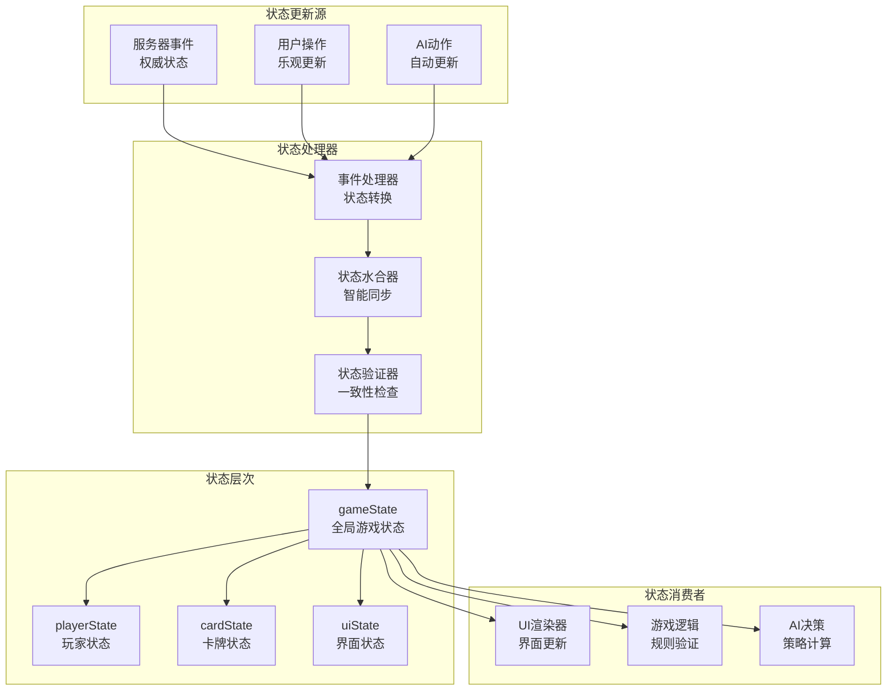
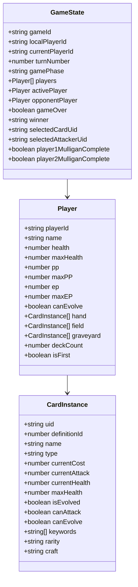

# 02-状态管理 [COMPLETED]

## 目的与范围

本文档详细说明Shadowverse-beyond项目的前端状态管理机制，包括游戏状态结构、状态同步策略、事件驱动更新模式以及与后端的状态协调。采用原生JavaScript实现的轻量级但功能完整的状态管理系统。

## 核心概念

### 状态管理原则
- **单一数据源**: gameState作为应用状态的唯一权威
- **不可变更新**: 通过函数式更新保证状态一致性
- **事件驱动**: 基于事件的响应式状态更新
- **智能同步**: 与服务器状态的高效同步机制

### 关键术语
- **GameState**: 客户端游戏状态对象
- **State Hydration**: 服务器状态到客户端的智能转换
- **Event-Driven Update**: 基于事件的状态更新模式
- **Optimistic Update**: 乐观更新策略

## 架构概览

### 状态管理架构图



### 状态数据结构



## 实现细节

### 核心状态结构

<augment_code_snippet path="src/gameManager.js" mode="EXCERPT">
````javascript
// 核心游戏状态定义
export let gameState = {
    // 游戏会话信息
    gameId: null,                   // 游戏唯一标识
    localPlayerId: null,            // 本地玩家ID
    currentPlayerId: null,          // 当前回合玩家ID
    turnNumber: 0,                  // 当前回合数
    gamePhase: "Initializing",      // 游戏阶段

    // 玩家状态
    players: [],                    // 玩家状态数组
    activePlayer: null,             // 当前玩家引用
    opponentPlayer: null,           // 对手玩家引用

    // 游戏结束状态
    gameOver: false,                // 游戏是否结束
    winner: null,                   // 获胜者ID

    // UI交互状态
    selectedCardUid: null,          // 选中的手牌UID
    selectedAttackerUid: null,      // 选中的攻击者UID

    // 换牌阶段状态
    player1MulliganComplete: false, // 玩家1换牌完成状态
    player2MulliganComplete: false, // 玩家2换牌完成状态

    // 临时状态
    lastPlayedCardInstanceId: null  // 最后出牌的卡牌ID
};
````
</augment_code_snippet>

### 状态更新机制

#### 完整状态更新 - 智能水合
<augment_code_snippet path="src/gameManager.js" mode="EXCERPT">
````javascript
// 完整游戏状态更新 - 智能水合策略
export function updateFullGameState(receivedGameState) {
    console.log("GM: Received full game state update from server");
    
    try {
        // 智能水合：保持现有对象实例，只更新数据属性
        if (receivedGameState.players && Array.isArray(receivedGameState.players)) {
            gameState.players = receivedGameState.players.map(playerDto => {
                const existingPlayer = gameState.players.find(p => p.playerId === playerDto.playerId);
                if (existingPlayer) {
                    // 更新现有玩家对象，保持引用
                    return hydratePlayerState(existingPlayer, playerDto);
                } else {
                    // 创建新玩家对象
                    return createPlayerFromDto(playerDto);
                }
            });
        }
        
        // 更新游戏级别状态
        gameState.currentPlayerId = receivedGameState.currentPlayerId;
        gameState.gamePhase = receivedGameState.phase;
        gameState.turnNumber = receivedGameState.turnNumber;
        gameState.gameOver = receivedGameState.isGameOver;
        gameState.winner = receivedGameState.winnerId;
        
        // 更新玩家引用
        updatePlayerReferences();
        
        // 验证状态一致性
        validateGameState();
        
        // 触发UI重新渲染
        renderGame(gameState);
        
        console.log("GM: Game state updated successfully");
        
    } catch (error) {
        console.error("GM: Error updating game state:", error);
        // 请求状态刷新作为恢复机制
        requestGameStateRefresh();
    }
}

// 玩家状态水合
function hydratePlayerState(existingPlayer, playerDto) {
    // 更新基础属性
    existingPlayer.health = playerDto.health;
    existingPlayer.maxHealth = playerDto.maxHealth;
    existingPlayer.pp = playerDto.pp;
    existingPlayer.maxPP = playerDto.maxPP;
    existingPlayer.ep = playerDto.ep;
    existingPlayer.maxEP = playerDto.maxEP;
    existingPlayer.canEvolve = playerDto.canEvolve;
    existingPlayer.deckCount = playerDto.deckCount;
    existingPlayer.isFirst = playerDto.isFirst;
    
    // 智能更新卡牌数组
    existingPlayer.hand = hydrateCardArray(existingPlayer.hand, playerDto.hand);
    existingPlayer.field = hydrateCardArray(existingPlayer.field, playerDto.field);
    existingPlayer.graveyard = hydrateCardArray(existingPlayer.graveyard, playerDto.graveyard);
    
    return existingPlayer;
}

// 卡牌数组智能水合
function hydrateCardArray(existingCards, newCardDtos) {
    if (!Array.isArray(newCardDtos)) return [];
    
    return newCardDtos.map(cardDto => {
        const existingCard = existingCards?.find(c => c.uid === cardDto.instanceId);
        if (existingCard) {
            // 更新现有卡牌状态
            return updateCardInstance(existingCard, cardDto);
        } else {
            // 创建新卡牌实例
            return createCardInstance(cardDto);
        }
    });
}
````
</augment_code_snippet>

### 事件驱动状态更新

#### 游戏事件处理器
```javascript
// 事件驱动的状态更新系统
const eventHandlers = {
    // 回合开始事件
    TurnStarted: (eventData) => {
        console.log(`GM: Turn started for player ${eventData.playerId}`);
        
        // 更新当前玩家
        gameState.currentPlayerId = eventData.playerId;
        gameState.turnNumber = eventData.turnNumber;
        
        // 更新玩家引用
        updatePlayerReferences();
        
        // 触发UI更新
        updateTurnIndicator(eventData.playerId);
        renderGame(gameState);
    },

    // 卡牌出牌事件
    CardPlayed: (eventData) => {
        console.log(`GM: Card played by ${eventData.sourcePlayerId}`);
        
        const player = getPlayerState(eventData.sourcePlayerId);
        if (!player) return;
        
        // 从手牌移除卡牌
        const cardIndex = player.hand.findIndex(c => c.uid === eventData.playedCardInstance.instanceId);
        if (cardIndex !== -1) {
            player.hand.splice(cardIndex, 1);
        }
        
        // 如果是随从，添加到战场
        if (eventData.playedCardInstance.cardType === 'Follower') {
            const fieldCard = createCardInstance(eventData.playedCardInstance);
            player.field.push(fieldCard);
        }
        
        // 更新PP
        player.pp = Math.max(0, player.pp - eventData.playedCardInstance.currentCost);
        
        // 触发UI更新
        updateHandDisplay(eventData.sourcePlayerId);
        updateFieldDisplay(eventData.sourcePlayerId);
        updatePpDisplay(eventData.sourcePlayerId, player.pp, player.maxPP);
    },

    // 单位进化事件
    UnitEvolved: (eventData) => {
        console.log(`GM: Unit evolved by ${eventData.sourcePlayerId}`);
        
        const player = getPlayerState(eventData.sourcePlayerId);
        if (!player) return;
        
        // 查找并更新进化的单位
        const unit = player.field.find(u => u.uid === eventData.evolvedUnitState.instanceId);
        if (unit) {
            updateCardInstance(unit, eventData.evolvedUnitState);
            
            // 触发进化动画
            showEvolutionAnimation(unit.uid);
        }
        
        // 触发UI更新
        updateFieldDisplay(eventData.sourcePlayerId);
    },

    // EP更新事件
    EpUpdate: (eventData) => {
        console.log(`GM: EP updated for ${eventData.sourcePlayerId}`);
        
        const player = getPlayerState(eventData.sourcePlayerId);
        if (player) {
            player.ep = eventData.currentEp;
            player.maxEP = eventData.maxEp;
            player.canEvolve = player.maxEP > 0 && player.ep > 0;
            
            // 触发UI更新
            updateEpDisplay(eventData.sourcePlayerId, player.ep, player.maxEP);
        }
    }
};

// 通用事件处理入口
export function processGameEvent(eventData) {
    const handler = eventHandlers[eventData.type];
    if (handler) {
        try {
            handler(eventData);
        } catch (error) {
            console.error(`GM: Error processing ${eventData.type} event:`, error);
        }
    } else {
        console.warn(`GM: No handler found for event type: ${eventData.type}`);
    }
}
```

### 状态验证和一致性检查

```javascript
// 状态验证器
function validateGameState() {
    const errors = [];
    
    // 验证基础状态
    if (!gameState.gameId) {
        errors.push("Missing gameId");
    }
    
    if (!gameState.localPlayerId) {
        errors.push("Missing localPlayerId");
    }
    
    // 验证玩家状态
    if (!Array.isArray(gameState.players) || gameState.players.length === 0) {
        errors.push("Invalid players array");
    } else {
        gameState.players.forEach((player, index) => {
            if (!player.playerId) {
                errors.push(`Player ${index} missing playerId`);
            }
            
            if (player.health < 0) {
                errors.push(`Player ${player.playerId} has negative health`);
            }
            
            if (player.pp < 0 || player.pp > player.maxPP) {
                errors.push(`Player ${player.playerId} has invalid PP`);
            }
            
            // 验证卡牌数组
            validateCardArray(player.hand, `Player ${player.playerId} hand`, errors);
            validateCardArray(player.field, `Player ${player.playerId} field`, errors);
        });
    }
    
    // 验证当前玩家
    if (gameState.currentPlayerId && !gameState.players.find(p => p.playerId === gameState.currentPlayerId)) {
        errors.push("Current player not found in players array");
    }
    
    if (errors.length > 0) {
        console.warn("GM: State validation errors:", errors);
        // 可以选择修复或请求状态刷新
    }
    
    return errors.length === 0;
}

function validateCardArray(cards, context, errors) {
    if (!Array.isArray(cards)) {
        errors.push(`${context} is not an array`);
        return;
    }
    
    cards.forEach((card, index) => {
        if (!card.uid) {
            errors.push(`${context}[${index}] missing uid`);
        }
        
        if (!card.definitionId) {
            errors.push(`${context}[${index}] missing definitionId`);
        }
        
        if (card.currentHealth < 0) {
            errors.push(`${context}[${index}] has negative health`);
        }
    });
}
```

## 集成点

### 状态同步策略

#### 乐观更新模式
```javascript
// 乐观更新：立即更新UI，等待服务器确认
export async function optimisticPlayCard(cardUid, targetUid = null) {
    const player = getPlayerState(gameState.localPlayerId);
    const card = player.hand.find(c => c.uid === cardUid);
    
    if (!card) return false;
    
    // 乐观更新：立即从手牌移除
    const cardIndex = player.hand.indexOf(card);
    player.hand.splice(cardIndex, 1);
    
    // 立即更新UI
    updateHandDisplay(gameState.localPlayerId);
    
    try {
        // 发送到服务器
        await signalRConnection.invoke("PerformPlayCard", {
            cardUid: cardUid,
            targetUid: targetUid
        });
        
        // 服务器会发送确认事件，进一步更新状态
    } catch (error) {
        // 回滚乐观更新
        player.hand.splice(cardIndex, 0, card);
        updateHandDisplay(gameState.localPlayerId);
        
        console.error("Failed to play card, rolled back:", error);
        throw error;
    }
}
```

#### 状态冲突解决
```javascript
// 状态冲突解决机制
function resolveStateConflict(localState, serverState) {
    console.log("GM: Resolving state conflict");
    
    // 服务器状态优先
    const resolvedState = { ...serverState };
    
    // 保留本地UI状态
    resolvedState.selectedCardUid = localState.selectedCardUid;
    resolvedState.selectedAttackerUid = localState.selectedAttackerUid;
    
    // 合并临时状态
    if (localState.lastPlayedCardInstanceId && !serverState.lastPlayedCardInstanceId) {
        resolvedState.lastPlayedCardInstanceId = localState.lastPlayedCardInstanceId;
    }
    
    return resolvedState;
}
```

### 性能优化

#### 状态比较和最小化更新
```javascript
// 智能状态比较，避免不必要的更新
function hasStateChanged(oldState, newState) {
    // 快速检查关键属性
    if (oldState.currentPlayerId !== newState.currentPlayerId) return true;
    if (oldState.turnNumber !== newState.turnNumber) return true;
    if (oldState.gamePhase !== newState.gamePhase) return true;
    
    // 深度比较玩家状态
    if (oldState.players.length !== newState.players.length) return true;
    
    for (let i = 0; i < oldState.players.length; i++) {
        if (hasPlayerStateChanged(oldState.players[i], newState.players[i])) {
            return true;
        }
    }
    
    return false;
}

function hasPlayerStateChanged(oldPlayer, newPlayer) {
    const keys = ['health', 'pp', 'maxPP', 'ep', 'maxEP', 'deckCount'];
    
    for (const key of keys) {
        if (oldPlayer[key] !== newPlayer[key]) return true;
    }
    
    // 检查卡牌数组长度变化
    if (oldPlayer.hand.length !== newPlayer.hand.length) return true;
    if (oldPlayer.field.length !== newPlayer.field.length) return true;
    
    return false;
}
```

## 使用模式

### 状态订阅模式
```javascript
// 状态变化订阅系统
const stateSubscribers = {
    gamePhase: [],
    currentPlayer: [],
    playerHealth: [],
    cardPlayed: []
};

export function subscribeToStateChange(event, callback) {
    if (stateSubscribers[event]) {
        stateSubscribers[event].push(callback);
    }
}

function notifyStateChange(event, data) {
    if (stateSubscribers[event]) {
        stateSubscribers[event].forEach(callback => {
            try {
                callback(data);
            } catch (error) {
                console.error(`Error in state subscriber for ${event}:`, error);
            }
        });
    }
}

// 使用示例
subscribeToStateChange('gamePhase', (newPhase) => {
    console.log(`Game phase changed to: ${newPhase}`);
    updatePhaseUI(newPhase);
});
```

### 状态持久化
```javascript
// 本地状态持久化
export function saveGameStateToLocal() {
    try {
        const stateToSave = {
            gameId: gameState.gameId,
            localPlayerId: gameState.localPlayerId,
            selectedCardUid: gameState.selectedCardUid,
            // 只保存必要的UI状态
        };
        
        localStorage.setItem('shadowverse_game_state', JSON.stringify(stateToSave));
    } catch (error) {
        console.error("Failed to save game state:", error);
    }
}

export function loadGameStateFromLocal() {
    try {
        const saved = localStorage.getItem('shadowverse_game_state');
        if (saved) {
            const parsedState = JSON.parse(saved);
            
            // 只恢复安全的UI状态
            gameState.selectedCardUid = parsedState.selectedCardUid;
            
            return parsedState;
        }
    } catch (error) {
        console.error("Failed to load game state:", error);
    }
    
    return null;
}
```

## 状态标识

**[COMPLETED]** - 前端状态管理系统已完全实现，包括智能同步、事件驱动更新和性能优化。

### 已实现功能
- ✅ 完整的游戏状态结构定义
- ✅ 智能状态水合机制
- ✅ 事件驱动的状态更新
- ✅ 乐观更新和回滚机制
- ✅ 状态验证和一致性检查
- ✅ 性能优化的状态比较
- ✅ 状态订阅和通知系统

### 技术特点
- **高效同步**: 智能水合避免不必要的对象创建
- **响应式**: 事件驱动的自动状态更新
- **容错性**: 完善的错误处理和状态恢复
- **性能优化**: 最小化DOM更新和状态比较
- **类型安全**: 严格的状态结构验证

### 扩展能力
- 支持状态时间旅行调试
- 可扩展的事件处理系统
- 灵活的状态订阅机制
- 完整的状态持久化方案
