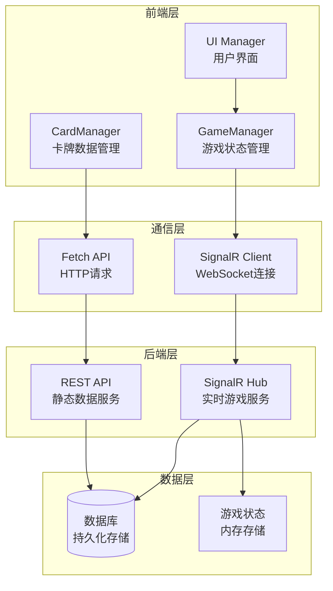
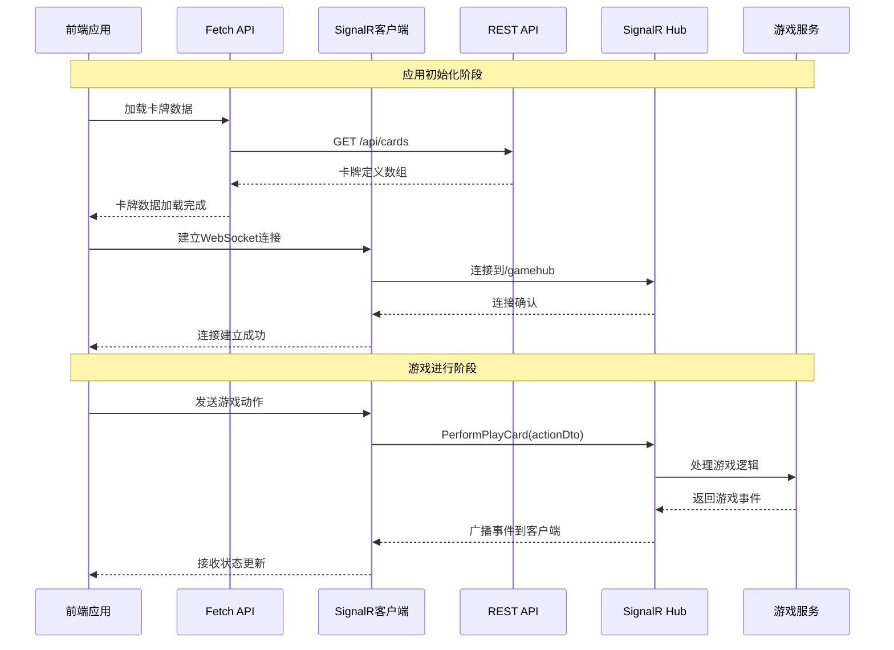

# 03-API集成 [COMPLETED]

## 目的与范围

本文档详细说明Shadowverse-beyond项目前端与后端的API集成方案，包括REST API调用、SignalR实时通信、错误处理机制以及数据传输优化策略。确保前后端之间的高效、可靠通信。

## 核心概念

### API集成原则
- **双重通信**: REST API用于静态数据，SignalR用于实时交互
- **错误恢复**: 完善的错误处理和重试机制
- **数据一致性**: 确保前后端数据状态同步
- **性能优化**: 减少网络请求，优化数据传输

### 通信协议
- **REST API**: 卡牌数据、用户信息等静态资源
- **SignalR WebSocket**: 游戏动作、状态同步、实时事件
- **JSON格式**: 统一的数据交换格式

## 架构概览

### API集成架构图



### 通信流程图



## 实现细节

### REST API 集成

#### 卡牌数据加载
<augment_code_snippet path="src/cardManager.js" mode="EXCERPT">
````javascript
// 异步加载卡牌数据
export async function loadCards() {
    const apiUrl = '/api/cards';
    console.log(`Attempting to load card data from API: ${apiUrl}`);
    
    try {
        const response = await fetch(apiUrl, {
            method: 'GET',
            headers: {
                'Accept': 'application/json',
                'Content-Type': 'application/json'
            }
        });
        
        if (!response.ok) {
            throw new Error(`HTTP error loading card data! status: ${response.status}`);
        }
        
        const result = await response.json();
        
        // 验证API响应格式
        if (!result.success || !Array.isArray(result.data)) {
            throw new Error("Invalid API response format");
        }
        
        cardDatabase = result.data;
        console.log(`Successfully loaded ${cardDatabase.length} card definitions from API.`);
        
        return cardDatabase;
        
    } catch (error) {
        console.error("Failed to load card data from API:", error);
        
        // 错误恢复：尝试加载本地备份数据
        return await loadFallbackCardData();
    }
}

// 错误恢复：加载备份数据
async function loadFallbackCardData() {
    console.log("Attempting to load fallback card data...");
    
    try {
        // 可以从本地存储或静态文件加载备份数据
        const fallbackData = localStorage.getItem('cardDatabase_backup');
        if (fallbackData) {
            cardDatabase = JSON.parse(fallbackData);
            console.log(`Loaded ${cardDatabase.length} cards from fallback data`);
            return cardDatabase;
        }
    } catch (error) {
        console.error("Failed to load fallback data:", error);
    }
    
    // 如果所有方法都失败，返回空数组
    console.warn("No card data available, using empty database");
    cardDatabase = [];
    return cardDatabase;
}
````
</augment_code_snippet>

#### API请求封装
```javascript
// 通用API请求封装
class APIClient {
    constructor(baseURL = '/api') {
        this.baseURL = baseURL;
        this.defaultHeaders = {
            'Accept': 'application/json',
            'Content-Type': 'application/json'
        };
    }

    async request(endpoint, options = {}) {
        const url = `${this.baseURL}${endpoint}`;
        const config = {
            headers: { ...this.defaultHeaders, ...options.headers },
            ...options
        };

        try {
            const response = await fetch(url, config);
            
            if (!response.ok) {
                throw new APIError(`HTTP ${response.status}: ${response.statusText}`, response.status);
            }

            const data = await response.json();
            
            // 验证标准API响应格式
            if (typeof data.success !== 'boolean') {
                throw new APIError('Invalid API response format');
            }

            if (!data.success) {
                throw new APIError(data.errorMessage || 'API request failed', data.errorCode);
            }

            return data.data;

        } catch (error) {
            if (error instanceof APIError) {
                throw error;
            }
            
            // 网络错误或其他异常
            throw new APIError(`Network error: ${error.message}`);
        }
    }

    async get(endpoint, params = {}) {
        const queryString = new URLSearchParams(params).toString();
        const url = queryString ? `${endpoint}?${queryString}` : endpoint;
        return this.request(url, { method: 'GET' });
    }

    async post(endpoint, data) {
        return this.request(endpoint, {
            method: 'POST',
            body: JSON.stringify(data)
        });
    }
}

// API错误类
class APIError extends Error {
    constructor(message, code = null) {
        super(message);
        this.name = 'APIError';
        this.code = code;
    }
}

// 全局API客户端实例
const apiClient = new APIClient();

// 导出API方法
export const cardAPI = {
    getAllCards: () => apiClient.get('/cards'),
    getCard: (id) => apiClient.get(`/cards/${id}`),
    searchCards: (criteria) => apiClient.get('/cards/search', criteria)
};
```

### SignalR 实时通信

#### 连接建立和管理
<augment_code_snippet path="src/main.js" mode="EXCERPT">
````javascript
// SignalR连接设置
async function setupSignalRConnection(gameId, playerId, resolveInitialState) {
    try {
        const hubUrlWithParams = `/gamehub?gameId=${encodeURIComponent(gameId)}&playerId=${encodeURIComponent(playerId)}`;
        
        connection = new signalR.HubConnectionBuilder()
            .withUrl(hubUrlWithParams)
            .withAutomaticReconnect([0, 2000, 10000, 30000]) // 自动重连策略
            .configureLogging(signalR.LogLevel.Information)
            .build();

        // 注册事件处理器
        registerSignalREventHandlers(connection, resolveInitialState);
        
        // 注册连接状态处理器
        registerConnectionStateHandlers(connection);

        // 启动连接
        await connection.start();
        console.log("MAIN: SignalR connection established successfully");

        // 设置连接到GameManager
        setSignalRConnection(connection);

        return connection;

    } catch (error) {
        console.error("MAIN: Failed to establish SignalR connection:", error);
        throw error;
    }
}

// 连接状态处理
function registerConnectionStateHandlers(connection) {
    connection.onreconnecting((error) => {
        console.warn("SignalR: Connection lost, attempting to reconnect...", error);
        showConnectionStatus('reconnecting');
    });

    connection.onreconnected((connectionId) => {
        console.log("SignalR: Reconnected successfully", connectionId);
        showConnectionStatus('connected');
        
        // 重连后请求最新游戏状态
        requestGameStateRefresh();
    });

    connection.onclose((error) => {
        console.error("SignalR: Connection closed", error);
        showConnectionStatus('disconnected');
        
        // 尝试手动重连
        setTimeout(() => {
            attemptManualReconnection();
        }, 5000);
    });
}
````
</augment_code_snippet>

#### 事件处理器注册
<augment_code_snippet path="src/main.js" mode="EXCERPT">
````javascript
// 注册SignalR事件处理器
function registerSignalREventHandlers(conn, resolveInitialState) {
    // 完整游戏状态接收
    conn.on("ReceiveGameState", (receivedGameState) => {
        console.log('[SIGNALR] ReceiveGameState event received');
        
        try {
            updateFullGameState(receivedGameState);
            
            // 解析初始状态Promise
            if (resolveInitialState) {
                resolveInitialState();
                resolveInitialState = null; // 防止重复调用
            }
        } catch (error) {
            console.error('[SIGNALR] Error processing ReceiveGameState:', error);
        }
    });

    // 游戏事件接收
    conn.on("ReceiveGameEvent", (gameEvent) => {
        console.log(`[SIGNALR] ReceiveGameEvent: ${gameEvent.type}`);
        
        try {
            processGameEvent(gameEvent);
        } catch (error) {
            console.error(`[SIGNALR] Error processing ${gameEvent.type} event:`, error);
        }
    });

    // 错误事件接收
    conn.on("ReceiveError", (errorDto) => {
        console.error('[SIGNALR] ReceiveError:', errorDto);
        
        handleServerError(errorDto);
    });

    // 连接确认
    conn.on("ConnectionConfirmed", (message) => {
        console.log('[SIGNALR] Connection confirmed:', message);
    });
}
````
</augment_code_snippet>

#### 游戏动作发送
```javascript
// 游戏动作发送封装
export class GameActionSender {
    constructor(signalRConnection) {
        this.connection = signalRConnection;
        this.pendingActions = new Map(); // 跟踪待处理的动作
    }

    async sendAction(actionType, actionData, timeout = 10000) {
        if (!this.connection || this.connection.state !== signalR.HubConnectionState.Connected) {
            throw new Error('SignalR connection not available');
        }

        const actionId = this.generateActionId();
        const fullActionData = {
            actionId,
            actionType,
            timestamp: Date.now(),
            ...actionData
        };

        try {
            // 记录待处理动作
            this.pendingActions.set(actionId, {
                actionType,
                timestamp: Date.now(),
                timeout: setTimeout(() => {
                    this.handleActionTimeout(actionId);
                }, timeout)
            });

            // 发送动作到服务器
            await this.connection.invoke("PerformGameAction", fullActionData);
            
            console.log(`Action sent successfully: ${actionType}`, fullActionData);

        } catch (error) {
            // 清理待处理动作
            this.clearPendingAction(actionId);
            
            console.error(`Failed to send ${actionType} action:`, error);
            throw new GameActionError(`Failed to send ${actionType}: ${error.message}`);
        }
    }

    // 动作完成确认
    confirmActionCompleted(actionId) {
        this.clearPendingAction(actionId);
    }

    // 清理待处理动作
    clearPendingAction(actionId) {
        const pending = this.pendingActions.get(actionId);
        if (pending) {
            clearTimeout(pending.timeout);
            this.pendingActions.delete(actionId);
        }
    }

    // 处理动作超时
    handleActionTimeout(actionId) {
        const pending = this.pendingActions.get(actionId);
        if (pending) {
            console.warn(`Action timeout: ${pending.actionType} (${actionId})`);
            this.clearPendingAction(actionId);
            
            // 显示超时错误
            showErrorMessage(`动作超时: ${pending.actionType}`);
        }
    }

    generateActionId() {
        return `action_${Date.now()}_${Math.random().toString(36).substr(2, 9)}`;
    }
}

// 游戏动作错误类
class GameActionError extends Error {
    constructor(message) {
        super(message);
        this.name = 'GameActionError';
    }
}
```

## 集成点

### 错误处理策略

#### 分层错误处理
```javascript
// 错误处理层次结构
class ErrorHandler {
    static handleAPIError(error, context) {
        console.error(`API Error in ${context}:`, error);
        
        if (error instanceof APIError) {
            switch (error.code) {
                case 404:
                    showErrorMessage('请求的资源不存在');
                    break;
                case 500:
                    showErrorMessage('服务器内部错误，请稍后重试');
                    break;
                case 'NETWORK_ERROR':
                    showErrorMessage('网络连接错误，请检查网络');
                    break;
                default:
                    showErrorMessage(`请求失败: ${error.message}`);
            }
        } else {
            showErrorMessage('未知错误，请刷新页面重试');
        }
    }

    static handleSignalRError(error, context) {
        console.error(`SignalR Error in ${context}:`, error);
        
        if (error.code === 'CONNECTION_LOST') {
            showConnectionStatus('reconnecting');
            // 自动重连逻辑已在连接配置中处理
        } else if (error.code === 'GAME_LOGIC_ERROR') {
            showErrorMessage(`游戏逻辑错误: ${error.message}`);
            // 请求状态刷新
            requestGameStateRefresh();
        } else {
            showErrorMessage(`通信错误: ${error.message}`);
        }
    }

    static handleGameActionError(error, actionType) {
        console.error(`Game Action Error (${actionType}):`, error);
        
        // 根据动作类型提供特定的错误处理
        const actionErrorMessages = {
            'PlayCard': '出牌失败',
            'Attack': '攻击失败',
            'Evolve': '进化失败',
            'EndTurn': '结束回合失败'
        };
        
        const message = actionErrorMessages[actionType] || '动作执行失败';
        showErrorMessage(`${message}: ${error.message}`);
    }
}
```

### 数据缓存策略

#### 智能缓存管理
```javascript
// 数据缓存管理器
class DataCacheManager {
    constructor() {
        this.cache = new Map();
        this.cacheExpiry = new Map();
        this.defaultTTL = 5 * 60 * 1000; // 5分钟默认过期时间
    }

    set(key, data, ttl = this.defaultTTL) {
        this.cache.set(key, data);
        this.cacheExpiry.set(key, Date.now() + ttl);
        
        // 设置自动清理
        setTimeout(() => {
            this.delete(key);
        }, ttl);
    }

    get(key) {
        if (!this.cache.has(key)) {
            return null;
        }

        const expiry = this.cacheExpiry.get(key);
        if (expiry && Date.now() > expiry) {
            this.delete(key);
            return null;
        }

        return this.cache.get(key);
    }

    delete(key) {
        this.cache.delete(key);
        this.cacheExpiry.delete(key);
    }

    clear() {
        this.cache.clear();
        this.cacheExpiry.clear();
    }

    // 缓存卡牌数据
    cacheCardData(cards) {
        this.set('cardDefinitions', cards, 30 * 60 * 1000); // 30分钟
        
        // 同时缓存到localStorage作为备份
        try {
            localStorage.setItem('cardDatabase_backup', JSON.stringify(cards));
        } catch (error) {
            console.warn('Failed to backup card data to localStorage:', error);
        }
    }

    getCachedCardData() {
        return this.get('cardDefinitions');
    }
}

// 全局缓存管理器实例
const cacheManager = new DataCacheManager();
```

### 性能优化

#### 请求去重和批处理
```javascript
// 请求去重管理器
class RequestDeduplicator {
    constructor() {
        this.pendingRequests = new Map();
    }

    async deduplicate(key, requestFn) {
        // 如果已有相同请求在进行中，返回相同的Promise
        if (this.pendingRequests.has(key)) {
            return this.pendingRequests.get(key);
        }

        // 创建新请求
        const promise = requestFn()
            .finally(() => {
                // 请求完成后清理
                this.pendingRequests.delete(key);
            });

        this.pendingRequests.set(key, promise);
        return promise;
    }
}

// 批处理请求管理器
class BatchRequestManager {
    constructor(batchSize = 10, delay = 100) {
        this.batchSize = batchSize;
        this.delay = delay;
        this.queue = [];
        this.timer = null;
    }

    addRequest(request) {
        return new Promise((resolve, reject) => {
            this.queue.push({ request, resolve, reject });
            
            if (this.queue.length >= this.batchSize) {
                this.processBatch();
            } else if (!this.timer) {
                this.timer = setTimeout(() => {
                    this.processBatch();
                }, this.delay);
            }
        });
    }

    async processBatch() {
        if (this.timer) {
            clearTimeout(this.timer);
            this.timer = null;
        }

        const batch = this.queue.splice(0, this.batchSize);
        if (batch.length === 0) return;

        try {
            // 并行处理批次中的所有请求
            const results = await Promise.allSettled(
                batch.map(item => item.request())
            );

            // 处理结果
            results.forEach((result, index) => {
                const { resolve, reject } = batch[index];
                if (result.status === 'fulfilled') {
                    resolve(result.value);
                } else {
                    reject(result.reason);
                }
            });

        } catch (error) {
            // 批处理失败，拒绝所有请求
            batch.forEach(({ reject }) => reject(error));
        }
    }
}
```

## 使用模式

### API调用模式
```javascript
// 标准API调用模式
async function loadGameData() {
    try {
        // 显示加载状态
        showLoadingIndicator('正在加载游戏数据...');
        
        // 并行加载多个资源
        const [cards, userProfile] = await Promise.all([
            cardAPI.getAllCards(),
            userAPI.getProfile()
        ]);
        
        // 处理加载的数据
        initializeCardDatabase(cards);
        initializeUserProfile(userProfile);
        
        console.log('Game data loaded successfully');
        
    } catch (error) {
        ErrorHandler.handleAPIError(error, 'loadGameData');
    } finally {
        hideLoadingIndicator();
    }
}
```

### SignalR通信模式
```javascript
// 游戏动作发送模式
async function performGameAction(actionType, actionData) {
    try {
        // 显示动作反馈
        showActionFeedback(actionType);
        
        // 发送动作
        await gameActionSender.sendAction(actionType, actionData);
        
        // 等待服务器响应（通过事件处理）
        console.log(`${actionType} action sent successfully`);
        
    } catch (error) {
        ErrorHandler.handleGameActionError(error, actionType);
    } finally {
        hideActionFeedback();
    }
}
```

## 状态标识

**[COMPLETED]** - 前端API集成已完全实现，包括REST API调用、SignalR实时通信和完善的错误处理机制。

### 已实现功能
- ✅ REST API客户端封装
- ✅ SignalR连接管理和自动重连
- ✅ 事件驱动的实时通信
- ✅ 分层错误处理策略
- ✅ 智能数据缓存机制
- ✅ 请求去重和批处理优化
- ✅ 连接状态监控和恢复

### 技术特点
- **双重通信**: REST + SignalR的混合架构
- **容错性**: 完善的错误处理和恢复机制
- **性能优化**: 缓存、去重、批处理等优化策略
- **实时性**: 低延迟的游戏状态同步
- **可靠性**: 自动重连和状态恢复机制

### 监控和调试
- 完整的请求日志记录
- 连接状态实时监控
- 性能指标收集
- 错误统计和分析
