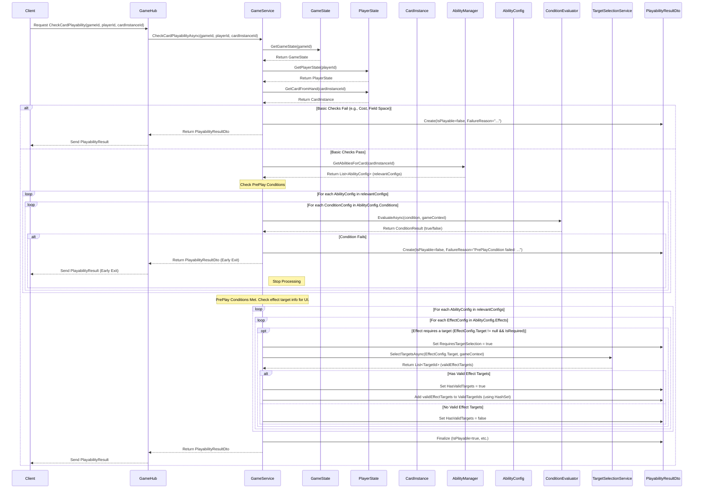

# 卡牌可玩性检查服务设计文档

## 1. 概述

本文档定义了“卡牌可玩性检查”服务的设计方案。该服务旨在客户端（UI）需要判断一张手牌当前是否可打出时提供必要的信息，区分了卡牌打出的硬性条件（预判断）和打出后效果的目标选择逻辑。

## 2. 核心概念

*   **预判断条件 (Pre-Play Conditions):** 定义在卡牌能力配置 (`AbilityConfig.Conditions`) 中的条件，必须在卡牌被打出 *之前* 满足。
*   **可玩性检查 (`CheckCardPlayabilityAsync`):** 服务端接口，负责检查基础条件（费用、场地）和所有预判断条件。
*   **效果目标信息:** 可玩性检查还会提供卡牌打出后其效果所需的目标信息（是否需要目标、是否有有效目标、有效目标列表），主要用于 UI 展示。

## 3. DTO 定义

创建一个新的 DTO 文件 `Server/Dtos/PlayabilityResultDto.cs`：

```csharp
// Location: Server/Dtos/PlayabilityResultDto.cs
namespace ShadowverseBeyond.Server.Dtos
{
    public class PlayabilityResultDto
    {
        /// <summary>
        /// 卡牌是否满足费用、场地、预判断条件等。
        /// </summary>
        public bool IsPlayable { get; set; }

        /// <summary>
        /// 打出这张卡牌后，其效果是否需要玩家选择目标。
        /// </summary>
        public bool RequiresTargetSelection { get; set; }

        /// <summary>
        /// 如果效果需要选择目标，当前场上是否存在至少一个有效的目标。
        /// </summary>
        public bool HasValidTargets { get; set; }

        /// <summary>
        /// 如果卡牌不可玩 (IsPlayable == false)，提供简要的原因。
        /// </summary>
        public string FailureReason { get; set; } = string.Empty;

        /// <summary>
        /// 如果效果需要选择目标且存在有效目标，返回所有有效目标的 ID 列表。
        /// 前端可以使用这个列表来高亮可选目标。
        /// </summary>
        public List<int> ValidTargetIds { get; set; } = new List<int>();
    }
}
```

## 4. 服务接口与实现

在 `Server/Services/GameService.cs` 中添加新方法：

**接口签名 (在 `IGameService` 或 `GameService`):**

```csharp
using ShadowverseBeyond.Server.Dtos;
using System.Threading.Tasks;

public interface IGameService // Or add directly to GameService class
{
    // ... other methods
    Task<PlayabilityResultDto> CheckCardPlayabilityAsync(string gameId, string playerId, int cardInstanceId);
}
```

**实现逻辑 (`GameService.CheckCardPlayabilityAsync`):**

1.  **获取状态:** 获取 `GameContext`, `PlayerState`, `CardInstance`。
2.  **基础检查:**
    *   检查费用 (`player.CurrentPp >= card.CurrentCost`)。
    *   检查场地空间（如果卡牌是随从且 `player.Board.Count >= gameContext.MaxBoardSize`）。
    *   若失败，设置 `result.IsPlayable = false`，填写 `FailureReason`，返回 `result`。
3.  **预判断条件检查:**
    *   获取与卡牌“打出”事件相关的 `AbilityConfig` 列表（例如，通过 `AbilityManager` 获取 `Trigger.Type` 为 `Fanfare` 的能力配置）。
    *   遍历这些 `AbilityConfig`。
    *   对于每个 `AbilityConfig`，遍历其 `Conditions` 列表 (`List<ConditionConfig>`)。
    *   使用注入的 `ConditionEvaluator` 服务调用 `EvaluateAsync(condition, gameContext)`。
    *   **如果任何 `EvaluateAsync` 返回 `false`，则设置 `result.IsPlayable = false`，设置 `FailureReason` (基于条件描述)，并立即返回 `result`。**
4.  **效果目标信息检查 (用于 UI):**
    *   初始化 `result.RequiresTargetSelection = false`, `result.HasValidTargets = false`, `result.ValidTargetIds = new List<int>()`。
    *   使用 `HashSet<int>` 存储有效目标 ID 以去重。
    *   再次遍历与“打出”事件相关的 `AbilityConfig`。
    *   遍历每个 `AbilityConfig` 的 `Effects` 列表 (`List<EffectConfig>`)。
    *   检查每个 `EffectConfig` 是否有关联的 `Target` (`TargetConfig`) 并且该目标是必需的（例如，检查 `TargetConfig.IsRequired` 标志或根据 `SelectorType` 判断）。
    *   如果是必需目标：
        *   设置 `result.RequiresTargetSelection = true`。
        *   调用 `_targetSelectionService.SelectTargetsAsync(effect.Target, gameContext)` 获取有效目标 ID 列表 `validEffectTargets`。
        *   如果 `validEffectTargets.Any()`:
            *   设置 `result.HasValidTargets = true`。
            *   将 `validEffectTargets` 中的 ID 添加到 `HashSet`。
        *   否则 (没有有效目标):
            *   设置 `result.HasValidTargets = false`。
            *   **(注意：此处不再检查空放，因为预判断已处理能否打出)**
5.  **返回结果:**
    *   如果所有检查通过，设置 `result.IsPlayable = true`。
    *   将 `HashSet` 中的目标 ID 转换为 `List` 并赋值给 `result.ValidTargetIds`。
    *   返回 `result`。

## 5. 流程图



## 6. 依赖与假设

*   `AbilityConfig` 包含 `List<ConditionConfig> Conditions` 用于定义预判断条件。
*   `ConditionEvaluator` 服务已注入 `GameService` 并能正确评估 `ConditionConfig` 中的表达式。
*   `TargetSelectionService` 服务已注入 `GameService` 并能通过 `SelectTargetsAsync` 返回有效目标列表。
*   `TargetConfig` (在 `EffectConfig` 中) 包含某种方式（如 `IsRequired` 标志或通过 `SelectorType` 推断）来判断效果是否必须选择目标。
*   `AbilityManager` 可以根据触发类型（如 `Fanfare`）过滤或提供相关的 `AbilityConfig`。