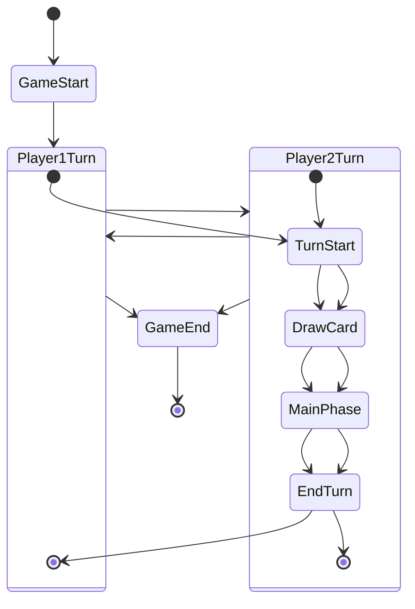
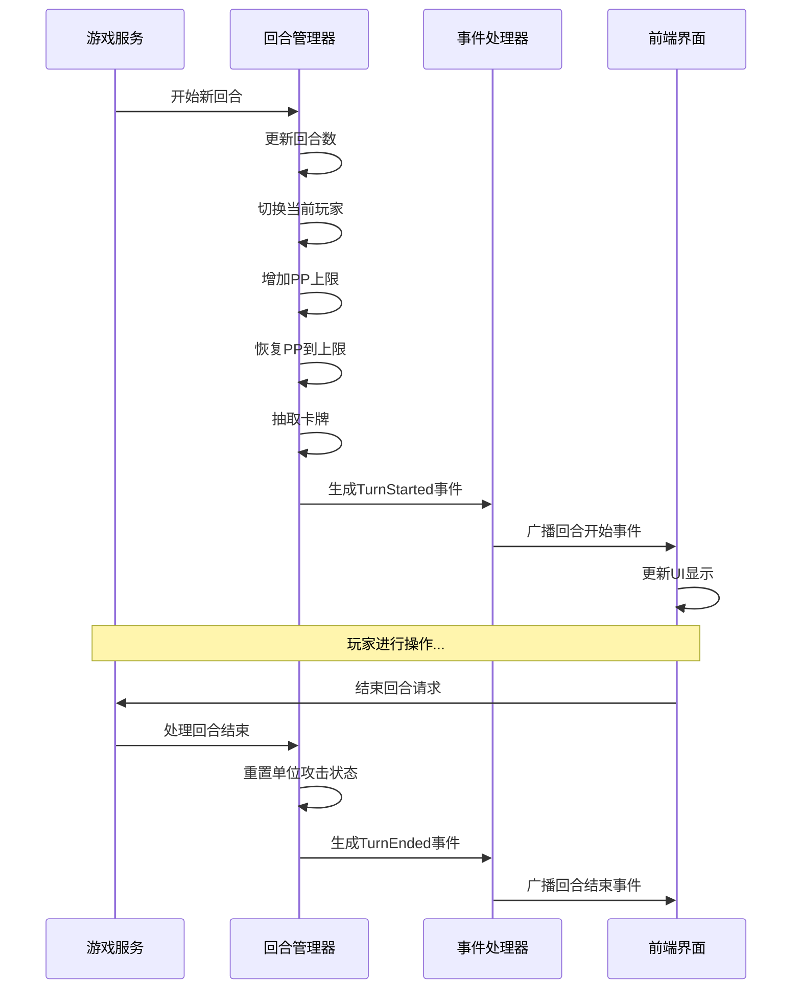

# 03-回合管理系统 [COMPLETED]

## 目的与范围

本文档详细说明Shadowverse-beyond项目的回合管理系统实现，包括回合流程控制、玩家切换机制、回合开始/结束事件处理、PP管理以及回合计时器功能。

## 核心概念

### 回合管理原则
- **严格顺序**: 回合按照固定顺序进行，不允许跳过
- **状态同步**: 回合状态在前后端实时同步
- **事件驱动**: 回合切换通过事件系统处理
- **资源管理**: 每回合自动管理PP、抽卡等资源

### 关键术语
- **TurnNumber**: 当前回合数（从1开始）
- **CurrentPlayerId**: 当前回合玩家ID
- **TurnPhase**: 回合阶段（开始、主要、结束）
- **PP (Play Point)**: 行动点数，用于出牌的资源

## 架构概览

### 回合管理流程图



### 回合事件序列



## 实现细节

### 后端回合管理

#### 回合开始处理
```csharp
public async Task<bool> StartNewTurnAsync(string gameId, GameActionContext context)
{
    var gameState = await GetGameStateAsync(gameId);
    var currentPlayer = GetCurrentPlayer(gameState);
    
    // 1. 更新回合数
    currentPlayer.TurnNumber++;
    gameState.TurnNumber = currentPlayer.TurnNumber;
    
    // 2. 增加PP上限（最大10）
    if (currentPlayer.MaxPP < 10)
    {
        currentPlayer.MaxPP++;
    }
    
    // 3. 恢复PP到上限
    currentPlayer.PP = currentPlayer.MaxPP;
    
    // 4. 检查EP解锁
    CheckAndUnlockEvolutionPoints(currentPlayer, gameState);
    
    // 5. 抽取卡牌
    await DrawCardForPlayer(currentPlayer, gameState);
    
    // 6. 重置单位状态
    ResetUnitsForNewTurn(currentPlayer);
    
    // 7. 生成回合开始事件
    var turnStartedEvent = new TurnStartedEventDto(
        currentPlayer.PlayerId, 
        currentPlayer.TurnNumber,
        currentPlayer.PP,
        currentPlayer.MaxPP
    );
    
    context.Events.Add(turnStartedEvent);
    
    _logger.LogInformation("Turn {TurnNumber} started for player {PlayerId}", 
        currentPlayer.TurnNumber, currentPlayer.PlayerId);
    
    return true;
}

private void CheckAndUnlockEvolutionPoints(PlayerStateDto player, GameStateDto gameState)
{
    int requiredEvoTurn = player.IsFirst ? 5 : 4;
    bool shouldUnlockEvolution = player.TurnNumber >= requiredEvoTurn && player.MaxEP == 0;

    if (shouldUnlockEvolution)
    {
        int maxEpForPlayer = player.IsFirst ? 2 : 3;
        player.MaxEP = maxEpForPlayer;
        player.CurrentEP = maxEpForPlayer;
        
        _logger.LogInformation("Evolution unlocked for player {PlayerId}: {MaxEP} EP", 
            player.PlayerId, maxEpForPlayer);
    }
}
```

#### 回合结束处理
```csharp
public async Task<bool> EndTurnAsync(string gameId, string playerId, GameActionContext context)
{
    var gameState = await GetGameStateAsync(gameId);
    
    // 验证是否为当前玩家
    if (gameState.CurrentPlayerId != playerId)
    {
        throw new GameLogicException("Not your turn");
    }
    
    var currentPlayer = GetPlayerState(gameState, playerId);
    
    // 1. 重置单位攻击状态
    foreach (var unit in currentPlayer.Field)
    {
        unit.CanAttack = false;
        unit.HasAttackedThisTurn = false;
    }
    
    // 2. 处理回合结束效果
    await ProcessEndOfTurnEffects(currentPlayer, gameState, context);
    
    // 3. 切换到下一个玩家
    SwitchToNextPlayer(gameState);
    
    // 4. 生成回合结束事件
    var turnEndedEvent = new TurnEndedEventDto(
        playerId,
        currentPlayer.TurnNumber
    );
    
    context.Events.Add(turnEndedEvent);
    
    // 5. 自动开始下一个玩家的回合
    await StartNewTurnAsync(gameId, context);
    
    return true;
}

private void SwitchToNextPlayer(GameStateDto gameState)
{
    var currentIndex = gameState.Players.FindIndex(p => p.PlayerId == gameState.CurrentPlayerId);
    var nextIndex = (currentIndex + 1) % gameState.Players.Count;
    gameState.CurrentPlayerId = gameState.Players[nextIndex].PlayerId;
}
```

### 前端回合管理

#### 回合状态显示
```javascript
// 回合开始事件处理
export function handleTurnStarted(eventData) {
    console.log(`GM: Turn started for player ${eventData.sourcePlayerId}`);
    
    // 更新游戏状态
    gameState.currentPlayerId = eventData.sourcePlayerId;
    gameState.turnNumber = eventData.turnNumber;
    
    // 更新玩家引用
    updatePlayerReferences();
    
    // 更新UI显示
    updateTurnIndicator(eventData.sourcePlayerId);
    updatePpDisplay(eventData.sourcePlayerId, eventData.currentPp, eventData.maxPp);
    
    // 显示回合开始动画
    showTurnStartAnimation(eventData.sourcePlayerId);
    
    // 如果是本地玩家回合，启用交互
    if (eventData.sourcePlayerId === gameState.localPlayerId) {
        enablePlayerInteraction();
        showTurnStartNotification("您的回合开始了！");
    } else {
        disablePlayerInteraction();
        showTurnStartNotification("对手回合开始");
    }
}

// 回合结束事件处理
export function handleTurnEnded(eventData) {
    console.log(`GM: Turn ended for player ${eventData.sourcePlayerId}`);
    
    // 重置选择状态
    gameState.selectedCardUid = null;
    gameState.selectedAttackerUid = null;
    
    // 清除高亮
    clearSelectionHighlights();
    
    // 显示回合结束动画
    showTurnEndAnimation(eventData.sourcePlayerId);
    
    // 禁用交互直到下一回合开始
    disablePlayerInteraction();
}

// 结束回合请求
export async function endTurnRequest() {
    if (gameState.currentPlayerId !== gameState.localPlayerId) {
        console.warn("GM: Cannot end turn - not your turn");
        return;
    }
    
    try {
        // 显示结束回合确认
        const confirmed = await showEndTurnConfirmation();
        if (!confirmed) return;
        
        // 发送结束回合动作
        const endTurnActionData = {
            actionType: "EndTurn"
        };
        
        await sendGameAction(endTurnActionData);
        
        // 立即禁用交互
        disablePlayerInteraction();
        showActionFeedback("正在结束回合...");
        
    } catch (error) {
        console.error("GM: Failed to end turn:", error);
        showErrorMessage("结束回合失败，请重试");
    }
}
```

### PP管理系统

#### PP计算和验证
```csharp
public class PPManager
{
    public static bool CanAffordCard(PlayerStateDto player, int cardCost)
    {
        return player.PP >= cardCost;
    }
    
    public static void SpendPP(PlayerStateDto player, int amount)
    {
        if (player.PP < amount)
        {
            throw new GameLogicException($"Insufficient PP: required {amount}, available {player.PP}");
        }
        
        player.PP -= amount;
    }
    
    public static void RestorePP(PlayerStateDto player, int amount)
    {
        player.PP = Math.Min(player.PP + amount, player.MaxPP);
    }
    
    public static void SetMaxPP(PlayerStateDto player, int newMax)
    {
        player.MaxPP = Math.Min(newMax, 10); // 最大PP限制为10
        player.PP = Math.Min(player.PP, player.MaxPP);
    }
}
```

## 集成点

### 回合事件DTO

#### TurnStartedEventDto
```csharp
public class TurnStartedEventDto : GameEventDto
{
    public int TurnNumber { get; set; }
    public int CurrentPp { get; set; }
    public int MaxPp { get; set; }
    public int CurrentEp { get; set; }
    public int MaxEp { get; set; }
    
    public TurnStartedEventDto(string sourcePlayerId, int turnNumber, int currentPp, int maxPp)
        : base(sourcePlayerId, "TurnStarted")
    {
        TurnNumber = turnNumber;
        CurrentPp = currentPp;
        MaxPp = maxPp;
    }
}
```

#### TurnEndedEventDto
```csharp
public class TurnEndedEventDto : GameEventDto
{
    public int TurnNumber { get; set; }
    
    public TurnEndedEventDto(string sourcePlayerId, int turnNumber)
        : base(sourcePlayerId, "TurnEnded")
    {
        TurnNumber = turnNumber;
    }
}
```

## 使用模式

### 回合计时器
```javascript
class TurnTimer {
    constructor(duration = 90000) { // 90秒默认时间
        this.duration = duration;
        this.remaining = duration;
        this.timer = null;
        this.callbacks = [];
    }
    
    start() {
        this.remaining = this.duration;
        this.timer = setInterval(() => {
            this.remaining -= 1000;
            this.notifyCallbacks();
            
            if (this.remaining <= 0) {
                this.timeout();
            }
        }, 1000);
    }
    
    stop() {
        if (this.timer) {
            clearInterval(this.timer);
            this.timer = null;
        }
    }
    
    timeout() {
        this.stop();
        console.log("Turn timer expired");
        
        // 自动结束回合
        if (gameState.currentPlayerId === gameState.localPlayerId) {
            endTurnRequest();
        }
    }
    
    onUpdate(callback) {
        this.callbacks.push(callback);
    }
    
    notifyCallbacks() {
        this.callbacks.forEach(callback => callback(this.remaining));
    }
}

// 全局回合计时器
const turnTimer = new TurnTimer();

// 在回合开始时启动计时器
turnTimer.onUpdate((remaining) => {
    updateTurnTimerDisplay(remaining);
    
    if (remaining <= 10000) { // 最后10秒警告
        showTimeWarning();
    }
});
```

### 自动化回合处理
```csharp
public class AutoTurnManager
{
    private readonly IGameService _gameService;
    private readonly Dictionary<string, Timer> _turnTimers = new();
    
    public void StartTurnTimer(string gameId, string playerId, int timeoutSeconds = 90)
    {
        StopTurnTimer(gameId);
        
        var timer = new Timer(async _ =>
        {
            await HandleTurnTimeout(gameId, playerId);
        }, null, TimeSpan.FromSeconds(timeoutSeconds), Timeout.InfiniteTimeSpan);
        
        _turnTimers[gameId] = timer;
    }
    
    public void StopTurnTimer(string gameId)
    {
        if (_turnTimers.TryGetValue(gameId, out var timer))
        {
            timer.Dispose();
            _turnTimers.Remove(gameId);
        }
    }
    
    private async Task HandleTurnTimeout(string gameId, string playerId)
    {
        try
        {
            var context = new GameActionContext();
            await _gameService.EndTurnAsync(gameId, playerId, context);
            
            _logger.LogInformation("Auto-ended turn for player {PlayerId} due to timeout", playerId);
        }
        catch (Exception ex)
        {
            _logger.LogError(ex, "Failed to auto-end turn for player {PlayerId}", playerId);
        }
    }
}
```

## 状态标识

**[COMPLETED]** - 回合管理系统已完全实现，包括回合流程控制、PP管理、事件处理和计时器功能。

### 已实现功能
- ✅ 回合开始/结束流程控制
- ✅ PP自动管理和验证
- ✅ EP解锁时机控制
- ✅ 单位状态重置
- ✅ 前端回合状态同步
- ✅ 回合计时器功能
- ✅ 自动回合结束机制

### 技术特点
- **严格控制**: 确保回合顺序和状态一致性
- **事件驱动**: 完整的回合事件系统
- **用户体验**: 直观的回合状态显示
- **自动化**: 支持回合超时自动处理

### 扩展功能
- 回合历史记录
- 自定义回合时长
- 回合统计分析
- 特殊回合效果支持
