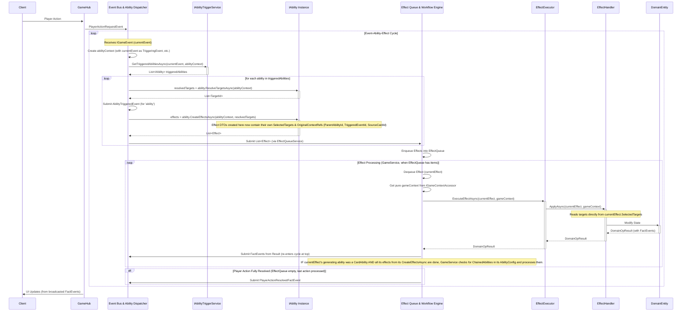

# 游戏循环、事件与能力处理统一架构 (V9 - 目标与上下文传递最终优化版)

## 0. 文档目的与读者对象
本文档为游戏核心逻辑的事件驱动架构提供全面、详尽的设计说明。目标读者包括所有项目开发者。本文旨在成为一个自成体系的参考，所有概念和流程均在本版本内进行解释或通过明确的内部章节引用。

## 1. 概述

### 1.1. 背景：追求清晰、健壮、可扩展的核心系统
本架构设计的核心目标，是通过引入一套统一的、事件驱动的、职责分离的机制，解决复杂集换式卡牌游戏中逻辑交错、难以维护和扩展的问题，实现一个逻辑清晰、高度内聚、松散耦合、易于测试和方便扩展的核心系统。

### 1.2. 核心设计原则
1.  **事件驱动 (Event-Driven):** 游戏中的所有重要状态变更都通过领域事件（`IGameEvent`，定义见1.3节）来宣告和传播。能力的触发、系统流程的推进，均由相应的事件驱动。唯一的例外是 `EffectConfig` 中定义的 `ChainedAbilities`（见1.3节），它代表一种在父能力效果完成后由 `GameService`（见2节）直接处理的固定后续流程，不通过标准事件匹配机制。
2.  **能力封装逻辑 (Ability Encapsulates Logic):** 所有运行时能力（卡牌能力、系统能力）通过实现统一的 `IAbility` 接口（定义见1.3节）封装其触发条件判断、目标解析、以及最终效果（`Effect` DTO，定义见1.3节）的创建逻辑。
3.  **效果原子化与上下文携带 (Atomic Effects with Context):** `Effect` DTO是描述一个最小化、不可再分的游戏状态变更指令。每个 `Effect` DTO都必须携带其执行时所需的全部上下文信息，包括明确的目标（`SelectedTargets`）以及必要的原始触发源信息。
4.  **职责分离 (Separation of Concerns):** 各核心组件（如 `EventProcessor`, `AbilityManager`, `GameService`, `IEffectExecutor`, `EffectHandler`，其职责定义见2节）的职责应尽可能明确和单一。

### 1.3. 核心概念详解

*   **玩家行动 (Player Action):** 由玩家通过用户界面（UI）或AI决策模块发起的原始意图（如出牌、攻击、结束回合）。这些原始意图会被转换为特定类型的 **玩家行动请求事件**（属于 `IGameEvent` 的一种），作为游戏逻辑处理链的起点。

*   **领域事件 (`IGameEvent`):**
    *   **定义：** 代表游戏中一个已经发生或被请求发生的重要事情。它是驱动游戏逻辑状态变迁和能力触发的基础。每个事件都应包含足够的信息来描述该事件本身。
    *   **主要分类与职责：**
        1.  **玩家行动请求事件 (Player Action Request Event):** 例如 `PlayCardRequestedEvent`, `AttackRequestedEvent`。这类事件由 `GameHub`（接收客户端请求）或AI模块（如 `AiTurnExecutor`）产生。**其唯一且直接的响应者是一个对应的“系统能力（玩家行动处理器）”（`IAbility` 接口的特定实现，详见下文“能力实现类”部分）。** 该系统能力负责对玩家的原始请求进行初步的合法性校验并创建执行该玩家行动所必需的第一批原子 `Effect` DTO列表。
        2.  **事实事件 (Fact Event):** 例如 `HealthChangedEvent`, `CardMovedEvent`, `UnitDestroyedEvent`, `PlayerActionResolvedFactEvent`。这类事件主要由 `EffectHandler` 在成功执行一个原子 `Effect` DTO后，或由 `GameService` 在完成某个宏观流程后产生。它们描述的是一个**已经发生**的游戏状态变化或一个处理阶段的完成。“事实事件”是触发后续所有通过事件监听机制激活的能力（包括数据驱动的卡牌能力、以及可选的“系统能力（通用规则型）”）的主要驱动力。这些事件也会被用于更新客户端UI。
        3.  **能力触发事件 (`AbilityTriggeredEvent`):** 此事件由 `EventProcessor` 在成功匹配一个 `IAbility` 实例（即其 `CanTrigger` 和 `CheckConditionsAsync` 方法均返回 `true`）并准备调用其 `CreateEffectsAsync` 方法之前产生。其载荷中应包含被触发能力的 `RuntimeId` (Guid) 和 `DefinitionId` (long)，以及触发该能力的原始事件类型和ID。此事件主要用于日志记录、调试，以及未来可能实现的“元能力”（即响应其他能力触发的能力）。

*   **能力接口 (`IAbility`):**
    *   **设计目标：** 接口定义简洁，聚焦于能力作为“Effect工厂”和“触发/条件检查器”的核心职责。能力的“激活状态”或“当前是否应被考虑用于触发”的管理职责主要由 `AbilityManager`（见2节）负责。
    *   **核心属性与方法（V9最终版定义）：**
        *   `Guid RuntimeId { get; }`: 运行时能力实例的唯一 `Guid` 标识。
        *   `long DefinitionId { get; }`: 能力的静态定义ID。对于卡牌能力，这对应其 `AbilityConfig` 的ID（来源于 `AbilityDefinition` 表）；对于硬编码的系统能力，这是一个预定义的 `long` 类型常量。
        *   `string Name { get; }`: 能力的易读名称。
        *   `string AbilityTag { get; }`: 能力标签（如 "Fanfare", "LastWords", "SystemActionHandler"）。
        *   `AbilityType Type { get; }`: 能力类型（如 `Triggered`, `Continuous`, `Keyword`, `System`）。
        *   `TriggerConfig TriggerConfig { get; }`: 能力的触发器配置，包含监听的事件类型 (`EventTypes`)、能力生效的源卡牌区域 (`ValidZones`) 等静态规则。它主要被下面的 `CanTrigger` 方法内部使用。
        *   `CardInstance? SourceCard { get; set; }`: 能力的源卡牌实例。
        *   `Task<bool> CanTrigger(IGameEvent gameEvent, GameContext context);`: **核心触发判断方法。** 实现此方法的类负责根据传入的 `gameEvent` 和 `context`，结合自身的 `TriggerConfig`（特别是 `EventTypes` 和 `ValidZones`），以及源卡牌的状态（如 `SourceCard.CurrentZone`、`SourceCard.IsSilenced` 等），来判断此能力实例是否应该被当前事件触发。
        *   `Task<bool> CheckConditionsAsync(GameContext context);`: 在 `CanTrigger` 返回 `true` 后被调用，用于执行能力在正式创建效果前的进一步前置条件检查。
        *   `Task<List<TargetId>> ResolveTargetsAsync(GameContext context);`: **负责解析能力所需的目标，并返回一个 `List<TargetId>`。** 它不直接修改 `GameContext.SelectedTargets`。
        *   `Task<List<Effect>> CreateEffectsAsync(GameContext context, List<TargetId> resolvedTargets);`: **核心的“Effect工厂”方法。** 它接收由 `ResolveTargetsAsync` 返回的 `resolvedTargets` 列表作为参数。此方法负责根据能力逻辑和已解析的目标，创建一系列原子 `Effect` DTO。在创建这些 `Effect` DTO时，必须将 `resolvedTargets`（或其子集）赋给每个 `Effect` DTO的 `SelectedTargets` 属性，并且将必要的原始触发上下文信息（如 `context.TriggeringEvent` 的ID/类型、`context.SourceCard` 的ID、`context.CurrentAbility` 的ID等）封装到每个 `Effect` DTO的新增上下文属性中（详见下文 `Effect` DTO定义）。
        *   `void RecordTrigger(GameContext context);`: 用于记录能力被触发的次数。
        *   `int GetTriggerCountThisTurn(GameContext context);`: 获取本回合已触发次数。
        *   `int GetTriggerCountThisGame(GameContext context);`: 获取本局游戏总已触发次数。
        *   `void ResetTurnState(GameContext context);`: 重置与回合相关的能力状态。
    *   **已从接口中移除的成员：** `Activate()`, `Deactivate()`, `Suspend()`, `Resume()`, `Destroy()`, `IsActive { get; }`, `State { get; }`。

*   **能力实现类：**
    *   **`AbilityConfig.Id` 类型：** `AbilityConfig` 类中的 `Id` 属性类型为 `long`。
    *   **`Ability` (数据驱动的卡牌能力):** 实现上述简化后的 `IAbility` 接口。其 `DefinitionId` 直接返回其关联的 `AbilityConfig` 实例的 `long` 类型的 `Id`。其 `CanTrigger` 方法将包含基于 `TriggerConfig.ValidZones` 的区域检查逻辑及对源卡牌沉默状态的检查。不包含内部的 `IsActive` 或 `State` 属性。`ResolveTargetsAsync` 返回 `List<TargetId>`，`CreateEffectsAsync` 接收此列表并用于填充其创建的 `Effect` DTO 的 `SelectedTargets` 及新增的上下文属性。
    *   **系统能力（玩家行动处理器）：**
        *   **职责定位：** 响应“玩家行动请求事件”的唯一直接处理者。进行初始校验并创建**完成该玩家行动所需的完整效果序列 `List<Effect>`**。
        *   **实现：** 硬编码C#类，实现简化后的 `IAbility` 接口。其 `CanTrigger` 方法精确匹配一种 `PlayerActionRequestEvent`。其 `ResolveTargetsAsync` 通常返回空列表或预设目标。其 `CreateEffectsAsync` 接收目标列表并返回一个有序的 `List<Effect>`，这些 `Effect` DTO 也应包含必要的上下文属性。
        *   **`DefinitionId`：** 为每个硬编码的系统能力分配一个唯一的、预定义的 `long` 类型常量。
        *   **不使用 `ChainedAbilities`。**
        *   **注册：** 在系统初始化时被实例化并通过依赖注入提供给 `IAbilityTriggerService`。
    *   **系统能力（通用规则/多阶段流程处理器）：** (可选) 响应“事实事件”的硬编码系统能力。

*   **效果 (`Effect` DTO - V9最终版):**
    *   **定义：** 原子性的游戏状态变更指令，是效果队列 (`Effect Queue`) 中的基本处理单元。
    *   **核心属性：**
        *   `Guid Id { get; set; }` (效果实例的运行时ID)
        *   `Guid RequestingPlayerId { get; set; }` (发起此效果链的玩家)
        *   `EffectConfig EffectConfig { get; set; }` (效果的静态配置)
        *   `List<TargetId> SelectedTargets { get; set; }` (此效果直接作用的目标)
    *   **携带的上下文属性 (由 `IAbility.CreateEffectsAsync` 填充，供 `GameService` 构建 `GameContext` 给 `EffectHandler` 使用)：**
        *   `Guid? ParentAbilityId { get; set; }` (生成此效果的父能力 `IAbility` 实例的 `RuntimeId`)
        *   `Guid TriggeredEventId { get; set; }` (最初触发了父能力的那个原始 `IGameEvent` 的 `EventId`)
        *   `Guid? SourceCardId { get; set; }` (生成此效果的父能力的源卡牌 `InstanceId`，若有)
    *   **其他辅助属性：** `DateTime CreatedAt`, `int Priority`, `bool ForceExecution`。
    *   **构造函数：** 接收 `EffectConfig`, `requestingPlayerId`, `selectedTargets`, 以及上述新增的 `parentAbilityId`, `triggeredEventId`, `sourceCardId` 上下文信息。

*   **`EffectConfig`:** 效果的静态配置。
    *   **`ChainedAbilities` (`List<AbilityConfig>`):**
        *   **架构决策**: 关于能力链的最终设计决策，包括其在数据模型中的位置、统一运行时模型以及 `GameService` 中的处理逻辑，已迁移至专门的设计文档中。
        *   **权威文档**: **关于此机制的最新、最详细的设计与实现方案，请参阅：[04-04-能力链与系统能力重构设计.md](./04-04-能力链与系统能力重构设计.md)。**

*   **`GameContext` (V11 - 最终纯粹版):**
    *   **设计哲学:** `GameContext` 是一个纯粹的、**不可变**的 `record`。它只提供稳定的“环境”信息（如游戏状态、服务提供者），作为效果执行时所需的背景。它本身不携带任何针对特定效果的动态信息。
    *   **彻底移除动态属性:** `SelectedTargets`, `ResolvedParameters` 等所有与特定效果处理相关的动态、可变状态都已从此类中移除。
    *   **创建与传递:** `GameContext` 在每次请求或后台任务单元的开始被创建，并通过 `IGameContextAccessor` 在整个调用链中传递。当需要一个带有更具体信息的上下文时（例如，在处理事件时指明 `TriggeringEvent`），应使用 `with` 表达式创建一个新的、衍生的实例，而不是修改现有实例。

## 2. 核心组件职责与交互 (V9 - 上下文传递优化后)

*   **`GameHub`:** 接收玩家输入，转换为“玩家行动请求事件”，提交给 `EventProcessor`。

*   **`EventProcessor` (`IEventProcessor`):**
    *   **事件总线：** 接收所有类型的 `IGameEvent`。
    *   **依赖 `IAbilityTriggerService`：** 通过此服务获取与当前事件匹配的、且已通过自身 `CanTrigger` 和 `CheckConditionsAsync` 初步校验的 `IAbility` 实例列表。
    *   **协调能力解析与效果创建：**
        1.  当接收到一个 `IGameEvent` (称之为 `currentEvent`) 后，为处理此事件创建一个 `abilityContext`。此 `abilityContext` 中应包含 `currentEvent` 作为 `TriggeringEvent`，并根据 `currentEvent` 的来源设置 `SourceCard`（如果事件源于卡牌）和 `RequestingPlayerId`。
        2.  调用 `List<IAbility> triggeredAbilities = await _abilityTriggerService.GetTriggeredAbilitiesAsync(currentEvent, abilityContext);` (如1.3节中 `IAbilityTriggerService` 所述，此方法内部已完成 `CanTrigger` 和 `CheckConditionsAsync` 的调用)。
        3.  遍历 `triggeredAbilities` 列表中的每一个 `ability` 实例：
            a.  将 `abilityContext.CurrentAbility` 设置为当前正在处理的 `ability` 实例。
            b.  `List<TargetId> resolvedTargets = await ability.ResolveTargetsAsync(abilityContext);`
            c.  提交一个 `AbilityTriggeredEvent` (包含 `ability.RuntimeId`, `ability.DefinitionId`, 以及 `currentEvent` 的信息)。
            d.  `List<Effect> effectsToEnqueue = await ability.CreateEffectsAsync(abilityContext, resolvedTargets);` (此时 `ability.CreateEffectsAsync` 内部会将 `resolvedTargets` 和从 `abilityContext` 获取的原始触发信息封装到每个 `Effect` DTO中)。
            e.  将 `effectsToEnqueue` 列表提交给 `GameService` (通过 `_effectQueueService.EnqueueEffectRequestAsync` 间接实现)。
            f.  在处理下一个 `ability` 实例前，`EventProcessor` 负责确保 `abilityContext` 的状态被适当地重置或更新，以避免能力间的状态污染。
    *   **移除 `ProcessSystemEventsAsync` 方法：** 所有类型的事件（包括玩家行动请求事件和事实事件）都通过上述统一流程处理。

*   **`IAbilityTriggerService` (接口) / `AbilityManager` (实现):**
    *   `GetTriggeredAbilitiesAsync(IGameEvent gameEvent, GameContext context)` 方法返回 `Task<List<IAbility>>`。
        *   **核心逻辑：**
            1.  从其管理的“当前游戏中所有存在的” `IAbility` 实例池中进行初步筛选（例如，对于卡牌能力，其源卡牌必须处于游戏中）。
            2.  对筛选后的每个实例，调用 `await ability.CanTrigger(gameEvent, context)`。
            3.  若 `CanTrigger` 返回 `true`，再调用 `await ability.CheckConditionsAsync(context)`。
            4.  将所有通过这两项检查的能力加入列表并返回。
    *   `AbilityManager` 内部存储和管理所有 `IAbility` 实例。
        *   **系统能力注册：** 启动时通过构造函数注入 `IEnumerable<IAbility>` 并存入管理列表。
        *   **卡牌能力注册/注销：** 当 `CardInstance` 进入游戏时创建并注册；彻底离开时注销。`AbilityManager` **不再**调用能力的 `Activate/Deactivate` 方法。

*   **`IAbility` 实现类 (包括 `Ability` 和各类系统能力):**
    *   实现简化后的接口。`CanTrigger` 方法负责包括区域检查、沉默状态检查（对卡牌能力而言）在内的所有触发时点判断。`ResolveTargetsAsync` 返回 `List<TargetId>`。`CreateEffectsAsync` 接收 `List<TargetId>` 作为参数，并负责在其创建的 `Effect` DTO中填充 `SelectedTargets` 以及从传入的 `GameContext` 中获取的原始触发上下文信息（填充到 `Effect` DTO 的 `ParentAbilityId`, `TriggeredEventId`, `SourceCardId` 等属性）。

*   **`GameService`:**
    *   从效果队列 (`_effectQueueService`) 中取出 `Effect` DTO (`currentEffect`)。
    *   **获取纯粹的 `GameContext`:** `GameService` 通过 `IGameContextAccessor` 获取当前的、纯粹的 `GameContext`。
    *   **调用效果执行器:** `GameService` 将**同时**传递 `Effect` DTO 和纯粹的 `GameContext` 给执行器：
        *   `IEffectExecutor.ExecuteEffectAsync(currentEffect, gameContext)`。
    *   处理 `EffectHandler` 返回的 `DomainOperationResult` 中的“事实事件”，将它们提交回 `EventProcessor`。
    *   在处理完一个源自卡牌 `Ability` 实例的完整效果列表后，检查并负责启动该卡牌 `AbilityConfig` 中定义的任何 `ChainedAbilities` (如1.3节所述)。
    *   在整个玩家行动链结束后（通常是效果队列暂时为空且上一个玩家行动已处理完毕时），生成“玩家行动完成事实事件” (`PlayerActionResolvedFactEvent`)。

*   **`IEffectExecutor`, `EffectHandler`, 领域实体:** `EffectHandler` 的接口被修改为 `ApplyAsync(Effect effect, GameContext context)`。它直接从传入的 `effect` 参数中获取目标 (`effect.SelectedTargets`)，并从 `context` 参数中获取环境信息来执行其逻辑。

## 3. 统一的游戏事件与能力驱动流程

### 3.1. 流程概览 (V9 - 上下文传递优化后)

1.  **玩家行动请求事件 -> 系统能力（玩家行动处理器） -> 初始 `Effect` DTO列表：**
    *   `GameHub` (或AI) -> `PlayerActionRequestEvent` -> `EventProcessor`。
    *   `EventProcessor` 创建 `abilityContext` (包含 `PlayerActionRequestEvent` 作为 `TriggeringEvent`)。
    *   `EventProcessor` 调用 `IAbilityTriggerService.GetTriggeredAbilitiesAsync(PlayerActionRequestEvent, abilityContext)` -> `AbilityManager` 返回匹配的唯一“系统能力（玩家行动处理器）”实例。
    *   `EventProcessor` 依次调用该系统能力的：
        *   `List<TargetId> resolvedTargets = await systemAbility.ResolveTargetsAsync(abilityContext);`
        *   (提交 `AbilityTriggeredEvent`)
        *   `List<Effect> initialEffects = await systemAbility.CreateEffectsAsync(abilityContext, resolvedTargets);` (系统能力在此创建 `Effect` DTO，并填充其 `SelectedTargets` 及新增的原始上下文属性，如 `ParentAbilityId` 等)。
    *   `initialEffects` 列表 -> `GameService` (通过 `_effectQueueService` 入队)。

2.  **效果执行与事实事件的产生：**
    *   `GameService` 从效果队列中取出 `Effect` DTO (`currentEffect`)。
    *   `GameService` 从 `IGameContextAccessor` 获取当前的、纯粹的 `gameContext`。
    *   `GameService` 调用 `IEffectExecutor.ExecuteEffectAsync(currentEffect, gameContext)`。
    *   `IEffectExecutor` 找到对应的 `EffectHandler` 并调用其 `ApplyAsync(currentEffect, gameContext)`。
    *   `EffectHandler` 直接从 `currentEffect.SelectedTargets` 获取目标，并使用 `gameContext` 执行逻辑，然后调用领域实体方法，返回 `DomainOperationResult` (包含“原子事实事件”)。
    *   `EffectHandler` 可能还会生成“效果处理器聚合事实事件”并加入 `DomainOperationResult`。
    *   所有这些“事实事件”通过 `IEffectExecutor` 和 `GameService` 回到 `EventProcessor`。

3.  **事实事件驱动后续能力（卡牌能力、通用规则系统能力）：**
    *   `EventProcessor` 收到“事实事件”。它会为此“事实事件”创建一个新的 `abilityContext` (此时，这个“事实事件”就是 `abilityContext.TriggeringEvent`)。
    *   `EventProcessor` 调用 `IAbilityTriggerService.GetTriggeredAbilitiesAsync(factEvent, abilityContext)` -> `AbilityManager` 返回所有匹配此事实事件的 `IAbility` 实例（可以是卡牌能力、或“系统能力（通用规则型）”）。
    *   对于每个返回的 `ability`：
        *   `List<TargetId> resolvedTargets = await ability.ResolveTargetsAsync(abilityContext);`
        *   (提交 `AbilityTriggeredEvent`)
        *   `List<Effect> subsequentEffects = await ability.CreateEffectsAsync(abilityContext, resolvedTargets);` (能力在此创建 `Effect` DTO，并填充其 `SelectedTargets` 及新增的原始上下文属性)。
    *   `subsequentEffects` 列表 -> `GameService` (通过 `_effectQueueService` 入队)。

4.  **`ChainedAbilities` 的处理：** 如1.3节中 `EffectConfig` 部分所述，当 `GameService` 处理完一个源自卡牌 `Ability` 的效果列表后，会检查并启动其 `ChainedAbilities`。

5.  **循环与完成：** 流程持续，直到效果队列为空。最终，`GameService` 在整个玩家行动链条完成后，生成并提交“玩家行动完成事实事件” (`PlayerActionResolvedFactEvent`) 给 `EventProcessor`。

### 3.2. 核心交互图 (Mermaid Sequence Diagram - V9)

**图例说明:** `Effect` DTO是自包含的指令，携带了包括目标在内的所有执行信息。`GameContext` 是一个纯粹的、不可变的环境上下文。`EffectHandler` 直接消费这两者来完成工作。

### 3.3. “系统能力（玩家行动处理器）”处理玩家请求的示例 - 出牌流程 (V9更新)
此流程将遵循3.1节描述的V9数据流。关键点在于 `HandlePlayCardRequestSystemAbility` 的 `CreateEffectsAsync` 方法会接收 `abilityContext` 和 `resolvedTargets`，并创建包含完整上下文信息的 `Effect` DTO 列表。

## 4. 复杂交互模式详解
本章节描述的各种交互模式的实现，都将基于V9版本定义的数据流和组件职责。
### 4.1. 静态编排的效果链
*   **系统能力：** 通过从 `CreateEffectsAsync` 返回一个有序的 `List<Effect>` 来实现其完整的行为序列。每个 `Effect` DTO都携带其执行上下文。
*   **卡牌能力：** 除了上述方式，还可以利用其 `AbilityConfig` 中的 `ChainedAbilities` 属性，由 `GameService` 在其初始效果执行完毕后接续处理。

### 4.2. 动态目标/参数传递
目标和参数的动态性主要体现在 `IAbility` 的 `ResolveTargetsAsync` 和 `CreateEffectsAsync` 方法中，它们可以访问完整的 `GameContext` 来决定目标和效果参数。`EffectHandler` 在执行时，其 `GameContext` 已包含由 `GameService` 根据 `Effect` DTO准备好的目标和原始上下文。

### 4.3. 条件分支、选择与随机
这些逻辑主要封装在 `IAbility` 的 `CheckConditionsAsync`、`ResolveTargetsAsync`（例如处理玩家选择）和 `CreateEffectsAsync`（例如根据条件创建不同的效果，或效果参数包含随机性）中，或者在具体的 `EffectHandler` 内部实现。

### 4.4. `EffectConfig.ChainedAbilities`
> **注意:** 关于此机制的最新、最详细的设计与实现方案，请参阅：[04-04-能力链与系统能力重构设计.md](./04-04-能力链与系统能力重构设计.md)。

*   **触发流程：** 如1.3节中 `EffectConfig` 部分所述，当一个卡牌 `Ability` 实例的 `CreateEffectsAsync` 返回的 `List<Effect>` 被 `GameService` 完全处理后，`GameService` 检查该父 `Ability` 的 `Config.ChainedAbilities`。若存在，`GameService` 为它们创建新的 `IAbility` 实例，并为这些新实例启动目标解析和效果创建流程，将返回的 `Effect` DTO列表加入效果队列。

## 5. 性能考量与优化策略
本章节内容的核心思想保持不变（例如，避免在主循环中进行过多同步IO操作，合理设计缓存，优化查询等），但具体的实现和考量点会基于V9的架构。例如，`AbilityManager` 中 `GetTriggeredAbilitiesAsync` 的初步筛选逻辑可以考虑性能优化，避免不必要的迭代。

## 6. 总结
V9版本通过优化目标和上下文的传递机制，进一步提升了系统的清晰度和健壮性。`IAbility.ResolveTargetsAsync` 现在直接返回目标ID列表，`IAbility.CreateEffectsAsync` 负责将这些目标及必要的原始触发上下文信息（`ParentAbilityId`, `TriggeredEventId`, `SourceCardId`）封装到 `Effect` DTO中。`GameService` 在效果出队时，利用 `Effect` DTO携带的完整信息来构建传递给 `EffectHandler` 的 `GameContext`。这消除了冗余，确保了效果执行时上下文的准确性和隔离性，为构建复杂且可靠的游戏逻辑奠定了更坚实的基础。