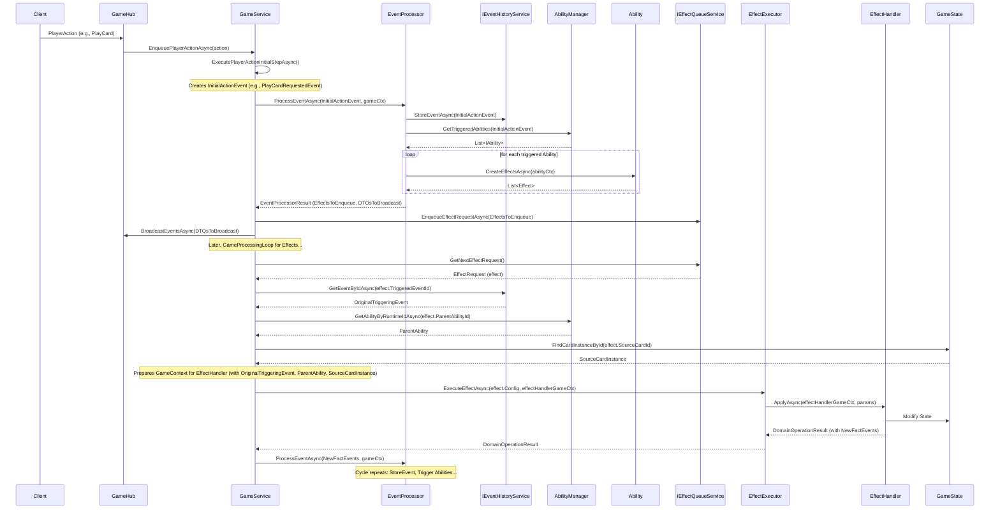

# 游戏事件系统详细设计文档

> **更新说明（与当前代码对齐）**：本文件的大部分内容基于早期 `GameService + EventProcessor + IEventHistoryService` 的架构草案。当前项目已迁移至以 `GameActionTransactionService` 为核心的事务处理模型（双队列：事件暂存区 + 效果队列），并在提交阶段统一广播与记录事件。请以以下实现与文档为准：
>
> - 事务引擎实现：`Server/Services/GameActionTransactionService.cs`
> - 可撤销动作与事务模型（权威）：`文档/05-游戏系统/17-可撤销动作与事务处理模型.md`
> - 可录制事件系统：`文档/05-游戏系统/16-可录制事件系统架构.md`

## 1. 概述

### 1.1. 背景与目标

本游戏的核心逻辑采用事件驱动的架构。一个健壮、清晰的事件系统对于实现模块间的解耦、驱动卡牌能力、支持游戏回放与战斗日志、以及保证游戏逻辑的正确性和可维护性至关重要。原有的事件处理流程在引入效果队列和 `EventProcessor` 后已得到优化，本次设计将进一步明确事件的定义、生命周期管理，并正式引入 **事件历史服务 (`IEventHistoryService`)**，以支持更复杂的上下文追溯需求。

主要目标包括：
1.  **明确事件定义**：将 `IGameEvent` 定义为不可变的“游戏事实”记录，统一事件ID格式。
2.  **规范事件处理流程**：清晰化事件的产生、处理、能力触发、效果生成以及与客户端的通信。
3.  **引入事件历史**：设计并实现一个事件历史服务，用于存储已处理的事件，供后续逻辑（如效果执行时追溯原始触发事件）查询。
4.  **提升系统可追溯性与可调试性**：通过清晰的事件流和历史记录，简化问题排查。

### 1.2. 核心概念

*   **游戏事件 (`IGameEvent`)**: 代表游戏中一个已经发生的、不可变的原子事实或状态变更。例如：卡牌被打出、单位受到伤害、回合开始。
*   **事件ID (`EventId`)**: 每个 `IGameEvent` 实例的全局唯一标识符 (GUID)。
*   **事件类型 (`EventType`)**: 区分不同种类事件的枚举。
*   **事件数据 (`Parameters`, `SourcePlayer`, `SourceCard`)**: 事件携带的与该事实相关的具体信息。
*   **事件源**: 触发事件的实体或动作。
*   **事件处理器 (`IEventProcessor`)**: 负责接收 `IGameEvent`，根据事件内容查找并触发相关的游戏能力 (`IAbility`)，最终生成待执行的效果 (`Effect`) 和待广播的客户端事件DTO (`GameEventDto`)。
*   **事件历史服务 (`IEventHistoryService`)**: 一个新的服务，负责存储近期已由 `EventProcessor` 处理完毕的 `IGameEvent` 实例，并提供按 `EventId` 查询的功能。
*   **效果 (`Effect`)**: 一个描述待执行游戏逻辑的请求，由能力触发产生，并进入效果队列等待执行。
*   **效果处理器 (`EffectHandler`)**: 负责执行具体 `Effect` 的逻辑。

### 1.3. 设计原则

*   **事件即事实**: `IGameEvent` 实例一旦创建，其内容不应再被修改。它们是对过去某个时间点状态的快照。
*   **单一职责**:
    *   事件 (`IGameEvent`)：只负责承载信息。
    *   事件处理器 (`IEventProcessor`)：负责事件的分发和能力触发。
    *   能力 (`IAbility`)：负责定义触发条件和由此产生的效果。
    *   效果处理器 (`EffectHandler`)：负责执行具体游戏逻辑。
*   **解耦**: 通过事件机制，不同游戏模块（如出牌逻辑、伤害计算、能力触发）可以相互作用而无需直接依赖。
*   **可追溯性**: 所有重要的游戏状态变更都应通过事件记录，便于调试和未来的功能扩展。

## 2. 组件详解

### 2.1. `IGameEvent` 接口与 `GameEventBase`

`IGameEvent` 是所有游戏事件的基础接口。`GameEventBase` 是其抽象基类，提供了通用实现。

*   **核心属性：**
    *   `Guid EventId { get; }`: 事件的唯一标识符，在 `GameEventBase` 构造时通过 `Guid.NewGuid()` 生成。
    *   `EventType EventType { get; }`: 事件的类型，通过枚举定义。
    *   `DateTime Timestamp { get; }`: 事件创建的时间戳。
    *   `PlayerStateDto? SourcePlayer { get; }`: 事件的来源玩家（DTO形式，可选）。
    *   `CardInstance? SourceCard { get; }`: 事件的来源卡牌实例（可选）。
    *   `Dictionary<string, object> Parameters { get; }`: 存储事件特有的参数。
*   **移除 `ExecuteAsync` 方法：**
    *   **理由：** 事件本身不应包含执行逻辑。其“执行”体现在 `EventProcessor` 对其的响应（触发能力）以及后续由能力产生的效果被 `EffectHandler` 执行。这符合单一职责原则，并使事件流更清晰。原先设想的事件自身执行逻辑已整合到 `EventProcessor` -> `IAbility` -> `Effect` -> `EffectHandler` 的链条中。

### 2.2. 具体事件类

项目中定义了多种具体的事件类，它们都继承自 `GameEventBase`。例如：
*   **行动请求类事件 (Action Request Events)** (位于 `Server/Domain/Events/ActionRequests/`)：
    *   `PlayCardRequestedEvent`
    *   `AttackRequestedEvent`
    *   `EndTurnRequestedEvent`
    *   `EvolveRequestedEvent`
    *   `MulliganSubmittedEvent`
    *   这些事件由玩家或AI的行动直接产生，是游戏逻辑处理的起点。
*   **核心游戏事实类事件 (Core Game Fact Events)** (位于 `Server/Domain/Events/CoreGameEvents.cs`)：
    *   `CardPlayedEvent`
    *   `DamageDealtEvent`
    *   `HealthChangedEvent`
    *   `UnitDestroyedEvent`
    *   `TurnStartedEvent`
    *   `AbilityTriggeredEvent` (用于记录一个能力被触发的事实)
    *   `EffectCompletedEvent` (用于记录一个效果（及其效果链）执行完毕的事实)
    *   这些事件通常由 `EffectHandler` 在执行完一个效果并改变了游戏状态后产生。

**命名约定建议：**
*   对于代表玩家/系统意图或请求的事件，可使用 `NounVerbRequestedEvent` 格式。
*   对于代表已发生事实的事件，可使用 `NounVerbFactEvent` 或 `NounChangedEvent` (如 `HealthChangedEvent`) 格式。

### 2.3. 事件的创建与发布

*   **创建时机：**
    *   **初始行动事件：** 由 `GameService.ExecutePlayerActionInitialStepAsync` 方法根据玩家的 `PlayerActionWrapper` 创建对应的行动请求事件（如 `PlayCardRequestedEvent`）。
    *   **事实性事件：** 主要由各个 `EffectHandler` 在其 `ApplyAsync` 方法执行完毕，并确实改变了游戏状态后，在其返回的 `DomainOperationResult.GeneratedEvents` (之前是 `ImmediateEvents`) 中创建。
*   **发布/传递：**
    *   `GameService` 将初始行动事件传递给 `ProcessGeneratedEventsImmediatelyAsync` 方法。
    *   `EffectHandler` 返回的 `DomainOperationResult` 中包含的 `GeneratedEvents` 也会被传递给 `ProcessGeneratedEventsImmediatelyAsync`。
    *   `ProcessGeneratedEventsImmediatelyAsync` 方法会遍历这些事件，并将每个事件交给 `IEventProcessor` 处理。

### 2.4. `IEventProcessor` (事件处理器)

*   **职责：**
    1.  接收一个 `IGameEvent` 和当前的 `GameContext`。
    2.  根据 `IGameEvent` 的类型和内容，查询 `AbilityManager` 以找到所有监听此事件并满足触发条件的已激活 `IAbility` 实例。
    3.  对于每个被触发的 `IAbility`：
        *   创建一个包含此 `IGameEvent` 和 `IAbility` 信息的 `AbilityContext`。
        *   调用 `ability.CreateEffectsAsync(abilityContext)` 来获取该能力将产生的 `Effect` DTO 列表。
    4.  收集所有由触发的能力产生的 `Effect` DTO。
    5.  将原始的 `IGameEvent` 映射为一个或多个 `GameEventDto`，用于向客户端广播。
    6.  返回一个 `EventProcessorResult` 对象，该对象包含：
        *   `List<Effect> EffectRequests`: 新产生的效果请求，将由 `GameService` 入队到 `IEffectQueueService`。
        *   `List<GameEventDto> ResultingDtos`: 用于广播给客户端的事件DTO。
        *   `List<IGameEvent> NewDomainEvents`: （可选）如果事件处理器自身逻辑会直接产生新的领域事件（不通过能力），则在此返回。通常此列表为空，新的领域事件主要由 `EffectHandler` 产生。
*   **依赖：** `IAbilityManager`, `IMapper` (用于DTO转换), `IEventHistoryService` (用于存储事件)。
*   **调用时机：** 由 `GameService.ProcessGeneratedEventsImmediatelyAsync` 方法调用。

### 2.5. `IEventHistoryService` (事件历史服务) - **新组件**

*   **目的：**
    *   存储由 `EventProcessor` 成功处理完毕的 `IGameEvent` 实例。
    *   允许游戏逻辑（主要是 `GameService` 在为 `EffectHandler` 构建 `GameContext` 时）根据 `EventId` (Guid) 回溯查找原始触发事件的完整信息。
*   **接口定义 (`Server/Domain/Events/Services/IEventHistoryService.cs`)：**
    ```csharp
    public interface IEventHistoryService
    {
        Task StoreEventAsync(string gameId, IGameEvent gameEvent);
        Task<IGameEvent?> GetEventByIdAsync(string gameId, Guid eventId);
        // 可选：Task ClearHistoryForGameAsync(string gameId);
    }
    ```
*   **初步内存实现 (`InMemoryEventHistoryService`)：**
    *   内部使用 `ConcurrentDictionary<string, ConcurrentDictionary<Guid, IGameEvent>> _gameEventHistories;`。
    *   `gameId` 作为外层Key，`EventId` (Guid) 作为内层Key。
*   **DI注册：** 建议在 `Program.cs` 中注册为 Singleton 服务。
*   **集成点 - 事件存储：**
    *   `IEventProcessor` 在其 `ProcessEventAsync` 方法的末尾，当一个事件被完全处理（所有相关的能力已被触发，效果请求已生成）之后，但在返回 `EventProcessorResult` 之前，调用 `await _eventHistoryService.StoreEventAsync(gameId, processedEvent);`。
    *   **重要：** 只存储那些确实被 `EventProcessor` 成功处理并可能引发后续逻辑的事件。
*   **集成点 - 事件检索：**
    *   `GameService` 在 `ProcessEffectQueueForGameAsync` 方法中，当从效果队列取出一个 `Effect` DTO 后，如果 `effect.TriggeredEventId` 有效，则调用 `await _eventHistoryService.GetEventByIdAsync(gameId, effect.TriggeredEventId)` 来获取原始的 `IGameEvent` 对象，并用它来填充传递给 `EffectHandler` 的 `GameContext.TriggeringEvent`。
*   **事件在历史中的生命周期：**
    *   对于内存实现，事件将存储在对应 `gameId` 的字典中，直到游戏结束。
    *   `GameService` 在游戏状态被清理时（例如，游戏循环结束的 `finally` 块中，或者一个专门的 `RemoveGameAsync` 方法中），应调用类似 `_eventHistoryService.ClearHistoryForGameAsync(gameId)` (如果实现该方法) 或确保 `InMemoryEventHistoryService` 实例与 `GameState` 一同被正确处理（如果 `_gameEventHistories` 的key是 `gameId`，当 `GameState` 被移除时，对应的历史也就不再被访问，但内存中的数据需要清理机制）。
    *   对于一个游戏会话而言，存储所有事件是可行的。如果考虑极长时间运行或大量事件的游戏，未来可考虑LRU缓存或只存储最近N个事件的策略。

## 3. 事件驱动流程

### 3.1. 玩家行动到初始事件
1.  客户端/AI 发起行动 (如出牌)。
2.  `GameHub` 接收请求，创建 `PlayerActionWrapper`。
3.  `GameService.EnqueuePlayerActionAsync` 将 `actionWrapper` 入玩家行动队列。
4.  `GameService.GameProcessingLoopAsync` 从行动队列取出 `actionWrapper`。
5.  调用 `GameService.ExecutePlayerActionInitialStepAsync`：
    *   进行基础验证。
    *   创建初始的行动请求事件 (如 `PlayCardRequestedEvent`)，并将其放入 `GameActionContext.DomainEvents`。
6.  `GameProcessingLoopAsync` 调用 `ProcessGeneratedEventsImmediatelyAsync` 处理这些初始事件。

### 3.2. 事件在 `EventProcessor` 中的处理
1.  `ProcessGeneratedEventsImmediatelyAsync` 将 `IGameEvent` 和 `GameContext` 传递给 `IEventProcessor.ProcessEventAsync`。
2.  `EventProcessor`:
    *   **调用 `await _eventHistoryService.StoreEventAsync(gameId, gameEvent);` 将当前处理的事件存入历史。**
    *   使用 `AbilityManager` 查找监听此 `gameEvent.EventType` 的所有相关 `IAbility`。
    *   对每个满足触发条件的 `ability`：
        *   创建 `AbilityContext` (包含 `gameEvent` 作为 `TriggeringEvent`)。
        *   调用 `await ability.CreateEffectsAsync(abilityContext)` 获取 `List<Effect>`。
    *   收集所有 `Effect` DTO。
    *   将 `gameEvent` 映射为 `GameEventDto`。
    *   返回 `EventProcessorResult` (包含效果列表和DTO列表)。

### 3.3. 能力触发与效果生成
(已在3.2中描述)

### 3.4. 效果执行与新事件产生
1.  `ProcessGeneratedEventsImmediatelyAsync` 收到 `EventProcessorResult` 后，将其中的 `EffectRequests` 通过 `IEffectQueueService.EnqueueEffectRequestAsync` 入效果队列。
2.  同时，将 `ResultingDtos` 通过 `GameService.BroadcastEventsAsync` 广播给客户端。
3.  `GameService.GameProcessingLoopAsync` (在其效果队列处理部分):
    *   从 `IEffectQueueService` 取出 `Effect` DTO。
    *   **构建 `GameContext` for `EffectHandler`:**
        *   `triggeringEvent = await _eventHistoryService.GetEventByIdAsync(gameId, effectRequest.TriggeredEventId);`
        *   `sourceAbility = await _abilityManager.GetAbilityByRuntimeIdAsync(effectRequest.ParentAbilityId);`
        *   `sourceCard = gameState.FindCardInstanceById(effectRequest.SourceCardId);`
        *   填充 `gameContext` 的这些属性。
    *   调用 `IEffectExecutor.ExecuteEffectAsync(effectConfig, gameContext)`。
    *   `EffectExecutor` 找到对应的 `EffectHandler` 并调用其 `ApplyAsync`。
    *   `EffectHandler.ApplyAsync` 执行游戏逻辑，修改 `GameState`，并返回包含新产生的 `IGameEvent` (事实性事件，如 `HealthChangedEvent`) 的 `DomainOperationResult`。
4.  `GameProcessingLoopAsync` 收到 `EffectHandler` 返回的 `DomainOperationResult` 后，将其中的 `GeneratedEvents` 再次交给 `ProcessGeneratedEventsImmediatelyAsync` 处理，形成事件驱动的闭环。

### 3.5. 事件历史的记录与使用
(已在3.2 和 3.4 中描述)

### 3.6. Mermaid序列图 (简化版，突出事件历史服务)


## 4. 设计考虑

### 4.1. 事件的粒度
事件应尽可能原子化，代表一个明确、单一的游戏事实。避免过于宽泛或包含多个独立逻辑的事件。

### 4.2. 性能
*   **事件创建与处理：** `EventProcessor` 的能力匹配逻辑、`Ability.CreateEffectsAsync` 的效率是关键。
*   **事件历史服务：**
    *   内存实现 (`ConcurrentDictionary`) 对于 `GetEventByIdAsync` 是高效的 (O(1) 平均)。
    *   `StoreEventAsync` 也是高效的。
    *   主要考虑点是内存占用，如果一场游戏中事件数量极大，需要考虑清理策略或更高级的存储方案。但对于单局游戏，通常可接受。

### 4.3. 扩展性
*   添加新事件类型：只需定义新的 `IGameEvent` 实现类。
*   添加新能力：只需创建新的 `IAbility` 实现，并在 `AbilityManager` 中注册其对特定事件的监听。
*   事件历史服务可以方便地替换为其他实现（如数据库存储）而无需修改核心逻辑。

### 4.4. 调试与日志
*   清晰的事件流和唯一的 `EventId` (Guid) 非常有助于追踪问题。
*   `EventHistoryService` 可以作为调试时检查事件序列的重要工具。
*   应在关键节点（事件创建、处理、存储、检索）添加详细日志。

## 5. 未来展望

*   **持久化事件存储：** 为了支持游戏回放、离线分析或更长时间的战斗日志，可以将 `IEventHistoryService` 的实现替换为数据库存储（如 SQLite, PostgreSQL）。
*   **事件溯源 (Event Sourcing)：** 更进一步，可以将整个游戏状态的变更都构建在事件流之上，但这需要更彻底的架构改造，目前阶段不作考虑。
*   **快照与优化：** 对于极长的游戏或需要快速恢复状态的场景，可以结合事件历史与游戏状态快照机制。
