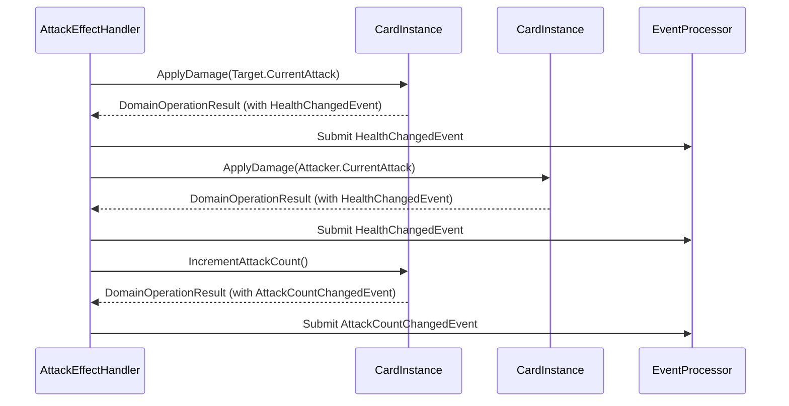

# 领域实体方法重构方案 (V1.0)

## 1. 概述

### 1.1. 背景与目标

当前项目的核心领域实体（`PlayerState`, `CardInstance`）内的方法存在职责不清、依赖混乱、流程与状态耦合等问题，这与项目核心设计文档（`04-01-游戏循环与队列处理设计.md`, `04-02-游戏事件系统详细设计.md`）中定义的事件驱动、职责分离的架构思想不符。

本方案旨在对这些领域实体的方法进行一次彻底的重构，使其回归“纯粹状态机”的本质。**核心目标**是：

1.  **实体纯化**：将领域实体改造为纯粹的状态容器，其方法仅负责原子化的自身状态变更。
2.  **逻辑上移**：将所有业务流程、复杂验证和实体间交互的逻辑，从实体内部完全剥离，并上移至 `EffectHandler` 层。
3.  **提升可测试性与可维护性**：通过上述重构，使领域实体变得极易进行单元测试，并让系统的逻辑流转更加清晰、可追溯。

### 1.2. 核心重构原则

1.  **单一职责原则**：领域实体的方法只负责一件事——修改自身状态并返回结果（`DomainOperationResult`）。
2.  **无外部依赖原则**：领域实体的方法内部严禁直接调用或依赖任何外部服务、管理器（Manager）、工厂（Factory）或其他的复杂领域实体（如 `GameState`）。所有必要的外部信息都应由 `EffectHandler` 处理并作为简单参数（如 `int`, `string`, `enum`）传入。
3.  **原子性原则**：每个公共方法都应代表一个不可再分的原子操作。例如，`TakeDamage` 应只处理“受到伤害”，而不应包含“如果死亡则如何”的逻辑。
4.  **事件驱动原则**：状态变更通过在 `DomainOperationResult` 中返回“事实事件”来通知外部系统，而不是通过直接调用其他方法。

## 2. 重构方案详解

### 2.1. `PlayerState.cs` 重构

#### 2.1.1. 待移除或重构的“业务流程”方法

以下方法将从 `PlayerState` 中被**彻底移除**或**重构为纯原子操作**。其原有逻辑将被迁移到新的或现有的 `EffectHandler` 中。

| 原方法名 | 问题分析 | 重构方案 |
| :--- | :--- | :--- |
| `DestroyCard(CardInstance, IMapper)` | 依赖 `IMapper`，执行了“从区域移除”和“移到墓地”两个流程。 | **移除此方法**。逻辑迁移至 `DestroyCardEffectHandler`。 |
| `PlayCard(CardInstance, List<Guid>)` | 包含扣费、移出手牌等多个原子操作，是典型的业务流程。 | **移除此方法**。逻辑迁移至 `PlayCardEffectHandler`。 |
| `EvolveCard(CardInstance, ICardRepository, GameState)` | 依赖 `ICardRepository` 和 `GameState`，执行了验证、消耗EP、进化卡牌等一系列流程。 | **移除此方法**。逻辑迁移至 `EvolveCardEffectHandler`。 |
| `EndTurn(GameContext, IMapper)` | 依赖 `GameContext` 和 `IMapper`，编排回合结束流程。 | **移除此方法**。逻辑迁移至 `EndTurnEffectHandler`。 |
| `PerformMulligan(...)` | 包含复杂的换牌、洗牌、抽牌、检查阶段转换等逻辑，是完整的Mulligan流程。 | **移除此方法**。逻辑迁移至 `MulliganEffectHandler`。 |
| `StartTurn(int, GameState, IMapper)` | 依赖 `GameState` 和 `IMapper`，编排回合开始流程（恢复PP、抽牌、重置单位）。 | **移除此方法**。逻辑迁移至 `StartTurnEffectHandler`。 |
| `ExecutePlayCard(CardInstance)` | 另一个版本的出牌流程，根据卡牌类型执行不同操作（召唤或进墓地）。 | **移除此方法**。逻辑迁移至 `PlayCardEffectHandler`。 |

#### 2.1.2. 待保留或优化的“原子操作”方法

以下方法将被保留，但会进行标准化和简化，确保其符合重构原则。

| 方法名 | 优化方向 |
| :--- | :--- |
| `ModifyPlayPoints(int)` | **保留**。已经是很好的原子操作。 |
| `ModifyMaxPlayPoints(int)` | **保留**。已经是很好的原子操作。 |
| `ModifyEvolutionPoints(int)` | **保留**。已经是很好的原子操作。 |
| `AddCard(CardInstance, CardZone, CardZone)` | **保留**。负责将卡牌添加到指定区域并更新状态，是核心原子操作。 |
| `RemoveCardFromZone(CardInstance, CardZone)` | **新增**。创建一个统一的、从指定区域移除卡牌的原子方法，返回 `DomainOperationResult`。 |
| `DrawCards(int)` | **重构**。内部逻辑简化，只负责循环调用 `RemoveCardFromZone(Deck)` 和 `AddCard(Hand)`，并处理牌库空和手牌满的情况。 |
| `AddCardsToHand(...)` | **重构**。简化为循环调用 `AddCard(Hand)`。 |
| `ResetUnitsForTurnStart()` | **重构**。此方法名不当，应拆分为 `ResetFieldUnitsAttackState()`，只负责重置场上单位的攻击状态。清理死亡单位的逻辑应由监听 `HealthChangedEvent` 的系统能力触发的 `DestroyEffect` 处理。 |
| `DiscardCard(...)` | **重构**。简化为调用 `RemoveCardFromZone(Hand)` 和 `AddCard(Graveyard)`。 |
| `ReturnCardToHand(...)` | **重构**。简化为调用 `RemoveCardFromZone(Field)` 和 `AddCard(Hand)`。 |

### 2.2. `CardInstance.cs` 重构

#### 2.2.1. 待移除或重构的“业务流程”方法

| 原方法名 | 问题分析 | 重构方案 |
| :--- | :--- | :--- |
| `CanPerformAttack(...)` / `CanEvolve(...)` | 包含对外部状态（`GameState`, `PlayerState`）的依赖和复杂验证。 | **移除这些方法**。验证逻辑完全上移到对应的 `AttackAbility` 和 `EvolveAbility` 的 `CheckConditionsAsync` 方法中。 |
| `PerformAttack(CardInstance)` / `AttackPlayer(PlayerState)` | 编排了完整的攻击和反击流程。 | **移除这些方法**。逻辑迁移至 `AttackEffectHandler`。该Handler将创建两个独立的 `DealDamageEffect`（攻击伤害和反击伤害）。 |
| `Evolve(CardDefinition)` | 包含了状态变更和“进化后可攻击”的副作用逻辑。 | **重构**。保留其核心的状态变更（修改攻防、血量、关键字），但移除 `CanAttack = true` 的副作用。进化后可攻击应由系统规则（`EvolveEvent` 触发）或进化后获得的新关键字（如`Rush`）来保证。 |
| `TakeDamage(int, CardInstance)` | 包含生成`DamageEvent`（意图）和调用`ApplyHealthChange`（执行）两个步骤。 | **重构**。更名为 `ApplyDamage(int, CardInstance)`，只负责计算并应用最终的生命值变化，并返回 `HealthChangedEvent`。`DamageEvent` 的创建由 `DealDamageEffectHandler` 负责。 |
| `Heal(int, CardInstance)` | 与 `TakeDamage` 类似。 | **重构**。更名为 `ApplyHeal(int, CardInstance)`，逻辑与 `ApplyDamage` 对应。 |
| `AddBuffAsync(...)` / `RemoveBuffsAsync(...)` | 严重违反依赖原则，直接依赖Manager/Factory。 | **移除这些方法**。逻辑完全迁移至 `AddBuffEffectHandler` 和 `RemoveBuffEffectHandler`。`CardInstance` 自身不应感知到Buff的存在，Buff的效果通过 `BuffManager` 监听事件并创建新的`Effect`来实现。 |

#### 2.2.2. 待保留或优化的“原子操作”方法

| 方法名 | 优化方向 |
| :--- | :--- |
| `ModifyStats(int atk, int health)` | **新增**。创建一个统一的、修改攻防/生命值上限的原子方法。 |
| `ApplyDamage(int, CardInstance)` | **新增/重构**。见上表。 |
| `ApplyHeal(int, CardInstance)` | **新增/重构**。见上表。 |
| `AddKeyword(...)` / `RemoveKeyword(...)` | **重构**。移除返回`bool`的旧版本，只保留返回`DomainOperationResult`的版本，并统一命名为 `AddKeyword` / `RemoveKeyword`。 |
| `SetSilenced(bool)` | **新增**。提供一个原子方法来设置沉默状态，并生成相应事件。 |
| `TickCountdown()` | **保留**。作为护符的核心原子操作。 |

## 3. 新的调用流程示例

以“攻击”流程为例，展示重构前后的变化。

### 3.1. 重构前 (伪代码)

```
// AttackEffectHandler
attacker.PerformAttack(target); // 一个方法调用包含了所有逻辑

// CardInstance.PerformAttack(target) 内部
this.AttacksThisTurn++;
target.TakeDamage(this.CurrentAttack, this); // 调用另一个实体的方法
this.TakeDamage(target.CurrentAttack, target); // 处理反击
return result;
```

### 3.2. 重构后 (伪代码)


**图例说明:** `AttackEffectHandler` 现在是流程的绝对主导者。它依次调用各个实体上纯粹的、原子化的方法（如`ApplyDamage`, `IncrementAttackCount`），收集它们返回的`DomainOperationResult`中的事件，并统一提交给`EventProcessor`，从而驱动后续的游戏逻辑。实体之间不再有直接的方法调用。

## 4. 实施计划

1.  **备份**: 在开始前确保项目代码已完全备份。
2.  **创建Effect Handlers**: 根据本方案，在 `Server/Domain/Abilities/Effects/Handlers/` 目录下创建或修改所需的 `EffectHandler` 类，用于承接上移的业务逻辑。
3.  **分步重构**:
    *   首先重构 `CardInstance.cs`，因为它处于依赖链的更底层。
    *   然后重构 `PlayerState.cs`。
    *   最后，更新所有调用了被修改或移除方法的 `EffectHandler`。
4.  **测试**: 对重构后的 `EffectHandler` 和领域实体编写单元测试，确保逻辑正确性。

本方案一经批准，即可进入实施阶段。