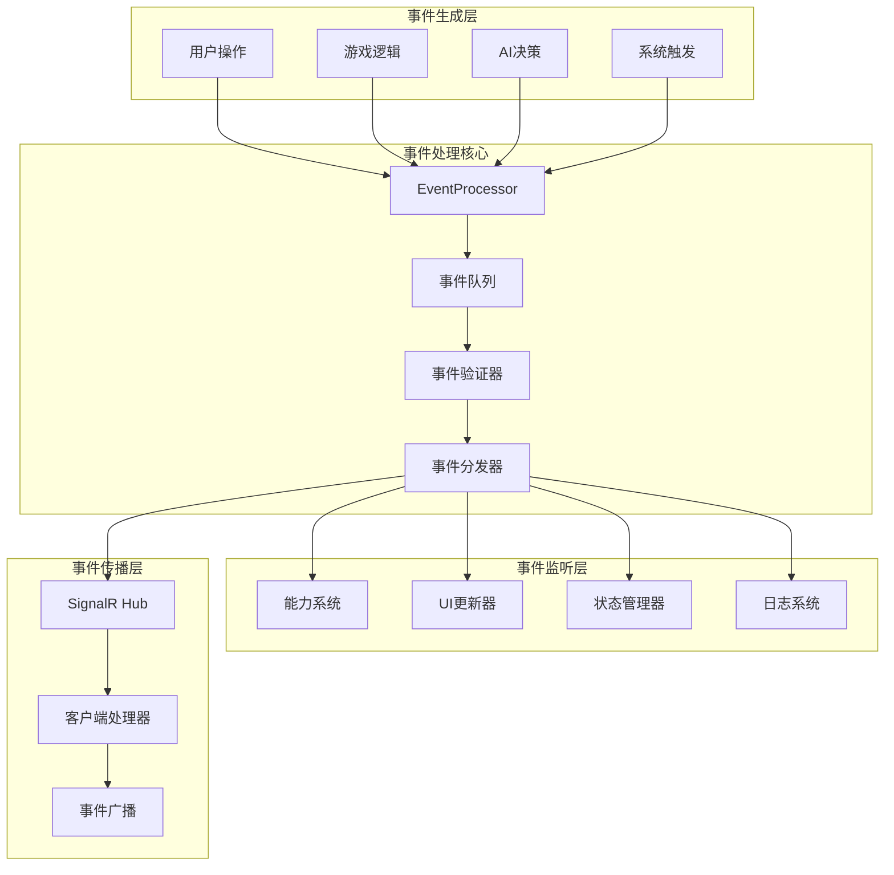
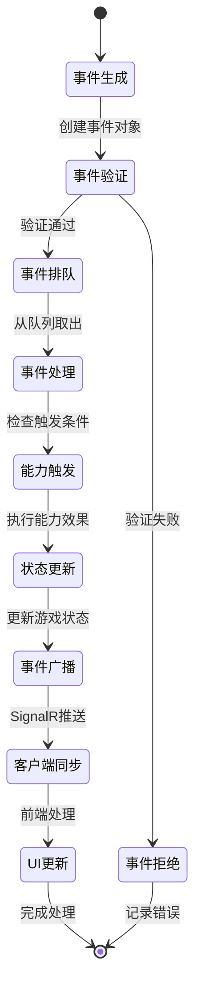

# 04-游戏事件系统 [COMPLETED]

## 目的与范围

本文档详细说明Shadowverse-beyond项目的完整事件驱动架构，包括事件定义、分类体系、处理机制、前后端同步以及与各子系统的集成。涵盖所有游戏行为的事件化处理流程。

## 核心概念

### 事件驱动架构原则
- **统一事件模型**: 所有游戏行为都通过事件表达
- **异步处理**: 事件的生成和处理完全解耦
- **可扩展性**: 新的事件类型可以无缝集成
- **状态一致性**: 通过事件确保前后端状态同步
- **可追溯性**: 完整的事件历史记录

### 事件分类体系
- **卡牌事件**: 出牌、召唤、进化、销毁相关
- **战斗事件**: 攻击、伤害、生命值变化
- **回合事件**: 回合开始、结束、阶段转换
- **资源事件**: PP/EP更新、牌堆变化
- **游戏状态事件**: 游戏开始、结束、玩家行动

## 架构概览

### 事件系统架构图



### 事件流转生命周期



## 实现细节

### 事件基础架构

#### 核心事件接口
```csharp
public interface IGameEvent
{
    string EventId { get; }
    string EventType { get; }
    string SourcePlayerId { get; }
    DateTime Timestamp { get; }
    Dictionary<string, object> EventData { get; }
}

public abstract class GameEventDto : IGameEvent
{
    public string EventId { get; init; } = Guid.NewGuid().ToString();
    public string EventType { get; init; } = string.Empty;
    public string SourcePlayerId { get; init; } = string.Empty;
    public DateTime Timestamp { get; init; } = DateTime.UtcNow;
    public virtual Dictionary<string, object> EventData { get; init; } = new();

    protected GameEventDto(string sourcePlayerId, string eventType)
    {
        SourcePlayerId = sourcePlayerId;
        EventType = eventType;
    }
}
```

#### EventProcessor核心实现
```csharp
public class EventProcessor
{
    private readonly ILogger<EventProcessor> _logger;
    private readonly IAbilityManager _abilityManager;
    private readonly Queue<IGameEvent> _eventQueue = new();
    private readonly List<IEventHandler> _eventHandlers = new();

    public async Task<List<IGameEvent>> ProcessEventAsync(IGameEvent gameEvent, GameContext context)
    {
        var resultEvents = new List<IGameEvent>();
        
        try
        {
            _logger.LogInformation("Processing event {EventType} from {SourcePlayer}", 
                gameEvent.EventType, gameEvent.SourcePlayerId);

            // 1. 验证事件
            if (!await ValidateEventAsync(gameEvent, context))
            {
                _logger.LogWarning("Event validation failed for {EventType}", gameEvent.EventType);
                return resultEvents;
            }

            // 2. 添加到处理队列
            _eventQueue.Enqueue(gameEvent);

            // 3. 处理队列中的所有事件
            while (_eventQueue.Count > 0)
            {
                var currentEvent = _eventQueue.Dequeue();
                var generatedEvents = await ProcessSingleEventAsync(currentEvent, context);
                
                // 4. 将生成的新事件加入队列
                foreach (var newEvent in generatedEvents)
                {
                    _eventQueue.Enqueue(newEvent);
                    resultEvents.Add(newEvent);
                }
            }

            return resultEvents;
        }
        catch (Exception ex)
        {
            _logger.LogError(ex, "Error processing event {EventType}", gameEvent.EventType);
            throw;
        }
    }

    private async Task<List<IGameEvent>> ProcessSingleEventAsync(IGameEvent gameEvent, GameContext context)
    {
        var generatedEvents = new List<IGameEvent>();

        // 1. 触发相关能力
        var abilityEvents = await _abilityManager.TriggerAbilitiesAsync(gameEvent, context);
        generatedEvents.AddRange(abilityEvents);

        // 2. 调用注册的事件处理器
        foreach (var handler in _eventHandlers)
        {
            if (handler.CanHandle(gameEvent))
            {
                var handlerEvents = await handler.HandleAsync(gameEvent, context);
                generatedEvents.AddRange(handlerEvents);
            }
        }

        return generatedEvents;
    }
}
```

### 卡牌相关事件

#### 卡牌出牌事件
```csharp
public class CardPlayedEventDto : GameEventDto
{
    public CardInstanceDto PlayedCard { get; init; } = null!;
    public string CardType { get; init; } = string.Empty;
    public string? TargetUid { get; init; }
    public int PPCost { get; init; }

    public CardPlayedEventDto(string sourcePlayerId, CardInstanceDto playedCard, string cardType, int ppCost)
        : base(sourcePlayerId, "CardPlayed")
    {
        PlayedCard = playedCard;
        CardType = cardType;
        PPCost = ppCost;
    }

    public override Dictionary<string, object> EventData => new()
    {
        ["PlayedCard"] = PlayedCard,
        ["CardType"] = CardType,
        ["TargetUid"] = TargetUid ?? string.Empty,
        ["PPCost"] = PPCost
    };
}
```

#### 单位召唤事件
```csharp
public class UnitSummonedEventDto : GameEventDto
{
    public CardInstanceDto SummonedUnit { get; init; } = null!;
    public int FieldPosition { get; init; }
    public bool IsEvolved { get; init; }

    public UnitSummonedEventDto(string sourcePlayerId, CardInstanceDto summonedUnit, int fieldPosition)
        : base(sourcePlayerId, "UnitSummoned")
    {
        SummonedUnit = summonedUnit;
        FieldPosition = fieldPosition;
        IsEvolved = summonedUnit.IsEvolved;
    }
}
```

#### 单位进化事件
```csharp
public class UnitEvolvedEventDto : GameEventDto
{
    public string UnitUid { get; init; } = string.Empty;
    public int AttackGain { get; init; }
    public int HealthGain { get; init; }
    public int EPCost { get; init; }

    public UnitEvolvedEventDto(string sourcePlayerId, string unitUid, int attackGain, int healthGain, int epCost)
        : base(sourcePlayerId, "UnitEvolved")
    {
        UnitUid = unitUid;
        AttackGain = attackGain;
        HealthGain = healthGain;
        EPCost = epCost;
    }
}
```

### 战斗相关事件

#### 攻击声明事件
```csharp
public class AttackDeclaredEventDto : GameEventDto
{
    public string AttackerUid { get; init; } = string.Empty;
    public string TargetUid { get; init; } = string.Empty;
    public int AttackValue { get; init; }
    public bool CanCounterAttack { get; init; }

    public AttackDeclaredEventDto(string sourcePlayerId, string attackerUid, string targetUid, int attackValue)
        : base(sourcePlayerId, "AttackDeclared")
    {
        AttackerUid = attackerUid;
        TargetUid = targetUid;
        AttackValue = attackValue;
        CanCounterAttack = DetermineCounterAttack(targetUid);
    }
}
```

#### 伤害处理事件
```csharp
public class DamageDealtEventDto : GameEventDto
{
    public string TargetUid { get; init; } = string.Empty;
    public int DamageAmount { get; init; }
    public string DamageSource { get; init; } = string.Empty;
    public string DamageType { get; init; } = "Combat"; // Combat, Spell, Ability
    public bool IsLethal { get; init; }

    public DamageDealtEventDto(string sourcePlayerId, string targetUid, int damageAmount, string damageSource)
        : base(sourcePlayerId, "DamageDealt")
    {
        TargetUid = targetUid;
        DamageAmount = damageAmount;
        DamageSource = damageSource;
        IsLethal = CheckIfLethal(targetUid, damageAmount);
    }
}
```

### 回合相关事件

#### 回合开始事件
```csharp
public class TurnStartedEventDto : GameEventDto
{
    public int TurnNumber { get; init; }
    public int MaxPP { get; init; }
    public int CurrentPP { get; init; }
    public int CardsDrawn { get; init; }
    public bool CanEvolveThisTurn { get; init; }

    public TurnStartedEventDto(string sourcePlayerId, int turnNumber, int maxPP, int currentPP, int cardsDrawn)
        : base(sourcePlayerId, "TurnStarted")
    {
        TurnNumber = turnNumber;
        MaxPP = maxPP;
        CurrentPP = currentPP;
        CardsDrawn = cardsDrawn;
        CanEvolveThisTurn = DetermineEvolveAvailability(sourcePlayerId, turnNumber);
    }
}
```

#### 回合结束事件
```csharp
public class TurnEndedEventDto : GameEventDto
{
    public int TurnNumber { get; init; }
    public string NextPlayerId { get; init; } = string.Empty;
    public List<string> TriggeredAbilities { get; init; } = new();

    public TurnEndedEventDto(string sourcePlayerId, int turnNumber, string nextPlayerId)
        : base(sourcePlayerId, "TurnEnded")
    {
        TurnNumber = turnNumber;
        NextPlayerId = nextPlayerId;
    }
}
```

### 资源相关事件

#### PP更新事件
```csharp
public class PPUpdateEventDto : GameEventDto
{
    public int CurrentPP { get; init; }
    public int MaxPP { get; init; }
    public int PPChange { get; init; }
    public string ChangeReason { get; init; } = string.Empty;

    public PPUpdateEventDto(string sourcePlayerId, int currentPP, int maxPP, int ppChange, string reason)
        : base(sourcePlayerId, "PPUpdate")
    {
        CurrentPP = currentPP;
        MaxPP = maxPP;
        PPChange = ppChange;
        ChangeReason = reason;
    }
}
```

#### EP更新事件
```csharp
public class EPUpdateEventDto : GameEventDto
{
    public int CurrentEP { get; init; }
    public int MaxEP { get; init; }
    public int EPChange { get; init; }
    public bool FirstTimeUnlock { get; init; }

    public EPUpdateEventDto(string sourcePlayerId, int currentEP, int maxEP, int epChange, bool firstTimeUnlock = false)
        : base(sourcePlayerId, "EPUpdate")
    {
        CurrentEP = currentEP;
        MaxEP = maxEP;
        EPChange = epChange;
        FirstTimeUnlock = firstTimeUnlock;
    }
}
```

### 前端事件处理系统

#### 事件监听器注册
```javascript
// 事件处理器映射
const eventHandlers = new Map([
    ['CardPlayed', handleCardPlayedEvent],
    ['UnitSummoned', handleUnitSummonedEvent],
    ['UnitEvolved', handleUnitEvolvedEvent],
    ['AttackDeclared', handleAttackDeclaredEvent],
    ['DamageDealt', handleDamageDealtEvent],
    ['TurnStarted', handleTurnStartedEvent],
    ['TurnEnded', handleTurnEndedEvent],
    ['PPUpdate', handlePPUpdateEvent],
    ['EPUpdate', handleEPUpdateEvent],
    ['GameOver', handleGameOverEvent]
]);

// SignalR事件监听器注册
export function registerEventHandlers(connection) {
    eventHandlers.forEach((handler, eventType) => {
        connection.on(eventType, (eventData) => {
            console.log(`Received ${eventType} event:`, eventData);
            try {
                handler(eventData);
                // 触发UI更新
                renderGame(gameState);
            } catch (error) {
                console.error(`Error handling ${eventType} event:`, error);
            }
        });
    });
}
```

#### 卡牌事件处理
```javascript
// 卡牌出牌事件处理
export function handleCardPlayedEvent(eventData) {
    const { SourcePlayerId, PlayedCard, CardType, PPCost } = eventData;
    const player = getPlayerState(SourcePlayerId);

    if (!player) {
        console.error(`Player not found: ${SourcePlayerId}`);
        return;
    }

    // 更新PP
    player.pp -= PPCost;

    // 根据卡牌类型处理
    switch (CardType) {
        case 'Follower':
            // 添加到战场
            player.field.push(PlayedCard);
            break;
        case 'Spell':
            // 法术直接进入墓地
            player.graveyard.push(PlayedCard);
            break;
        case 'Amulet':
            // 护符添加到战场
            player.amulets.push(PlayedCard);
            break;
    }

    // 播放出牌动画
    playCardAnimation(PlayedCard, CardType);

    // 更新UI显示
    updatePlayerResourceDisplay(SourcePlayerId);
    updateFieldDisplay(SourcePlayerId);
}

// 单位召唤事件处理
export function handleUnitSummonedEvent(eventData) {
    const { SourcePlayerId, SummonedUnit, FieldPosition } = eventData;
    const player = getPlayerState(SourcePlayerId);

    if (!player) return;

    // 确保单位在正确位置
    if (FieldPosition >= 0 && FieldPosition < player.field.length) {
        player.field[FieldPosition] = SummonedUnit;
    } else {
        player.field.push(SummonedUnit);
    }

    // 播放召唤特效
    playSummonEffect(SummonedUnit);

    // 更新战场显示
    updateFieldDisplay(SourcePlayerId);
}

// 单位进化事件处理
export function handleUnitEvolvedEvent(eventData) {
    const { SourcePlayerId, UnitUid, AttackGain, HealthGain, EPCost } = eventData;
    const player = getPlayerState(SourcePlayerId);

    if (!player) return;

    // 查找并更新单位
    const unit = findCardInstanceByUid(UnitUid);
    if (unit) {
        unit.currentAttack += AttackGain;
        unit.currentHealth += HealthGain;
        unit.maxHealth += HealthGain;
        unit.isEvolved = true;
        unit.canAttack = true; // 进化后可以立即攻击
    }

    // 更新玩家EP
    player.ep -= EPCost;

    // 播放进化特效
    playEvolutionEffect(unit);

    // 更新显示
    updatePlayerResourceDisplay(SourcePlayerId);
    updateUnitDisplay(unit);
}
```

#### 战斗事件处理
```javascript
// 攻击声明事件处理
export function handleAttackDeclaredEvent(eventData) {
    const { SourcePlayerId, AttackerUid, TargetUid, AttackValue } = eventData;

    const attacker = findCardInstanceByUid(AttackerUid);
    const target = findCardInstanceByUid(TargetUid);

    if (!attacker || !target) {
        console.error('Attacker or target not found for attack event');
        return;
    }

    // 标记攻击者已攻击
    attacker.canAttack = false;
    attacker.attacksMadeThisTurn = (attacker.attacksMadeThisTurn || 0) + 1;

    // 播放攻击动画
    playAttackAnimation(attacker, target, AttackValue);

    // 更新单位显示状态
    updateUnitDisplay(attacker);
}

// 伤害处理事件处理
export function handleDamageDealtEvent(eventData) {
    const { TargetUid, DamageAmount, DamageSource, DamageType, IsLethal } = eventData;

    const target = findCardInstanceByUid(TargetUid);
    if (!target) {
        console.error(`Damage target not found: ${TargetUid}`);
        return;
    }

    // 更新生命值
    target.currentHealth -= DamageAmount;

    // 播放伤害特效
    playDamageEffect(target, DamageAmount, DamageType);

    // 如果是致命伤害，播放销毁动画
    if (IsLethal) {
        playDestroyAnimation(target);
        // 从战场移除（实际移除由后续事件处理）
    }

    // 更新单位显示
    updateUnitDisplay(target);
}
```

#### 回合事件处理
```javascript
// 回合开始事件处理
export function handleTurnStartedEvent(eventData) {
    const { SourcePlayerId, TurnNumber, MaxPP, CurrentPP, CardsDrawn, CanEvolveThisTurn } = eventData;
    const player = getPlayerState(SourcePlayerId);

    if (!player) return;

    // 更新回合信息
    gameState.currentPlayerId = SourcePlayerId;
    gameState.turnNumber = TurnNumber;

    // 更新玩家资源
    player.maxPP = MaxPP;
    player.pp = CurrentPP;
    player.canEvolveThisTurn = CanEvolveThisTurn;

    // 重置战场单位攻击状态
    player.field.forEach(unit => {
        if (unit && !unit.summoned_this_turn) {
            unit.canAttack = true;
        }
    });

    // 播放回合开始特效
    playTurnStartEffect(SourcePlayerId);

    // 更新UI状态
    updateTurnIndicator(SourcePlayerId);
    updatePlayerResourceDisplay(SourcePlayerId);
    updateFieldDisplay(SourcePlayerId);

    // 如果是本地玩家回合，启用交互
    if (SourcePlayerId === gameState.localPlayerId) {
        enablePlayerInteraction();
    } else {
        disablePlayerInteraction();
    }
}

// 回合结束事件处理
export function handleTurnEndedEvent(eventData) {
    const { SourcePlayerId, TurnNumber, NextPlayerId } = eventData;

    // 清除选择状态
    clearAllSelections();

    // 播放回合结束特效
    playTurnEndEffect(SourcePlayerId);

    // 禁用当前玩家交互
    disablePlayerInteraction();

    console.log(`Turn ${TurnNumber} ended for ${SourcePlayerId}, next: ${NextPlayerId}`);
}
```

## 集成点

### 与卡牌能力系统集成

#### 能力触发事件监听
```csharp
public class AbilityEventHandler : IEventHandler
{
    private readonly IAbilityManager _abilityManager;

    public bool CanHandle(IGameEvent gameEvent)
    {
        // 所有事件都可能触发能力
        return true;
    }

    public async Task<List<IGameEvent>> HandleAsync(IGameEvent gameEvent, GameContext context)
    {
        var triggeredEvents = new List<IGameEvent>();

        // 获取所有可能被触发的能力
        var relevantAbilities = await _abilityManager.GetTriggeredAbilitiesAsync(gameEvent, context);

        foreach (var ability in relevantAbilities)
        {
            if (await ability.CanTriggerAsync(gameEvent, context))
            {
                var abilityEvents = await ability.ExecuteAsync(context);
                triggeredEvents.AddRange(abilityEvents);
            }
        }

        return triggeredEvents;
    }
}
```

### 与AI系统集成

#### AI事件响应
```csharp
public class AIEventHandler : IEventHandler
{
    private readonly IAIService _aiService;

    public bool CanHandle(IGameEvent gameEvent)
    {
        // AI只响应特定事件类型
        return gameEvent.EventType switch
        {
            "TurnStarted" => IsAIPlayer(gameEvent.SourcePlayerId),
            "AttackDeclared" => true, // AI需要分析攻击
            "CardPlayed" => true, // AI需要分析对手出牌
            _ => false
        };
    }

    public async Task<List<IGameEvent>> HandleAsync(IGameEvent gameEvent, GameContext context)
    {
        return gameEvent.EventType switch
        {
            "TurnStarted" => await HandleAITurnStart(gameEvent, context),
            "AttackDeclared" => await HandleAttackAnalysis(gameEvent, context),
            "CardPlayed" => await HandleOpponentCardAnalysis(gameEvent, context),
            _ => new List<IGameEvent>()
        };
    }
}
```

### SignalR事件广播

#### 事件广播机制
```csharp
public class SignalREventBroadcaster : IEventHandler
{
    private readonly IHubContext<GameHub> _hubContext;

    public async Task BroadcastEventAsync(string gameId, IGameEvent gameEvent)
    {
        var groupName = $"Game_{gameId}";

        // 根据事件类型选择广播方法
        switch (gameEvent.EventType)
        {
            case "CardPlayed":
                await _hubContext.Clients.Group(groupName)
                    .SendAsync("CardPlayed", gameEvent);
                break;

            case "AttackDeclared":
                await _hubContext.Clients.Group(groupName)
                    .SendAsync("AttackDeclared", gameEvent);
                break;

            case "TurnStarted":
                await _hubContext.Clients.Group(groupName)
                    .SendAsync("TurnStarted", gameEvent);
                break;

            default:
                // 通用事件广播
                await _hubContext.Clients.Group(groupName)
                    .SendAsync("GameEvent", gameEvent);
                break;
        }
    }
}
```

## 使用模式

### 事件驱动开发模式

#### 新事件类型添加流程
1. **定义事件DTO**: 继承`GameEventDto`基类
2. **注册事件处理器**: 实现`IEventHandler`接口
3. **前端监听器**: 在SignalR连接中注册
4. **UI响应逻辑**: 实现前端事件处理函数

```csharp
// 1. 定义新事件类型
public class CustomEventDto : GameEventDto
{
    public string CustomData { get; init; } = string.Empty;

    public CustomEventDto(string sourcePlayerId, string customData)
        : base(sourcePlayerId, "CustomEvent")
    {
        CustomData = customData;
    }
}

// 2. 实现事件处理器
public class CustomEventHandler : IEventHandler
{
    public bool CanHandle(IGameEvent gameEvent) => gameEvent.EventType == "CustomEvent";

    public async Task<List<IGameEvent>> HandleAsync(IGameEvent gameEvent, GameContext context)
    {
        // 处理自定义事件逻辑
        return new List<IGameEvent>();
    }
}
```

#### 事件链式处理
```csharp
public async Task<List<IGameEvent>> ProcessCardPlayChain(CardPlayedEventDto cardPlayedEvent, GameContext context)
{
    var eventChain = new List<IGameEvent> { cardPlayedEvent };

    // 1. 处理出牌事件
    var playEvents = await ProcessEventAsync(cardPlayedEvent, context);
    eventChain.AddRange(playEvents);

    // 2. 检查是否触发召唤事件
    if (cardPlayedEvent.CardType == "Follower")
    {
        var summonEvent = new UnitSummonedEventDto(
            cardPlayedEvent.SourcePlayerId,
            cardPlayedEvent.PlayedCard,
            GetFieldPosition(cardPlayedEvent.PlayedCard)
        );

        var summonEvents = await ProcessEventAsync(summonEvent, context);
        eventChain.AddRange(summonEvents);
    }

    // 3. 处理能力触发
    var abilityEvents = await ProcessTriggeredAbilities(eventChain, context);
    eventChain.AddRange(abilityEvents);

    return eventChain;
}
```

### 事件调试和监控

#### 事件日志记录
```csharp
public class EventLogger : IEventHandler
{
    private readonly ILogger<EventLogger> _logger;

    public bool CanHandle(IGameEvent gameEvent) => true; // 记录所有事件

    public async Task<List<IGameEvent>> HandleAsync(IGameEvent gameEvent, GameContext context)
    {
        _logger.LogInformation("Event: {EventType} | Source: {SourcePlayer} | Time: {Timestamp} | Data: {@EventData}",
            gameEvent.EventType,
            gameEvent.SourcePlayerId,
            gameEvent.Timestamp,
            gameEvent.EventData);

        return new List<IGameEvent>();
    }
}
```

#### 前端事件调试
```javascript
// 事件调试工具
export class EventDebugger {
    constructor() {
        this.eventHistory = [];
        this.isEnabled = false;
    }

    enable() {
        this.isEnabled = true;
        console.log("Event debugging enabled");
    }

    logEvent(eventType, eventData) {
        if (!this.isEnabled) return;

        const logEntry = {
            timestamp: new Date().toISOString(),
            type: eventType,
            data: eventData,
            gameState: JSON.parse(JSON.stringify(gameState)) // 深拷贝当前状态
        };

        this.eventHistory.push(logEntry);
        console.group(`🎮 Event: ${eventType}`);
        console.log("Data:", eventData);
        console.log("Game State:", logEntry.gameState);
        console.groupEnd();

        // 保持历史记录在合理范围内
        if (this.eventHistory.length > 100) {
            this.eventHistory.shift();
        }
    }

    getEventHistory(eventType = null) {
        if (eventType) {
            return this.eventHistory.filter(entry => entry.type === eventType);
        }
        return this.eventHistory;
    }

    exportHistory() {
        const blob = new Blob([JSON.stringify(this.eventHistory, null, 2)],
            { type: 'application/json' });
        const url = URL.createObjectURL(blob);
        const a = document.createElement('a');
        a.href = url;
        a.download = `event-history-${Date.now()}.json`;
        a.click();
        URL.revokeObjectURL(url);
    }
}

// 全局事件调试器实例
export const eventDebugger = new EventDebugger();
```

### 性能优化模式

#### 事件批处理
```csharp
public class EventBatchProcessor
{
    private readonly List<IGameEvent> _eventBatch = new();
    private readonly Timer _batchTimer;
    private const int BATCH_SIZE = 10;
    private const int BATCH_TIMEOUT_MS = 100;

    public void AddEvent(IGameEvent gameEvent)
    {
        _eventBatch.Add(gameEvent);

        if (_eventBatch.Count >= BATCH_SIZE)
        {
            ProcessBatch();
        }
        else
        {
            // 重置定时器
            _batchTimer.Change(BATCH_TIMEOUT_MS, Timeout.Infinite);
        }
    }

    private async void ProcessBatch()
    {
        if (_eventBatch.Count == 0) return;

        var batch = _eventBatch.ToList();
        _eventBatch.Clear();

        // 批量处理事件
        await ProcessEventBatchAsync(batch);
    }
}
```

#### 事件过滤和优化
```javascript
// 事件过滤器 - 避免不必要的UI更新
export class EventFilter {
    constructor() {
        this.lastUpdateTime = 0;
        this.pendingUpdates = new Set();
        this.updateThrottle = 16; // 60fps
    }

    shouldProcessEvent(eventType, eventData) {
        // 过滤重复的资源更新事件
        if (eventType === 'PPUpdate' || eventType === 'EPUpdate') {
            const key = `${eventType}_${eventData.SourcePlayerId}`;
            if (this.pendingUpdates.has(key)) {
                return false; // 跳过重复更新
            }
            this.pendingUpdates.add(key);

            // 延迟清除标记
            setTimeout(() => this.pendingUpdates.delete(key), this.updateThrottle);
        }

        return true;
    }

    throttleUIUpdate(callback) {
        const now = Date.now();
        if (now - this.lastUpdateTime >= this.updateThrottle) {
            this.lastUpdateTime = now;
            callback();
        } else {
            // 延迟执行
            setTimeout(() => {
                this.lastUpdateTime = Date.now();
                callback();
            }, this.updateThrottle - (now - this.lastUpdateTime));
        }
    }
}
```

## 状态标识

**[COMPLETED]** - 游戏事件系统已完全实现，包括完整的事件驱动架构、前后端事件同步、与各子系统的集成以及性能优化机制。

### 已实现功能
- ✅ 完整的事件分类体系和定义
- ✅ EventProcessor核心处理引擎
- ✅ 前端事件监听和处理机制
- ✅ SignalR实时事件广播
- ✅ 与卡牌能力系统的深度集成
- ✅ AI系统事件响应机制
- ✅ 事件调试和监控工具
- ✅ 性能优化和批处理机制

### 系统特点
- **统一性**: 所有游戏行为都通过事件表达
- **可扩展性**: 新事件类型可以无缝添加
- **实时性**: SignalR确保事件即时同步
- **可靠性**: 完整的错误处理和恢复机制
- **可观测性**: 全面的日志记录和调试支持
