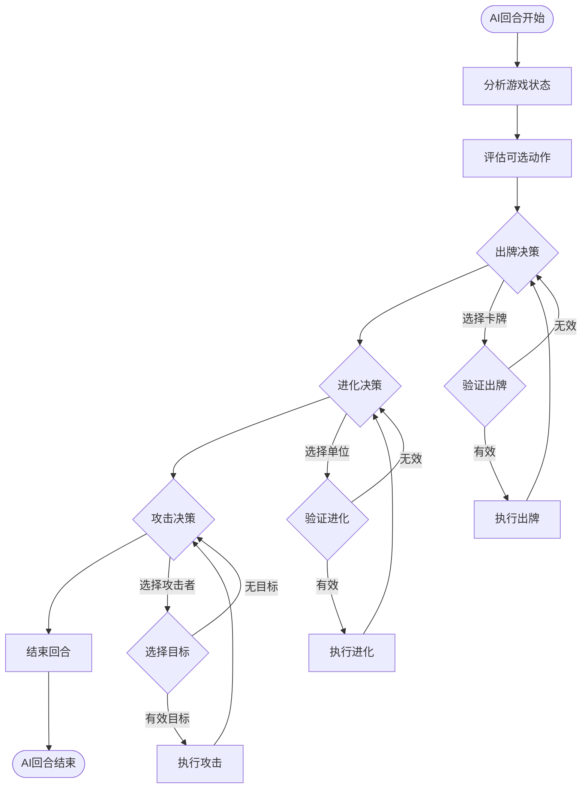
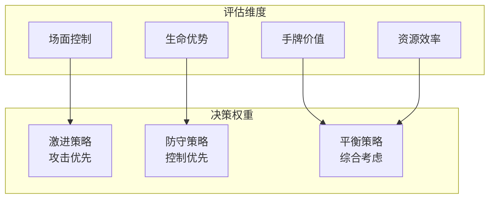

# 05-AI决策系统 [COMPLETED]

## 目的与范围

本文档详细说明Shadowverse-beyond项目的AI决策系统实现，包括AI决策算法、策略评估、动作选择、难度调节以及与游戏系统的完整集成。

## 核心概念

### AI设计原则
- **智能决策**: 基于游戏状态的合理决策
- **策略多样性**: 支持不同的AI策略和风格
- **性能优化**: 高效的决策算法和计算
- **可调节性**: 支持不同难度级别的AI

### AI决策类型
- **出牌决策**: 选择最优的卡牌出牌
- **攻击决策**: 选择攻击目标和时机
- **进化决策**: 选择进化的单位和时机
- **换牌决策**: 起手换牌的策略选择

## 架构概览

### AI决策流程图



### AI评估系统



## 实现细节

### 后端AI服务

#### AI决策入口
```csharp
public class AiService : IAiService
{
    private readonly ILogger<AiService> _logger;
    private readonly ICardRepository _cardRepository;
    private readonly Dictionary<string, IAiStrategy> _strategies;
    
    public AiService(ILogger<AiService> logger, ICardRepository cardRepository)
    {
        _logger = logger;
        _cardRepository = cardRepository;
        _strategies = new Dictionary<string, IAiStrategy>
        {
            ["Aggressive"] = new AggressiveStrategy(),
            ["Defensive"] = new DefensiveStrategy(),
            ["Balanced"] = new BalancedStrategy()
        };
    }
    
    public async Task ExecuteAiTurnAsync(string gameId, string aiPlayerId, GameStateDto gameState)
    {
        _logger.LogInformation("AI {PlayerId} starting turn in game {GameId}", aiPlayerId, gameId);
        
        var aiPlayer = gameState.Players.FirstOrDefault(p => p.PlayerId == aiPlayerId);
        if (aiPlayer == null) return;
        
        // 选择AI策略
        var strategy = SelectStrategy(aiPlayer, gameState);
        
        try
        {
            // 执行AI决策序列
            await ExecutePlayCardDecisions(strategy, aiPlayer, gameState);
            await ExecuteEvolveDecisions(strategy, aiPlayer, gameState);
            await ExecuteAttackDecisions(strategy, aiPlayer, gameState);
            
            // 延迟后结束回合
            await Task.Delay(2000);
            await EndAiTurn(gameId, aiPlayerId);
            
        }
        catch (Exception ex)
        {
            _logger.LogError(ex, "AI turn execution failed for player {PlayerId}", aiPlayerId);
        }
    }
    
    private IAiStrategy SelectStrategy(PlayerStateDto aiPlayer, GameStateDto gameState)
    {
        // 根据游戏状态动态选择策略
        var opponent = gameState.Players.FirstOrDefault(p => p.PlayerId != aiPlayer.PlayerId);
        if (opponent == null) return _strategies["Balanced"];
        
        var healthDifference = aiPlayer.Health - opponent.Health;
        var fieldAdvantage = aiPlayer.Field.Count - opponent.Field.Count;
        
        if (healthDifference < -5 || fieldAdvantage < -2)
        {
            return _strategies["Aggressive"]; // 劣势时激进
        }
        else if (healthDifference > 5 && fieldAdvantage > 1)
        {
            return _strategies["Defensive"]; // 优势时保守
        }
        else
        {
            return _strategies["Balanced"]; // 平衡策略
        }
    }
}
```

#### 出牌决策算法
```csharp
public class PlayCardDecisionEngine
{
    public async Task<PlayCardDecision?> DecideCardToPlay(IAiStrategy strategy, 
        PlayerStateDto aiPlayer, GameStateDto gameState)
    {
        var playableCards = GetPlayableCards(aiPlayer);
        if (!playableCards.Any()) return null;
        
        var decisions = new List<PlayCardDecision>();
        
        foreach (var card in playableCards)
        {
            var decision = await EvaluateCardPlay(strategy, card, aiPlayer, gameState);
            if (decision != null)
            {
                decisions.Add(decision);
            }
        }
        
        // 按评分排序，选择最高分的决策
        return decisions.OrderByDescending(d => d.Score).FirstOrDefault();
    }
    
    private async Task<PlayCardDecision?> EvaluateCardPlay(IAiStrategy strategy, 
        CardInstance card, PlayerStateDto aiPlayer, GameStateDto gameState)
    {
        var cardDef = await _cardRepository.GetCardDefinitionByIdAsync(card.DefinitionId);
        if (cardDef == null) return null;
        
        var decision = new PlayCardDecision
        {
            Card = card,
            CardDefinition = cardDef
        };
        
        // 基础评分
        decision.Score = CalculateBaseScore(card, cardDef, aiPlayer);
        
        // 策略修正
        decision.Score = strategy.AdjustPlayCardScore(decision.Score, card, cardDef, gameState);
        
        // 类型特定评估
        switch (cardDef.CardType)
        {
            case "Follower":
                decision.Score += EvaluateFollowerPlay(card, cardDef, aiPlayer, gameState);
                break;
            case "Spell":
                var spellDecision = EvaluateSpellPlay(card, cardDef, aiPlayer, gameState);
                decision.Score += spellDecision.Score;
                decision.Target = spellDecision.Target;
                break;
        }
        
        return decision.Score > 0 ? decision : null;
    }
    
    private float CalculateBaseScore(CardInstance card, CardDefinition cardDef, PlayerStateDto aiPlayer)
    {
        // 基础评分考虑：
        // 1. 费用效率 (攻击力+生命值)/费用
        // 2. 当前PP利用率
        // 3. 手牌数量压力
        
        float efficiencyScore = 0;
        if (cardDef.Cost > 0)
        {
            efficiencyScore = (float)(cardDef.Attack + cardDef.Health) / cardDef.Cost;
        }
        
        float ppUtilizationScore = (float)cardDef.Cost / Math.Max(aiPlayer.PP, 1);
        float handPressureScore = aiPlayer.Hand.Count > 7 ? 2.0f : 0;
        
        return efficiencyScore + ppUtilizationScore + handPressureScore;
    }
}

public class PlayCardDecision
{
    public CardInstance Card { get; set; } = null!;
    public CardDefinition CardDefinition { get; set; } = null!;
    public float Score { get; set; }
    public CardInstance? Target { get; set; }
}
```

#### 攻击决策算法
```csharp
public class AttackDecisionEngine
{
    public List<AttackDecision> DecideAttacks(IAiStrategy strategy, 
        PlayerStateDto aiPlayer, GameStateDto gameState)
    {
        var decisions = new List<AttackDecision>();
        var opponent = gameState.Players.FirstOrDefault(p => p.PlayerId != aiPlayer.PlayerId);
        if (opponent == null) return decisions;
        
        var attackers = aiPlayer.Field.Where(unit => unit.CanAttack).ToList();
        
        foreach (var attacker in attackers)
        {
            var decision = DecideAttackTarget(strategy, attacker, opponent, gameState);
            if (decision != null)
            {
                decisions.Add(decision);
            }
        }
        
        // 按优先级排序攻击
        return decisions.OrderByDescending(d => d.Priority).ToList();
    }
    
    private AttackDecision? DecideAttackTarget(IAiStrategy strategy, CardInstance attacker, 
        PlayerStateDto opponent, GameStateDto gameState)
    {
        var possibleTargets = new List<AttackTarget>();
        
        // 添加敌方随从作为目标
        foreach (var enemyUnit in opponent.Field)
        {
            var target = new AttackTarget
            {
                Target = enemyUnit,
                Type = AttackTargetType.Unit,
                Priority = CalculateUnitAttackPriority(attacker, enemyUnit)
            };
            possibleTargets.Add(target);
        }
        
        // 添加敌方玩家作为目标
        var playerTarget = new AttackTarget
        {
            Target = null, // 表示攻击玩家
            Type = AttackTargetType.Player,
            Priority = CalculatePlayerAttackPriority(attacker, opponent, gameState)
        };
        possibleTargets.Add(playerTarget);
        
        // 策略调整优先级
        foreach (var target in possibleTargets)
        {
            target.Priority = strategy.AdjustAttackPriority(target.Priority, attacker, target, gameState);
        }
        
        // 选择最高优先级的目标
        var bestTarget = possibleTargets.OrderByDescending(t => t.Priority).FirstOrDefault();
        
        if (bestTarget != null && bestTarget.Priority > 0)
        {
            return new AttackDecision
            {
                Attacker = attacker,
                Target = bestTarget.Target,
                Priority = bestTarget.Priority
            };
        }
        
        return null;
    }
    
    private float CalculateUnitAttackPriority(CardInstance attacker, CardInstance defender)
    {
        // 计算攻击单位的优先级
        float priority = 0;
        
        // 1. 能否击杀敌方单位
        if (attacker.CurrentAttack >= defender.CurrentHealth)
        {
            priority += 10.0f; // 击杀奖励
            priority += defender.CurrentAttack; // 移除威胁价值
        }
        
        // 2. 交换价值
        float tradeValue = (float)defender.CurrentAttack / Math.Max(attacker.CurrentHealth, 1);
        priority += tradeValue;
        
        // 3. 威胁等级
        if (defender.CurrentAttack >= attacker.CurrentHealth)
        {
            priority += 5.0f; // 移除威胁
        }
        
        return priority;
    }
}

public class AttackDecision
{
    public CardInstance Attacker { get; set; } = null!;
    public CardInstance? Target { get; set; } // null表示攻击玩家
    public float Priority { get; set; }
}
```

### 前端AI集成

#### AI回合执行
```javascript
// AI回合执行入口
export function executeAITurn(aiPlayer, currentGameState) {
    console.log(`AI: Starting turn for ${aiPlayer.id}`);
    
    try {
        // 显示AI思考状态
        showAIThinking(aiPlayer.id);
        
        // 执行AI决策序列
        setTimeout(() => executeAIPlayCards(aiPlayer, currentGameState), 1000);
        
    } catch (error) {
        console.error("AI: Error during turn execution:", error);
        // 出错时直接结束回合
        setTimeout(() => endAITurn(), 2000);
    }
}

// AI出牌决策
function executeAIPlayCards(aiPlayer, gameState) {
    const playableCards = getPlayableCards(aiPlayer);
    
    if (playableCards.length === 0) {
        console.log("AI: No playable cards, proceeding to evolve phase");
        setTimeout(() => executeAIEvolve(aiPlayer, gameState), 500);
        return;
    }
    
    // 选择最优卡牌
    const cardToPlay = selectBestCard(playableCards, aiPlayer, gameState);
    
    if (cardToPlay) {
        console.log(`AI: Playing card ${cardToPlay.name}`);
        
        try {
            const playCardActionData = {
                actionType: "PlayCard",
                cardUid: cardToPlay.uid,
                targetUid: selectSpellTarget(cardToPlay, gameState)
            };
            
            sendGameAction(playCardActionData);
            
            // 继续出牌决策
            setTimeout(() => executeAIPlayCards(aiPlayer, gameState), 1500);
            
        } catch (error) {
            console.error(`AI: Error playing card ${cardToPlay.name}:`, error);
            setTimeout(() => executeAIEvolve(aiPlayer, gameState), 500);
        }
    } else {
        setTimeout(() => executeAIEvolve(aiPlayer, gameState), 500);
    }
}

// AI卡牌选择算法
function selectBestCard(playableCards, aiPlayer, gameState) {
    let bestCard = null;
    let bestScore = -1;
    
    for (const card of playableCards) {
        const score = evaluateCardPlay(card, aiPlayer, gameState);
        
        if (score > bestScore) {
            bestScore = score;
            bestCard = card;
        }
    }
    
    return bestScore > 0 ? bestCard : null;
}

function evaluateCardPlay(card, aiPlayer, gameState) {
    let score = 0;
    
    // 基础评分：费用效率
    if (card.cost > 0) {
        score += (card.currentAttack + card.currentHealth) / card.cost;
    }
    
    // PP利用率
    score += card.cost / Math.max(aiPlayer.pp, 1);
    
    // 手牌压力
    if (aiPlayer.hand.length > 7) {
        score += 2;
    }
    
    // 类型特定评分
    switch (card.type) {
        case 'Follower':
            score += evaluateFollowerPlay(card, aiPlayer, gameState);
            break;
        case 'Spell':
            score += evaluateSpellPlay(card, aiPlayer, gameState);
            break;
    }
    
    return score;
}

function evaluateFollowerPlay(card, aiPlayer, gameState) {
    let score = 0;
    
    // 战场空间检查
    if (aiPlayer.field.length >= 5) {
        return -10; // 无法出牌
    }
    
    // 场面控制价值
    const opponent = getOpponentPlayer(aiPlayer.id);
    if (opponent && opponent.field.length > aiPlayer.field.length) {
        score += 3; // 需要场面
    }
    
    // 攻击力价值
    score += card.currentAttack * 0.5;
    
    return score;
}
```

### AI策略系统

#### 策略接口定义
```csharp
public interface IAiStrategy
{
    string Name { get; }
    float AdjustPlayCardScore(float baseScore, CardInstance card, CardDefinition cardDef, GameStateDto gameState);
    float AdjustAttackPriority(float basePriority, CardInstance attacker, AttackTarget target, GameStateDto gameState);
    float AdjustEvolvePriority(float basePriority, CardInstance unit, GameStateDto gameState);
}

public class AggressiveStrategy : IAiStrategy
{
    public string Name => "Aggressive";
    
    public float AdjustPlayCardScore(float baseScore, CardInstance card, CardDefinition cardDef, GameStateDto gameState)
    {
        // 激进策略偏好高攻击力单位
        if (cardDef.CardType == "Follower")
        {
            baseScore += cardDef.Attack * 0.3f;
        }
        
        // 偏好低费用快速展开
        if (cardDef.Cost <= 3)
        {
            baseScore += 1.0f;
        }
        
        return baseScore;
    }
    
    public float AdjustAttackPriority(float basePriority, CardInstance attacker, AttackTarget target, GameStateDto gameState)
    {
        // 激进策略优先攻击玩家
        if (target.Type == AttackTargetType.Player)
        {
            basePriority += 3.0f;
        }
        
        return basePriority;
    }
    
    public float AdjustEvolvePriority(float basePriority, CardInstance unit, GameStateDto gameState)
    {
        // 激进策略优先进化高攻击力单位
        basePriority += unit.CurrentAttack * 0.2f;
        return basePriority;
    }
}
```

## 集成点

### AI难度调节
```csharp
public class AiDifficultyManager
{
    public enum AiDifficulty
    {
        Easy,
        Normal,
        Hard,
        Expert
    }
    
    public static IAiStrategy CreateStrategyForDifficulty(AiDifficulty difficulty)
    {
        return difficulty switch
        {
            AiDifficulty.Easy => new EasyAiStrategy(),
            AiDifficulty.Normal => new BalancedStrategy(),
            AiDifficulty.Hard => new HardAiStrategy(),
            AiDifficulty.Expert => new ExpertAiStrategy(),
            _ => new BalancedStrategy()
        };
    }
}

public class EasyAiStrategy : IAiStrategy
{
    public string Name => "Easy";
    
    // 简单AI：随机性更高，决策不够优化
    public float AdjustPlayCardScore(float baseScore, CardInstance card, CardDefinition cardDef, GameStateDto gameState)
    {
        // 添加随机因子
        var random = new Random();
        return baseScore + (float)(random.NextDouble() - 0.5) * 2;
    }
    
    // 其他方法类似添加随机性...
}
```

## 使用模式

### AI性能监控
```javascript
class AIPerformanceMonitor {
    constructor() {
        this.metrics = {
            decisionTime: [],
            winRate: 0,
            averageGameLength: 0,
            strategiesUsed: {}
        };
    }
    
    recordDecision(decisionType, startTime, endTime) {
        const duration = endTime - startTime;
        this.metrics.decisionTime.push({
            type: decisionType,
            duration: duration,
            timestamp: Date.now()
        });
        
        // 保持最近100个决策记录
        if (this.metrics.decisionTime.length > 100) {
            this.metrics.decisionTime.shift();
        }
    }
    
    getAverageDecisionTime(decisionType = null) {
        let relevantDecisions = this.metrics.decisionTime;
        
        if (decisionType) {
            relevantDecisions = relevantDecisions.filter(d => d.type === decisionType);
        }
        
        if (relevantDecisions.length === 0) return 0;
        
        const totalTime = relevantDecisions.reduce((sum, d) => sum + d.duration, 0);
        return totalTime / relevantDecisions.length;
    }
    
    generateReport() {
        return {
            averageDecisionTime: this.getAverageDecisionTime(),
            playCardTime: this.getAverageDecisionTime('PlayCard'),
            attackTime: this.getAverageDecisionTime('Attack'),
            evolveTime: this.getAverageDecisionTime('Evolve'),
            totalDecisions: this.metrics.decisionTime.length
        };
    }
}

// 全局AI性能监控器
const aiMonitor = new AIPerformanceMonitor();
```

## 状态标识

**[COMPLETED]** - AI决策系统已完全实现，包括多策略支持、智能决策算法和性能优化。

### 已实现功能
- ✅ 完整的AI决策流程
- ✅ 多种AI策略 (激进、防守、平衡)
- ✅ 智能出牌决策算法
- ✅ 攻击目标选择系统
- ✅ 进化时机判断
- ✅ 难度等级调节
- ✅ 性能监控和优化

### 技术特点
- **智能决策**: 基于游戏状态的合理判断
- **策略多样**: 支持不同风格的AI行为
- **性能优化**: 高效的决策算法
- **可扩展性**: 易于添加新的策略和算法

### 未来扩展
- 机器学习集成
- 更复杂的策略组合
- 玩家行为学习
- 动态难度调整
