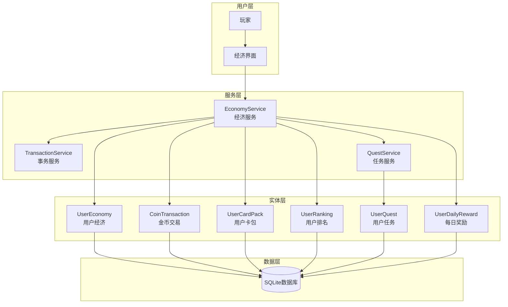
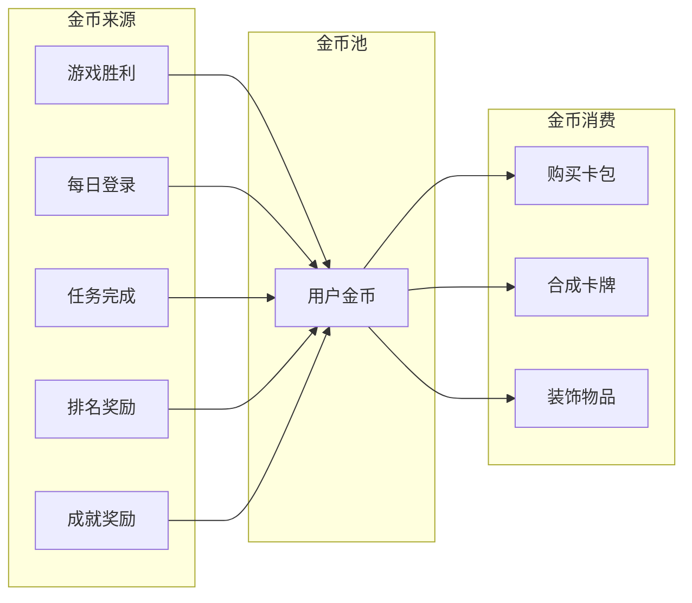
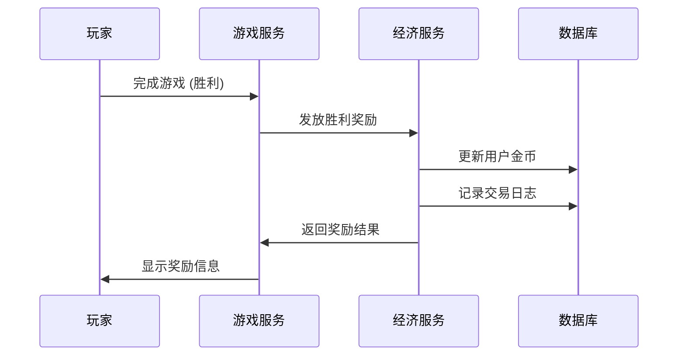

# 06-经济系统 [COMPLETED]

## 目的与范围

本文档详细说明Shadowverse-beyond项目的经济系统实现，包括金币管理、卡包系统、排名奖励、任务系统以及完整的用户经济生态。遵循现代卡牌游戏的经济设计模式，提供可持续的游戏体验。

## 核心概念

### 经济系统组成
- **金币系统**: 主要游戏货币，用于购买卡包和其他物品
- **卡包系统**: 随机卡牌获取机制，包含稀有度和保底机制
- **排名系统**: 基于胜负的天梯排名和季度奖励
- **任务系统**: 日常、周常和特殊事件任务
- **每日奖励**: 连续登录奖励机制

### 关键术语
- **CoinTransaction**: 金币交易记录
- **UserEconomy**: 用户经济状态
- **CardPack**: 卡包实体
- **UserRanking**: 用户排名信息
- **Quest**: 任务系统
- **DailyReward**: 每日奖励

## 架构概览

### 经济系统架构



### 金币流转图



## 实现细节

### EconomyService - 经济服务核心

<augment_code_snippet path="Server/Services/EconomyService.cs" mode="EXCERPT">
````csharp
public class EconomyService : IEconomyService
{
    public async Task<bool> AddCoinsAsync(Guid userId, int amount, 
        CoinTransactionType type, string? description = null, string? relatedEntityId = null)
    {
        using var transaction = await _context.Database.BeginTransactionAsync();
        try
        {
            // 获取用户经济信息
            var userEconomy = await GetOrCreateUserEconomyAsync(userId);

            // 更新金币
            userEconomy.Coins += amount;
            userEconomy.UpdatedAt = DateTime.UtcNow;

            // 记录交易
            var coinTransaction = new CoinTransaction
            {
                Id = Guid.NewGuid(),
                UserId = userId,
                Amount = amount,
                Type = type,
                Description = description,
                RelatedEntityId = relatedEntityId,
                CreatedAt = DateTime.UtcNow
            };

            _context.CoinTransactions.Add(coinTransaction);
            await _context.SaveChangesAsync();
            await transaction.CommitAsync();

            _logger.LogInformation("成功添加金币: UserId={UserId}, Amount={Amount}, Type={Type}", 
                userId, amount, type);
            return true;
        }
        catch (Exception ex)
        {
            await transaction.RollbackAsync();
            _logger.LogError(ex, "添加金币失败: UserId={UserId}, Amount={Amount}", userId, amount);
            return false;
        }
    }

    public async Task<bool> SpendCoinsAsync(Guid userId, int amount, 
        CoinTransactionType type, string? description = null, string? relatedEntityId = null)
    {
        if (amount <= 0) return false;

        using var transaction = await _context.Database.BeginTransactionAsync();
        try
        {
            var userEconomy = await GetOrCreateUserEconomyAsync(userId);

            // 检查余额
            if (userEconomy.Coins < amount)
            {
                _logger.LogWarning("金币不足: UserId={UserId}, Required={Amount}, Available={Available}", 
                    userId, amount, userEconomy.Coins);
                return false;
            }

            // 扣除金币
            userEconomy.Coins -= amount;
            userEconomy.UpdatedAt = DateTime.UtcNow;

            // 记录交易 (负数表示支出)
            var coinTransaction = new CoinTransaction
            {
                Id = Guid.NewGuid(),
                UserId = userId,
                Amount = -amount,
                Type = type,
                Description = description,
                RelatedEntityId = relatedEntityId,
                CreatedAt = DateTime.UtcNow
            };

            _context.CoinTransactions.Add(coinTransaction);
            await _context.SaveChangesAsync();
            await transaction.CommitAsync();

            return true;
        }
        catch (Exception ex)
        {
            await transaction.RollbackAsync();
            _logger.LogError(ex, "扣除金币失败: UserId={UserId}, Amount={Amount}", userId, amount);
            return false;
        }
    }
}
````
</augment_code_snippet>

### 卡包系统实现

<augment_code_snippet path="Server/Services/EconomyService.cs" mode="EXCERPT">
````csharp
public async Task<CardPackOpenResultDto?> OpenCardPackAsync(Guid userId, Guid cardPackId)
{
    using var transaction = await _context.Database.BeginTransactionAsync();
    try
    {
        // 获取用户卡包
        var userCardPack = await _context.UserCardPacks
            .Include(ucp => ucp.Cards)
            .FirstOrDefaultAsync(ucp => ucp.Id == cardPackId && ucp.UserId == userId);

        if (userCardPack == null || userCardPack.IsOpened)
        {
            return null;
        }

        // 标记为已开启
        userCardPack.IsOpened = true;
        userCardPack.OpenedAt = DateTime.UtcNow;

        // 生成卡牌 (如果还没有生成)
        if (!userCardPack.Cards.Any())
        {
            await GenerateCardPackContentsAsync(userCardPack);
        }

        await _context.SaveChangesAsync();
        await transaction.CommitAsync();

        // 返回开包结果
        return new CardPackOpenResultDto
        {
            CardPackId = cardPackId,
            Cards = userCardPack.Cards.Select(c => new CardInstanceDto
            {
                InstanceId = c.Id.ToString(),
                DefinitionId = c.CardDefinitionId,
                // 其他属性映射...
            }).ToList(),
            OpenedAt = userCardPack.OpenedAt.Value
        };
    }
    catch (Exception ex)
    {
        await transaction.RollbackAsync();
        _logger.LogError(ex, "开启卡包失败: UserId={UserId}, CardPackId={CardPackId}", 
            userId, cardPackId);
        return null;
    }
}

private async Task GenerateCardPackContentsAsync(UserCardPack cardPack)
{
    // 实现卡包内容生成逻辑
    // 包含稀有度分布、保底机制等
    var cardDefinitions = await GetRandomCardsForPackAsync(cardPack.PackType);
    
    foreach (var cardDef in cardDefinitions)
    {
        var userCard = new UserCard
        {
            Id = Guid.NewGuid(),
            UserId = cardPack.UserId,
            CardDefinitionId = cardDef.Id,
            CardPackId = cardPack.Id,
            ObtainedAt = DateTime.UtcNow
        };
        
        cardPack.Cards.Add(userCard);
    }
}
````
</augment_code_snippet>

### 每日奖励系统

<augment_code_snippet path="Server/Services/EconomyService.cs" mode="EXCERPT">
````csharp
public async Task<DailyRewardDto?> ClaimDailyRewardAsync(Guid userId)
{
    try
    {
        // 获取或创建用户每日奖励记录
        var userDailyReward = await GetOrCreateUserDailyRewardAsync(userId);

        if (!userDailyReward.CanClaimDailyReward())
        {
            _logger.LogWarning("用户今日已领取每日奖励: UserId={UserId}", userId);
            return null;
        }

        // 领取奖励并获得金币数量
        var totalReward = userDailyReward.ClaimDailyReward();

        // 发放奖励
        await AddCoinsAsync(userId, totalReward, CoinTransactionType.DailyLoginBonus,
            $"每日登录奖励 (连续{userDailyReward.ConsecutiveDays}天)");

        await _context.SaveChangesAsync();

        _logger.LogInformation("用户领取每日奖励: UserId={UserId}, Reward={Reward}, Streak={Streak}",
            userId, totalReward, userDailyReward.ConsecutiveDays);

        return DailyRewardDto.Create(userId, totalReward, userDailyReward.ConsecutiveDays);
    }
    catch (Exception ex)
    {
        _logger.LogError(ex, "领取每日奖励失败: UserId={UserId}", userId);
        return null;
    }
}
````
</augment_code_snippet>

### 用户经济实体设计

<augment_code_snippet path="Server/Domain/Entities/UserEconomy.cs" mode="EXCERPT">
````csharp
/// <summary>
/// 用户经济实体 - 存储用户的经济信息
/// </summary>
public class UserEconomy
{
    public Guid Id { get; set; }
    public Guid UserId { get; set; }
    public int Coins { get; set; } = 1000; // 初始金币
    public DateTime CreatedAt { get; set; } = DateTime.UtcNow;
    public DateTime UpdatedAt { get; set; } = DateTime.UtcNow;

    // 导航属性
    public User User { get; set; } = null!;
    public List<CoinTransaction> CoinTransactions { get; set; } = new();
    public List<UserCardPack> CardPacks { get; set; } = new();
    public UserRanking? Ranking { get; set; }
    public UserDailyReward? DailyReward { get; set; }
    public List<UserQuest> Quests { get; set; } = new();

    /// <summary>
    /// 检查是否有足够的金币
    /// </summary>
    public bool HasSufficientCoins(int amount) => Coins >= amount;

    /// <summary>
    /// 更新时间戳
    /// </summary>
    public void UpdateTimestamp() => UpdatedAt = DateTime.UtcNow;
}
````
</augment_code_snippet>

## 集成点

### 金币交易类型

```csharp
public enum CoinTransactionType
{
    GameVictory,           // 游戏胜利
    DailyLoginBonus,       // 每日登录奖励
    QuestCompletion,       // 任务完成
    RankingReward,         // 排名奖励
    AchievementReward,     // 成就奖励
    CardPackPurchase,      // 购买卡包
    CardCrafting,          // 合成卡牌
    CosmeticPurchase,      // 购买装饰
    AdminGrant,            // 管理员发放
    AdminDeduct            // 管理员扣除
}
```

### 经济事件流程



### 卡包稀有度配置

```csharp
public class PackRarityConfig
{
    public static readonly Dictionary<CardRarity, double> StandardPackRates = new()
    {
        { CardRarity.Bronze, 0.70 },    // 70% 青铜
        { CardRarity.Silver, 0.25 },    // 25% 白银
        { CardRarity.Gold, 0.04 },      // 4% 黄金
        { CardRarity.Legendary, 0.01 }  // 1% 传说
    };

    public static readonly int GuaranteedSilverEvery = 5;  // 每5包保底白银
    public static readonly int GuaranteedGoldEvery = 20;   // 每20包保底黄金
    public static readonly int GuaranteedLegendaryEvery = 100; // 每100包保底传说
}
```

## 使用模式

### 游戏胜利奖励发放
```csharp
// 在GameService中处理游戏结束
public async Task HandleGameVictoryAsync(string gameId, string winnerId)
{
    var baseReward = 50; // 基础胜利奖励
    var bonusReward = CalculateBonusReward(gameId, winnerId);
    var totalReward = baseReward + bonusReward;

    await _economyService.AddCoinsAsync(
        Guid.Parse(winnerId),
        totalReward,
        CoinTransactionType.GameVictory,
        $"游戏胜利奖励 (基础:{baseReward} + 奖励:{bonusReward})"
    );
}
```

### 卡包购买流程
```csharp
public async Task<bool> PurchaseCardPackAsync(Guid userId, CardPackType packType)
{
    var packPrice = GetPackPrice(packType);
    
    // 检查并扣除金币
    var success = await _economyService.SpendCoinsAsync(
        userId, 
        packPrice, 
        CoinTransactionType.CardPackPurchase,
        $"购买{packType}卡包"
    );

    if (success)
    {
        // 创建卡包
        await CreateCardPackForUserAsync(userId, packType);
    }

    return success;
}
```

### 每日奖励检查
```csharp
public async Task<DailyRewardDto?> CheckDailyRewardAsync(Guid userId)
{
    var userDailyReward = await GetUserDailyRewardAsync(userId);
    
    if (userDailyReward?.CanClaimDailyReward() == true)
    {
        return await ClaimDailyRewardAsync(userId);
    }
    
    return null;
}
```

## 状态标识

**[COMPLETED]** - 经济系统已完全实现，包括金币管理、卡包系统、每日奖励和完整的事务处理。

### 已实现功能
- ✅ 金币收入和支出管理
- ✅ 完整的交易记录系统
- ✅ 卡包购买和开启机制
- ✅ 稀有度分布和保底系统
- ✅ 每日登录奖励
- ✅ 连续登录奖励递增
- ✅ 事务安全和数据一致性
- ✅ 用户经济状态管理

### 技术特点
- **事务安全**: 所有经济操作都在数据库事务中执行
- **审计追踪**: 完整的金币交易记录
- **扩展性**: 支持新的奖励类型和经济活动
- **性能优化**: 高效的数据库查询和缓存策略

### 未来扩展
- 任务系统完整实现
- 排名奖励自动发放
- 成就系统集成
- 经济数据分析和平衡调整工具
