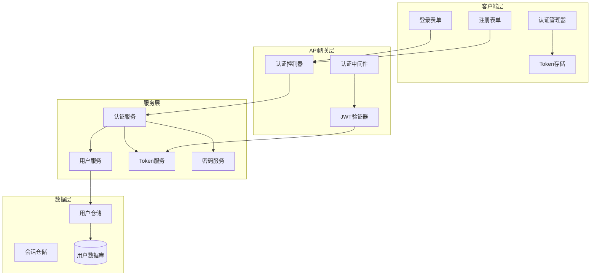
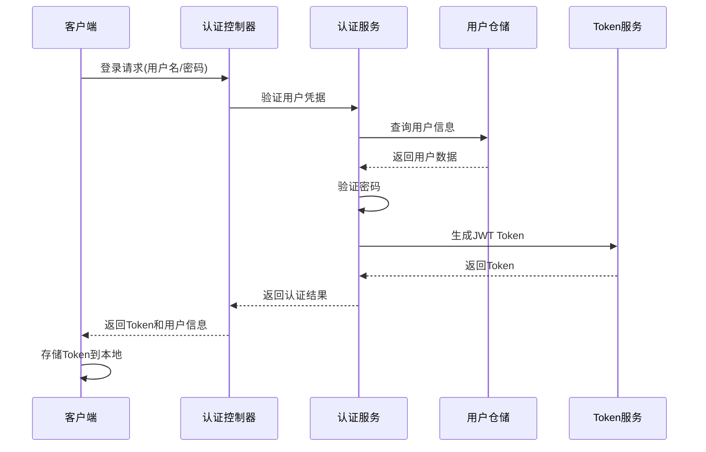

# 07-用户认证与会话管理 [IN-PROGRESS]

## 目的与范围

本文档详细说明Shadowverse-beyond项目的用户认证与会话管理系统实现，包括用户注册、登录、JWT token管理、权限验证、会话状态管理以及与SignalR的集成。涵盖完整的用户身份验证和授权机制。

## 核心概念

### 认证系统组成
- **用户注册**: 账户创建、邮箱验证、密码安全策略
- **用户登录**: 身份验证、JWT token生成、会话建立
- **权限管理**: 基于角色的访问控制(RBAC)
- **会话管理**: 用户状态跟踪、自动登录、会话过期处理
- **安全机制**: 密码加密、token刷新、防暴力破解

### 技术术语
- **JWT (JSON Web Token)**: 用于身份验证的无状态token
- **BCrypt**: 密码哈希算法，用于安全存储密码
- **RBAC**: 基于角色的访问控制模型
- **Refresh Token**: 用于刷新访问token的长期token
- **Claims**: JWT中包含的用户身份信息
- **Principal**: 表示当前用户身份的对象

## 架构概览

### 认证系统架构图



### 认证流程图



## 实现细节

### 用户实体设计

#### User实体
```csharp
public class User
{
    public Guid Id { get; set; }
    public string Username { get; set; } = string.Empty;
    public string Email { get; set; } = string.Empty;
    public string PasswordHash { get; set; } = string.Empty;
    public string? AvatarUrl { get; set; }
    public string? Bio { get; set; }
    public UserRole Role { get; set; } = UserRole.Player;
    public DateTime CreatedAt { get; set; } = DateTime.UtcNow;
    public DateTime UpdatedAt { get; set; } = DateTime.UtcNow;
    public DateTime? LastLoginAt { get; set; }
    public bool IsEmailVerified { get; set; } = false;
    public bool IsActive { get; set; } = true;

    // 导航属性
    public UserProfile? Profile { get; set; }
    public UserEconomy? Economy { get; set; }
    public List<GameSession> GameSessions { get; set; } = new();
}

public enum UserRole
{
    Player = 0,
    Admin = 1,
    Guest = 2
}
```

### 认证服务实现

#### IAuthService接口
```csharp
public interface IAuthService
{
    Task<AuthResult> RegisterAsync(RegisterDto registerDto);
    Task<AuthResult> LoginAsync(LoginDto loginDto);
    Task<AuthResult> RefreshTokenAsync(string refreshToken);
    Task<bool> LogoutAsync(string userId);
    Task<bool> ChangePasswordAsync(string userId, ChangePasswordDto changePasswordDto);
    Task<bool> ResetPasswordAsync(ResetPasswordDto resetPasswordDto);
    string HashPassword(string password);
    bool VerifyPassword(string password, string hash);
}

public class AuthResult
{
    public bool Success { get; set; }
    public string? AccessToken { get; set; }
    public string? RefreshToken { get; set; }
    public UserDto? User { get; set; }
    public string? ErrorMessage { get; set; }
    public DateTime? ExpiresAt { get; set; }
}
```

#### AuthService实现
```csharp
public class AuthService : IAuthService
{
    private readonly IUserRepository _userRepository;
    private readonly ITokenService _tokenService;
    private readonly ILogger<AuthService> _logger;
    private readonly IConfiguration _configuration;

    public AuthService(
        IUserRepository userRepository,
        ITokenService tokenService,
        ILogger<AuthService> logger,
        IConfiguration configuration)
    {
        _userRepository = userRepository;
        _tokenService = tokenService;
        _logger = logger;
        _configuration = configuration;
    }

    public async Task<AuthResult> LoginAsync(LoginDto loginDto)
    {
        try
        {
            // 查找用户
            var user = await _userRepository.GetByUsernameOrEmailAsync(loginDto.UsernameOrEmail);
            if (user == null)
            {
                _logger.LogWarning("登录失败: 用户不存在 {UsernameOrEmail}", loginDto.UsernameOrEmail);
                return AuthResult.Failure("用户名或密码错误");
            }

            // 验证密码
            if (!VerifyPassword(loginDto.Password, user.PasswordHash))
            {
                _logger.LogWarning("登录失败: 密码错误 {UserId}", user.Id);
                return AuthResult.Failure("用户名或密码错误");
            }

            // 检查账户状态
            if (!user.IsActive)
            {
                _logger.LogWarning("登录失败: 账户已禁用 {UserId}", user.Id);
                return AuthResult.Failure("账户已被禁用");
            }

            // 生成Token
            var accessToken = await _tokenService.GenerateAccessTokenAsync(user);
            var refreshToken = await _tokenService.GenerateRefreshTokenAsync(user);

            // 更新最后登录时间
            user.LastLoginAt = DateTime.UtcNow;
            await _userRepository.UpdateAsync(user);

            _logger.LogInformation("用户登录成功: {UserId}", user.Id);

            return AuthResult.Success(accessToken, refreshToken, user.ToDto());
        }
        catch (Exception ex)
        {
            _logger.LogError(ex, "登录过程中发生错误: {UsernameOrEmail}", loginDto.UsernameOrEmail);
            return AuthResult.Failure("登录失败，请稍后重试");
        }
    }

    public async Task<AuthResult> RegisterAsync(RegisterDto registerDto)
    {
        try
        {
            // 验证用户名唯一性
            if (await _userRepository.ExistsByUsernameAsync(registerDto.Username))
            {
                return AuthResult.Failure("用户名已存在");
            }

            // 验证邮箱唯一性
            if (await _userRepository.ExistsByEmailAsync(registerDto.Email))
            {
                return AuthResult.Failure("邮箱已被注册");
            }

            // 创建新用户
            var user = new User
            {
                Id = Guid.NewGuid(),
                Username = registerDto.Username,
                Email = registerDto.Email,
                PasswordHash = HashPassword(registerDto.Password),
                Role = UserRole.Player,
                CreatedAt = DateTime.UtcNow,
                UpdatedAt = DateTime.UtcNow,
                IsActive = true
            };

            await _userRepository.CreateAsync(user);

            // 创建用户经济信息
            await CreateUserEconomyAsync(user.Id);

            _logger.LogInformation("新用户注册成功: {UserId}", user.Id);

            // 自动登录
            var accessToken = await _tokenService.GenerateAccessTokenAsync(user);
            var refreshToken = await _tokenService.GenerateRefreshTokenAsync(user);

            return AuthResult.Success(accessToken, refreshToken, user.ToDto());
        }
        catch (Exception ex)
        {
            _logger.LogError(ex, "注册过程中发生错误: {Username}", registerDto.Username);
            return AuthResult.Failure("注册失败，请稍后重试");
        }
    }

    public string HashPassword(string password)
    {
        return BCrypt.Net.BCrypt.HashPassword(password, 12);
    }

    public bool VerifyPassword(string password, string hash)
    {
        return BCrypt.Net.BCrypt.Verify(password, hash);
    }
}
```

### JWT Token服务

#### ITokenService接口
```csharp
public interface ITokenService
{
    Task<string> GenerateAccessTokenAsync(User user);
    Task<string> GenerateRefreshTokenAsync(User user);
    Task<ClaimsPrincipal?> ValidateTokenAsync(string token);
    Task<bool> RevokeTokenAsync(string token);
    Task<bool> IsTokenRevokedAsync(string token);
}
```

#### TokenService实现
```csharp
public class TokenService : ITokenService
{
    private readonly IConfiguration _configuration;
    private readonly ILogger<TokenService> _logger;
    private readonly IMemoryCache _revokedTokens;

    public TokenService(IConfiguration configuration, ILogger<TokenService> logger, IMemoryCache memoryCache)
    {
        _configuration = configuration;
        _logger = logger;
        _revokedTokens = memoryCache;
    }

    public async Task<string> GenerateAccessTokenAsync(User user)
    {
        var key = new SymmetricSecurityKey(Encoding.UTF8.GetBytes(_configuration["Jwt:Key"]!));
        var credentials = new SigningCredentials(key, SecurityAlgorithms.HmacSha256);

        var claims = new[]
        {
            new Claim(ClaimTypes.NameIdentifier, user.Id.ToString()),
            new Claim(ClaimTypes.Name, user.Username),
            new Claim(ClaimTypes.Email, user.Email),
            new Claim(ClaimTypes.Role, user.Role.ToString()),
            new Claim("IsActive", user.IsActive.ToString()),
            new Claim(JwtRegisteredClaimNames.Jti, Guid.NewGuid().ToString()),
            new Claim(JwtRegisteredClaimNames.Iat, DateTimeOffset.UtcNow.ToUnixTimeSeconds().ToString(), ClaimValueTypes.Integer64)
        };

        var token = new JwtSecurityToken(
            issuer: _configuration["Jwt:Issuer"],
            audience: _configuration["Jwt:Audience"],
            claims: claims,
            expires: DateTime.UtcNow.AddMinutes(15), // 15分钟过期
            signingCredentials: credentials
        );

        return new JwtSecurityTokenHandler().WriteToken(token);
    }

    public async Task<ClaimsPrincipal?> ValidateTokenAsync(string token)
    {
        try
        {
            // 检查token是否被撤销
            if (await IsTokenRevokedAsync(token))
            {
                return null;
            }

            var key = new SymmetricSecurityKey(Encoding.UTF8.GetBytes(_configuration["Jwt:Key"]!));
            var tokenHandler = new JwtSecurityTokenHandler();

            var validationParameters = new TokenValidationParameters
            {
                ValidateIssuerSigningKey = true,
                IssuerSigningKey = key,
                ValidateIssuer = true,
                ValidIssuer = _configuration["Jwt:Issuer"],
                ValidateAudience = true,
                ValidAudience = _configuration["Jwt:Audience"],
                ValidateLifetime = true,
                ClockSkew = TimeSpan.Zero
            };

            var principal = tokenHandler.ValidateToken(token, validationParameters, out SecurityToken validatedToken);
            return principal;
        }
        catch (Exception ex)
        {
            _logger.LogWarning(ex, "Token验证失败");
            return null;
        }
    }
}
```

## 集成点

### SignalR认证集成

#### Hub认证配置
```csharp
[Authorize] // 要求认证
public class GameHub : Hub<IGameClient>
{
    public override async Task OnConnectedAsync()
    {
        var userId = Context.UserIdentifier;
        var user = await _userService.GetUserByIdAsync(Guid.Parse(userId));

        if (user != null)
        {
            // 将用户与连接关联
            await Groups.AddToGroupAsync(Context.ConnectionId, $"User_{userId}");
            _logger.LogInformation("用户 {UserId} 已连接到Hub", userId);
        }

        await base.OnConnectedAsync();
    }

    public override async Task OnDisconnectedAsync(Exception? exception)
    {
        var userId = Context.UserIdentifier;
        if (!string.IsNullOrEmpty(userId))
        {
            await Groups.RemoveFromGroupAsync(Context.ConnectionId, $"User_{userId}");
            _logger.LogInformation("用户 {UserId} 已断开Hub连接", userId);
        }

        await base.OnDisconnectedAsync(exception);
    }
}
```

### 前端认证管理

#### AuthManager实现
```javascript
export class AuthManager {
    static TOKEN_KEY = 'authToken';
    static REFRESH_TOKEN_KEY = 'refreshToken';
    static USER_KEY = 'currentUser';

    static async login(usernameOrEmail, password) {
        try {
            const response = await fetch('/api/auth/login', {
                method: 'POST',
                headers: {
                    'Content-Type': 'application/json'
                },
                body: JSON.stringify({
                    usernameOrEmail,
                    password
                })
            });

            const result = await response.json();

            if (result.success) {
                // 存储认证信息
                localStorage.setItem(this.TOKEN_KEY, result.accessToken);
                localStorage.setItem(this.REFRESH_TOKEN_KEY, result.refreshToken);
                localStorage.setItem(this.USER_KEY, JSON.stringify(result.user));

                console.log('登录成功:', result.user.username);
                return { success: true, user: result.user };
            } else {
                console.error('登录失败:', result.errorMessage);
                return { success: false, error: result.errorMessage };
            }
        } catch (error) {
            console.error('登录请求失败:', error);
            return { success: false, error: '网络错误，请稍后重试' };
        }
    }

    static async logout() {
        try {
            const token = this.getToken();
            if (token) {
                await fetch('/api/auth/logout', {
                    method: 'POST',
                    headers: {
                        'Authorization': `Bearer ${token}`
                    }
                });
            }
        } catch (error) {
            console.error('登出请求失败:', error);
        } finally {
            // 清除本地存储
            localStorage.removeItem(this.TOKEN_KEY);
            localStorage.removeItem(this.REFRESH_TOKEN_KEY);
            localStorage.removeItem(this.USER_KEY);
            
            // 重定向到登录页
            window.location.href = '/login.html';
        }
    }

    static getToken() {
        return localStorage.getItem(this.TOKEN_KEY);
    }

    static getCurrentUser() {
        const userJson = localStorage.getItem(this.USER_KEY);
        return userJson ? JSON.parse(userJson) : null;
    }

    static isAuthenticated() {
        const token = this.getToken();
        const user = this.getCurrentUser();
        return !!(token && user);
    }

    static async checkAuthStatus() {
        const token = this.getToken();
        if (!token) {
            return false;
        }

        try {
            const response = await fetch('/api/auth/validate', {
                headers: {
                    'Authorization': `Bearer ${token}`
                }
            });

            if (response.ok) {
                return true;
            } else {
                // Token无效，尝试刷新
                return await this.refreshToken();
            }
        } catch (error) {
            console.error('认证状态检查失败:', error);
            return false;
        }
    }

    static async refreshToken() {
        const refreshToken = localStorage.getItem(this.REFRESH_TOKEN_KEY);
        if (!refreshToken) {
            return false;
        }

        try {
            const response = await fetch('/api/auth/refresh', {
                method: 'POST',
                headers: {
                    'Content-Type': 'application/json'
                },
                body: JSON.stringify({ refreshToken })
            });

            const result = await response.json();

            if (result.success) {
                localStorage.setItem(this.TOKEN_KEY, result.accessToken);
                return true;
            } else {
                // 刷新失败，需要重新登录
                this.logout();
                return false;
            }
        } catch (error) {
            console.error('Token刷新失败:', error);
            this.logout();
            return false;
        }
    }
}
```

## 使用模式

### 认证中间件配置
```csharp
// Program.cs中的认证配置
builder.Services.AddAuthentication(JwtBearerDefaults.AuthenticationScheme)
    .AddJwtBearer(options =>
    {
        options.TokenValidationParameters = new TokenValidationParameters
        {
            ValidateIssuerSigningKey = true,
            IssuerSigningKey = new SymmetricSecurityKey(Encoding.UTF8.GetBytes(builder.Configuration["Jwt:Key"]!)),
            ValidateIssuer = true,
            ValidIssuer = builder.Configuration["Jwt:Issuer"],
            ValidateAudience = true,
            ValidAudience = builder.Configuration["Jwt:Audience"],
            ValidateLifetime = true,
            ClockSkew = TimeSpan.Zero
        };

        // SignalR认证配置
        options.Events = new JwtBearerEvents
        {
            OnMessageReceived = context =>
            {
                var accessToken = context.Request.Query["access_token"];
                var path = context.HttpContext.Request.Path;
                
                if (!string.IsNullOrEmpty(accessToken) && path.StartsWithSegments("/gamehub"))
                {
                    context.Token = accessToken;
                }
                
                return Task.CompletedTask;
            }
        };
    });

builder.Services.AddAuthorization();

// 在管道中启用认证
app.UseAuthentication();
app.UseAuthorization();
```

### 路由保护
```javascript
// 页面加载时检查认证状态
document.addEventListener('DOMContentLoaded', async () => {
    const isAuthenticated = await AuthManager.checkAuthStatus();
    
    if (!isAuthenticated) {
        // 未认证用户重定向到登录页
        if (window.location.pathname !== '/login.html' && 
            window.location.pathname !== '/register.html') {
            window.location.href = '/login.html';
            return;
        }
    } else {
        // 已认证用户访问登录页时重定向到游戏页
        if (window.location.pathname === '/login.html' || 
            window.location.pathname === '/register.html') {
            window.location.href = '/';
            return;
        }
    }
    
    // 初始化页面
    initializePage();
});
```

## 状态标识

**[IN-PROGRESS]** - 用户认证与会话管理系统正在开发中，基础架构已完成，需要完善前端集成和安全机制。

### 已实现功能
- ✅ 用户实体设计和数据库结构
- ✅ 基础认证服务接口设计
- ✅ JWT Token生成和验证机制
- ✅ 密码安全存储(BCrypt)
- ✅ 基础权限管理框架

### 待实现功能
- 🔄 完整的认证控制器实现
- 🔄 前端登录/注册界面
- 🔄 SignalR认证集成
- 🔄 Token刷新机制
- 🔄 密码重置功能
- 🔄 邮箱验证系统

### 技术特点
- **安全性**: BCrypt密码加密，JWT无状态认证
- **可扩展性**: 基于角色的权限管理
- **用户体验**: 自动登录，Token自动刷新
- **集成性**: 与SignalR和游戏系统无缝集成
