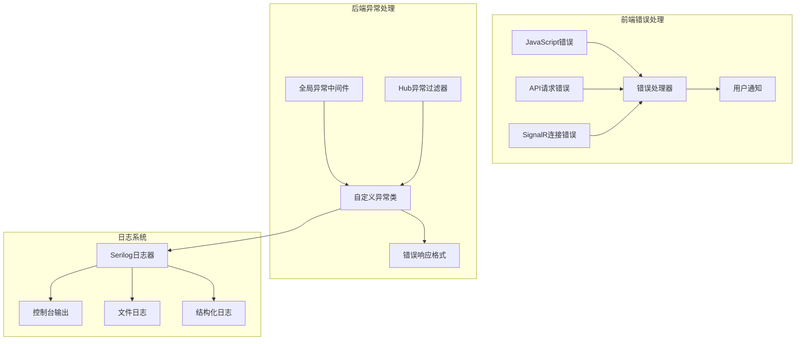
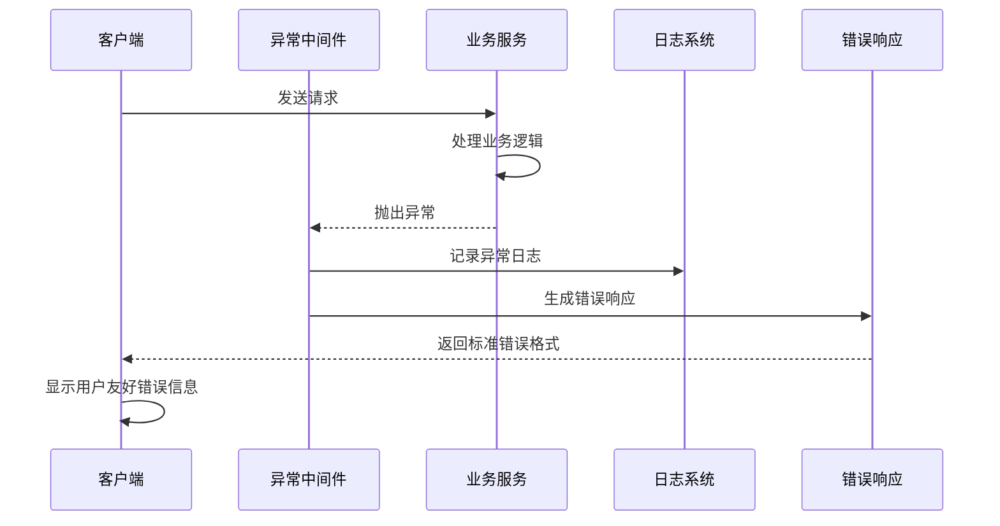

# 08-错误处理与日志系统 [COMPLETED]

## 目的与范围

本文档详细说明Shadowverse-beyond项目的错误处理与日志系统实现，包括全局异常处理、自定义异常类、结构化日志记录、错误响应格式、前端错误处理以及调试和监控机制。涵盖完整的错误管理和日志记录策略。

## 核心概念

### 错误处理系统组成
- **异常分类**: 游戏逻辑异常、数据访问异常、验证异常、系统异常
- **全局异常处理**: 统一的异常捕获和处理机制
- **错误响应格式**: 标准化的API错误响应结构
- **前端错误处理**: 客户端错误捕获和用户友好提示
- **日志记录**: 结构化日志、性能监控、错误追踪

### 技术术语
- **Serilog**: 结构化日志记录库
- **Middleware**: ASP.NET Core中间件，用于全局异常处理
- **HubFilter**: SignalR Hub过滤器，用于Hub方法异常处理
- **LogLevel**: 日志级别(Debug/Information/Warning/Error/Fatal)
- **Structured Logging**: 结构化日志记录，便于查询和分析

## 架构概览

### 错误处理架构图



### 异常处理流程图



## 实现细节

### 自定义异常类

#### 游戏逻辑异常
```csharp
/// <summary>
/// 游戏逻辑异常 - 用于游戏规则验证失败
/// </summary>
public class GameLogicException : Exception
{
    public string ErrorCode { get; }
    public object? ErrorData { get; }

    public GameLogicException(string message, string errorCode = "GAME_LOGIC_ERROR") 
        : base(message)
    {
        ErrorCode = errorCode;
    }

    public GameLogicException(string message, string errorCode, object errorData) 
        : base(message)
    {
        ErrorCode = errorCode;
        ErrorData = errorData;
    }

    public GameLogicException(string message, Exception innerException) 
        : base(message, innerException)
    {
        ErrorCode = "GAME_LOGIC_ERROR";
    }
}
```

#### 数据访问异常
```csharp
/// <summary>
/// 数据访问异常 - 用于数据库操作失败
/// </summary>
public class DataAccessException : Exception
{
    public string Operation { get; }
    public string? EntityType { get; }

    public DataAccessException(string message, string operation) 
        : base(message)
    {
        Operation = operation;
    }

    public DataAccessException(string message, string operation, string entityType) 
        : base(message)
    {
        Operation = operation;
        EntityType = entityType;
    }

    public DataAccessException(string message, Exception innerException, string operation) 
        : base(message, innerException)
    {
        Operation = operation;
    }
}
```

#### 验证异常
```csharp
/// <summary>
/// 验证异常 - 用于输入验证失败
/// </summary>
public class ValidationException : Exception
{
    public Dictionary<string, string[]> Errors { get; }

    public ValidationException(string message) : base(message)
    {
        Errors = new Dictionary<string, string[]>();
    }

    public ValidationException(Dictionary<string, string[]> errors) 
        : base("One or more validation errors occurred.")
    {
        Errors = errors;
    }

    public ValidationException(string field, string error) : base(error)
    {
        Errors = new Dictionary<string, string[]>
        {
            { field, new[] { error } }
        };
    }
}
```

### 全局异常处理中间件

#### GlobalExceptionMiddleware实现
```csharp
public class GlobalExceptionMiddleware
{
    private readonly RequestDelegate _next;
    private readonly ILogger<GlobalExceptionMiddleware> _logger;

    public GlobalExceptionMiddleware(RequestDelegate next, ILogger<GlobalExceptionMiddleware> logger)
    {
        _next = next;
        _logger = logger;
    }

    public async Task InvokeAsync(HttpContext context)
    {
        try
        {
            await _next(context);
        }
        catch (Exception ex)
        {
            _logger.LogError(ex, "Unhandled exception occurred. RequestPath: {RequestPath}", context.Request.Path);
            await HandleExceptionAsync(context, ex);
        }
    }

    private async Task HandleExceptionAsync(HttpContext context, Exception exception)
    {
        context.Response.ContentType = "application/json";

        var response = exception switch
        {
            GameLogicException gameEx => new ApiErrorResponse
            {
                StatusCode = 400,
                ErrorCode = gameEx.ErrorCode,
                Message = gameEx.Message,
                Data = gameEx.ErrorData
            },
            ValidationException validationEx => new ApiErrorResponse
            {
                StatusCode = 400,
                ErrorCode = "VALIDATION_ERROR",
                Message = "Validation failed",
                Data = validationEx.Errors
            },
            DataAccessException dataEx => new ApiErrorResponse
            {
                StatusCode = 500,
                ErrorCode = "DATA_ACCESS_ERROR",
                Message = "Data access error occurred",
                Data = new { Operation = dataEx.Operation, EntityType = dataEx.EntityType }
            },
            UnauthorizedAccessException => new ApiErrorResponse
            {
                StatusCode = 401,
                ErrorCode = "UNAUTHORIZED",
                Message = "Unauthorized access"
            },
            _ => new ApiErrorResponse
            {
                StatusCode = 500,
                ErrorCode = "INTERNAL_SERVER_ERROR",
                Message = "An internal server error occurred"
            }
        };

        context.Response.StatusCode = response.StatusCode;

        var jsonResponse = JsonSerializer.Serialize(response, new JsonSerializerOptions
        {
            PropertyNamingPolicy = JsonNamingPolicy.CamelCase
        });

        await context.Response.WriteAsync(jsonResponse);
    }
}

public class ApiErrorResponse
{
    public int StatusCode { get; set; }
    public string ErrorCode { get; set; } = string.Empty;
    public string Message { get; set; } = string.Empty;
    public object? Data { get; set; }
    public DateTime Timestamp { get; set; } = DateTime.UtcNow;
}
```

### SignalR异常处理

#### HubExceptionLoggerFilter实现
```csharp
public class HubExceptionLoggerFilter : IHubFilter
{
    private readonly ILogger<HubExceptionLoggerFilter> _logger;

    public HubExceptionLoggerFilter(ILogger<HubExceptionLoggerFilter> logger)
    {
        _logger = logger;
    }

    public async ValueTask<object?> InvokeMethodAsync(
        HubInvocationContext invocationContext, 
        Func<HubInvocationContext, ValueTask<object?>> next)
    {
        try
        {
            _logger.LogDebug("Hub method {MethodName} invoked by {ConnectionId}", 
                invocationContext.HubMethodName, invocationContext.Context.ConnectionId);

            var result = await next(invocationContext);

            _logger.LogDebug("Hub method {MethodName} completed successfully", 
                invocationContext.HubMethodName);

            return result;
        }
        catch (GameLogicException ex)
        {
            _logger.LogWarning(ex, "Game logic error in Hub method {MethodName}: {Message}", 
                invocationContext.HubMethodName, ex.Message);

            // 发送游戏逻辑错误到客户端
            await invocationContext.Hub.Clients.Caller.SendAsync("ReceiveError", new
            {
                Type = "GameLogicError",
                Code = ex.ErrorCode,
                Message = ex.Message,
                Data = ex.ErrorData
            });

            return null; // 不重新抛出异常
        }
        catch (Exception ex)
        {
            _logger.LogError(ex, "Unhandled exception in Hub method {MethodName}", 
                invocationContext.HubMethodName);

            // 发送通用错误到客户端
            await invocationContext.Hub.Clients.Caller.SendAsync("ReceiveError", new
            {
                Type = "ServerError",
                Code = "HUB_METHOD_ERROR",
                Message = "Hub method execution failed"
            });

            throw; // 重新抛出以触发SignalR的默认错误处理
        }
    }
}
```

### 日志系统配置

#### Serilog配置
```csharp
// Program.cs中的Serilog配置
var timestamp = DateTime.Now.ToString("yyyyMMddHHmmssfff");
var logFilePath = Path.Combine("Logs", $"server-{timestamp}.log");

builder.Host.UseSerilog((context, services, configuration) => configuration
    .ReadFrom.Configuration(context.Configuration)
    .ReadFrom.Services(services)
    .Enrich.FromLogContext()
    .Enrich.WithProperty("Application", "ShadowverseBeyond")
    .Enrich.WithProperty("Environment", context.HostingEnvironment.EnvironmentName)
    .WriteTo.Console(outputTemplate: 
        "{Timestamp:yyyy-MM-dd HH:mm:ss.fff zzz} [{Level:u3}] [{SourceContext}] {Message:lj}{NewLine}{Exception}")
    .WriteTo.File(
        logFilePath,
        outputTemplate: 
            "{Timestamp:yyyy-MM-dd HH:mm:ss.fff zzz} [{Level:u3}] [{SourceContext}] {Message:lj}{NewLine}{Exception}",
        rollingInterval: RollingInterval.Day,
        retainedFileCountLimit: 30,
        fileSizeLimitBytes: 100 * 1024 * 1024) // 100MB
);
```

#### 结构化日志记录示例
```csharp
public class GameService : IGameService
{
    private readonly ILogger<GameService> _logger;

    public async Task<bool> PlayCardAsync(string gameId, string playerId, PlayCardActionDto actionDto, GameActionContext context)
    {
        using var scope = _logger.BeginScope(new Dictionary<string, object>
        {
            ["GameId"] = gameId,
            ["PlayerId"] = playerId,
            ["CardUid"] = actionDto.CardUid,
            ["Action"] = "PlayCard"
        });

        try
        {
            _logger.LogInformation("开始处理出牌请求: {CardUid}", actionDto.CardUid);

            // 业务逻辑处理...

            _logger.LogInformation("出牌请求处理成功: {CardUid}", actionDto.CardUid);
            return true;
        }
        catch (GameLogicException ex)
        {
            _logger.LogWarning(ex, "出牌请求失败 - 游戏逻辑错误: {ErrorCode}", ex.ErrorCode);
            throw;
        }
        catch (Exception ex)
        {
            _logger.LogError(ex, "出牌请求处理时发生未预期错误");
            throw;
        }
    }
}
```

### 前端错误处理

#### JavaScript错误处理器
```javascript
export class ErrorHandler {
    static init() {
        // 全局JavaScript错误处理
        window.addEventListener('error', (event) => {
            console.error('Global JavaScript Error:', event.error);
            this.logError('JavaScript Error', event.error.message, {
                filename: event.filename,
                lineno: event.lineno,
                colno: event.colno,
                stack: event.error.stack
            });
        });

        // Promise rejection处理
        window.addEventListener('unhandledrejection', (event) => {
            console.error('Unhandled Promise Rejection:', event.reason);
            this.logError('Promise Rejection', event.reason.message || event.reason, {
                stack: event.reason.stack
            });
        });
    }

    static handleAPIError(error, context) {
        console.error(`API Error in ${context}:`, error);
        
        if (error.response) {
            // HTTP错误响应
            const { status, data } = error.response;
            
            switch (status) {
                case 400:
                    if (data.errorCode === 'GAME_LOGIC_ERROR') {
                        this.showGameError(data.message);
                    } else if (data.errorCode === 'VALIDATION_ERROR') {
                        this.showValidationErrors(data.data);
                    } else {
                        this.showErrorMessage(`请求错误: ${data.message}`);
                    }
                    break;
                case 401:
                    this.handleUnauthorized();
                    break;
                case 404:
                    this.showErrorMessage('请求的资源不存在');
                    break;
                case 500:
                    this.showErrorMessage('服务器内部错误，请稍后重试');
                    break;
                default:
                    this.showErrorMessage(`请求失败 (${status}): ${data.message || '未知错误'}`);
            }
        } else if (error.request) {
            // 网络错误
            this.showErrorMessage('网络连接错误，请检查网络设置');
        } else {
            // 其他错误
            this.showErrorMessage(`请求失败: ${error.message}`);
        }

        // 记录错误日志
        this.logError('API Error', error.message, {
            context,
            status: error.response?.status,
            url: error.config?.url
        });
    }

    static handleSignalRError(error, context) {
        console.error(`SignalR Error in ${context}:`, error);
        
        if (error.type === 'GameLogicError') {
            this.showGameError(error.message);
        } else if (error.type === 'ServerError') {
            this.showErrorMessage(`服务器错误: ${error.message}`);
        } else {
            this.showErrorMessage(`通信错误: ${error.message || '连接异常'}`);
        }

        this.logError('SignalR Error', error.message, {
            context,
            type: error.type,
            code: error.code
        });
    }

    static showGameError(message) {
        // 显示游戏相关错误（通常是用户操作错误）
        this.showNotification(message, 'warning', 3000);
    }

    static showErrorMessage(message) {
        // 显示一般错误信息
        this.showNotification(message, 'error', 5000);
    }

    static showValidationErrors(errors) {
        // 显示验证错误
        Object.entries(errors).forEach(([field, messages]) => {
            messages.forEach(message => {
                this.showNotification(`${field}: ${message}`, 'warning', 4000);
            });
        });
    }

    static showNotification(message, type = 'info', duration = 3000) {
        // 创建通知元素
        const notification = document.createElement('div');
        notification.className = `notification notification-${type}`;
        notification.textContent = message;
        
        // 添加到页面
        document.body.appendChild(notification);
        
        // 自动移除
        setTimeout(() => {
            if (notification.parentNode) {
                notification.parentNode.removeChild(notification);
            }
        }, duration);
    }

    static handleUnauthorized() {
        // 处理未授权错误
        this.showErrorMessage('登录已过期，请重新登录');
        
        // 清除认证信息并重定向
        localStorage.removeItem('authToken');
        localStorage.removeItem('currentUser');
        
        setTimeout(() => {
            window.location.href = '/login.html';
        }, 2000);
    }

    static logError(type, message, details = {}) {
        // 发送错误日志到服务器（可选）
        const errorLog = {
            type,
            message,
            details,
            timestamp: new Date().toISOString(),
            userAgent: navigator.userAgent,
            url: window.location.href
        };

        // 可以发送到服务器进行集中日志记录
        // fetch('/api/logs/client-error', {
        //     method: 'POST',
        //     headers: { 'Content-Type': 'application/json' },
        //     body: JSON.stringify(errorLog)
        // }).catch(() => {}); // 忽略日志发送失败
        
        console.error('Error logged:', errorLog);
    }
}

// 初始化错误处理器
ErrorHandler.init();
```

## 集成点

### 中间件注册
```csharp
// Program.cs中注册异常处理中间件
app.UseMiddleware<GlobalExceptionMiddleware>();

// SignalR Hub过滤器注册
builder.Services.AddScoped<HubExceptionLoggerFilter>();
builder.Services.AddSignalR(options =>
{
    options.EnableDetailedErrors = true;
    options.AddFilter<HubExceptionLoggerFilter>();
});
```

### 日志配置文件
```json
// appsettings.Development.json
{
  "Serilog": {
    "Using": ["Serilog.Sinks.Console", "Serilog.Sinks.File"],
    "MinimumLevel": {
      "Default": "Information",
      "Override": {
        "Microsoft": "Warning",
        "Microsoft.AspNetCore": "Warning",
        "Microsoft.Hosting.Lifetime": "Debug",
        "ShadowverseBeyond": "Debug"
      }
    },
    "WriteTo": [
      { "Name": "Console" },
      {
        "Name": "File",
        "Args": {
          "path": "Logs/shadowverse-.log",
          "rollingInterval": "Day",
          "retainedFileCountLimit": 30
        }
      }
    ],
    "Enrich": ["FromLogContext"]
  }
}
```

## 使用模式

### 业务逻辑中的错误处理
```csharp
public async Task<bool> AttackAsync(string gameId, string playerId, AttackActionDto actionDto, GameActionContext context)
{
    try
    {
        // 验证攻击条件
        if (!ValidateAttackConditions(attacker, gameState))
        {
            throw new GameLogicException("攻击条件不满足", "INVALID_ATTACK_CONDITIONS");
        }

        // 执行攻击逻辑...
        
        return true;
    }
    catch (GameLogicException)
    {
        // 重新抛出游戏逻辑异常
        throw;
    }
    catch (Exception ex)
    {
        // 包装为数据访问异常
        throw new DataAccessException("攻击处理失败", ex, "Attack");
    }
}
```

### 前端API调用错误处理
```javascript
async function playCard(cardUid, targetUid = null) {
    try {
        const response = await fetch('/api/game/play-card', {
            method: 'POST',
            headers: {
                'Content-Type': 'application/json',
                'Authorization': `Bearer ${AuthManager.getToken()}`
            },
            body: JSON.stringify({ cardUid, targetUid })
        });

        if (!response.ok) {
            const errorData = await response.json();
            throw new APIError(errorData, response.status);
        }

        const result = await response.json();
        return result;
    } catch (error) {
        ErrorHandler.handleAPIError(error, 'playCard');
        throw error;
    }
}
```

## 状态标识

**[COMPLETED]** - 错误处理与日志系统已完全实现，包括全局异常处理、结构化日志记录和完整的前后端错误处理机制。

### 已实现功能
- ✅ 自定义异常类体系
- ✅ 全局异常处理中间件
- ✅ SignalR Hub异常过滤器
- ✅ Serilog结构化日志配置
- ✅ 前端错误处理器
- ✅ 标准化错误响应格式
- ✅ 日志文件轮转和保留策略

### 技术特点
- **全面覆盖**: 涵盖前后端所有错误场景
- **结构化**: 便于查询和分析的日志格式
- **用户友好**: 清晰的错误提示和处理
- **可维护性**: 统一的错误处理和日志记录策略
