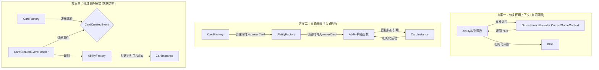

# 架构决策文档：核心上下文传递与依赖管理方案

## 1. 背景

在修复卡牌能力（Ability）无法正确初始化其来源卡牌（SourceCard）的BUG时，我们发现其根本原因在于 `Ability` 实体在构造时，依赖了一个静态的 `GameServiceProvider` 来获取当前的 `GameContext`。然而，在对象创建的特定时间点，这个上下文尚未被设置，导致 `GameContext` 为 `null`，从而引发一系列问题。

此文档旨在分析当前上下文传递机制的利弊，并评估多种备选方案，以期找到一个健壮、可维护且可测试的解决方案。

## 2. 当前架构分析：环境上下文 + 服务定位器

我们当前的实现结合了两种模式：

-   **环境上下文 (Ambient Context)**: 通过一个 `Scoped` 服务的 `IGameContextAccessor`，利用 `AsyncLocal<T>` 在异步调用链中隐式地传递 `GameContext`。
-   **服务定位器 (Service Locator)**: 通过一个静态类 `GameServiceProvider` 暴露对 `IGameContextAccessor` 的全局访问，并提供便捷方法（如 `GetService<T>()`）来获取服务。

### 2.1. 优点

-   **便捷性**: 在调用链的深处，任何代码都可以通过 `GameServiceProvider.CurrentGameContext` 轻松访问到上下文，而无需在每一层方法上手动传递参数。
-   **减少参数数量**: 避免了在大量方法签名中添加 `GameContext` 或 `GameState` 参数，使代码看起来更“简洁”。

### 2.2. 缺点与风险

-   **隐式依赖**: 类的依赖关系被隐藏在实现细节中。不阅读源码，你无法知道一个类（如 `Ability`）依赖于 `GameServiceProvider`。这违反了依赖倒置原则（DIP），使得代码难以理解和维护。
-   **可测试性差**: 依赖静态全局状态的类极难进行单元测试。为了测试 `Ability`，我们必须模拟整个 `GameServiceProvider` 和 `GameContext` 的状态，这是非常脆弱和复杂的。
-   **生命周期问题**: 正如我们所见，这种模式对代码的执行顺序有严格要求。如果在 `GameContext` 被设置**之前**调用了依赖它的代码（尤其是在对象的构造函数中），就会立即失败。这使得代码充满了“定时炸弹”。
-   **服务定位器是反模式**: 社区普遍认为服务定位器是一种反模式，因为它隐藏了依赖、违反了SOLID原则，并使代码与特定的定位器实现紧密耦合。

## 3. 备选方案评估

### 方案一：修复环境上下文 (用户的提议)

这个方案的核心思想是：既然问题是 `GameContext` 没有被及时设置，那我们就在调用 `CardFactory` 之前手动设置它。

**可行性分析**:
理论上，我们可以在 `GameService.GetOrCreateGameState` 中，在创建卡牌之前，手动创建一个 `GameContext` 并设置它。

```csharp
// 伪代码
public GameState GetOrCreateGameState(...)
{
    // ...
    // 在创建卡牌前手动设置上下文
    using (var tempContext = new GameContext(...))
    {
        // 在这个 using 块内，GameServiceProvider 可以工作
        player1State.Deck.Add(cardFactory.CreateAndRegisterNewCard(...));
        // ...
    }
    // ...
}
```

**优点**:
-   改动较小，能快速修复当前的BUG。

**缺点**:
-   **治标不治本**: 这只是为当前的BUG打上了一个“补丁”。它没有解决 `Ability` 构造函数依赖全局状态这个根本性的坏味道。未来在其他地方创建 `Ability` 时，我们必须记住要重复这个“手动设置上下文”的模式，否则BUG会重现。
-   **构造函数中的陷阱**: 在构造函数中执行需要复杂外部环境（如一个必须被预先设置的静态属性）的逻辑，是一种非常危险的做法。构造函数应该只做最基本的数据初始化，而不应有副作用或依赖外部环境。
-   **并未改善可测试性**: `Ability` 类依然难以测试。

**结论**: 这是一个短期修复方案，但它会加剧技术债务，并使架构问题固化下来。**不推荐**。

### 方案二：显式依赖注入 (我最初的提议)

这个方案遵循标准的依赖注入原则：**一个类需要什么，就通过构造函数明确地告诉它**。

**实现**:
1.  修改 `Ability` 的构造函数，移除对 `GameServiceProvider` 的任何引用。
2.  让 `Ability` 直接接收它所需要的核心依赖。对于 `SourceCard`，最直接的依赖就是 `CardInstance` 本身。

```csharp
// Ability.cs
public class Ability
{
    public CardInstance SourceCard { get; } // 直接持有引用，不再需要查找

    public Ability(..., CardInstance sourceCard)
    {
        // ...
        this.SourceCard = sourceCard;
    }
}

// AbilityFactory.cs
public Ability CreateAbility(..., CardInstance ownerCard)
{
    // ...
    return new Ability(..., ownerCard);
}
```

**回应您的担忧**:

-   **“`Ability` 是否会显得臃肿？”**: 不会。恰恰相反，这会让 `Ability` 变得更“轻”。它不再需要知道 `GameServiceProvider`、`GameContext` 或 `GameState` 的存在。它只关心一个 `CardInstance`，这完全符合它的职责。一个对象的“臃肿”通常指它承担了过多的职责，而不是它持有了必要的依赖引用。
-   **“传递链是否会过长？”**: 这是一个合理的担忧，被称为“依赖注入隧道”（Dependency Injection Tunneling）。但在当前场景下，`Ability` 是由 `AbilityFactory` 创建的，而 `AbilityFactory` 是在 `CardFactory` 中使用的，`CardFactory` 本身就知道正在为哪个 `CardInstance` 创建能力。所以传递链非常短，几乎没有增加额外的复杂度。

**优点**:
-   **依赖明确**: 类的依赖关系一目了然。
-   **极易测试**: 我们可以轻松地 `new Ability(..., mockCard)` 来进行单元测试，无需任何复杂的环境设置。
-   **高内聚，低耦合**: `Ability` 只关心它需要的东西，与其他基础设施（如 `GameServiceProvider`）完全解耦。
-   **时序安全**: 因为依赖是直接传入的，所以不存在“上下文尚未设置”的竞态条件问题。

**缺点**:
-   在极少数情况下，如果依赖链条确实非常长，可能会显得繁琐。但对于当前问题，这并非缺点。

**结论**: 这是解决当前问题的**最直接、最标准、最健壮**的方案。它遵循了业界公认的最佳实践。**强烈推荐**。

### 方案三：领域事件模式 (更高级的解耦方案)

这是一个更高级、更彻底的解耦方案，适用于更复杂的场景。

**实现**:
1.  `CardFactory` 在创建 `CardInstance` 后，不立即创建 `Ability`，而是发布一个 `CardCreatedEvent` 领域事件。
2.  创建一个 `CardCreatedEventHandler`，它订阅这个事件。
3.  在这个 Handler 中，获取到 `CardInstance`，然后调用 `AbilityFactory` 来创建 `Ability` 并附加到卡牌上。

**优点**:
-   **极致解耦**: 卡牌的创建过程与能力的附加过程完全分离。
-   **扩展性强**: 未来如果卡牌创建后还需要做其他事（比如记录日志、更新统计），我们只需增加新的 Handler，而无需修改 `CardFactory`。

**缺点**:
-   **实现复杂**: 需要引入一个领域事件发布/订阅的基础设施。
-   **心智负担**: 调用链变得异步和间接，调试和追踪逻辑流会更加困难。
-   **过度设计**: 对于当前的问题，这可能是一种“杀鸡用牛刀”的做法。

**结论**: 这是一个非常优秀的架构模式，值得在未来系统变得更复杂时考虑。但对于当前需要解决的初始化时序问题，它引入的复杂度超出了必要范围。可以作为未来的演进方向，**当前不推荐**。

## 4. 方案对比

| 方案 | 耦合度 | 可测试性 | 代码清晰度 | 性能开销 | 实现复杂度 | 结论 |
| :--- | :--- | :--- | :--- | :--- | :--- | :--- |
| **一：修复环境上下文** | 极高 (依赖全局静态状态) | 极差 | 差 (依赖关系隐藏) | 低 | 低 | **不推荐** |
| **二：显式依赖注入** | 低 (只依赖传入的接口/实体) | 极佳 | 极佳 (依赖关系明确) | 极低 | 中 | **强烈推荐** |
| **三：领域事件模式** | 极低 (依赖事件，而非具体实现) | 极佳 | 中 (逻辑流分散) | 中 (事件总线开销) | 高 | **未来方向** |

## 5. 架构图 (Mermaid)



## 6. 最终建议

我强烈建议我们采用 **方案二：显式依赖注入**。

这个方案不仅能完美地解决当前的BUG，更重要的是，它将引导我们走向一个依赖关系明确、高度可测试、易于维护的健康架构。它遵循了最核心的软件设计原则，能够从根本上杜绝此类问题的再次发生。您关于“臃肿”和“长调用链”的担忧，在这种具体的场景下并不会成为问题，反而其带来的代码清晰性和可靠性的提升是巨大的。

我们可以立即开始实施这个方案。