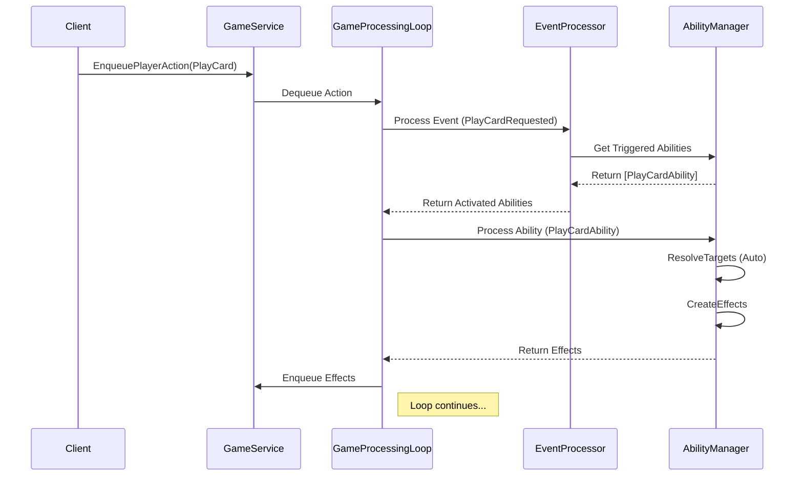

# 架构设计：响应式目标选择与可中断的游戏循环

## 1. 背景与目标

随着核心BUG的修复，项目需要支持更复杂的游戏机制。当前的目标选择系统仅支持由玩家主动发起的 `PlayCard` 动作。为了实现更丰富的卡牌能力（例如，“攻击时，选择一个敌方随从造成1点伤害”），后端架构必须支持由**游戏事件**（如攻击、回合开始）触发，并需要玩家介入选择目标的能力。

本次架构设计的核心目标如下：

1.  **响应式目标选择 (Reactive Targeting):** 实现由任意游戏事件触发，并需要玩家选择目标的能力。
2.  **可中断的游戏流 (Interruptible Game Flow):** 改造当前的游戏主循环，使其能够在需要玩家输入时“暂停”，等待玩家响应后从断点处“恢复”。
3.  **上下文感知的撤销 (Context-Aware Undo):** 设计一个健壮的撤销机制，允许玩家取消由自己主动发起的选择，同时禁止取消由系统事件强制触发的选择。

## 2. 现有架构分析

通过对 `GameService.cs`, `EventProcessor.cs`, 和 `AbilityManager.cs` 的分析，我们得出以下结论：

*   **核心驱动**: `GameProcessingLoopAsync` 是一个不可中断的、线性的处理循环。它持续从**动作队列**和**效果队列**中取出任务执行，直到队列为空。
*   **事件驱动**: 流程由玩家动作（Player Action）发起，生成初始事件（Event），事件触发能力（Ability），能力创建效果（Effect），效果再生成新的事件，形成一个闭环的处理链。
*   **核心痛点**: 整个处理链是**同步且自动**的。当一个由游戏事件（非玩家动作）触发的能力需要玩家选择目标时，处理链无法暂停以等待玩家的 SignalR 响应。

### 2.1. 当前流程图 (不可中断)



## 3. 新架构设计方案：状态机驱动的可中断循环

我们引入一个新的核心概念来解决暂停问题：**待处理的玩家输入状态 (`PendingInputState`)**。

### 3.1. 核心概念：`PendingInputState`

在 `GameState` 中增加一个新的状态对象 `PendingInputState`。当游戏需要玩家输入时，就会创建并设置此对象，此时游戏主循环将暂停。

`PendingInputState` 结构如下：

*   `InputId` (Guid): 本次输入请求的唯一ID。
*   `PlayerId` (Guid): 需要进行输入的玩家。
*   `InputType` (Enum): 输入类型（例如：`TargetSelection`）。
*   `RequestContext` (Object): 请求输入的上下文，包含是哪个能力（`AbilityRuntimeId`）和哪个事件（`EventId`）触发了它。
*   `ValidTargets` (List<Guid>): 一个包含所有有效目标ID的列表，供客户端高亮显示。
*   `IsCancellable` (bool): 标记本次选择是否可以被玩家取消。

### 3.2. 改造游戏循环：暂停与恢复

对 `GameService.cs` 的 `GameProcessingLoopAsync` 进行改造：

1.  **暂停 (Pause)**:
    *   当一个能力需要玩家选择目标时，它不再直接创建效果，而是创建一个 `PendingInputState` 对象，然后抛出一个特殊的、可控的 `PlayerInputRequiredException` 异常。
    *   `GameProcessingLoopAsync` 会捕获这个异常，将 `PendingInputState` 设置到当前的 `GameState` 中，然后立即将这个请求通过一个新的DTO（例如 `RequestPlayerInputDto`）发送给客户端。
    *   在 `GameProcessingLoopAsync` 的循环开始处增加检查：如果 `GameState.PendingInputState` 不为 `null`，则循环立即进入等待状态，从而实现**游戏逻辑的暂停**。

2.  **恢复 (Resume)**:
    *   玩家在客户端做出选择后，会发送一个新的SignalR指令，例如 `SubmitPlayerChoice(inputId, selectedTargetIds)`。
    *   `GameService` 接收到指令后，会验证其有效性，然后将玩家的选择结果缓存起来，并将 `GameState.PendingInputState` 设为 `null`。
    *   一旦 `PendingInputState` 变回 `null`，游戏循环就会自动解除暂停状态，并**从头开始重新处理**之前被中断的那个事件。
    *   这一次，当再次执行到那个需要目标的能力时，`AbilityManager` 会发现该请求已经有了对应的玩家选择缓存，于是直接使用该选择来创建效果，流程得以顺利继续。

### 3.3. 撤销机制的挑战与升级

用户提出的一个关键问题是：当 `PlayCard` 动作触发目标选择时，像“支付费用”这类前置效果可能已经发生。此时撤销会导致状态不一致。

为了解决这个问题，我们引入**“动作暂存与预处理” (Action Staging & Pre-processing)**机制。

### 3.4. 升级版设计：智能撤销与事务性操作

核心思想是：**在所有需要玩家输入的部分都完成之前，绝不真正修改游戏主状态。**

1.  **动作预处理/暂存 (Action Pre-processing/Staging)**:
    *   当服务器收到一个玩家动作（如 `PlayCard`）时，它不再立即执行。
    *   取而代之，它会进入一个**预处理阶段**。在这个阶段，系统会**模拟**执行这个动作，检查整个潜在的效果链中，是否包含需要玩家输入的部分。
    *   **如果需要玩家输入**：
        *   服务器会**暂存**这个动作，**不会修改**主 `GameState`，也不会广播任何事件。
        *   服务器直接创建 `PendingInputState`，并将其发送给客户端，请求玩家进行目标选择。
        *   此时，从服务器的角度看，游戏状态**完全没有改变**。

2.  **带有上下文的提交 (Contextual Submission)**:
    *   当玩家在客户端完成目标选择后，发送 `SubmitPlayerChoice` 指令。
    *   这个指令将不仅仅包含目标选择的结果，还会**重新附带上最初的那个动作**（例如，`PlayCard` 的信息）。
    *   服务器收到后，将暂存的动作和玩家的选择合并，然后**一次性地**、**原子地**执行整个动作链条，修改 `GameState` 并广播所有相关事件。

3.  **无风险撤销 (Risk-Free Undo)**:
    *   由于在请求玩家输入时，服务器的 `GameState` 根本没有发生变化，所以“撤销”操作变得极其简单和安全。
    *   当玩家点击取消时，客户端发送 `CancelPlayerChoice` 指令。
    *   服务器收到后，只需简单地**清除 `PendingInputState` 和被暂存的动作**即可。整个过程不需要任何复杂的状态回滚。

### 3.5. 新设计流程图 (可中断且支持智能撤销)

```mermaid
sequenceDiagram
    participant C as Client
    participant GS as GameService
    participant GP as GameProcessingLoop
    participant AM as AbilityManager

    box LightCyan "Phase 1: Pre-process, Request & Pause"
        C->>GS: EnqueuePlayerAction(PlayCard with Target)
        GS->>GP: Dequeue Action for **Pre-processing**
        GP->>AM: **Simulate** Ability Chain, Detects Player Input Need
        AM-->>GP: Confirms Input is Required
        GP->>GS: Create GameState.PendingInput (IsCancellable=true)
        Note right of GS: **No Game State is Changed!**
        GS->>C: Send DTO [RequestPlayerInput]
        Note over GP: **Loop Pauses**
    end

    alt Player Cancels
        C->>GS: CancelPlayerChoice(InputId)
        GS->>GS: Clear GameState.PendingInput
        Note over GP: Loop remains idle. State is clean.
    else Player Submits
        box LightYellow "Phase 2: Player Response"
            C->>GS: SubmitPlayerChoice(InputId, Targets, OriginalAction)
            GS->>GS: Validate & Cache Choice
            GS->>GS: Clear GameState.PendingInput
            GS->>GP: **Re-enqueue** Original Action with Choices
        end

        box LightGreen "Phase 3: Execute & Complete"
            Note over GP: **Loop Resumes**
            GP->>AM: Process Action & Ability Chain
            AM->>GS: Get Cached Choice
            AM->>AM: CreateEffects (with player's choice)
            AM-->>GP: Return Effects
            GP->>GS: Enqueue Effects
            Note right of GP: Loop continues with real state changes...
        end
    end