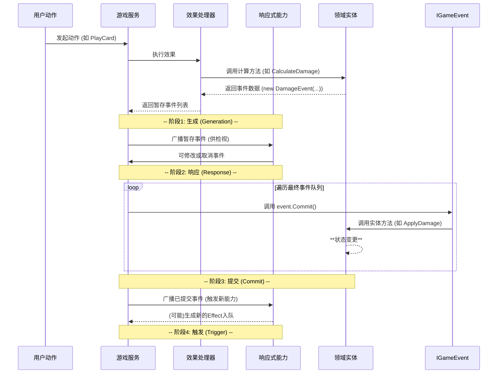
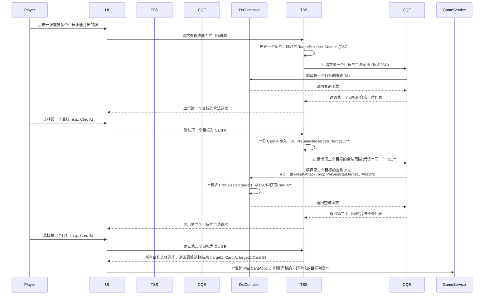

# 架构设计：可录制事件系统 (Replayable Event System)

## 1. 概述

为了从根本上支持游戏录像（Replay）、撤销（Undo）等高级功能，并进一步简化系统逻辑，我们决定采用一种全新的事件系统架构。

该架构的核心原则是 **数据与逻辑的彻底分离**：
*   **事件 (Event)** 是纯粹的、可序列化的**数据容器**，它只描述“发生了什么”，不包含任何执行逻辑。
*   **执行逻辑 (Logic)** 被严格限制在拥有状态的**领域实体**（Domain Entities）的方法中。

这个设计确保了只要我们记录下事件流，就能100%地复现任何一局游戏。

## 2. 核心概念

*   **游戏事件 (IGameEvent)**: 一个纯粹的数据接口/基类，用于描述游戏过程中发生的各种事情。例如，`DamageEvent` 会包含伤害来源、目标、伤害数值等数据。

*   **可提交事件 (ICommittableEvent)**: 一个继承自 `IGameEvent` 的接口，它定义了一个核心方法：`Commit(GameContext context)`。这个接口标志着一个事件不仅是一个通知，更是一个需要被执行并导致状态变更的动作。

*   **实体方法 (Entity Method)**: 领域实体（如 `CardInstance`, `PlayerState`）中负责执行状态变更的具体方法。例如，`CardInstance` 会有一个 `ApplyDamage(int amount)` 方法，这个方法是唯一能够修改 `CardInstance.Damage` 属性的地方。

*   **游戏服务 (GameService)**: 作为事件流的总调度中心。它负责接收动作请求，驱动效果处理器（EffectHandler）生成事件，管理事件的生命周期（暂存、响应、提交），并最终广播事件。

## 3. 工作流程

新的事件处理流程遵循一个清晰的四阶段生命周期，这为能力响应和状态管理提供了极大的灵活性。


 
### 3.1. 目标选择流程：原子化的预选择 (Pre-Selection)

为了解决玩家直觉（期望一次性选择所有目标，并可随时撤销）与系统实现（依赖于前置结果的动态目标需要分步计算）之间的矛盾，我们引入了一个隔离的、原子化的**预选择**流程。该流程在任何游戏状态变更**之前**完成。

它由 `TargetSelectionService` 协调，并使用一个临时的、仅在当次操作生命周期内有效的 `TargetSelectionContext` 对象来传递“已被选择但未提交”的目标信息，从而允许后续的目标查询能够依赖这些临时选择的结果。

这保证了整个目标选择过程对玩家来说是原子化的，并且可以安全地在任意步骤被撤销，而不会对游戏状态造成任何影响。



## 4. 关键接口与类定义

### 4.1. ICommittableEvent

```csharp
// File: Server/Domain/Events/IGameEvent.cs

public interface IGameEvent 
{
    EventType Type { get; }
    TargetInfo Source { get; }
    TargetInfo Target { get; }
}

public interface ICommittableEvent : IGameEvent
{
    /// <summary>
    /// 执行此事件，应用最终的状态变更。
    /// </summary>
    /// <param name="context">游戏上下文，用于访问实体和状态。</param>
    void Commit(GameContext context);
}
```

### 4.2. 事件实现示例

事件本身成为一个简单的POCO（Plain Old C# Object）。

```csharp
// File: Server/Domain/Events/CoreGameEvents.cs

public class DamageEvent : ICommittableEvent
{
    public EventType Type => EventType.Damage;
    public TargetInfo Source { get; set; }
    public TargetInfo Target { get; set; }
    
    public int Amount { get; set; }

    public DamageEvent(TargetInfo source, TargetInfo target, int amount)
    {
        Source = source;
        Target = target;
        Amount = amount;
    }

    public void Commit(GameContext context)
    {
        var targetCard = context.GameState.GetCard(Target.Id);
        if (targetCard != null)
        {
            targetCard.ApplyDamage(Amount);
        }
    }
}
```

### 4.3. 实体方法实现示例

实体类成为状态和相关逻辑的唯一守护者。

```csharp
// File: Server/Domain/Entities/CardInstance.cs

public class CardInstance 
{
    public int Damage { get; private set; } = 0;
    public int CurrentHealth => Math.Max(0, MaxHealth - Damage);

    // ... 其他属性 ...

    /// <summary>
    /// 应用伤害，这是唯一修改Damage属性的地方。
    /// </summary>
    public void ApplyDamage(int amount)
    {
        if (amount > 0)
        {
            this.Damage += amount;
        }
    }
}
```

## 5. 对录像系统的支持

由于所有 `IGameEvent` 都是纯数据对象，游戏录像系统的工作将变得极其简单：

1.  **记录**: 在“提交”阶段之后，将每个成功提交的事件序列化（如转为JSON）并存储起来。
2.  **回放**: 创建一个初始的 `GameState`，然后按顺序读取记录的事件，并依次在新的 `GameContext` 中调用它们的 `Commit()` 方法。这将完美地、一步步地重现整场对局。

这个架构为我们未来的高级功能打下了坚实、可靠的基础。