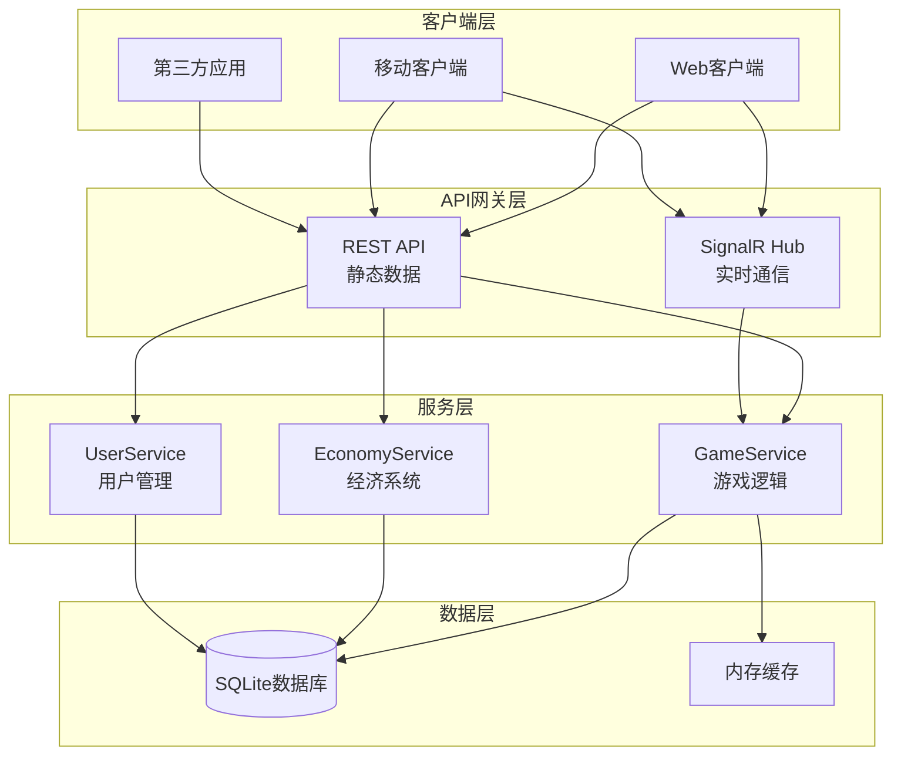

# 01-端点总览 [COMPLETED]

## 目的与范围

本文档详细说明Shadowverse-beyond项目的API端点设计，包括REST API和SignalR Hub方法、请求响应格式、错误处理机制以及API版本管理策略。为前端开发和第三方集成提供完整的接口参考。

## 核心概念

### API设计原则
- **RESTful设计**: 遵循REST架构风格，资源导向的URL设计
- **实时通信**: SignalR Hub处理游戏实时交互
- **统一响应**: 标准化的响应格式和错误处理
- **版本控制**: 支持API版本演进和向后兼容

### 通信协议
- **HTTP REST**: 静态数据查询和基础操作
- **SignalR WebSocket**: 实时游戏状态同步和动作处理
- **JSON格式**: 统一的数据交换格式

## 架构概览

### API架构图



### 端点分类

#### REST API 端点
```yaml
基础路径: /api/v1

卡牌相关:
  - GET /cards                    # 获取所有卡牌
  - GET /cards/{id}              # 获取特定卡牌
  - GET /cards/search            # 搜索卡牌

用户相关:
  - GET /users/{id}              # 获取用户信息
  - PUT /users/{id}              # 更新用户信息
  - GET /users/{id}/economy      # 获取用户经济状态

游戏相关:
  - GET /games/{id}              # 获取游戏状态
  - POST /games                  # 创建新游戏
  - GET /games/{id}/history      # 获取游戏历史

健康检查:
  - GET /health                  # 服务健康状态
  - GET /version                 # API版本信息
```

#### SignalR Hub 方法
```yaml
连接路径: /gamehub

游戏动作:
  - PerformPlayCard(PlayCardActionDto)     # 出牌
  - PerformAttack(AttackActionDto)         # 攻击
  - PerformEvolve(EvolveActionDto)         # 进化
  - PerformEndTurn(EndTurnActionDto)       # 结束回合
  - PerformMulligan(MulliganActionDto)     # 换牌

连接管理:
  - JoinGame(gameId, playerId)             # 加入游戏
  - LeaveGame(gameId, playerId)            # 离开游戏
  - Reconnect(gameId, playerId)            # 重新连接

客户端事件:
  - ReceiveGameState(GameStateDto)         # 接收游戏状态
  - ReceiveGameEvent(GameEventDto)         # 接收游戏事件
  - ReceiveError(ErrorDto)                 # 接收错误信息
```

## 实现细节

### REST API 实现

#### 卡牌控制器

<augment_code_snippet path="Server/Controllers/CardsController.cs" mode="EXCERPT">
````csharp
[ApiController]
[Route("api/v1/[controller]")]
public class CardsController : ControllerBase
{
    private readonly ICardRepository _cardRepository;
    private readonly ILogger<CardsController> _logger;

    [HttpGet]
    public async Task<ActionResult<ApiResponse<List<CardDefinitionDto>>>> GetAllCards()
    {
        try
        {
            var cards = await _cardRepository.GetAllAsync();
            var cardDtos = cards.Select(MapToDto).ToList();
            
            return Ok(ApiResponse<List<CardDefinitionDto>>.Success(cardDtos));
        }
        catch (Exception ex)
        {
            _logger.LogError(ex, "Failed to retrieve cards");
            return StatusCode(500, ApiResponse<List<CardDefinitionDto>>.Error("Internal server error"));
        }
    }

    [HttpGet("{id:int}")]
    public async Task<ActionResult<ApiResponse<CardDefinitionDto>>> GetCard(int id)
    {
        try
        {
            var card = await _cardRepository.GetByIdAsync(id);
            if (card == null)
            {
                return NotFound(ApiResponse<CardDefinitionDto>.Error("Card not found"));
            }

            var cardDto = MapToDto(card);
            return Ok(ApiResponse<CardDefinitionDto>.Success(cardDto));
        }
        catch (Exception ex)
        {
            _logger.LogError(ex, "Failed to retrieve card {CardId}", id);
            return StatusCode(500, ApiResponse<CardDefinitionDto>.Error("Internal server error"));
        }
    }

    [HttpGet("search")]
    public async Task<ActionResult<ApiResponse<List<CardDefinitionDto>>>> SearchCards(
        [FromQuery] string? name = null,
        [FromQuery] string? cardType = null,
        [FromQuery] int? cost = null,
        [FromQuery] string? rarity = null)
    {
        try
        {
            var searchCriteria = new CardSearchCriteria
            {
                Name = name,
                CardType = cardType,
                Cost = cost,
                Rarity = rarity
            };

            var cards = await _cardRepository.SearchAsync(searchCriteria);
            var cardDtos = cards.Select(MapToDto).ToList();
            
            return Ok(ApiResponse<List<CardDefinitionDto>>.Success(cardDtos));
        }
        catch (Exception ex)
        {
            _logger.LogError(ex, "Failed to search cards");
            return StatusCode(500, ApiResponse<List<CardDefinitionDto>>.Error("Internal server error"));
        }
    }
}
````
</augment_code_snippet>

### SignalR Hub 实现

<augment_code_snippet path="Server/Hubs/GameHub.cs" mode="EXCERPT">
````csharp
public class GameHub : Hub<IGameClient>
{
    private readonly IGameService _gameService;
    private readonly ILogger<GameHub> _logger;

    public async Task PerformPlayCard(PlayCardActionDto actionDto)
    {
        var gameId = GetGameId();
        var playerId = GetPlayerId();
        
        try
        {
            _logger.LogInformation("[GameHub] Player {PlayerId} playing card {CardUid} in game {GameId}",
                playerId, actionDto.CardUid, gameId);

            var context = new GameActionContext();
            var success = await _gameService.PlayCardAsync(gameId, playerId, actionDto, context);

            if (success)
            {
                await BroadcastEventsAsync(context.Events);
            }
            else
            {
                await Clients.Caller.ReceiveError(new ErrorDto
                {
                    Code = "PLAY_CARD_FAILED",
                    Message = "Failed to play card",
                    Details = context.ErrorMessage
                });
            }
        }
        catch (GameLogicException ex)
        {
            _logger.LogWarning(ex, "[GameHub] Game logic error for player {PlayerId}", playerId);
            await Clients.Caller.ReceiveError(new ErrorDto
            {
                Code = "GAME_LOGIC_ERROR",
                Message = ex.Message
            });
        }
        catch (Exception ex)
        {
            _logger.LogError(ex, "[GameHub] Unexpected error for player {PlayerId}", playerId);
            await Clients.Caller.ReceiveError(new ErrorDto
            {
                Code = "INTERNAL_ERROR",
                Message = "An unexpected error occurred"
            });
        }
    }

    public async Task JoinGame(string gameId, string playerId)
    {
        try
        {
            await Groups.AddToGroupAsync(Context.ConnectionId, gameId);
            
            // 设置连接上下文
            Context.Items["GameId"] = gameId;
            Context.Items["PlayerId"] = playerId;

            _logger.LogInformation("[GameHub] Player {PlayerId} joined game {GameId}", playerId, gameId);

            // 发送当前游戏状态
            var gameState = await _gameService.GetGameStateAsync(gameId);
            if (gameState != null)
            {
                await Clients.Caller.ReceiveGameState(gameState);
            }
        }
        catch (Exception ex)
        {
            _logger.LogError(ex, "[GameHub] Failed to join game {GameId} for player {PlayerId}", gameId, playerId);
            await Clients.Caller.ReceiveError(new ErrorDto
            {
                Code = "JOIN_GAME_FAILED",
                Message = "Failed to join game"
            });
        }
    }

    private async Task BroadcastEventsAsync(List<GameEventDto> events)
    {
        var gameId = GetGameId();
        foreach (var gameEvent in events)
        {
            await Clients.Group(gameId).ReceiveGameEvent(gameEvent);
        }
    }
}
````
</augment_code_snippet>

### 统一响应格式

<augment_code_snippet path="Server/Dtos/ApiResponse.cs" mode="EXCERPT">
````csharp
/// <summary>
/// 统一的API响应格式
/// </summary>
public class ApiResponse<T>
{
    public bool Success { get; set; }
    public T? Data { get; set; }
    public string? ErrorMessage { get; set; }
    public string? ErrorCode { get; set; }
    public DateTime Timestamp { get; set; } = DateTime.UtcNow;

    public static ApiResponse<T> Success(T data)
    {
        return new ApiResponse<T>
        {
            Success = true,
            Data = data
        };
    }

    public static ApiResponse<T> Error(string message, string? code = null)
    {
        return new ApiResponse<T>
        {
            Success = false,
            ErrorMessage = message,
            ErrorCode = code
        };
    }
}

/// <summary>
/// 分页响应格式
/// </summary>
public class PagedResponse<T> : ApiResponse<List<T>>
{
    public int Page { get; set; }
    public int PageSize { get; set; }
    public int TotalCount { get; set; }
    public int TotalPages { get; set; }

    public static PagedResponse<T> Success(List<T> data, int page, int pageSize, int totalCount)
    {
        return new PagedResponse<T>
        {
            Success = true,
            Data = data,
            Page = page,
            PageSize = pageSize,
            TotalCount = totalCount,
            TotalPages = (int)Math.Ceiling((double)totalCount / pageSize)
        };
    }
}
````
</augment_code_snippet>

## 集成点

### 错误处理机制

#### 全局异常处理
```csharp
public class GlobalExceptionMiddleware
{
    public async Task InvokeAsync(HttpContext context, RequestDelegate next)
    {
        try
        {
            await next(context);
        }
        catch (GameLogicException ex)
        {
            await HandleGameLogicExceptionAsync(context, ex);
        }
        catch (ValidationException ex)
        {
            await HandleValidationExceptionAsync(context, ex);
        }
        catch (Exception ex)
        {
            await HandleGenericExceptionAsync(context, ex);
        }
    }

    private async Task HandleGameLogicExceptionAsync(HttpContext context, GameLogicException ex)
    {
        context.Response.StatusCode = 400;
        var response = ApiResponse<object>.Error(ex.Message, "GAME_LOGIC_ERROR");
        await context.Response.WriteAsync(JsonSerializer.Serialize(response));
    }
}
```

#### SignalR错误处理
```csharp
public class HubExceptionLoggerFilter : IHubFilter
{
    public async ValueTask<object?> InvokeMethodAsync(
        HubInvocationContext invocationContext, 
        Func<HubInvocationContext, ValueTask<object?>> next)
    {
        try
        {
            return await next(invocationContext);
        }
        catch (Exception ex)
        {
            var logger = invocationContext.ServiceProvider.GetRequiredService<ILogger<HubExceptionLoggerFilter>>();
            logger.LogError(ex, "Hub method {Method} failed", invocationContext.HubMethodName);
            
            await invocationContext.Hub.Clients.Caller.SendAsync("ReceiveError", new ErrorDto
            {
                Code = "HUB_METHOD_ERROR",
                Message = "Hub method execution failed"
            });
            
            throw;
        }
    }
}
```

### API版本管理

#### 版本控制策略
```csharp
// Startup.cs 中的版本配置
services.AddApiVersioning(options =>
{
    options.DefaultApiVersion = new ApiVersion(1, 0);
    options.AssumeDefaultVersionWhenUnspecified = true;
    options.ApiVersionReader = ApiVersionReader.Combine(
        new UrlSegmentApiVersionReader(),
        new HeaderApiVersionReader("X-Version"),
        new QueryStringApiVersionReader("version")
    );
});

// 控制器版本标记
[ApiController]
[ApiVersion("1.0")]
[Route("api/v{version:apiVersion}/[controller]")]
public class CardsController : ControllerBase
{
    // v1.0 实现
}

[ApiController]
[ApiVersion("2.0")]
[Route("api/v{version:apiVersion}/[controller]")]
public class CardsV2Controller : ControllerBase
{
    // v2.0 实现
}
```

## 使用模式

### 客户端调用示例

#### REST API 调用
```javascript
// 获取所有卡牌
async function getAllCards() {
    try {
        const response = await fetch('/api/v1/cards');
        const result = await response.json();
        
        if (result.success) {
            return result.data;
        } else {
            throw new Error(result.errorMessage);
        }
    } catch (error) {
        console.error('Failed to fetch cards:', error);
        throw error;
    }
}

// 搜索卡牌
async function searchCards(criteria) {
    const params = new URLSearchParams();
    if (criteria.name) params.append('name', criteria.name);
    if (criteria.cardType) params.append('cardType', criteria.cardType);
    if (criteria.cost !== undefined) params.append('cost', criteria.cost);
    
    const response = await fetch(`/api/v1/cards/search?${params}`);
    return await response.json();
}
```

#### SignalR Hub 调用
```javascript
// 建立连接
const connection = new signalR.HubConnectionBuilder()
    .withUrl("/gamehub")
    .build();

// 注册事件处理器
connection.on("ReceiveGameState", (gameState) => {
    updateGameState(gameState);
});

connection.on("ReceiveGameEvent", (gameEvent) => {
    processGameEvent(gameEvent);
});

connection.on("ReceiveError", (error) => {
    handleError(error);
});

// 发送游戏动作
async function playCard(cardUid, targetUid = null) {
    try {
        await connection.invoke("PerformPlayCard", {
            cardUid: cardUid,
            targetUid: targetUid
        });
    } catch (error) {
        console.error('Failed to play card:', error);
    }
}
```

### API测试和文档

#### Swagger/OpenAPI 配置
```csharp
// Program.cs 中的Swagger配置
builder.Services.AddSwaggerGen(c =>
{
    c.SwaggerDoc("v1", new OpenApiInfo 
    { 
        Title = "Shadowverse Beyond API", 
        Version = "v1",
        Description = "API for Shadowverse Beyond card game"
    });
    
    c.AddSecurityDefinition("Bearer", new OpenApiSecurityScheme
    {
        Description = "JWT Authorization header using the Bearer scheme",
        Name = "Authorization",
        In = ParameterLocation.Header,
        Type = SecuritySchemeType.ApiKey
    });
});

// 开发环境启用Swagger
if (app.Environment.IsDevelopment())
{
    app.UseSwagger();
    app.UseSwaggerUI(c =>
    {
        c.SwaggerEndpoint("/swagger/v1/swagger.json", "Shadowverse Beyond API V1");
    });
}
```

## 状态标识

**[COMPLETED]** - API端点设计已完全实现，包括REST API和SignalR Hub的完整接口定义。

### 已实现端点
- ✅ 卡牌相关API (查询、搜索)
- ✅ 游戏动作Hub方法 (出牌、攻击、进化)
- ✅ 连接管理 (加入游戏、离开游戏)
- ✅ 实时事件广播 (游戏状态、事件)
- ✅ 统一错误处理
- ✅ API版本控制

### 技术特点
- **RESTful设计**: 符合REST架构原则
- **实时通信**: SignalR提供低延迟交互
- **错误处理**: 完善的异常处理机制
- **文档化**: Swagger/OpenAPI自动文档生成

### 扩展计划
- 用户认证和授权API
- 经济系统API (卡包购买、金币管理)
- 排名和统计API
- 管理员API接口
