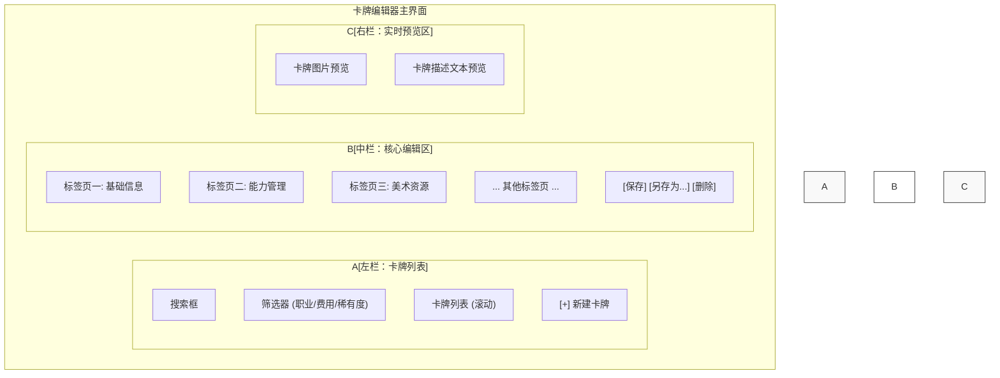
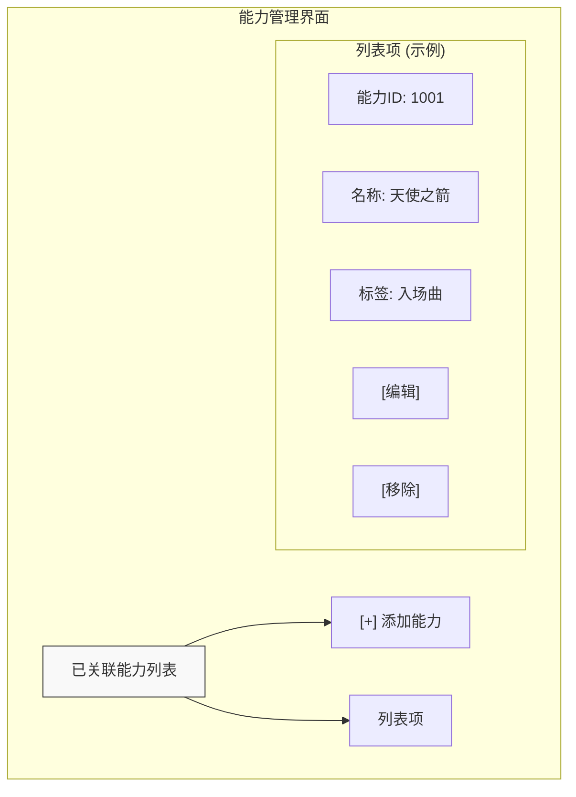

# 01. 卡牌编辑器原型设计

**版本: 1.0**

**作者: AI 技术总监**

**更新日期: 2025-08-10**

## 1. 概述

本文档旨在为“卡牌编辑器”提供一套完整、清晰的用户界面（UI）和用户体验（UX）原型设计方案。设计严格遵循以下两份核心技术规格文档：

*   **卡牌定义**: [`文档/05-游戏系统/13-卡牌数据结构指南.md`](../05-游戏系统/13-卡牌数据结构指南.md)
*   **能力定义**: [`文档/05-游戏系统/14-卡牌能力DSL开发指南.md`](../05-游戏系统/14-卡牌能力DSL开发指南.md)

本原型将详细描述编辑器的布局、核心功能区的UI控件规格以及关键的交互流程，为后续的开发工作提供直观、明确的蓝图。

---

## 2. 主界面布局设计

我们将采用经典且高效的三栏式布局，为用户提供清晰、直观且反馈及时的编辑体验。

### 2.1. 布局线框图



### 2.2. 各区域功能说明

*   **左栏 (卡牌列表区):**
    *   **功能**: 提供对所有 `CardDefinition` 的快速访问、搜索和筛选。
    *   **交互**:
        *   点击列表中的卡牌，会在中栏加载该卡牌的详细信息以供编辑。
        *   点击“新建卡牌”按钮，中栏将清空并呈现一个全新的 `CardDefinition` 表单。

*   **中栏 (核心编辑区):**
    *   **功能**: 这是编辑工作的核心区域，通过标签页 (Tabs) 来组织复杂的配置项，避免界面过于拥挤。
    *   **设计**:
        *   **基础信息**: 包含卡牌的名称、费用、攻击/生命值等静态属性。
        *   **能力管理**: 集中处理与卡牌关联的 `AbilityIds`。
        *   **美术资源**: 用于上传和管理卡牌的插画、卡背等。

*   **右栏 (实时预览区):**
    *   **功能**: 根据中栏编辑区的内容，实时生成卡牌的视觉预览。
    *   **交互**: 当中栏的任何数据发生变化时（例如修改了卡牌名称），右栏的预览图会立刻刷新，为设计师提供最直观的反馈。

---

## 3. 基础信息编辑区设计

此区域位于中栏的第一个标签页，用于编辑卡牌的各项基础属性。所有控件的设计都直接映射自 `CardDefinition` 的字段。

### 3.1. 控件规格表

| 属性名 (`CardDefinition`) | UI 控件类型 | 标签文本 (中文) | 校验规则/说明 |
| :--- | :--- | :--- | :--- |
| `Id` | 只读文本 | `卡牌ID` | 数据库自动生成，不可编辑。 |
| `Name` | 单行文本输入框 | `名称` | 必填项。 |
| `Type` | 下拉菜单 | `类型` | 必选项。选项的显示文本通过本地化API获取。 |
| `Rarity` | 下拉菜单 | `稀有度` | 必选项。选项的显示文本通过本地化API获取。 |
| `CardSet` | 单行文本输入框 | `卡包` | 必填项。 |
| `Class` | 下拉菜单 | `职业` | 必选项。选项的显示文本通过本地化API获取。 |
| `Cost` | 数字输入框 | `费用` | 必填项，仅接受非负整数。 |
| `Attack` | 数字输入框 | `攻击力` | 仅当 `类型` 为“随从”时显示和启用。仅接受非负整数。 |
| `Health` | 数字输入框 | `生命值` | 仅当 `类型` 为“随从”时显示和启用。仅接受正整数。 |
| `Tribe` | 标签式多选框 | `种族/特性` | 允许用户输入文本后按回车添加为标签，或从预设列表中选择。 |
| `Description` | 多行文本输入框 | `描述` | 用于填写卡牌的效果描述文本。支持换行。 |
| `Keywords` | 标签式多选框 | `关键字` | 从预设的关键字列表中勾选，显示文本通过本地化API获取。 |
| `IsCollectible` | 复选框 | `可收集卡牌` | 勾选代表是，不勾选代表否（如衍生卡）。 |

### 3.2. 交互说明

*   **动态显隐**: “攻击力”和“生命值”输入框的可见性与“类型”下拉菜单的选项动态绑定。当用户选择“随从”时，这两个输入框出现；选择“法术”或“护符”时，它们则隐藏。
*   **标签输入**: 对于“种族”和“关键字”，用户可以方便地添加或移除标签。这提供了比传统多选列表更直观的交互方式。

---

## 3.5. 数据-UI组件映射规范

为了确保前端开发与后端数据模型完全对齐，本章节将提供一份从 `CardDefinition` 每一个属性到具体UI组件的精确映射规范。这份规范是实现“基础信息编辑区”的直接技术指导。

| 属性名 (`CardDefinition`) | 数据类型 | UI 组件推荐 | 交互与校验规则 |
| :--- | :--- | :--- | :--- |
| `Id` | `int` | **只读文本/标签 (Read-only Text/Label)** | **不可编辑**。用于展示数据库分配的唯一ID，帮助设计师定位问题。 |
| `Name` | `string` | **单行文本输入框 (Text Input)** | **必填项**。应有最大长度限制（如50个字符）。 |
| `Type` | `CardType` (enum) | **下拉选择器 (Dropdown/Select)** | **必选项**。数据源来自 `GET /api/localization/enums/CardType`。选择后会触发其他UI（如攻击力/生命值）的显隐。 |
| `Rarity` | `CardRarity` (enum) | **下拉选择器 (Dropdown/Select)** | **必选项**。数据源来自 `GET /api/localization/enums/CardRarity`。 |
| `CardSet` | `string` | **单行文本输入框 (Text Input)** | **必填项**。未来可升级为从卡包数据表选择的下拉框。 |
| `Class` | `CardClass` (enum) | **下拉选择器 (Dropdown/Select)** | **必选项**。数据源来自 `GET /api/localization/enums/CardClass`。 |
| `Cost` | `int` | **数字步进器 (Number Stepper)** | **必填项**。值必须为 `≥ 0` 的整数。提供 `+` / `-` 按钮方便快速调整。 |
| `Attack` | `int?` | **数字步进器 (Number Stepper)** | **条件显示**：仅当 `Type` 为 `Follower` (随从) 时可见。值必须为 `≥ 0` 的整数。 |
| `Health` | `int?` | **数字步进器 (Number Stepper)** | **条件显示**：仅当 `Type` 为 `Follower` (随从) 时可见。值必须为 `> 0` 的整数。 |
| `Tribe` | `List<string>` | **标签输入框 (Tag Input)** | 允许用户自由输入文本，按回车或逗号确认为一个标签。支持删除已添加的标签。建议提供一个常见种族的自动补全列表。 |
| `Description` | `string` | **多行文本区域 (Textarea)** | 用于输入卡牌描述。应支持富文本特性，例如用特定标记（如 `<b>...</b>`）来加粗关键字，并在预览区正确渲染。 |
| `Keywords` | `List<string>` | **多选勾选组 (Checkbox Group) / 标签输入框** | **推荐使用多选勾选组**。选项来自 `GET /api/localization/enums/CardKeyword`。每个关键字是一个复选框，勾选即添加。 |
| `IsCollectible` | `bool` | **复选框 (Checkbox)** | 勾选状态对应 `true`，未勾选对应 `false`。 |
| `AbilityIds` | `List<long>` | **专用列表控件 (Custom List Control)** | 此项由“能力管理”标签页中的专用UI进行管理，详见第4节。 |

---

## 4. 核心功能区设计 - 能力管理

此区域位于中栏的“能力管理”标签页，是连接卡牌与具体行为逻辑的桥梁。

### 4.1. 界面设计

我们将使用一个功能丰富的列表控件来管理已关联的能力。



### 4.2. 控件与交互说明

*   **已关联能力列表**:
    *   **显示内容**: 每一行清晰地展示一个已关联能力的摘要信息，至少包括 `能力ID`, `能力名称`, `能力标签` (如Fanfare, LastWords)。这能让设计师对卡牌行为一目了然。
    *   **排序**: 允许拖拽列表项进行排序，以定义能力在同一触发时机下的执行优先级。
    *   **[编辑]按钮**: 点击后，打开“能力编辑器”（在未来阶段实现），并加载该能力的详细配置。
    *   **[移除]按钮**: 点击后，将该能力从 `AbilityIds` 列表中移除，解除与当前卡牌的关联。

*   **[+] 添加新能力/关联现有能力 按钮**:
    *   **功能**: 这是为卡牌赋予新行为的入口。
    *   **交互流程**: 点击此按钮后，系统应弹出一个模态窗口（Modal Dialog）。

### 4.3. “添加能力”模态窗口交互流程

这是连接两个编辑器的关键交互点，需要详细规划。

```mermaid
graph TD
    A[用户点击 '[+] 添加能力' 按钮] --> B{弹出 '添加能力' 模态窗口};
    
    subgraph "'添加能力' 模态窗口"
        direction TB
        B --> C["选项卡: 创建新能力"];
        B --> D["选项卡: 关联现有能力"];
    end

    subgraph "创建新能力"
        C --> E["显示简化的能力创建表单"];
        E --> F["核心字段: 能力名称, 触发器, 效果"];
        F --> G["[创建并关联]"];
    end

    subgraph "关联现有能力"
        D --> H["显示能力搜索/筛选器"];
        H --> I["能力列表 (带分页)"];
        I --> J["[选择]"];
    end

    G -- "1. 创建新能力条目<br>2. 获取新能力ID<br>3. 将ID添加到卡牌的AbilityIds列表<br>4. 关闭模态窗口" --> K[主界面能力列表刷新];
    J -- "1. 获取选中能力的ID<br>2. 将ID添加到卡牌的AbilityIds列表<br>3. 关闭模态窗口" --> K;

```

**流程详解**:

1.  **点击添加**: 用户在卡牌编辑器的“能力管理”标签页中点击 `[+]` 按钮。
2.  **弹出窗口**: 系统弹出一个模态窗口，提供两个选项：
    *   **创建新能力**: 这是最常用的路径。窗口内会呈现一个**简化版**的能力编辑器界面，让用户可以快速定义一个新能力的核心部分（如名称、触发时机、一个简单的效果）。点击“创建并关联”后，系统会在后台创建一个完整的 `AbilityConfig` JSON对象，存入数据库，然后将返回的新ID添加到当前卡牌的 `AbilityIds` 列表中。
    *   **关联现有能力**: 这个选项用于复用已有的能力。窗口内会显示一个能力库，支持搜索和筛选。用户找到需要的能力后，点击“选择”，系统会将该能力的ID添加到 `AbilityIds` 列表中。
3.  **完成关联**: 无论通过哪种方式，操作完成后，模态窗口关闭，主界面上的“已关联能力列表”会自动刷新，显示新加入的能力。

---

## 5. 本地化架构方案

为了实现UI的完全中文化，并避免硬编码带来的维护问题，我们设计了以下动态、可扩展的本地化架构。

### 5.1. 核心思想

**数据与表现分离**。后台C#代码中的枚举（如 `CardRarity.Bronze`）是稳定的**数据**，而UI上显示的“青铜”是**表现**。我们通过为后台数据附加元数据的方式，让前端可以动态获取其对应的显示文本。

### 5.2. 后端实现：基于`Description`特性的动态API

1.  **定义`Description`特性**: 在所有需要本地化的枚举上，为每个成员添加 `System.ComponentModel.DescriptionAttribute`。

    ```csharp
    // 示例：CardRarity 枚举
    using System.ComponentModel;

    public enum CardRarity
    {
        [Description("青铜")]
        Bronze,
        [Description("白银")]
        Silver,
        [Description("黄金")]
        Gold,
        [Description("传说")]
        Legendary
    }
    ```

2.  **创建通用API端点**: 建立一个API端点，如 `GET /api/localization/enums/{enumName}`，用于动态获取任何枚举的本地化文本。

3.  **API逻辑 (反射)**: 该API接收一个枚举名称（如 "CardRarity"），通过C#的反射机制：
    *   找到对应的枚举类型。
    *   遍历该枚举的所有成员。
    *   读取每个成员的 `Description` 特性中的文本。
    *   构建并返回一个键值对的JSON对象。

    **请求**: `GET /api/localization/enums/CardRarity`

    **响应**:
    ```json
    {
      "Bronze": "青铜",
      "Silver": "白银",
      "Gold": "黄金",
      "Legendary": "传说"
    }
    ```

### 5.3. 前端实现

1.  **启动时加载**: 卡牌编辑器应用在初始化时，会向后端API请求所有需要的枚举本地化数据（如 `CardRarity`, `CardClass`, `CardType` 等），并缓存在前端。

2.  **动态填充UI**:
    *   对于下拉菜单（如“稀有度”），其选项列表将根据缓存的本地化数据动态生成。
    *   **显示文本**: 用户看到的是中文，如“传说”。
    *   **后台值**: 当用户提交表单时，发送给后端的是其对应的英文枚举成员名，如 `Legendary`。

### 5.4. 优点

*   **高内聚**: 本地化文本与其数据源（枚举）在代码中紧密关联，修改方便。
*   **易维护**: 增加或修改一个枚举成员或其翻译，只需在C#代码中修改一处，无需触碰任何前端代码。
*   **可扩展**: 此方案可轻松扩展到任何需要本地化的枚举或数据结构。
*   **前后端解耦**: 前后端通过稳定的英文枚举名进行通信，显示层和数据层完全分离。

## 6. 总结与后续步骤

本原型设计文档详细规划了卡牌编辑器的UI布局、核心功能区的控件规格、关键的交互流程以及一套完整的UI本地化架构方案。我们设计了一个清晰、高效、可扩展的编辑器框架，它将为游戏设计师提供强大的工具来创建和管理卡牌。

**核心设计原则**:

*   **数据驱动**: 所有UI设计都严格基于 `CardDefinition` 的数据结构。
*   **直观反馈**: 通过三栏式布局和实时预览，提供即时的视觉反馈。
*   **关注流程**: 详细规划了“添加能力”这一核心交互，为后续实现能力编辑器铺平了道路。
*   **本地化支持**: 通过动态API提供枚举的中文翻译，实现了优雅的本地化。

**后续步骤**:

1.  **原型审核**: 将此文档提交给项目相关方进行审核，收集反馈并进行必要的调整。
2.  **技术选型**: 基于此原型，前端团队可以选择合适的技术栈（如 React, Vue, Blazor 等）来实现。
3.  **进入开发**: 审核通过后，此文档将作为UI开发的直接蓝图。开发团队可以切换到 **Code** 模式，开始具体的编码实现工作。
