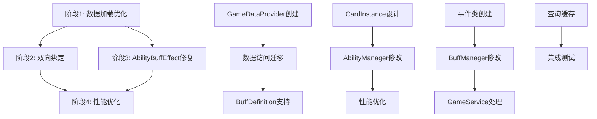

# 核心架构优化实施计划

## 目的与范围

本文档基于当前架构状态评估，制定系统化的核心架构优化实施计划。重点解决数据加载性能瓶颈、CardInstance-Ability绑定缺陷和AbilityBuffEffect架构问题。

**最新更新：** 2025年1月 - 基于Context系统统一完成状态的重新规划

## 当前架构状态评估 [COMPLETED]

### ✅ 已完成项目
- **Context系统统一** - GameContext已完全替代分散的Context类
- **基础能力系统** - Ability、AbilityManager、EventProcessor核心架构完成
- **事件驱动架构** - 完整的事件处理和广播机制
- **Buff系统基础** - BuffManager和基础Buff处理逻辑

### ❌ 待解决的核心问题

#### 问题1: 数据加载性能瓶颈 [CRITICAL]
**当前状态：** 按需加载模式导致频繁数据库查询
- AbilityLoader在每次打牌时查询数据库加载能力配置
- CardDefinition重复加载（游戏初始化 + 每次打牌）
- 缺少统一的GameDataProvider缓存服务
- GameService中频繁创建Scope访问数据库

#### 问题2: CardInstance-Ability单向绑定缺陷 [CRITICAL]
**当前状态：** CardInstance无法直接访问自己的能力
- 每次查询能力需要通过AbilityManager.GetAbilitiesForCard()
- UI显示和游戏逻辑中频繁的能力查询造成性能开销
- CardInstance缺少Abilities属性，无法直接访问

#### 问题3: AbilityBuffEffect架构不匹配 [HIGH]
**当前状态：** 临时能力无法正常注册
- BuffManager只有CardInstance的字符串ID，无法获取完整对象
- AbilityManager.RegisterAbility()需要完整的CardInstance对象
- 跨层级通信问题导致"获得能力"类Buff无法工作

## 重新调整的任务优先级

### 优先级1: 核心数据加载机制优化 [CRITICAL]
**理由：** 解决性能瓶颈，为后续优化奠定基础

### 优先级2: CardInstance-Ability双向绑定 [CRITICAL]  
**理由：** 解决架构根本缺陷，提升查询性能

### 优先级3: AbilityBuffEffect架构修复 [HIGH]
**理由：** 完善临时能力功能，确保Buff系统完整性

### 优先级4: 性能优化和缓存机制 [MEDIUM]
**理由：** 在架构修复基础上进一步优化性能

## 详细实施计划

### 阶段0: 基础架构修复 [2-3天] [IN-PROGRESS]

#### 0.1 修复编译错误 [Day 1-2]
**目标：** 修复由于之前重构造成的Guid/string类型不匹配问题

**发现的问题：**
- CardInstance.InstanceId从string改为Guid后，大量代码需要适配
- Keywords枚举缺少Rush、Storm、Ward等定义
- GameConstants.Evolution缺少EvolutionPointCost定义
- CardInstance缺少Name、Description等属性访问
- 事件处理中的类型转换问题

**任务清单：**
- [x] **已完成**: GameDataProvider接口和基础实现创建
- [ ] **Day 1**: 修复CardInstance相关的Guid/string转换问题
- [ ] **Day 2**: 修复Keywords枚举和GameConstants定义
- [ ] **Day 3**: 修复事件处理和DTO转换问题

### 阶段1: 核心数据加载机制优化 [1-2周] [PENDING]

#### 1.1 完成GameDataProvider服务 [Day 1-2]
**目标：** 完成统一的数据预加载和缓存服务实现

**任务清单：**
- [x] **已完成**: 设计GameDataProvider接口和基础实现
- [x] **已完成**: 在Program.cs中注册服务
- [ ] **Day 1**: 修复编译错误后测试GameDataProvider
- [ ] **Day 2**: 完善错误处理和性能监控

**文件修改清单：**
- 新建：`Server/Services/GameDataProvider.cs`
- 新建：`Server/Services/Abstractions/IGameDataProvider.cs`
- 新建：`Server/Services/GameDataPreloadService.cs`
- 修改：`Server/Program.cs`

#### 1.2 修改数据访问逻辑 [Day 4-7]
**目标：** 将现有组件迁移到缓存访问模式

**任务清单：**
- [ ] **Day 4-5**: 修改GameService数据访问
  - 注入IGameDataProvider到GameService
  - 修改FetchCardDataAsync使用缓存
  - 修改GetOrCreateGameStateAsync使用缓存构建牌库

- [ ] **Day 6**: 修改AbilityManager数据访问
  - 注入IGameDataProvider到AbilityManager
  - 修改CreateAbilitiesForCard从缓存获取配置
  - 移除对AbilityLoader的直接使用

- [ ] **Day 7**: 清理和测试
  - 移除GameService中的AbilityLoader使用
  - 编写单元测试验证缓存功能

**文件修改清单：**
- 修改：`Server/Services/GameService.cs`
- 修改：`Server/Domain/Abilities/AbilityManager.cs`
- 修改：`Server/Program.cs` (DI注册)

#### 1.3 BuffDefinition支持 [Day 8-10]
**目标：** 扩展预加载机制支持Buff模板

**任务清单：**
- [ ] **Day 8**: 确认BuffDefinition实体设计
- [ ] **Day 9**: 实现BuffDefinition预加载逻辑
- [ ] **Day 10**: 集成测试和性能验证

**验收标准：**
- [ ] 应用启动时成功预加载所有静态数据
- [ ] 运行时无数据库查询（除动态数据）
- [ ] 性能测试显示查询响应时间<1ms
- [ ] 内存使用增长<50MB

### 阶段2: CardInstance-Ability双向绑定实现 [1-2周] [PENDING]

#### 2.1 CardInstance双向绑定设计 [Day 1-4]
**目标：** 让CardInstance能够直接访问自己的能力

**任务清单：**
- [ ] **Day 1-2**: 设计CardInstance.Abilities属性
  - 在CardInstance中添加IReadOnlyList<Ability> Abilities属性
  - 添加内部方法SetAbilities()
  - 添加便捷方法：GetAbilitiesByType()、HasAbility()

- [ ] **Day 3-4**: 修改AbilityManager支持双向绑定
  - 修改RegisterAbility()方法同步更新CardInstance
  - 修改UnregisterAbility()方法同步更新CardInstance
  - 实现UpdateCardInstanceAbilities()核心同步方法

**文件修改清单：**
- 修改：`Server/Domain/Entities/CardInstance.cs`
- 修改：`Server/Domain/Abilities/AbilityManager.cs`

#### 2.2 性能优化和并发保护 [Day 5-7]
**目标：** 确保双向绑定的性能和线程安全

**任务清单：**
- [ ] **Day 5**: 实现批量操作优化
- [ ] **Day 6**: 添加并发访问保护
- [ ] **Day 7**: 内存泄漏防护和测试

**验收标准：**
- [ ] CardInstance.Abilities属性正确反映当前能力状态
- [ ] 能力注册/注销时自动同步CardInstance
- [ ] 线程安全，无并发访问问题
- [ ] 性能测试无明显回归

### 阶段3: AbilityBuffEffect架构修复 [1周] [PENDING]

#### 3.1 事件驱动解决方案 [Day 1-5]
**目标：** 通过事件机制解决跨层级通信问题

**任务清单：**
- [ ] **Day 1-2**: 创建AbilityBuffRegistrationEvent
- [ ] **Day 3**: 修改BuffManager事件发送逻辑
- [ ] **Day 4**: 在GameService中实现事件处理
- [ ] **Day 5**: 端到端测试临时能力功能

**文件修改清单：**
- 新建：`Server/Domain/Events/AbilityBuffRegistrationEvent.cs`
- 修改：`Server/Domain/Buffs/BuffManager.cs`
- 修改：`Server/Services/GameService.cs`

**验收标准：**
- [ ] "获得能力"类Buff能够正常工作
- [ ] 临时能力在Buff移除时正确清理
- [ ] 事件处理不影响现有系统性能

### 阶段4: 性能优化和缓存机制 [3-5天] [PENDING]

#### 4.1 查询缓存实现 [Day 1-3]
**目标：** 在双向绑定基础上进一步优化查询性能

**任务清单：**
- [ ] **Day 1-2**: 实现AbilityManager查询缓存
- [ ] **Day 3**: 性能监控和分析工具

#### 4.2 集成测试和验证 [Day 4-5]
**目标：** 全面验证架构优化效果

**任务清单：**
- [ ] **Day 4**: 功能完整性测试
- [ ] **Day 5**: 性能回归测试和文档更新

## 依赖关系图



## 风险缓解策略

### 高风险项目
- **数据预加载内存影响** - 监控内存使用，实现分批加载
- **双向绑定内存泄漏** - 实现Dispose模式和弱引用机制
- **并发访问问题** - 使用ReaderWriterLockSlim确保线程安全

### 回滚机制
- 每个阶段独立提交，便于回滚
- 保持现有API向后兼容
- 渐进式迁移，避免破坏性变更

## 成功标准

- [ ] 所有数据加载改为预加载，消除运行时数据库查询
- [ ] CardInstance能够直接访问自己的能力列表
- [ ] 临时能力（AbilityBuffEffect）正常工作
- [ ] 性能测试显示明显改善，无功能回归
- [ ] 内存使用增长在可接受范围内（<100MB）
- [ ] 所有TODO注释得到解决

## 实施时间线

**总计：** 4-6周
- 阶段1：1-2周
- 阶段2：1-2周  
- 阶段3：1周
- 阶段4：3-5天

**里程碑：**
- Week 2: 数据预加载完成
- Week 4: 双向绑定完成
- Week 5: AbilityBuffEffect修复完成
- Week 6: 性能优化和验证完成

## 详细技术实现方案

### GameDataProvider技术设计

#### 接口设计
```csharp
// IGameDataProvider.cs
public interface IGameDataProvider
{
    // 初始化方法
    Task InitializeAsync();

    // 卡牌定义访问
    CardDefinition? GetCardDefinition(int cardId);
    IReadOnlyDictionary<int, CardDefinition> GetAllCardDefinitions();

    // 能力配置访问
    List<AbilityConfig> GetAbilityConfigs(int cardId);
    AbilityConfig? GetAbilityConfig(long abilityId);
    IReadOnlyDictionary<int, List<AbilityConfig>> GetAllAbilityConfigs();

    // Buff定义访问（待实现）
    BuffDefinition? GetBuffDefinition(string buffId);

    // 缓存管理
    Task RefreshCacheAsync();
    void ClearCache();

    // 统计信息
    CacheStatistics GetCacheStatistics();
}
```

#### 实现设计
```csharp
// GameDataProvider.cs
public class GameDataProvider : IGameDataProvider
{
    private readonly IServiceScopeFactory _scopeFactory;
    private readonly ILogger<GameDataProvider> _logger;

    // 缓存字典
    private readonly ConcurrentDictionary<int, CardDefinition> _cardDefinitions = new();
    private readonly ConcurrentDictionary<int, List<AbilityConfig>> _abilityConfigsByCard = new();
    private readonly ConcurrentDictionary<long, AbilityConfig> _abilityConfigsById = new();

    // 缓存状态
    private volatile bool _isInitialized = false;
    private readonly SemaphoreSlim _initializationLock = new(1, 1);
    private DateTime _lastInitialized = DateTime.MinValue;

    public async Task InitializeAsync()
    {
        if (_isInitialized) return;

        await _initializationLock.WaitAsync();
        try
        {
            if (_isInitialized) return;

            _logger.LogInformation("开始初始化GameDataProvider缓存...");
            var startTime = DateTime.UtcNow;

            await LoadCardDefinitionsAsync();
            await LoadAbilityConfigsAsync();

            _isInitialized = true;
            _lastInitialized = DateTime.UtcNow;

            var duration = DateTime.UtcNow - startTime;
            _logger.LogInformation("GameDataProvider缓存初始化完成，耗时: {Duration}ms", duration.TotalMilliseconds);
        }
        finally
        {
            _initializationLock.Release();
        }
    }

    private async Task LoadCardDefinitionsAsync()
    {
        using var scope = _scopeFactory.CreateScope();
        var cardRepository = scope.ServiceProvider.GetRequiredService<ICardRepository>();

        var allCards = await cardRepository.GetAllCardDefinitionsAsync();

        _cardDefinitions.Clear();
        foreach (var card in allCards)
        {
            _cardDefinitions[card.Id] = card;
        }

        _logger.LogDebug("加载了 {Count} 个卡牌定义", allCards.Count);
    }

    private async Task LoadAbilityConfigsAsync()
    {
        using var scope = _scopeFactory.CreateScope();
        var dbContext = scope.ServiceProvider.GetRequiredService<ApplicationDbContext>();
        var abilityLoader = new AbilityLoader(dbContext,
            scope.ServiceProvider.GetRequiredService<ILogger<AbilityLoader>>());

        var allAbilities = await abilityLoader.LoadAllAbilitiesAsync();

        _abilityConfigsByCard.Clear();
        _abilityConfigsById.Clear();

        foreach (var ability in allAbilities)
        {
            // 按卡牌ID索引
            _abilityConfigsByCard.AddOrUpdate(
                ability.CardId,
                new List<AbilityConfig> { ability },
                (key, existing) => { existing.Add(ability); return existing; });

            // 按能力ID索引
            _abilityConfigsById[ability.Id] = ability;
        }

        _logger.LogDebug("加载了 {Count} 个能力配置", allAbilities.Count);
    }
}
```

### CardInstance双向绑定技术设计

#### CardInstance修改
```csharp
// CardInstance.cs 新增部分
public class CardInstance : ICard
{
    // 新增：只读能力列表属性
    public IReadOnlyList<Ability> Abilities { get; private set; } = Array.Empty<Ability>();

    // 新增：内部方法，仅供AbilityManager调用
    internal void SetAbilities(IReadOnlyList<Ability> abilities)
    {
        Abilities = abilities ?? Array.Empty<Ability>();
    }

    // 新增：便捷方法 - 获取特定类型的能力
    public IEnumerable<Ability> GetAbilitiesByType(AbilityType type)
    {
        return Abilities.Where(a => a.Type == type);
    }

    // 新增：便捷方法 - 获取特定标签的能力
    public IEnumerable<Ability> GetAbilitiesByTag(string tag)
    {
        return Abilities.Where(a => a.AbilityTag.Equals(tag, StringComparison.OrdinalIgnoreCase));
    }

    // 新增：便捷方法 - 检查是否有特定能力
    public bool HasAbility(string abilityTag)
    {
        return Abilities.Any(a => a.AbilityTag.Equals(abilityTag, StringComparison.OrdinalIgnoreCase));
    }

    // 新增：便捷方法 - 获取触发特定事件的能力
    public IEnumerable<Ability> GetAbilitiesTriggeredBy(GameEventType eventType)
    {
        return Abilities.Where(a => a.Trigger.EventTypes.Contains(eventType));
    }
}
```

#### AbilityManager双向同步
```csharp
// AbilityManager.cs 修改部分
public class AbilityManager
{
    // 新增：双向绑定支持
    private readonly ConcurrentDictionary<string, WeakReference<CardInstance>> _cardInstanceRefs = new();

    // 修改：注册能力时同步更新CardInstance
    public void RegisterAbility(Ability ability)
    {
        if (ability?.SourceCard == null) return;

        // 现有逻辑...
        _allAbilities.Add(ability);

        // 按事件类型索引
        foreach (var eventType in ability.Trigger.EventTypes)
        {
            var eventTypeString = eventType.ToString();
            _abilitiesByEventType.AddOrUpdate(eventTypeString,
                new List<Ability> { ability },
                (key, existingList) => { existingList.Add(ability); return existingList; });
        }

        // 按卡片ID索引
        var cardInstanceId = ability.SourceCard.InstanceId.ToString();
        _abilitiesByCardId.AddOrUpdate(cardInstanceId,
            new List<Ability> { ability },
            (key, existingList) => { existingList.Add(ability); return existingList; });

        // 新增：同步更新CardInstance的能力列表
        UpdateCardInstanceAbilities(ability.SourceCard);

        // 新增：保持CardInstance的弱引用
        _cardInstanceRefs[cardInstanceId] = new WeakReference<CardInstance>(ability.SourceCard);
    }

    // 新增：同步CardInstance能力列表的核心方法
    private void UpdateCardInstanceAbilities(CardInstance cardInstance)
    {
        var abilities = GetAbilitiesForCard(cardInstance.InstanceId.ToString());
        cardInstance.SetAbilities(abilities.AsReadOnly());

        _logger?.LogDebug("[AbilityManager] 更新了卡牌 {CardId} 的能力列表: {Count} 个能力",
            cardInstance.InstanceId, abilities.Count);
    }

    // 新增：批量更新多个CardInstance的能力
    public void RefreshAllCardAbilities()
    {
        var validRefs = new List<CardInstance>();
        var keysToRemove = new List<string>();

        foreach (var kvp in _cardInstanceRefs)
        {
            if (kvp.Value.TryGetTarget(out var cardInstance))
            {
                validRefs.Add(cardInstance);
            }
            else
            {
                keysToRemove.Add(kvp.Key);
            }
        }

        // 清理失效的弱引用
        foreach (var key in keysToRemove)
        {
            _cardInstanceRefs.TryRemove(key, out _);
        }

        // 批量更新
        foreach (var cardInstance in validRefs)
        {
            UpdateCardInstanceAbilities(cardInstance);
        }

        _logger?.LogDebug("[AbilityManager] 批量更新了 {Count} 个卡牌的能力列表", validRefs.Count);
    }
}
```

### AbilityBuffEffect事件驱动设计

#### 事件类设计
```csharp
// AbilityBuffRegistrationEvent.cs
public class AbilityBuffRegistrationEvent : IGameEvent
{
    public string EventId { get; } = Guid.NewGuid().ToString();
    public string EventType => "ability_buff_registration";
    public DateTime Timestamp { get; } = DateTime.UtcNow;
    public Dictionary<string, object> Parameters { get; } = new();

    public string TargetCardInstanceId { get; }
    public List<AbilityConfig> AbilityConfigs { get; }
    public string SourceBuffId { get; }
    public bool IsRemoval { get; }

    public AbilityBuffRegistrationEvent(
        string targetCardInstanceId,
        List<AbilityConfig> abilityConfigs,
        string sourceBuffId,
        bool isRemoval = false)
    {
        TargetCardInstanceId = targetCardInstanceId;
        AbilityConfigs = abilityConfigs ?? new List<AbilityConfig>();
        SourceBuffId = sourceBuffId;
        IsRemoval = isRemoval;

        Parameters["target_card_id"] = targetCardInstanceId;
        Parameters["source_buff_id"] = sourceBuffId;
        Parameters["is_removal"] = isRemoval;
        Parameters["ability_count"] = AbilityConfigs.Count;
    }

    public async Task<List<IGameEvent>> ExecuteAsync(GameContext context)
    {
        // 事件本身不执行逻辑，由GameService处理
        return new List<IGameEvent>();
    }
}
```

## 测试策略

### 单元测试重点
- [ ] GameDataProvider缓存功能测试
- [ ] CardInstance.Abilities属性正确性测试
- [ ] AbilityManager双向同步机制测试
- [ ] 临时能力生命周期管理测试
- [ ] 并发访问线程安全测试

### 集成测试场景
- [ ] 完整的数据预加载流程测试
- [ ] Buff应用和移除的完整流程测试
- [ ] 多个临时能力同时存在的情况测试
- [ ] 高并发环境下的数据一致性测试

### 性能测试指标
- [ ] 数据预加载时间（目标：<10秒）
- [ ] 能力查询响应时间（目标：<1ms）
- [ ] 内存使用增长（目标：<100MB）
- [ ] 并发处理能力（目标：无性能回归）

## 监控和分析

### 性能监控指标
```csharp
public class CacheStatistics
{
    public int CardDefinitionCount { get; set; }
    public int AbilityConfigCount { get; set; }
    public DateTime LastInitialized { get; set; }
    public TimeSpan InitializationDuration { get; set; }
    public long MemoryUsageBytes { get; set; }
    public int CacheHitCount { get; set; }
    public int CacheMissCount { get; set; }
    public double CacheHitRatio => CacheHitCount + CacheMissCount > 0
        ? (double)CacheHitCount / (CacheHitCount + CacheMissCount)
        : 0.0;
}
```

### 日志记录策略
- **启动阶段：** 详细记录预加载过程和性能指标
- **运行时：** 记录缓存命中率和异常情况
- **调试模式：** 记录能力同步和事件处理详情

## 文档更新计划

### 需要更新的文档
- [ ] `文档/02-后端架构/01-服务层设计.md` - 添加GameDataProvider描述
- [ ] `文档/05-游戏系统/01-卡牌能力系统.md` - 更新双向绑定架构
- [ ] `文档/05-游戏系统/10-动态效果与Buff系统.md` - 更新临时能力处理
- [ ] `文档/08-项目管理/04-系统集成与架构改进.md` - 标记任务完成状态
- [ ] `文档/08-项目管理/05-优化核心游戏数据加载机制.md` - 更新实施状态

### 新增文档
- [ ] `文档/02-后端架构/03-数据缓存与预加载策略.md`
- [ ] `文档/05-游戏系统/01-02-能力系统性能优化.md`
