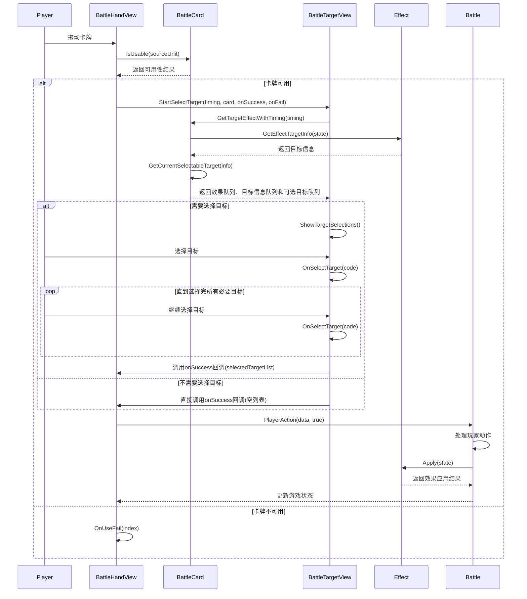

I need to search for more information about the Battle.cs file since it wasn't fully included in the provided excerpts. Let me analyze what I can see so far and then I'll create the requested technical document.

# 卡牌使用与目标选择系统技术文档

## 1. 卡牌使用流程概述

卡牌使用系统是游戏核心玩法的关键部分，它涉及多个组件的协作，包括用户界面交互、目标选择、效果验证和执行。整个流程从玩家拖动卡牌开始，到效果完全应用结束。

### 1.1 主要组件

从代码分析中，我们可以看到以下关键组件参与了卡牌使用流程：

- **BattleCard**: 表示战斗中的卡牌实例，包含卡牌数据和状态
- **BattleHandView**: 管理手牌区域的UI视图
- **BattleTargetView**: 处理目标选择的UI交互
- **Effect**: 表示卡牌效果
- **EffectTargetInfo**: 解析和存储效果目标信息
- **Battle**: 处理游戏核心逻辑和状态更新

## 2. 卡牌使用前的验证

在玩家尝试使用卡牌前，系统会进行一系列验证：

```csharp
public bool IsUsable(BattleUnit sourceUnit) {
    var useCost = GetUseCost(sourceUnit.leader, out var situation);
    var useCard = GetCurrentBattleCard(useCost, situation);

    bool isCostEnough = sourceUnit.leader.PP >= useCost;
    bool isFieldFull = useCard.CurrentCard.IsFollower() && sourceUnit.field.IsFull;
    bool isSpellTargetable = true;

    if (useCard.CurrentCard.Type == CardType.Spell) {
        GetTargetEffectWithTiming("on_this_play", out _, out var infoQueue, out var selectableQueue);

        while (infoQueue.Count > 0) {
            isSpellTargetable = infoQueue.Dequeue().num <= selectableQueue.Dequeue().Count;
            if (!isSpellTargetable)
                break;
        }
    }

    return sourceUnit.isMyTurn && isCostEnough && (!isFieldFull) && isSpellTargetable;
}
```

验证包括：
- 检查是否是玩家的回合
- 检查玩家是否有足够的PP点数
- 如果是随从卡，检查场上是否已满
- 如果是法术卡，检查是否有可选择的有效目标

## 3. 目标选择机制

### 3.1 目标效果获取

当玩家尝试使用卡牌时，系统会调用`GetTargetEffectWithTiming`方法来获取需要选择目标的效果：

```csharp
public void GetTargetEffectWithTiming(string timing, out Queue<Effect> targetEffectQueue, out Queue<EffectTargetInfo> targetInfoQueue, out Queue<List<int>> selectableTargetQueue) {
    bool isEvolveTiming = timing == "on_this_evolve_with_ep";

    var nowCost = GetUseCost(Hud.CurrentState.myUnit.leader, out var situation);
    var nowBattleCard = GetCurrentBattleCard(nowCost, situation);
    var nowCard = GetCurrentCard(isEvolveTiming ? nowBattleCard.evolveCard : nowBattleCard.OriginalCard);

    targetEffectQueue = new Queue<Effect>();
    targetInfoQueue = new Queue<EffectTargetInfo>();
    selectableTargetQueue = new Queue<List<int>>();

    for (int i = 0; i < nowCard.effects.Count; i++) {
        var currentEffect = nowCard.effects[i];
        if (currentEffect.timing != timing)
            continue;

        currentEffect.invokeUnit = Hud.CurrentState.myUnit;
        if (currentEffect.Condition(Hud.CurrentState)) {
            var info = currentEffect.GetEffectTargetInfo(Hud.CurrentState);

            if ((!List.IsNullOrEmpty(info.mode)) && (info.mode[0] == "index")) {
                targetEffectQueue.Enqueue(currentEffect);
                targetInfoQueue.Enqueue(info);
                selectableTargetQueue.Enqueue(GetCurrentSelectableTarget(info));
            }
            
            // 处理附加效果
            var appendixEffect = currentEffect;
            while (appendixEffect.abilityOptionDict.TryGetValue("appendix", out var trimId)) {
                // ...处理附加效果的逻辑...
            }
        }
        currentEffect.invokeTarget = null;
    }
}
```

这个方法：
1. 确定当前使用的卡牌（考虑到可能的选择效果）
2. 初始化三个队列用于存储：效果、目标信息和可选目标
3. 遍历卡牌的所有效果，筛选出匹配指定时机（timing）的效果
4. 检查效果条件是否满足
5. 获取效果的目标信息
6. 如果目标模式是"index"（需要玩家选择），则将效果、目标信息和可选目标加入队列
7. 处理可能的附加效果

### 3.2 可选目标确定

`GetCurrentSelectableTarget`方法负责根据目标信息确定可选择的目标：

```csharp
public List<int> GetCurrentSelectableTarget(EffectTargetInfo currentInfo) {
    List<int> currentSelectableList = new List<int>();

    // 处理手牌区域的目标
    if (currentInfo.places.Contains(BattlePlaceId.Hand)) {
        // ...筛选手牌区域的可选目标...
    }

    // 处理场地区域的目标
    if (currentInfo.places.Contains(BattlePlaceId.Field)) {
        // ...筛选场地区域的可选目标...
    }

    // 处理主战者目标
    if (currentInfo.places.Contains(BattlePlaceId.Leader)) {
        // ...筛选主战者目标...
    }

    // 排除自身（如果模式包含"other"）
    if (currentInfo.mode.Contains("other"))
        currentSelectableList.Remove(Hud.CurrentState.GetCardPlaceInfo(this).ToIntCode());

    return currentSelectableList;
}
```

这个方法：
1. 根据目标信息中指定的区域（手牌、场地、主战者）筛选可能的目标
2. 应用目标信息中的过滤条件
3. 将目标转换为整数编码（包含区域和索引信息）
4. 如果需要排除自身，则从列表中移除

## 4. 目标选择UI交互

当需要选择目标时，系统会启动目标选择UI：

```csharp
public void StartSelectTarget(string timing, BattleCard sourceCard, Action<List<int>> onSuccess, Action onFail) {
    Clear();

    sourceCard.GetTargetEffectWithTiming(timing, out targetEffectQueue, out infoQueue, out var selectableQueue);

    if (infoQueue.Count <= 0) { 
        onSuccess?.Invoke(selectedTargetList);
        return;
    } 
    
    IsSelectingTarget = true;
    myHandView.SetHandMode(false);

    if (timing == "on_this_play") {
        cardView.rectTransform.anchoredPosition = selectTargetPos;
        cardView.rectTransform.localScale = selectTargetScale * Vector3.one;
        cardView.SetCard(sourceCard.CurrentCard);
    }

    currentInfo = infoQueue.Dequeue();
    currentSelectableList = selectableQueue.Dequeue();
    
    onSuccessTarget = onSuccess;
    onFailTarget = onFail;

    ShowTargetSelections();
}
```

这个方法：
1. 清除之前的选择状态
2. 获取源卡牌的目标效果
3. 如果没有需要选择的目标，直接调用成功回调
4. 设置UI为目标选择模式
5. 显示源卡牌（如果是出牌时机）
6. 获取当前需要处理的目标信息和可选目标
7. 存储成功和失败的回调
8. 显示可选目标

### 4.1 目标选择处理

当玩家选择目标时：

```csharp
public void OnSelectTarget(int code) {
    if ((code != 0) && (!currentSelectableList.Contains(code)))
        return;

    var info = BattleCardPlaceInfo.Parse(code);
    var fieldCardView = (info.unitId == 0) ? myFieldCardViews : opFieldCardViews;

    if (code != 0) {
        currentSelectableList.Remove(code);
        selectedTargetList.Add(code);
        selectNum++;

        // 更新UI显示选中状态
        switch (info.place) {
            default:
                break;
            case BattlePlaceId.Field:
                fieldCardView[info.index].SetOutlineColor(Color.cyan);
                break;
        }
    }
    // ...更多处理逻辑...
}
```

这个方法：
1. 验证选择的目标是否有效
2. 解析目标编码，获取区域和索引信息
3. 将目标添加到已选列表，并从可选列表中移除
4. 更新UI显示选中状态
5. 检查是否已完成所有必要的选择，如果是则进入下一步

## 5. 卡牌使用执行

当目标选择完成后，系统会调用成功回调，最终触发卡牌使用动作：

```csharp
private void OnUseSuccess(int index, List<int> target){
    int[] data = (new int[] { (int)EffectAbility.Play, index }).Concat(target).ToArray();
    Battle.PlayerAction(data, true);
}
```

这个方法：
1. 构造包含操作类型、卡牌索引和目标列表的数据数组
2. 调用Battle.PlayerAction方法执行玩家动作

## 6. 流程图



## 7. 数据结构

### 7.1 关键数据结构

1. **Effect**: 表示卡牌效果
   - ability: 效果能力类型
   - timing: 触发时机
   - target: 目标选择字符串
   - condition: 条件字符串
   - abilityOptionDict: 效果参数字典

2. **EffectTargetInfo**: 解析后的目标信息
   - unit: 目标单位类型（"me", "op", "all"）
   - places: 目标区域列表（手牌、场地、主战者等）
   - mode: 选择模式（"index", "random", "all"等）
   - num: 需要选择的目标数量
   - filter: 目标过滤器

3. **BattleCardPlaceInfo**: 卡牌位置信息
   - unitId: 单位ID（0表示玩家，1表示对手）
   - place: 区域ID（手牌、场地、主战者等）
   - index: 在区域中的索引

### 7.2 关键方法

1. **BattleCard.IsUsable**: 检查卡牌是否可用
2. **BattleCard.GetTargetEffectWithTiming**: 获取指定时机的目标效果
3. **BattleCard.GetCurrentSelectableTarget**: 获取当前可选择的目标
4. **BattleTargetView.StartSelectTarget**: 启动目标选择UI
5. **BattleTargetView.OnSelectTarget**: 处理目标选择
6. **BattleHandView.OnUseSuccess**: 处理卡牌使用成功
7. **Battle.PlayerAction**: 执行玩家动作

## 8. 总结

卡牌使用与目标选择系统是一个复杂而精密的机制，它通过多个组件的协作实现了类似Shadowverse的卡牌交互体验。整个流程从卡牌可用性验证开始，经过目标效果获取、可选目标确定、用户交互选择，最终到效果应用，形成了一个完整的闭环。

系统的设计具有良好的扩展性，通过字符串解析和数据驱动的方式，可以支持各种复杂的卡牌效果和目标选择逻辑，而无需修改核心代码。同时，清晰的组件分工和数据流向，也使得系统易于理解和维护。

## 9.具体实现细节

```csharp
public bool IsUsable(BattleUnit sourceUnit) {
    var useCost = GetUseCost(sourceUnit.leader, out var situation);
    var useCard = GetCurrentBattleCard(useCost, situation);

    bool isCostEnough = sourceUnit.leader.PP >= useCost;
    bool isFieldFull = useCard.CurrentCard.IsFollower() && sourceUnit.field.IsFull;
    bool isSpellTargetable = true;

    if (useCard.CurrentCard.Type == CardType.Spell) {
        GetTargetEffectWithTiming("on_this_play", out _, out var infoQueue, out var selectableQueue);

        while (infoQueue.Count > 0) {
            isSpellTargetable = infoQueue.Dequeue().num <= selectableQueue.Dequeue().Count;
            if (!isSpellTargetable)
                break;
        }
    }

    return sourceUnit.isMyTurn && isCostEnough && (!isFieldFull) && isSpellTargetable;
}
```

### 9.1. IsUsable方法实现细节分析

IsUsable方法是卡牌使用系统的第一道关卡，它决定了玩家是否能够使用一张卡牌。这个方法的核心功能是验证卡牌使用的各项前提条件。

#### 9.1.1 验证流程详解

```csharp
public bool IsUsable(BattleUnit sourceUnit) {
    var useCost = GetUseCost(sourceUnit.leader, out var situation);
    var useCard = GetCurrentBattleCard(useCost, situation);

    bool isCostEnough = sourceUnit.leader.PP >= useCost;
    bool isFieldFull = useCard.CurrentCard.IsFollower() && sourceUnit.field.IsFull;
    bool isSpellTargetable = true;
    // ...
}
```

##### 1.费用计算与卡牌确定:

首先调用GetUseCost获取卡牌使用费用，同时输出使用情境(situation)
然后通过GetCurrentBattleCard获取实际使用的卡牌实例（考虑到某些卡牌可能有多种使用模式）

##### 2.基础条件验证:

isCostEnough: 检查玩家是否有足够的PP点数
isFieldFull: 如果是随从卡，检查场上是否已满
isSpellTargetable: 默认为true，后续针对法术卡进行特殊验证

##### 3.法术卡目标验证:

```csharp
if (useCard.CurrentCard.Type == CardType.Spell) {
    GetTargetEffectWithTiming("on_this_play", out _, out var infoQueue, out var selectableQueue);

    while (infoQueue.Count > 0) {
        isSpellTargetable = infoQueue.Dequeue().num <= selectableQueue.Dequeue().Count;
        if (!isSpellTargetable)
            break;
    }
}
```

这段代码是目标验证的核心：
对于法术卡，调用GetTargetEffectWithTiming获取"on_this_play"时机的效果
方法返回三个队列，这里我们关注infoQueue(目标信息队列)和selectableQueue(可选目标队列)
遍历这两个队列，比较每个效果所需的目标数量(info.num)与可选目标数量(selectable.Count)
如果任何一个效果所需的目标数量大于可选目标数量，则设置isSpellTargetable = false并中断循环

#### 9.1.2 目标验证的关键点

目标验证的核心在于比较"需要的目标数量"与"可选的目标数量"。例如，如果一个法术效果需要指定2个敌方随从，但场上只有1个敌方随从，那么这个法术就无法使用。
这种验证机制确保了玩家不会陷入"选择了一张卡但无法完成目标选择"的尴尬情况，提升了游戏体验。

### 9.2. GetTargetEffectWithTiming方法工作流程分析

```csharp
public void GetTargetEffectWithTiming(string timing, out Queue<Effect> targetEffectQueue, out Queue<EffectTargetInfo> targetInfoQueue, out Queue<List<int>> selectableTargetQueue) {
    bool isEvolveTiming = timing == "on_this_evolve_with_ep";

    var nowCost = GetUseCost(Hud.CurrentState.myUnit.leader, out var situation);
    var nowBattleCard = GetCurrentBattleCard(nowCost, situation);
    var nowCard = GetCurrentCard(isEvolveTiming ? nowBattleCard.evolveCard : nowBattleCard.OriginalCard);

    targetEffectQueue = new Queue<Effect>();
    targetInfoQueue = new Queue<EffectTargetInfo>();
    selectableTargetQueue = new Queue<List<int>>();
    // ...
}
```

#### 9.2.1 初始化与卡牌确定

1.时机判断:
首先判断是否是进化时机(isEvolveTiming)
根据时机不同，后续会选择不同的卡牌数据源
2.卡牌实例获取:
获取当前费用和使用情境
获取对应的战斗卡牌实例
根据时机选择原始卡牌或进化卡牌
3.队列初始化:
初始化三个队列用于存储结果:
targetEffectQueue: 需要目标选择的效果队列
targetInfoQueue: 目标信息队列
selectableTargetQueue: 可选目标队列

### 9.2.2 效果筛选与目标信息获取

```csharp
for (int i = 0; i < nowCard.effects.Count; i++) {
    var currentEffect = nowCard.effects[i];
    if (currentEffect.timing != timing)
        continue;

    currentEffect.invokeUnit = Hud.CurrentState.myUnit;
    if (currentEffect.Condition(Hud.CurrentState)) {
        var info = currentEffect.GetEffectTargetInfo(Hud.CurrentState);

        if ((!List.IsNullOrEmpty(info.mode)) && (info.mode[0] == "index")) {
            targetEffectQueue.Enqueue(currentEffect);
            targetInfoQueue.Enqueue(info);
            selectableTargetQueue.Enqueue(GetCurrentSelectableTarget(info));
        }
        
        // 处理附加效果...
    }
    currentEffect.invokeTarget = null;
}
```

1.效果遍历与时机筛选:
遍历卡牌的所有效果
筛选出与指定时机匹配的效果
2.效果条件验证:
设置效果的触发单位(invokeUnit)
调用Condition方法验证效果条件是否满足
3.目标信息获取:
调用GetEffectTargetInfo获取效果的目标信息
这一步会解析Effect中的target字符串，转换为结构化的EffectTargetInfo对象
4.目标模式判断:
检查目标信息的模式(info.mode)
如果模式是"index"(需要玩家手动选择)，则将相关信息加入队列:
将效果加入targetEffectQueue
将目标信息加入targetInfoQueue
调用GetCurrentSelectableTarget获取可选目标，并加入selectableTargetQueue

### 9.2.3 可选目标确定

GetCurrentSelectableTarget方法负责根据目标信息确定具体的可选目标:

```csharp
public List<int> GetCurrentSelectableTarget(EffectTargetInfo currentInfo) {
    List<int> currentSelectableList = new List<int>();

    // 处理各种区域的目标...
    if (currentInfo.places.Contains(BattlePlaceId.Hand)) {
        // 处理手牌区域目标...
    }
    if (currentInfo.places.Contains(BattlePlaceId.Field)) {
        // 处理场地区域目标...
    }
    if (currentInfo.places.Contains(BattlePlaceId.Leader)) {
        // 处理主战者目标...
    }

    // 应用额外过滤条件...
    if (currentInfo.mode.Contains("other"))
        currentSelectableList.Remove(Hud.CurrentState.GetCardPlaceInfo(this).ToIntCode());

    return currentSelectableList;
}
```

这个方法根据目标信息中指定的区域、过滤条件和模式，从游戏状态中筛选出符合条件的目标，并将它们转换为整数编码返回。

## 9.3. 目标选择系统与Effect类的交互机制

### 9.3.1 Effect类中的目标定义

```csharp
public class Effect : IIdentifyHandler
{
    // ...
    public string target { get; private set; }
    // ...
    
    public Effect(string[] _data, int startIndex) {
        // ...
        target = _slicedData[4];
        // ...
    }
    
    public EffectTargetInfo GetEffectTargetInfo(BattleState state) {
        return EffectTargetInfo.Parse(this, state);
    }
    // ...
}
```

Effect类中的目标信息主要通过以下方式存储和处理:
1.目标字符串存储:
target字段存储原始的目标定义字符串
这个字符串通常采用特定格式，如"me_field_1_index_[type:1]"
2.目标信息获取:
GetEffectTargetInfo方法负责将原始字符串转换为结构化的EffectTargetInfo对象
它调用EffectTargetInfo.Parse静态方法进行解析

### 9.3.2 EffectTargetInfo解析目标字符串

```csharp
public static EffectTargetInfo Parse(Effect effect, BattleState state) {
    var info = new EffectTargetInfo();
    var options = effect.target.Split('_');

    info.effect = effect;
    info.unit = options[0];
    if ((info.unit == "none") || (info.unit == "self"))
        return info;

    info.places = options[1].Split('+').Select(x => x.ToBattlePlace()).ToList();
    info.num = Parser.ParseEffectExpression(options[2], effect, state);
    info.mode = options[3].Split('+').ToList();

    if (options.Length <= 4)
        return info;

    info.filter = BattleCardFilter.Parse(options[4]);
    info.options = options.SubArray(5).ToList();
    return info;
}
```

EffectTargetInfo.Parse方法解析目标字符串的流程:
1.字符串分割:
将目标字符串按_分割为多个部分
2.基本信息提取:
unit: 第一部分，表示目标单位类型(me/op/all/self/none等)
如果是"none"或"self"，则不需要进一步解析
详细信息解析:
places: 第二部分，表示目标区域(hand/field/leader等)，可以有多个，用+分隔
num: 第三部分，表示需要选择的目标数量，可以是动态表达式
mode: 第四部分，表示选择模式(index/random/all等)，可以有多个，用+分隔
3.过滤条件解析:
如果有第五部分，则解析为过滤条件(filter)
剩余部分作为额外选项(options)

### 9.3.3 目标获取与过滤
EffectTargetInfo类还提供了获取实际目标的方法:

```csharp
public List<BattleCard> GetTarget(Effect effect, BattleState state) {
    var invokeUnit = effect.invokeUnit;
    var rhsUnit = state.GetRhsUnitById(invokeUnit.id);

    var source = effect.source;
    var sourceEffect = effect.sourceEffect;

    var allUnit = unit switch {
        "all"   =>  new List<BattleUnit>() { invokeUnit, rhsUnit },
        "me"    =>  new List<BattleUnit>() { invokeUnit },
        "op"    =>  new List<BattleUnit>() { rhsUnit },
        _       =>  new List<BattleUnit>(),
    };

    var allPlace = new List<BattlePlace>();
    var allCards = new List<BattleCard>();

    places.ForEach(placeId => { allUnit.ForEach(unit => allPlace.Add(unit.GetPlace(placeId))); });
    allPlace.ForEach(x => allCards.AddRange(x == null ? new List<BattleCard>() : filter.FilterCurrentCardList(x.cards)));

    allCards = ExcludeTargetByMode(allCards, effect);
    allCards = SortTargetByMode(allCards, effect);

    return mode[0] switch {
        "all"       => allCards,
        "random"    => allCards.Random(num, false),
        "first"     => allCards.Take(num).ToList(),
        "index"     => GetIndexTarget(allCards, invokeUnit),
        _ => effect.invokeTarget,
    };
}
```

这个方法的工作流程:
1.目标单位确定:
根据unit字段确定目标单位(玩家/对手/全部)
2.目标区域收集:
根据places字段从目标单位中获取对应区域
3.卡牌收集与过滤:
从所有区域收集卡牌
应用filter过滤条件
4.模式处理:
根据mode字段排除或排序卡牌
5.最终目标确定:
根据第一个模式确定最终返回的目标:
"all": 返回所有符合条件的卡牌
"random": 随机选择指定数量的卡牌
"first": 选择前N张卡牌
"index": 需要玩家手动选择(这是我们关注的核心模式)

## 9.4. 卡牌选择到目标确定再到效果执行的完整时序流程

### 9.4.1 卡牌选择与可用性验证

玩家从手牌中选择一张卡牌
系统调用BattleCard.IsUsable验证卡牌是否可用
如果卡牌可用，进入目标选择阶段

### 9.4.2 目标选择准备

系统调用BattleTargetView.StartSelectTarget启动目标选择UI
StartSelectTarget调用BattleCard.GetTargetEffectWithTiming获取需要目标的效果
GetTargetEffectWithTiming遍历卡牌效果，筛选出需要目标选择的效果
对于每个效果，调用Effect.GetEffectTargetInfo获取目标信息
然后调用BattleCard.GetCurrentSelectableTarget获取可选目标
将效果、目标信息和可选目标加入队列返回

### 9.4.3 玩家交互选择目标

BattleTargetView显示可选目标
玩家点击选择目标
系统调用BattleTargetView.OnSelectTarget处理选择
OnSelectTarget将选择的目标加入已选列表，并检查是否需要继续选择
如果需要继续选择，返回步骤1
如果选择完成，调用成功回调

### 9.4.4 效果执行

成功回调构造包含操作类型、卡牌索引和目标列表的数据
调用Battle.PlayerAction执行玩家动作
PlayerAction创建对应的Effect实例
将选择的目标信息设置到Effect中
调用Effect.Apply应用效果
更新游戏状态

## 9.5. 关键代码片段分析

### 9.5.1 卡牌使用与目标选择的接口

```csharp
public static bool Play(this Effect effect, BattleState state) {
    var unit = effect.invokeUnit;
    var isMyUnit = unit.id == state.myUnit.id;

    int index = int.Parse(effect.abilityOptionDict.Get("index", "0"));
    if (!index.IsInRange(0, unit.hand.Count))
        return false;

    var useCard = unit.hand.cards[index];
    if (isMyUnit && (!useCard.IsUsable(unit)))
        return false;

    // Record selected target.
    var targetList = effect.abilityOptionDict.Get("target", string.Empty).ToIntList('/').Select(x => BattleCardPlaceInfo.Parse(x).GetBattleCard(state));
    state.currentUnit.targetQueue = new Queue<BattleCard>(targetList);

    // Use cost
    var cost = useCard.GetUseCost(unit.leader, out var situation);
    effect.abilityOptionDict.Set("useCost", cost.ToString());
    effect.abilityOptionDict.Set("useSituation", situation);
    effect.outputOptionDict.Set("useCost", cost.ToString());
    effect.outputOptionDict.Set("useSituation", situation);

    useCard = useCard.GetCurrentBattleCard(cost, situation);
    
    // ...
}
```

这段代码展示了卡牌使用的核心逻辑:
1.卡牌索引获取:
从效果选项中获取卡牌索引
验证索引是否有效
2.卡牌可用性再次验证:
获取对应的卡牌
再次调用IsUsable验证可用性(双重保险)
3.目标记录:
从效果选项中获取目标列表
将目标转换为BattleCard对象
存储到state.currentUnit.targetQueue中供后续使用
4.费用处理:
获取卡牌使用费用
记录费用和使用情境
获取最终使用的卡牌实例

### 9.5.2 Effect设置目标的机制

Effect类提供了SetInvokeTarget方法，用于将选择的目标设置到效果中：

```csharp
public void SetInvokeTarget(BattleState state, List<int> targetList) {
    invokeTarget = new List<BattleCard>();
    foreach (var target in targetList) {
        var info = BattleCardPlaceInfo.Parse(target);
        var card = info.GetBattleCard(state);
        if (card != null)
            invokeTarget.Add(card);
    }
}
```

这个方法的工作流程：
1.初始化invokeTarget列表
2.遍历传入的目标编码列表
3.将每个编码解析为BattleCardPlaceInfo
4.使用GetBattleCard方法从游戏状态中获取对应的卡牌实例
5.将有效的卡牌实例添加到invokeTarget列表中
这样，效果在执行时就可以通过invokeTarget访问到玩家选择的目标。

### 9.5.3 目标编码与解码

```csharp
public struct BattleCardPlaceInfo {
    public int unitId;
    public BattlePlaceId place;
    public int index;

    public static BattleCardPlaceInfo Parse(int code) {
        return new BattleCardPlaceInfo() {
            unitId = code / 10000,
            place = (BattlePlaceId)((code / 100) % 100),
            index = code % 100
        };
    }

    public int ToIntCode() {
        return unitId * 10000 + (int)place * 100 + index;
    }

    public BattleCard GetBattleCard(BattleState state) {
        var unit = (unitId == 0) ? state.myUnit : state.opUnit;
        var battlePlace = unit.GetPlace(place);
        if ((battlePlace == null) || (index >= battlePlace.cards.Count))
            return null;
        return battlePlace.cards[index];
    }
}
```

目标编码系统是目标选择机制的重要组成部分：
1.编码结构：
一个整数编码包含三部分信息：单位ID、区域ID和索引
单位ID：0表示玩家，1表示对手
区域ID：对应BattlePlaceId枚举（手牌、场地、主战者等）
索引：在区域中的位置
2.编码方法：
ToIntCode将结构体转换为整数编码
计算公式：unitId * 10000 + (int)place * 100 + index
3.解码方法：
Parse将整数编码解析为结构体
单位ID = code / 10000
区域ID = (code / 100) % 100
索引 = code % 100
4.目标获取：
GetBattleCard根据编码从游戏状态中获取对应的卡牌实例
首先确定单位（玩家/对手）
然后获取对应区域
最后根据索引获取卡牌

这种编码系统使得目标信息可以方便地在不同组件间传递，同时保持结构清晰。

### 9.5.4 目标选择UI交互

```csharp

public void StartSelectTarget(string timing, BattleCard sourceCard, Action<List<int>> onSuccess, Action onFail) {
    Clear();

    sourceCard.GetTargetEffectWithTiming(timing, out targetEffectQueue, out infoQueue, out var selectableQueue);

    if (infoQueue.Count <= 0) { 
        onSuccess?.Invoke(selectedTargetList);
        return;
    } 
    
    IsSelectingTarget = true;
    myHandView.SetHandMode(false);

    if (timing == "on_this_play") {
        cardView.rectTransform.anchoredPosition = selectTargetPos;
        cardView.rectTransform.localScale = selectTargetScale * Vector3.one;
        cardView.SetCard(sourceCard.CurrentCard);
    }

    currentInfo = infoQueue.Dequeue();
    currentSelectableList = selectableQueue.Dequeue();
    
    onSuccessTarget = onSuccess;
    onFailTarget = onFail;

    ShowTargetSelections();
}
```

StartSelectTarget方法是目标选择UI交互的入口：
1.初始化：
清除之前的选择状态
获取源卡牌的目标效果队列
2.快速路径：
如果没有需要选择的目标，直接调用成功回调
3.UI准备：
设置选择目标模式
禁用手牌交互
显示源卡牌（如果是出牌时机）
4.获取当前目标信息：
从队列中获取当前需要处理的目标信息和可选目标
存储成功和失败的回调
5.显示可选目标：
调用ShowTargetSelections显示可选目标

```csharp
public void OnSelectTarget(int code) {
    if ((code != 0) && (!currentSelectableList.Contains(code)))
        return;

    var info = BattleCardPlaceInfo.Parse(code);
    var fieldCardView = (info.unitId == 0) ? myFieldCardViews : opFieldCardViews;

    if (code != 0) {
        currentSelectableList.Remove(code);
        selectedTargetList.Add(code);
        selectNum++;

        switch (info.place) {
            default:
                break;
            case BattlePlaceId.Field:
                fieldCardView[info.index].SetOutlineColor(Color.cyan);
                break;
        }
    }

    if (selectNum >= currentInfo.num) {
        if (infoQueue.Count > 0) {
            currentInfo = infoQueue.Dequeue();
            currentSelectableList = selectableQueue.Dequeue();
            selectNum = 0;
            ShowTargetSelections();
        } else {
            IsSelectingTarget = false;
            myHandView.SetHandMode(true);
            onSuccessTarget?.Invoke(selectedTargetList);
        }
    }
}
```

OnSelectTarget方法处理玩家的目标选择：
1.验证选择：
检查选择的目标是否在可选列表中
2.解析目标：
将目标编码解析为BattleCardPlaceInfo
确定对应的UI视图
3.记录选择：
从可选列表中移除已选目标
将目标添加到已选列表
增加已选计数
更新UI显示选中状态
4.检查完成状态：
如果已选数量达到需求，检查是否还有更多目标需要选择
如果有，获取下一个目标信息并继续选择
如果没有，结束选择模式并调用成功回调

### 9.5.5 效果应用流程

```csharp
public static void PlayerAction(int[] data, bool isMyAction = true) {
    var state = Hud.CurrentState;
    var unit = isMyAction ? state.myUnit : state.opUnit;
    var ability = (EffectAbility)data[0];
    var effect = new Effect(data);
    effect.invokeUnit = unit;
    
    if (isMyAction) {
        state.myUnit.actionQueue.Enqueue(effect);
        state.myUnit.isActionable = false;
    } else {
        state.opUnit.actionQueue.Enqueue(effect);
    }
    
    if (state.myUnit.actionQueue.Count > 0) {
        var currentEffect = state.myUnit.actionQueue.Dequeue();
        currentEffect.Apply(state);
    }
}
```

PlayerAction方法是效果应用的入口：
1.效果创建：
从数据数组创建新的Effect实例
设置触发单位
2.动作队列：
将效果加入单位的动作队列
如果是玩家动作，设置单位不可操作
3.效果应用：
从动作队列中取出效果
调用Effect.Apply应用效果

```csharp
public bool Apply(BattleState state) {
    bool result = false;
    switch (ability) {
        case EffectAbility.None:
            result = true;
            break;
        case EffectAbility.Play:
            result = this.Play(state);
            break;
        case EffectAbility.Evolve:
            result = this.Evolve(state);
            break;
        // 其他效果类型...
    }
    return result;
}
```