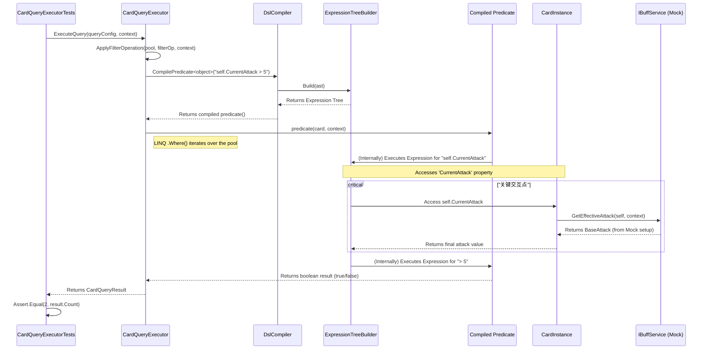

# BUG-024: CardQueryExecutor 过滤器编译后未生效问题

**CWE-20: Improper Input Validation**

- **发现日期:** 2025-07-28
- **报告人:** Kilo Code
- **状态:** Investigating
- **严重性:** Critical

## 1. 问题描述

在对 `DslCompiler` 和 `CardQueryExecutor` 进行大规模重构后，集成测试 `CardQueryExecutorTests.ExecuteQuery_WithWhereClause_FiltersCorrectly` 持续失败。测试期望查询 `self.CurrentAttack > 5` 能从4张卡牌中筛选出2张，但实际结果返回了全部4张，表明 `where` 过滤条件没有按预期工作。

尽管已经修复了 `DslExpressionParser` 的统一问题和 `ExpressionTreeBuilder` 中关于 `object` 类型转换的关键bug，但问题依旧存在。

## 2. 根本原因分析 (RCA)

目前的怀疑集中在 `DslCompiler` 生成的表达式树与 `IBuffService` 的 mock 交互上。`CardInstance.CurrentAttack` 属性依赖于 `IBuffService.GetEffectiveAttack` 来计算最终值。在测试环境中，`IBuffService` 被 mock 以返回卡牌的基础攻击力。

如果编译器生成的表达式树未能正确地调用这个被 mock 的服务，那么 `CurrentAttack` 的值将不正确，导致过滤逻辑失效。

## 3. 执行流程分析 (Mermaid)

为了清晰地理解整个调用链，以下是使用 Mermaid 绘制的从测试到最终属性访问的流程图。

## 4. 调试计划

1.  **添加精确日志**: 在以下关键位置添加详细日志，以跟踪执行流和数据值：
    *   `CardQueryExecutorTests`: 记录测试开始时，每张卡牌的 `InstanceId` 和 `BaseAttack`。
    *   `CardQueryExecutor.ApplyFilterOperation`: 记录进入时的 `pool` 大小和 `dsl` 表达式。
    *   `DslCompiler.CompilePredicate`: 记录正在编译的 `dsl`。
    *   `ExpressionTreeBuilder.BuildMemberAccess`: 记录正在访问的成员名称 (`CurrentAttack`) 和目标实例的类型。
    *   `CardInstance.get_CurrentAttack`: **(如果可修改)** 添加日志记录 `BaseAttack`、从 `IBuffService` 获取的buff值以及最终返回的 `CurrentAttack`。如果不能直接修改，则在 `IBuffService` 的 mock 中添加日志。
    *   `CardQueryExecutorTests`: 在 `IBuffService` 的 mock 设置中添加日志，以确认 `GetEffectiveAttack` 是否被调用，以及传入和返回的值。

2.  **运行测试并分析日志**: 仔细检查日志输出，确认以下几点：
    *   `IBuffService.GetEffectiveAttack` 是否被每一张卡牌的过滤过程所调用。
    *   调用时传入的 `CardInstance` 是否正确。
    *   返回的攻击力值是否与 `BaseAttack` 一致。
    *   最终 `predicate` 的布尔结果是否符合预期。

3.  **修复**: 根据日志分析结果定位并修复问题。