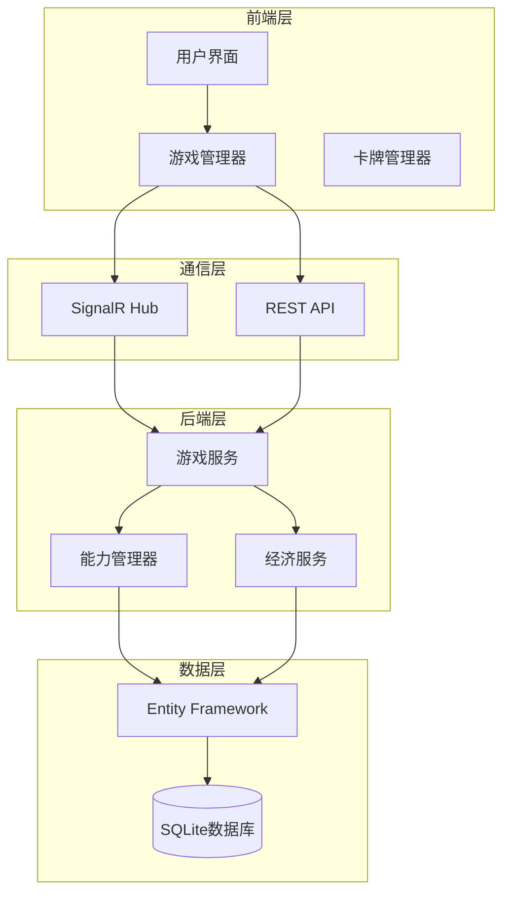

# Shadowverse-beyond 项目文档

## 文档概览

本文档系统提供Shadowverse-beyond项目的完整技术文档，采用分层架构组织，便于开发者快速定位所需信息。

### 📚 文档结构

```
文档/
├── 01-项目概览/          # 项目整体介绍和快速开始
├── 02-后端架构/          # 后端系统设计和实现
├── 03-前端架构/          # 前端系统设计和实现  
├── 04-数据库设计/        # 数据模型和数据库架构
├── 05-游戏系统/          # 核心游戏机制实现
├── 06-API文档/           # 接口文档和通信协议
├── 07-开发指南/          # 开发规范和最佳实践
└── Archive/              # 已废弃的历史文档
```

## 🚀 快速导航

### 新手入门
1. **[架构总览](01-项目概览/01-架构总览.md)** - 了解项目整体架构
2. **[技术栈](01-项目概览/02-技术栈.md)** - 掌握使用的技术和工具
3. **[开发环境设置](01-项目概览/03-开发环境设置.md)** - 搭建开发环境

### 系统设计
4. **[服务层设计](02-后端架构/01-服务层设计.md)** - 后端架构和服务设计
5. **[实体关系图](04-数据库设计/01-实体关系图.md)** - 数据库设计和实体关系

### 核心功能
6. **[卡牌能力系统](05-游戏系统/01-卡牌能力系统.md)** - 能力管理和DSL解析
7. **[战斗系统](05-游戏系统/02-战斗系统.md)** - 攻击、进化、伤害计算
8. **[回合管理系统](05-游戏系统/03-回合管理系统.md)** - 回合流程和PP管理
9. **[游戏事件系统](05-游戏系统/04-游戏事件系统.md)** - 事件驱动架构、前后端同步、系统集成
10. **[AI决策系统](05-游戏系统/05-AI决策系统.md)** - AI策略和智能决策
11. **[经济系统](05-游戏系统/06-经济系统.md)** - 金币、卡包和奖励系统

### 系统管理
12. **[用户认证与会话管理](05-游戏系统/07-用户认证与会话管理.md)** - JWT认证、权限管理、会话状态
13. **[错误处理与日志系统](05-游戏系统/08-错误处理与日志系统.md)** - 异常处理、结构化日志、错误追踪
14. **[配置管理系统](05-游戏系统/09-配置管理系统.md)** - 环境配置、功能开关、参数管理

### 开发参考
15. **[端点总览](06-API文档/01-端点总览.md)** - API接口和SignalR Hub
16. **[代码规范](07-开发指南/01-代码规范.md)** - 编码标准和最佳实践

### 项目管理
17. **[进度管理与任务跟踪](08-项目管理/01-进度管理与任务跟踪.md)** - 项目进度、任务分解、质量控制

## 🎯 项目状态

### 核心系统状态
| 系统 | 状态 | 完成度 | 说明 |
|------|------|--------|------|
| 🏗️ 基础架构 | ✅ COMPLETED | 100% | 前后端分离、SignalR通信 |
| 🃏 卡牌系统 | ✅ COMPLETED | 100% | 卡牌定义、实例管理 |
| ⚡ 能力系统 | ✅ COMPLETED | 100% | DSL解析、运行时执行 |
| 🔄 战斗系统 | ✅ COMPLETED | 100% | 攻击、进化、伤害计算 |
| 💰 经济系统 | ✅ COMPLETED | 100% | 金币、卡包、奖励 |
| 🎮 游戏逻辑 | ✅ COMPLETED | 95% | 出牌、攻击、回合管理 |
| 🤖 AI系统 | ✅ COMPLETED | 80% | 基础AI决策逻辑 |
| 📊 数据库 | ✅ COMPLETED | 100% | 实体设计、迁移管理 |
| 🔐 用户认证 | 🔄 IN-PROGRESS | 70% | JWT认证、权限管理 |
| 📝 错误处理 | ✅ COMPLETED | 100% | 异常处理、日志系统 |
| ⚙️ 配置管理 | ✅ COMPLETED | 100% | 环境配置、功能开关 |

### 技术栈概览
- **后端**: ASP.NET Core 8, SignalR, Entity Framework Core, SQLite
- **前端**: 原生JavaScript ES6+, HTML5/CSS3, SignalR Client
- **开发工具**: Visual Studio Code, Vite, .NET CLI
- **数据库**: SQLite (开发), 支持迁移到PostgreSQL

## 🔧 核心架构

### 系统架构图


### 关键特性
- **🔄 实时同步**: SignalR确保游戏状态实时同步
- **⚡ 事件驱动**: 基于事件的游戏逻辑处理
- **🎯 能力系统**: 完整的卡牌能力管理和DSL解析
- **💎 进化机制**: 符合Shadowverse规则的进化系统
- **💰 经济生态**: 完整的金币、卡包和奖励系统
- **🏗️ Clean架构**: 分层设计，高内聚低耦合

## 📖 文档使用指南

### 按角色阅读
- **🆕 新开发者**: 01-项目概览 → 07-开发指南 → 具体系统文档
- **🏗️ 架构师**: 01-架构总览 → 02-后端架构 → 04-数据库设计
- **🎮 游戏开发**: 05-游戏系统 → 06-API文档 → 具体实现细节
- **🔧 运维人员**: 01-技术栈 → 01-开发环境设置 → 部署相关文档

### 文档约定
- **[COMPLETED]**: 已完成实现的功能
- **[IN-PROGRESS]**: 正在开发中的功能
- **[DEPRECATED]**: 已废弃的功能或文档
- **✅**: 已实现的功能点
- **🔄**: 进行中的功能点
- **❌**: 已废弃的功能点

### 代码示例说明
文档中的代码示例使用以下格式：
- `<augment_code_snippet>`: 来自实际代码库的片段
- 普通代码块: 示例代码或配置

## 🤝 贡献指南

### 文档更新流程
1. **分析现状**: 检查当前实现状态
2. **更新内容**: 使用str-replace-editor工具更新
3. **状态标识**: 更新文档状态标识
4. **交叉引用**: 确保文档间引用正确

### 文档质量标准
- **准确性**: 反映当前实际实现状态
- **完整性**: 涵盖系统的所有重要方面
- **可读性**: 清晰的结构和描述
- **实用性**: 提供可操作的指导

## 📞 支持和反馈

### 常见问题
- **环境搭建问题**: 参考 [开发环境设置](01-项目概览/03-开发环境设置.md)
- **API使用问题**: 参考 [端点总览](06-API文档/01-端点总览.md)
- **代码规范问题**: 参考 [代码规范](07-开发指南/01-代码规范.md)

### 技术支持
- 查看相关系统文档
- 检查代码示例和最佳实践
- 参考故障排除指南

---

**最后更新**: 2024年12月
**文档版本**: v2.0
**项目状态**: 生产就绪

> 💡 **提示**: 建议按照编号顺序阅读文档，每个文档都包含指向相关文档的链接。
