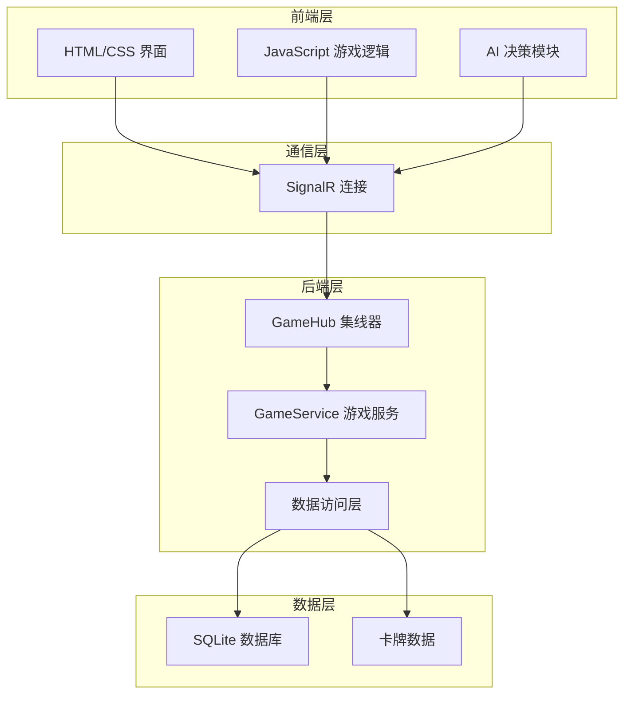

# 02-项目架构总览 ✅ COMPLETED

> **状态：** ✅ COMPLETED | **最后更新：** 2024-12-19 | **版本：** V1.0

## 🏗️ 整体架构

Shadowverse Beyond 采用前后端分离的架构设计，通过 SignalR 实现实时双向通信，确保游戏状态的实时同步。



## 🎯 设计原则

### 1. 事件驱动架构
- **前端发送动作**：用户操作转换为动作 DTO
- **后端处理逻辑**：验证并执行游戏逻辑
- **事件广播**：将状态变化广播给所有客户端

### 2. 状态同步机制
- **权威服务器**：后端作为游戏状态的唯一权威
- **乐观更新**：前端进行乐观预测，后端确认
- **事件驱动同步**：通过事件确保状态一致性

### 3. 模块化设计
- **职责分离**：前后端各自负责不同层面的逻辑
- **松耦合**：模块间通过明确的接口通信
- **可扩展性**：便于添加新功能和优化

## 🔧 技术架构详解

### 前端架构

#### 核心模块
```javascript
// 游戏状态管理
gameManager.js
├── 游戏状态维护
├── 事件处理器
├── 动作发送器
└── AI 逻辑调用

// 用户界面
ui.js
├── 游戏渲染
├── 用户交互
├── 动画效果
└── 状态显示

// AI 决策
ai.js
├── 决策算法
├── 策略评估
└── 动作选择
```

#### 数据流
1. **用户输入** → UI 事件处理
2. **动作生成** → GameManager 处理
3. **发送请求** → SignalR 传输
4. **接收事件** → 状态更新
5. **界面刷新** → UI 重新渲染

### 后端架构

#### 核心组件
```csharp
// SignalR 集线器
GameHub
├── 连接管理
├── 动作路由
├── 事件广播
└── 错误处理

// 游戏服务
GameService
├── 游戏逻辑
├── 状态管理
├── 事件生成
└── 数据持久化

// 数据访问
Repository Pattern
├── 卡牌数据访问
├── 游戏状态存储
└── 用户数据管理
```

#### 处理流程
1. **接收动作** → GameHub 路由
2. **验证权限** → 安全检查
3. **执行逻辑** → GameService 处理
4. **生成事件** → 状态变化记录
5. **广播事件** → 客户端同步

## 📡 通信协议

### SignalR 消息类型

#### 动作消息 (Client → Server)
```csharp
// 出牌动作
PlayCardActionDto
├── CardUid: string
├── TargetUid?: string
└── BoardIndex?: int

// 攻击动作
AttackActionDto
├── AttackerUid: string
└── TargetUid: string

// 进化动作
EvolveActionDto
└── UnitUid: string
```

#### 事件消息 (Server → Client)
```csharp
// 游戏状态事件
GameStateEventDto
├── GameState: GameStateDto
└── UpdateType: string

// 卡牌出牌事件
CardPlayedEventDto
├── PlayedCard: CardInstanceDto
├── SourcePlayerId: string
└── TargetUid?: string

// 单位进化事件
UnitEvolvedEventDto
├── EvolvedUnitState: CardInstanceDto
└── SourcePlayerId: string
```

### 事件广播机制

#### 事件生成流程
```csharp
// 1. 创建事件上下文
var context = new GameActionContext();

// 2. 执行游戏逻辑
ExecuteGameLogic(context);

// 3. 收集生成的事件
var events = context.Events;

// 4. 广播事件
await BroadcastEventsAsync(gameId, events);
```

#### 事件处理优先级
1. **高优先级**：游戏状态变化、回合切换
2. **中优先级**：卡牌状态更新、属性变化
3. **低优先级**：UI 提示、动画触发

## 🗄️ 数据模型

### 核心数据结构

#### 游戏状态
```csharp
GameStateDto
├── GameId: string
├── Players: List<PlayerStateDto>
├── CurrentPlayerId: string
├── Phase: GamePhase
├── TurnNumber: int
├── IsGameOver: bool
└── WinnerId?: string
```

#### 玩家状态
```csharp
PlayerStateDto
├── PlayerId: string
├── Health: int
├── CurrentPP: int
├── MaxPP: int
├── CurrentEP: int
├── MaxEP: int
├── CanEvolve: bool
├── Hand: List<CardInstanceDto>
├── Field: List<CardInstanceDto>
├── Deck: List<CardInstanceDto>
└── Graveyard: List<CardInstanceDto>
```

#### 卡牌实例
```csharp
CardInstanceDto
├── InstanceId: Guid
├── CardId: int
├── Name: string
├── Cost: int
├── Type: CardType
├── CurrentAttack: int
├── CurrentHealth: int
├── MaxHealth: int
├── Zone: CardZone
├── CanAttack: bool
├── IsEvolved: bool
└── Keywords: List<string>
```

### 数据库设计

#### 表结构
```sql
-- 卡牌定义表
Cards
├── Id (PK)
├── Name
├── Cost
├── Type
├── Attack
├── Health
├── Description
├── Keywords
└── EvolveId (FK)

-- 游戏记录表
Games
├── Id (PK)
├── Player1Id
├── Player2Id
├── WinnerId
├── StartTime
└── EndTime
```

## 🔄 状态管理

### 前端状态管理

#### 状态结构
```javascript
gameState = {
    gameId: string,
    players: {
        player1: PlayerState,
        player2: PlayerState
    },
    currentPlayerId: string,
    phase: string,
    turnNumber: number,
    isGameOver: boolean,
    winner: string
}
```

#### 状态更新流程
1. **接收事件** → 事件处理器分发
2. **更新状态** → 对应状态字段修改
3. **触发渲染** → UI 重新渲染
4. **动画处理** → 视觉效果展示

### 后端状态管理

#### 内存状态
- **游戏状态缓存**：活跃游戏保存在内存中
- **并发控制**：使用锁机制防止状态冲突
- **状态验证**：每次操作前验证状态有效性

#### 持久化策略
- **关键节点保存**：回合结束、游戏结束时保存
- **增量更新**：只保存变化的数据
- **错误恢复**：异常情况下的状态恢复机制

## 🚀 性能优化

### 前端优化
- **事件防抖**：防止重复点击
- **渲染优化**：只更新变化的 DOM 元素
- **内存管理**：及时清理不需要的对象

### 后端优化
- **连接池**：数据库连接复用
- **缓存策略**：热点数据内存缓存
- **异步处理**：非阻塞的事件处理

### 网络优化
- **消息压缩**：SignalR 消息压缩
- **批量发送**：合并多个事件一次发送
- **连接管理**：自动重连机制

## 🔒 安全考虑

### 输入验证
- **客户端验证**：基础的输入检查
- **服务器验证**：权威的业务逻辑验证
- **数据清理**：防止注入攻击

### 权限控制
- **回合验证**：只允许当前玩家操作
- **动作验证**：验证动作的合法性
- **状态保护**：防止非法状态修改

### 错误处理
- **异常捕获**：全局异常处理机制
- **错误日志**：详细的错误记录
- **优雅降级**：异常情况下的备用方案

---

**相关文档：**
- [技术文档/M5_SignalR通信设计_V1.0.md](./技术文档/M5_SignalR通信设计_V1.0.md)
- [技术文档/M7_核心动作处理与事件广播设计_V1.0.md](./技术文档/M7_核心动作处理与事件广播设计_V1.0.md)
- [技术文档/M8_领域模型重构计划_V1.0.md](./技术文档/M8_领域模型重构计划_V1.0.md)
