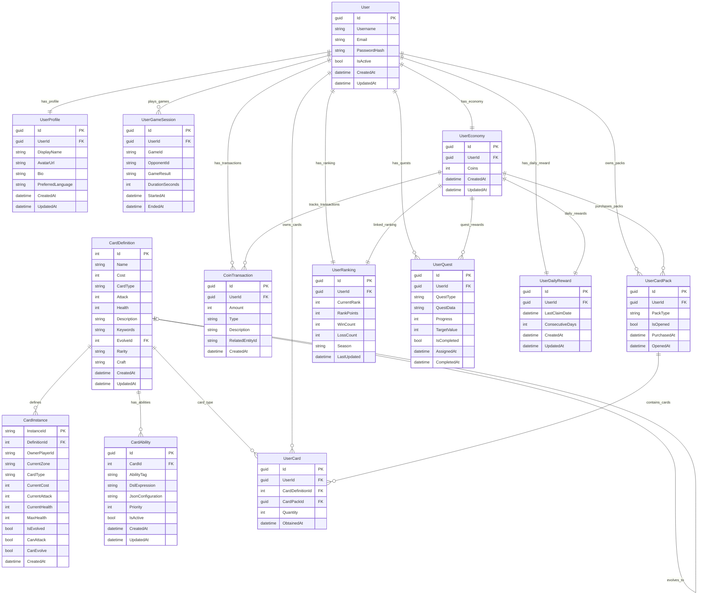

# 01-实体关系图 [COMPLETED]

## 目的与范围

本文档详细说明Shadowverse-beyond项目的数据库设计，包括实体关系图、表结构设计、索引策略以及数据完整性约束。为数据库开发和维护提供完整的技术参考。

## 核心概念

### 数据库设计原则
- **规范化设计**: 遵循第三范式，减少数据冗余
- **性能优化**: 合理的索引设计和查询优化
- **数据完整性**: 外键约束和业务规则验证
- **扩展性**: 支持未来功能扩展的灵活设计

### 主要实体域
- **游戏核心**: CardDefinition, CardInstance, CardAbility
- **用户管理**: User, UserProfile, UserGameSession
- **经济系统**: UserEconomy, CoinTransaction, UserCardPack
- **社交功能**: UserRanking, UserQuest, UserDailyReward

## 架构概览

### 完整实体关系图



### 核心表结构

#### CardDefinition - 卡牌定义表
```sql
CREATE TABLE CardDefinitions (
    Id INTEGER PRIMARY KEY AUTOINCREMENT,
    Name NVARCHAR(100) NOT NULL,
    Cost INTEGER NOT NULL DEFAULT 0,
    CardType NVARCHAR(50) NOT NULL,
    Attack INTEGER NOT NULL DEFAULT 0,
    Health INTEGER NOT NULL DEFAULT 0,
    Description NVARCHAR(500),
    Keywords NVARCHAR(200),
    EvolveId INTEGER NULL,
    Rarity NVARCHAR(20) NOT NULL DEFAULT 'Bronze',
    Craft NVARCHAR(20) NOT NULL DEFAULT 'Neutral',
    CreatedAt DATETIME NOT NULL DEFAULT CURRENT_TIMESTAMP,
    UpdatedAt DATETIME NOT NULL DEFAULT CURRENT_TIMESTAMP,
    
    FOREIGN KEY (EvolveId) REFERENCES CardDefinitions(Id)
);

CREATE INDEX IX_CardDefinitions_CardType ON CardDefinitions(CardType);
CREATE INDEX IX_CardDefinitions_Cost ON CardDefinitions(Cost);
CREATE INDEX IX_CardDefinitions_Rarity ON CardDefinitions(Rarity);
CREATE INDEX IX_CardDefinitions_Craft ON CardDefinitions(Craft);
```

#### CardInstance - 卡牌实例表
```sql
CREATE TABLE CardInstances (
    InstanceId NVARCHAR(50) PRIMARY KEY,
    DefinitionId INTEGER NOT NULL,
    OwnerPlayerId NVARCHAR(50) NOT NULL,
    CurrentZone NVARCHAR(20) NOT NULL DEFAULT 'Deck',
    CardType NVARCHAR(50) NOT NULL,
    CurrentCost INTEGER NOT NULL DEFAULT 0,
    CurrentAttack INTEGER NOT NULL DEFAULT 0,
    CurrentHealth INTEGER NOT NULL DEFAULT 0,
    MaxHealth INTEGER NOT NULL DEFAULT 0,
    IsEvolved BOOLEAN NOT NULL DEFAULT 0,
    CanAttack BOOLEAN NOT NULL DEFAULT 0,
    CanEvolve BOOLEAN NOT NULL DEFAULT 1,
    CreatedAt DATETIME NOT NULL DEFAULT CURRENT_TIMESTAMP,
    
    FOREIGN KEY (DefinitionId) REFERENCES CardDefinitions(Id)
);

CREATE INDEX IX_CardInstances_OwnerPlayerId ON CardInstances(OwnerPlayerId);
CREATE INDEX IX_CardInstances_CurrentZone ON CardInstances(CurrentZone);
CREATE INDEX IX_CardInstances_DefinitionId ON CardInstances(DefinitionId);
```

#### UserEconomy - 用户经济表
```sql
CREATE TABLE UserEconomies (
    Id UNIQUEIDENTIFIER PRIMARY KEY,
    UserId UNIQUEIDENTIFIER NOT NULL,
    Coins INTEGER NOT NULL DEFAULT 1000,
    CreatedAt DATETIME NOT NULL DEFAULT CURRENT_TIMESTAMP,
    UpdatedAt DATETIME NOT NULL DEFAULT CURRENT_TIMESTAMP,
    
    FOREIGN KEY (UserId) REFERENCES Users(Id) ON DELETE CASCADE
);

CREATE UNIQUE INDEX IX_UserEconomies_UserId ON UserEconomies(UserId);
```

## 实现细节

### Entity Framework 配置

<augment_code_snippet path="Server/Infrastructure/Data/ApplicationDbContext.cs" mode="EXCERPT">
````csharp
protected override void OnModelCreating(ModelBuilder modelBuilder)
{
    base.OnModelCreating(modelBuilder);

    // 配置现有实体
    ConfigureCardDefinition(modelBuilder);
    ConfigureCardAbility(modelBuilder);
    ConfigureUserEntities(modelBuilder);
    ConfigureEconomyEntities(modelBuilder);
}

private void ConfigureCardDefinition(ModelBuilder modelBuilder)
{
    modelBuilder.Entity<CardDefinition>(entity =>
    {
        entity.ToTable("CardDefinitions");
        entity.HasKey(e => e.Id);
        
        entity.Property(e => e.Name).HasMaxLength(100).IsRequired();
        entity.Property(e => e.CardType).HasMaxLength(50).IsRequired();
        entity.Property(e => e.Description).HasMaxLength(500);
        entity.Property(e => e.Keywords).HasMaxLength(200);
        entity.Property(e => e.Rarity).HasMaxLength(20).IsRequired();
        entity.Property(e => e.Craft).HasMaxLength(20).IsRequired();

        // 自引用关系 (进化)
        entity.HasOne<CardDefinition>()
              .WithMany()
              .HasForeignKey(e => e.EvolveId)
              .OnDelete(DeleteBehavior.SetNull);

        // 索引
        entity.HasIndex(e => e.CardType);
        entity.HasIndex(e => e.Cost);
        entity.HasIndex(e => e.Rarity);
        entity.HasIndex(e => e.Craft);
    });
}

private void ConfigureEconomyEntities(ModelBuilder modelBuilder)
{
    // 配置UserEconomy实体
    modelBuilder.Entity<UserEconomy>(entity =>
    {
        entity.ToTable("UserEconomies");
        entity.HasKey(e => e.Id);
        entity.HasIndex(e => e.UserId).IsUnique();

        // 配置与User的一对一关系
        entity.HasOne(e => e.User)
              .WithOne(u => u.Economy)
              .HasForeignKey<UserEconomy>(e => e.UserId)
              .OnDelete(DeleteBehavior.Cascade);
    });

    // 配置CoinTransaction实体
    modelBuilder.Entity<CoinTransaction>(entity =>
    {
        entity.ToTable("CoinTransactions");
        entity.HasKey(e => e.Id);
        
        entity.Property(e => e.Type).HasMaxLength(50).IsRequired();
        entity.Property(e => e.Description).HasMaxLength(200);
        entity.Property(e => e.RelatedEntityId).HasMaxLength(100);

        // 索引
        entity.HasIndex(e => e.UserId);
        entity.HasIndex(e => e.Type);
        entity.HasIndex(e => e.CreatedAt);
    });
}
````
</augment_code_snippet>

### 数据库迁移策略

<augment_code_snippet path="Server/Infrastructure/Data/Migrations" mode="EXCERPT">
````csharp
// 示例迁移文件结构
public partial class InitialCreate : Migration
{
    protected override void Up(MigrationBuilder migrationBuilder)
    {
        // 创建核心表
        migrationBuilder.CreateTable(
            name: "CardDefinitions",
            columns: table => new
            {
                Id = table.Column<int>(type: "INTEGER", nullable: false)
                    .Annotation("Sqlite:Autoincrement", true),
                Name = table.Column<string>(type: "TEXT", maxLength: 100, nullable: false),
                Cost = table.Column<int>(type: "INTEGER", nullable: false),
                // ... 其他列定义
            },
            constraints: table =>
            {
                table.PrimaryKey("PK_CardDefinitions", x => x.Id);
            });

        // 创建索引
        migrationBuilder.CreateIndex(
            name: "IX_CardDefinitions_CardType",
            table: "CardDefinitions",
            column: "CardType");
    }
}
````
</augment_code_snippet>

## 集成点

### 查询优化策略

#### 常用查询模式
```csharp
// 高效的卡牌查询
public async Task<List<CardDefinition>> GetCardsByTypeAsync(string cardType)
{
    return await _context.CardDefinitions
        .AsNoTracking()
        .Where(c => c.CardType == cardType)
        .OrderBy(c => c.Cost)
        .ToListAsync();
}

// 用户经济信息查询
public async Task<UserEconomy> GetUserEconomyWithTransactionsAsync(Guid userId)
{
    return await _context.UserEconomies
        .Include(ue => ue.CoinTransactions.OrderByDescending(ct => ct.CreatedAt).Take(10))
        .Include(ue => ue.CardPacks.Where(cp => !cp.IsOpened))
        .FirstOrDefaultAsync(ue => ue.UserId == userId);
}
```

#### 性能监控
```csharp
// 查询性能日志
public class QueryPerformanceInterceptor : DbCommandInterceptor
{
    public override async ValueTask<DbDataReader> ReaderExecutedAsync(
        DbCommand command, CommandExecutedEventData eventData, 
        DbDataReader result, CancellationToken cancellationToken = default)
    {
        if (eventData.Duration.TotalMilliseconds > 1000)
        {
            Log.Warning("Slow query detected: {Query} took {Duration}ms", 
                command.CommandText, eventData.Duration.TotalMilliseconds);
        }
        
        return await base.ReaderExecutedAsync(command, eventData, result, cancellationToken);
    }
}
```

### 数据完整性约束

#### 业务规则验证
```csharp
// 实体级别的验证
public class UserEconomy
{
    public void ValidateCoins()
    {
        if (Coins < 0)
            throw new InvalidOperationException("用户金币不能为负数");
    }

    public bool CanAfford(int amount)
    {
        return Coins >= amount;
    }
}

// 数据库级别的约束
modelBuilder.Entity<CoinTransaction>(entity =>
{
    entity.HasCheckConstraint("CK_CoinTransaction_Amount", "Amount != 0");
});
```

## 使用模式

### 事务处理模式
```csharp
// 复杂业务操作的事务处理
public async Task<bool> ProcessCardPackPurchaseAsync(Guid userId, int packCost)
{
    using var transaction = await _context.Database.BeginTransactionAsync();
    try
    {
        // 1. 检查并扣除金币
        var userEconomy = await _context.UserEconomies
            .FirstOrDefaultAsync(ue => ue.UserId == userId);
            
        if (userEconomy.Coins < packCost)
            return false;
            
        userEconomy.Coins -= packCost;

        // 2. 记录交易
        var transaction = new CoinTransaction
        {
            UserId = userId,
            Amount = -packCost,
            Type = CoinTransactionType.CardPackPurchase
        };
        _context.CoinTransactions.Add(transaction);

        // 3. 创建卡包
        var cardPack = new UserCardPack
        {
            UserId = userId,
            PackType = "Standard",
            PurchasedAt = DateTime.UtcNow
        };
        _context.UserCardPacks.Add(cardPack);

        await _context.SaveChangesAsync();
        await transaction.CommitAsync();
        return true;
    }
    catch
    {
        await transaction.RollbackAsync();
        throw;
    }
}
```

### 数据种子和初始化
```csharp
public static class DataSeeder
{
    public static async Task SeedAsync(ApplicationDbContext context)
    {
        // 种子卡牌数据
        if (!await context.CardDefinitions.AnyAsync())
        {
            var cards = new List<CardDefinition>
            {
                new() { Name = "森林守护者", Cost = 2, CardType = "Follower", Attack = 2, Health = 1 },
                new() { Name = "治疗术", Cost = 1, CardType = "Spell", Description = "恢复3点生命值" }
            };
            
            context.CardDefinitions.AddRange(cards);
            await context.SaveChangesAsync();
        }
    }
}
```

## 状态标识

**[COMPLETED]** - 数据库设计已完全实现，包括完整的实体关系、索引优化和数据完整性约束。

### 已实现表结构
- ✅ CardDefinition (卡牌定义)
- ✅ CardInstance (卡牌实例)
- ✅ CardAbility (卡牌能力)
- ✅ User (用户基础信息)
- ✅ UserEconomy (用户经济)
- ✅ CoinTransaction (金币交易)
- ✅ UserCardPack (用户卡包)
- ✅ UserRanking (用户排名)
- ✅ UserQuest (用户任务)
- ✅ UserDailyReward (每日奖励)

### 技术特点
- **规范化设计**: 减少数据冗余，提高数据一致性
- **性能优化**: 合理的索引设计和查询优化
- **扩展性**: 支持未来功能扩展
- **数据完整性**: 完善的约束和验证机制

### 维护策略
- 定期性能监控和查询优化
- 数据库备份和恢复策略
- 迁移脚本的版本控制管理
