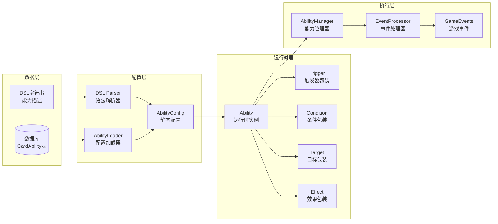
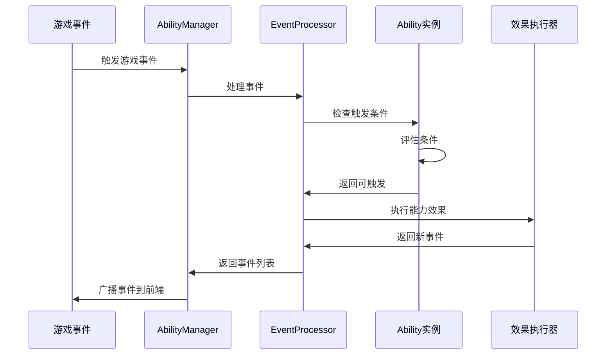

# 01-卡牌能力系统 [COMPLETED]

## 目的与范围

本文档详细说明Shadowverse-beyond项目的卡牌能力管理系统，包括从数据库配置到运行时执行的完整管道、DSL解析系统、事件驱动架构以及能力触发机制。这是游戏核心机制的技术实现指南。

## 核心概念

### 能力系统架构
- **AbilityConfig**: 静态配置，从数据库或DSL解析得到
- **Ability**: 运行时实例，包含执行状态和触发逻辑
- **Runtime Wrappers**: 运行时包装类，为静态配置添加执行上下文
- **EventProcessor**: 事件处理引擎，协调能力触发和效果执行

### 关键组件
- **Trigger**: 触发条件 (如"出牌时"、"回合开始时")
- **Condition**: 执行条件 (如"如果生命值小于5")
- **Target**: 目标选择 (如"所有敌方单位")
- **Effect**: 效果执行 (如"造成2点伤害")

## 架构概览

### 能力系统管道



### 数据库设计

<augment_code_snippet path="Server/Infrastructure/Data/ApplicationDbContext.cs" mode="EXCERPT">
````csharp
// CardAbility 实体配置
modelBuilder.Entity<CardAbility>(entity =>
{
    entity.ToTable("CardAbilities");
    entity.HasKey(e => e.Id);
    entity.HasIndex(e => new { e.CardId, e.Priority });
    
    // 支持混合存储方案
    entity.Property(e => e.DslExpression).HasMaxLength(2000);
    entity.Property(e => e.JsonConfiguration).HasColumnType("TEXT");
    entity.Property(e => e.AbilityTag).HasMaxLength(100);
});
````
</augment_code_snippet>

## 实现细节

### AbilityConfig - 静态配置

<augment_code_snippet path="Server/Domain/Abilities/AbilityConfig.cs" mode="EXCERPT">
````csharp
/// <summary>
/// 能力的静态配置，可从DSL或JSON解析得到
/// </summary>
public class AbilityConfig
{
    public string Id { get; set; } = string.Empty;
    public int CardId { get; set; }
    public string Name { get; set; } = string.Empty;
    public string AbilityTag { get; set; } = string.Empty;
    public AbilityType Type { get; set; }
    public TriggerConfig Trigger { get; set; } = new();
    public List<ConditionConfig> Conditions { get; set; } = new();
    public List<TargetConfig> Targets { get; set; } = new();
    public List<EffectConfig> Effects { get; set; } = new();
    
/// <remarks>
    /// AbilityTag 主要用于前端展示、日志记录或特定类型的能力分组与播报，
    /// 例如区分 "Fanfare"（入场曲）和 "Spell"（法术）虽然可能触发时机相似，
    /// 但 AbilityTag 可以帮助区分它们是哪种类型的能力触发。
    /// 它通常不直接决定能力的核心执行逻辑，核心逻辑由 Trigger, Condition, Target, Effect 定义。
    /// </remarks>
    // 配置源信息
    public string? DslSource { get; set; }
    public string? JsonSource { get; set; }

    // 静态工厂方法
    public static AbilityConfig FromJson(string jsonSource)
    {
        return JsonSerializer.Deserialize<AbilityConfig>(jsonSource)
            ?? throw new InvalidOperationException("Failed to deserialize AbilityConfig");
    }

    // 注意：DSL不再用于生成完整的AbilityConfig
    // DSL主要用于运行时的条件评估、目标选择和效果参数计算
}
````
</augment_code_snippet>

### Ability - 运行时实例

<augment_code_snippet path="Server/Domain/Abilities/Ability.cs" mode="EXCERPT">
````csharp
/// <summary>
/// 运行时能力实例，包含执行状态和行为
/// </summary>
public class Ability
{
    public AbilityConfig Config { get; }
    public Trigger Trigger { get; }
    public List<Condition> Conditions { get; }
    public List<Target> Targets { get; }
    public List<Effect> Effects { get; }
    
    public CardInstance? SourceCard { get; set; }
    public bool IsActive { get; set; } = true;
    public DateTime? ActivationTime { get; private set; }
    public int TriggerCount { get; private set; }

    public Ability(AbilityConfig config, CardInstance? sourceCard = null)
    {
        Config = config;
        SourceCard = sourceCard;
        
        // 创建运行时组件
        Trigger = new Trigger(config.Trigger);
        Conditions = config.Conditions
            .Select(c => CreateRuntimeCondition(c))
            .ToList();
        Targets = config.Targets
            .Select(t => new Target(t))
            .ToList();
        Effects = config.Effects
            .Select(e => new Effect(e))
            .ToList();
    }

    public async Task<bool> CanTriggerAsync(IGameEvent gameEvent, GameContext context)
    {
        if (!IsActive) return false;
        
        // 检查触发条件
        if (!await Trigger.ShouldTriggerAsync(gameEvent, context))
            return false;
            
        // 检查所有条件
        foreach (var condition in Conditions)
        {
            if (!await condition.EvaluateAsync(context))
                return false;
        }
        
        return true;
    }
}
````
</augment_code_snippet>

### AbilityLoader - 配置加载器

<augment_code_snippet path="Server/Domain/Abilities/AbilityLoader.cs" mode="EXCERPT">
````csharp
public class AbilityLoader
{
    public async Task<List<AbilityConfig>> LoadAbilitiesForCardAsync(int cardId)
    {
        var cardAbilities = await _context.Set<CardAbility>()
            .Where(ca => ca.CardId == cardId && ca.IsActive)
            .OrderBy(ca => ca.Priority)
            .ToListAsync();

        var configs = new List<AbilityConfig>();
        await ProcessCardAbilitiesAsync(cardAbilities, configs);
        return configs;
    }

    private async Task ProcessCardAbilitiesAsync(
        List<CardAbility> cardAbilities, 
        List<AbilityConfig> configs)
    {
        foreach (var cardAbility in cardAbilities)
        {
            try
            {
                AbilityConfig? config = null;

                // 优先使用JSON配置作为基础结构
                if (!string.IsNullOrEmpty(cardAbility.JsonConfiguration))
                {
                    config = AbilityConfig.FromJson(cardAbility.JsonConfiguration);
                }
                // 如果没有JSON配置，创建基础配置
                else
                {
                    config = new AbilityConfig();
                }

                if (config != null)
                {
                    config.CardId = cardAbility.CardId;
                    config.DslSource = cardAbility.DslExpression; // 保存DSL用于运行时解析

                    // DSL将在运行时被解析，用于：
                    // 1. 条件评估 - 在Condition.EvaluateAsync()中解析DSL表达式
                    // 2. 目标选择 - 在Target.SelectTargetsAsync()中解析DSL表达式
                    // 3. 效果参数 - 在Effect.ExecuteAsync()中解析DSL公式

                    configs.Add(config);
                }
            }
            catch (Exception ex)
            {
                _logger.LogError(ex, "Failed to load ability for card {CardId}", 
                    cardAbility.CardId);
            }
        }
    }
}
````
</augment_code_snippet>

### EventProcessor - 事件处理引擎

<augment_code_snippet path="Server/Domain/Events/EventProcessor.cs" mode="EXCERPT">
````csharp
public async Task<List<GameEventDto>> ProcessEventAsync(
    IGameEvent initialEvent, GameContext context)
{
    var processedEvents = new List<GameEventDto>();
    _eventQueue.Clear();
    _eventQueue.Enqueue(initialEvent);

    while (_eventQueue.Count > 0)
    {
        var currentEvent = _eventQueue.Dequeue();
        
        // 1. 执行事件本身
        var newEvents = await currentEvent.ExecuteAsync(context);
        
        // 2. 转换为DTO并记录
        var eventDto = ConvertEventToDto(currentEvent);
        if (eventDto != null)
        {
            processedEvents.Add(eventDto);
        }
        
        // 3. 检查触发的能力
        var triggeredAbilities = await GetTriggeredAbilitiesAsync(
            currentEvent, context);
            
        // 4. 执行触发的能力
        foreach (var ability in triggeredAbilities)
        {
            var abilityEvents = await ProcessAbilityAsync(
                ability, currentEvent, context);
            foreach (var abilityEvent in abilityEvents)
            {
                _eventQueue.Enqueue(abilityEvent);
            }
            
            // 播报能力触发事件
            var abilityTriggeredEvent = new AbilityTriggeredEvent(
                ability, currentEvent);
            _eventQueue.Enqueue(abilityTriggeredEvent);
        }
        
        // 5. 将事件本身产生的新事件加入队列
        foreach (var newEvent in newEvents)
        {
            _eventQueue.Enqueue(newEvent);
        }
    }
    
    return processedEvents;
}
````
</augment_code_snippet>

## 集成点

### DSL在能力系统中的应用

#### DSL用于条件表达式
```dsl
// 在ConditionConfig中使用DSL表达式
"condition_expression": "target.health < 5 AND source.attack > 2"
"condition_expression": "count(field.allies) >= 3"
"condition_expression": "turn_number > 5 AND player.pp >= 7"
```

#### DSL用于目标选择
```dsl
// 在TargetConfig中使用DSL表达式
"target_expression": "select_random(enemy_followers, 1)"
"target_expression": "select_all(ally_followers) where health < max_health"
"target_expression": "select_lowest_attack(enemy_followers, 2)"
```

#### DSL用于效果参数
```dsl
// 在EffectConfig中使用DSL表达式
"damage_formula": "source.attack + 2"
"heal_amount": "target.max_health - target.current_health"
"draw_count": "min(3, deck_size)"
```

#### 混合配置示例
```json
{
  "name": "Fanfare Damage",
  "type": "Triggered",
  "trigger": {
    "event_types": ["CardPlayed"],
    "scope": "Self"
  },
  "conditions": [
    {
      "type": "DslExpression",
      "expression": "count(enemy_followers) > 0"
    }
  ],
  "targets": [
    {
      "type": "DslSelector",
      "expression": "select_random(enemy_followers, 1)"
    }
  ],
  "effects": [
    {
      "type": "DealDamage",
      "amount": {
        "type": "DslFormula",
        "formula": "source.attack / 2"
      }
    }
  ]
}
```

### 运行时执行流程



## 使用模式

### 能力注册模式
```csharp
// 在游戏开始时注册卡牌能力
public async Task RegisterCardAbilitiesAsync(CardInstance cardInstance)
{
    var abilityConfigs = await _abilityLoader
        .LoadAbilitiesForCardAsync(cardInstance.DefinitionId);
        
    foreach (var config in abilityConfigs)
    {
        var ability = new Ability(config, cardInstance);
        _abilityManager.RegisterAbility(ability);
    }
}
```

### 事件处理模式
```csharp
// 在GameService中处理游戏动作
public async Task<bool> PlayCardAsync(string gameId, string playerId, 
    PlayCardActionDto actionDto, GameActionContext context)
{
    // 执行出牌逻辑
    var playCardEvent = new PlayCardEvent(cardInstance, playerId);
    
    // 通过AbilityManager处理事件
    var resultEvents = await _abilityManager
        .ProcessEventAsync(playCardEvent, gameContext);
        
    // 将事件添加到上下文中广播
    context.Events.AddRange(resultEvents);
    
    return true;
}
```

### 能力效果扩展
```csharp
// 添加新的效果类型
public class CustomDamageEffect : IEffect
{
    public async Task<List<IGameEvent>> ExecuteAsync(
        EffectExecutionContext context)
    {
        var damage = CalculateDamage(context);
        var damageEvent = new DamageEvent(context.Target, damage);
        return new List<IGameEvent> { damageEvent };
    }
}
```

## 状态标识

**[IN-PROGRESS]** - 卡牌能力系统核心组件已实现，但数据库集成和GameService集成需要完善。

### 已实现功能
- ✅ AbilityConfig静态配置系统
- ✅ Ability运行时实例管理
- ✅ DSL表达式解析器 (用于条件、目标、效果参数)
- ✅ 运行时包装类 (RuntimeTrigger, RuntimeEffect等)
- ✅ EventProcessor事件处理引擎
- ✅ AbilityManager能力管理器
- ✅ 混合存储机制 (JSON基础结构 + DSL表达式)
- ✅ 变量存储系统 (临时与持久)
- ✅ 变量操作效果处理器 (`SetVariable`, `ModifyVariable`)
- ✅ AbilityLoader数据库加载器
- ✅ CardAbility数据库表结构

### 待完成功能
- ❌ GameService与AbilityLoader的集成
- ❌ 数据库中的测试能力数据
- ❌ 卡牌创建时的能力预加载
- ❌ 完整的数据库→运行时流程测试

### 技术特点
- **混合配置**: JSON提供结构化配置，DSL提供灵活表达式
- **类型安全**: 强类型的配置和运行时系统
- **可扩展**: 支持新能力类型和效果的添加
- **高性能**: 事件驱动的异步处理
- **调试友好**: 完整的日志记录和错误处理

### DSL应用范围与执行上下文

DSL（领域特定语言）在能力系统中扮演核心角色，用于定义动态逻辑。它的主要应用范围包括：

- **条件评估**: 定义能力触发或效果执行的复杂条件。
- **目标选择**: 实现灵活、动态的目标筛选逻辑。
- **效果参数计算**: 动态计算效果的数值参数（如伤害量、治疗量、抽牌数量等）。
- **变量与状态访问**: 读取和引用游戏状态、玩家状态、卡牌状态以及能力自身的内部状态。

#### DSL执行上下文 (`GameContext`)

所有DSL表达式都在一个名为 `GameContext` 的执行上下文中进行求值。`GameContext` 实例封装了当前时刻与能力执行相关的所有必要信息。DSL表达式可以通过特定的标识符直接或间接访问这些信息。

#### 标识符解析优先级与隐式上下文

DSL中的标识符（变量名或属性路径）遵循以下解析优先级：

1.  **预定义的顶级关键字**:
    *   `player`: 指向当前执行能力或发起请求的玩家对象 (`GameContext.RequestingPlayer`)。示例: `player.pp >= 5`
    *   `opponent`: 指向对手玩家对象 (`GameContext.OpponentPlayer`)。示例: `opponent.hand.count > 0`
    *   `gamestate`: 指向完整的当前游戏状态对象 (`GameContext.CurrentGameState`)。示例: `gamestate.turnNumber > 10`
    *   `self` / `this` / `current`: 指向当前正在被处理的上下文对象 (`GameContext.CurrentItem`)，通常是触发能力的卡牌实例或效果的目标。示例: `self.attack > self.defense`

2.  **临时变量**:
    *   如果标识符是一个单段名称（例如 `MyVar`），并且不是上述顶级关键字，系统会首先尝试在当前能力的临时变量作用域 (`GameContext.TemporaryVariables`) 中查找。这允许能力在执行过程中存储和读取中间值。

3.  **`GameContext` 的直接公共属性 (隐式上下文)**:
    *   如果标识符不是顶级关键字，也不是临时变量，DSL求值器会默认尝试将其作为 `GameContext` 实例自身的一个公共属性来解析。这使得可以直接访问 `GameContext` 上的重要属性，而无需显式的前缀（如 `Context.`）。
    *   **关键的隐式上下文属性包括**：
        *   `TriggeringEvent` (`IGameEvent?`): 指向触发当前整个能力处理流程的原始游戏事件。
            *   示例: `TriggeringEvent.SourceCard.Attack`
            *   访问事件参数: `TriggeringEvent.Parameters["damageAmount"]` (这将通过增强 `DslEvaluator.ResolvePathSegments` 来支持对字典属性的键访问)。
        *   `CurrentAbility` (`Ability?`): 指向当前正在执行或评估的能力对象。示例: `CurrentAbility.Config.Name`
        *   `SourceCard` (`CardInstance?`): 指向触发当前效果的源卡牌实例。示例: `SourceCard.IsEvolved`
        *   `CurrentItem` (`object?`): 通常指代当前效果正在处理的直接目标或上下文相关的核心对象。DSL中也可用 `self`, `this` 访问。
        *   `CurrentEffectAtomicEvents` (`IReadOnlyList<IGameEvent>`): **(新增)** 一个在当前效果处理生命周期内有效的只读列表，包含该效果（包括其所有子操作和多目标处理）到目前为止产生的所有原子领域事件。此列表由 `EffectHandlerBase` 负责在效果开始时清空，并在领域逻辑执行后填充。
            *   示例: `CountList(CurrentEffectAtomicEvents, e => e.Type == 'DamageEvent')`
        *   其他 `GameContext` 上的直接公共属性，如 `RequestingPlayerId`, `TurnNumber` (如果添加的话) 等。

    *   **示例**：
        *   判断触发事件是否为“卡牌被破坏”：`TriggeringEvent.Type == EventType.Destroy`
        *   获取当前能力配置的ID：`CurrentAbility.Config.Id`
        *   统计当前效果已造成的伤害事件数量：`CountList(CurrentEffectAtomicEvents, e => e.Type == 'DamageEvent')`

4.  **属性路径解析**:
    *   对于多段路径（如 `player.leader.health` 或 `TriggeringEvent.SourceCard.Attack`），在确定了根对象后，后续的段会通过 `DslEvaluator.ResolvePathSegments` 在该对象上逐级解析公共属性。
    *   **重要**: `ResolvePathSegments` 将被增强以支持对 `IReadOnlyDictionary<string, object?>` 类型（如 `IGameEvent.Parameters`）的属性，通过字符串键进行索引访问。例如，如果 `event` 是一个 `IGameEvent` 对象，`event.Parameters["key"]` 将尝试获取名为 "key" 的参数。

#### 通过 `Outputs` 配置动态生成聚合事件参数

为了进一步增强能力系统的灵活性和配置驱动特性，我们引入 `Outputs` 机制，用于声明式地定义当一个效果执行完毕后，哪些信息应该被提取并包含在其对应的聚合事件（`EffectCompletedEvent`）的 `ExecutionResults` 字典中。这些参数随后可供连锁能力（Chained Abilities）使用。

##### 1. `EffectConfig` 中的 `Outputs` 结构

在 `EffectConfig` 类（及其JSON表示）中，将添加一个新的可选属性 `Outputs`：

```csharp
// 在 Server/Domain/Abilities/AbilityConfig.cs 的 EffectConfig 类中
public class EffectConfig
{
    // ... 其他现有属性 ...
    public string Id { get; set; } = string.Empty;
    public string Type { get; set; } = string.Empty; // 例如 "DealDamage", "DrawCard"
    public Dictionary<string, ValueConfig> Parameters { get; set; } = new(); // 效果的输入参数

    /// <summary>
    /// 定义当此效果成功执行后，如何构建 EffectCompletedEvent.ExecutionResults 的内容。
    /// 键 (string): 将作为 ExecutionResults 中的参数名。
    /// 值 (string): 一个DSL表达式，用于从效果的执行上下文中计算或提取该参数的值。
    /// </summary>
    public Dictionary<string, string>? Outputs { get; set; }
}
```

-   **`Outputs` 字典**:
    -   **键 (string)**：定义了在 `EffectCompletedEvent.ExecutionResults` 中暴露给后续连锁能力的参数名称。
    -   **值 (string)**：一个DSL表达式，其执行结果将作为对应参数的值。

##### 2. DSL求值的执行上下文 (针对 `Outputs`)

当为 `Outputs` 中定义的DSL表达式进行求值时，DSL求值器将可以访问一个特定的“输出求值上下文”。此上下文包含以下主要数据源：

*   **`parameters`**: 一个对象或字典，包含了当前效果在执行前，其输入参数经过DSL初步解析和类型转换后的最终值。例如，如果 `DrawCardEffect` 的配置参数是 `Amount: "1 + SourceCard.FanfareCount"`，那么 `parameters.Amount` 将是计算后的整数值。
*   **`domainResult`**: 从核心领域逻辑方法（例如 `PlayerState.ProcessDrawCardEffect()`）返回的 `DomainOperationResult` 实例（或其特定子类，如 `DrawCardsResult`）。这包含了该单个领域操作直接产生的原子事件列表 (`ImmediateEvents`) 以及任何特定于该操作的返回值（例如，实际抽到的卡牌ID列表、爆牌ID列表等）。
    *   *注意：如果效果作用于多个目标，`domainResult` 通常指代针对主要目标或第一个成功目标的结果。对于多目标结果的聚合，请参见下文的 `targetResults`。*
*   **`targetResults`**: (仅当效果通过 `ITargetProcessingService` 作用于多个目标时可用) 一个 `List<DomainOperationResult>`，包含了对每个目标执行领域逻辑后返回的 `DomainOperationResult`。DSL可以使用列表操作函数（如 `FilterList`, `MapList`, `SumListProperty`）来处理和聚合这些结果。
*   **`allAtomicEvents`**: 一个扁平化的列表，包含了在此效果（包括其所有子操作和多目标处理）的整个执行过程中产生的所有原子领域事件 (`IGameEvent`)。这通常是从 `GameStateActionResult.GeneratedEvents` 或通过收集所有 `targetResults[i].ImmediateEvents` 得到。
*   **`GameContext` 的标准属性**: 可以通过隐式上下文直接访问 `GameContext` 的所有相关公共属性，例如：
    *   `TriggeringEvent`: 触发当前整个能力链的原始游戏事件。
    *   `SourceCard`: 当前效果的源卡牌实例。
    *   `CurrentAbility`: 当前正在执行的能力对象。
    *   `Player`: 当前玩家状态。
    *   `Opponent`: 对手玩家状态。
    *   `GameState`: 当前游戏状态。

##### 3. DSL表达式示例 (用于 `Outputs`)

以下是一些如何在 `EffectConfig` 的 `Outputs` 部分使用DSL表达式的示例：

**示例 1: `DrawCardEffect`**
假设 `PlayerState.ProcessDrawCardEffect` 返回一个 `DrawCardsResult` (继承自 `DomainOperationResult`)，该结果包含 `List<Guid> DrawnCardInstanceIds` 和 `List<Guid> BurnedCardInstanceIds`。

```json
// 在 DrawCardEffect 的 EffectConfig.json 中
"Type": "DrawCard",
"Parameters": {
  "Amount": { "Type": "DslFormula", "Formula": "1 + Player.CardsPlayedThisTurn" }
},
"Outputs": {
  "RequestedAmount": "parameters.Amount",
  "ActualDrawnCardIds": "domainResult.DrawnCardInstanceIds", // 假设 DrawCardsResult 有此属性
  "ActualDrawnCount": "CountList(domainResult.DrawnCardInstanceIds)",
  "BurnedCardIds": "domainResult.BurnedCardInstanceIds",
  "BurnedCardCount": "CountList(domainResult.BurnedCardInstanceIds)",
  "WasDeckEmpty": "Any(FilterList(allAtomicEvents, e => e.Type == 'DeckEmptyOnDraw'))"
}
```

**示例 2: `DealDamageEffect` (作用于多个目标)**
假设效果是对选定的一组敌方随从造成伤害。`DealDamageEffectHandler` 的领域逻辑会为每个目标生成一个包含 `DamageDealtEvent` 的 `DomainOperationResult`。

```json
// 在 DealDamageEffect 的 EffectConfig.json 中
"Type": "DealDamage",
"Parameters": {
  "Amount": { "Type": "Static", "Value": 2 }
},
"Targets": [ { /* ... 选择多个敌方随从 ... */ } ],
"Outputs": {
  "TotalDamageDealt": "SumListProperty(FilterList(allAtomicEvents, e => e.Type == 'DamageEvent'), 'Parameters[\"damage\"]')", // 假设 DamageEvent 有 Parameters["damage"]
  "TargetsHitCount": "CountList(targetResults, r => r.Success)",
  "DestroyedTargetsCount": "CountList(FilterList(allAtomicEvents, e => e.Type == 'DestroyEvent'))"
}
```

##### 4. `EffectHandlerBase.CreateEffectCompletedEvent` 的通用化

`EffectHandlerBase` 中的 `CreateEffectCompletedEvent` 方法将被重构，以利用 `EffectConfig.Outputs` 配置。它将：
1.  接收 `GameContext`, 效果的原始参数 (`TParams`), `GameStateActionResult` (包含了所有子操作的结果和产生的原子事件), 以及当前效果的 `EffectConfig`。
2.  构建上述描述的“输出求值上下文”。
3.  遍历 `effectConfig.Outputs` 字典。
4.  对于字典中的每一项，使用DSL求值器和“输出求值上下文”来计算其DSL表达式的值。
5.  将计算得到的值以配置的名称为键，存入 `EffectCompletedEvent` 的 `ExecutionResults` 字典中。
这样，各个具体的 `EffectHandler` 将不再需要（或只需要很少）硬编码 `ExecutionResults` 的填充逻辑。

##### 5. DSL函数库的潜在扩展

为了有效地从执行上下文中提取和转换数据以用于 `Outputs`，DSL函数库可能需要进一步增强，例如：

*   **集合操作**: `CountList(list, [predicate])`, `FilterList(list, predicate)`, `MapList(list, transformExpression)`, `SumListProperty(list, 'propertyName')`, `Any(list, predicate)`, `All(list, predicate)`.
*   **对象/字典操作**: `GetProperty(object, 'propertyName')`, `GetDictionaryValue(dictionary, 'key')`.
*   **事件特定函数**: `GetEventParam(event, 'paramName')`, `FilterEventsByType(eventList, eventTypeString)`.
*   **类型转换**: `ToInt(value)`, `ToString(value)`.

通过这种方式，`Outputs` 机制将允许能力设计者以声明式、高度可配置的方式定义效果完成后需要传递给后续连锁能力的数据，从而大大增强系统的灵活性和表达能力。

### DSL函数库
系统提供了丰富的内置函数，支持各种游戏逻辑计算。部分核心函数已在前面章节中列出。随着对 `GameEvent` 和执行结果的访问需求增加，可能会添加更多专用函数，例如：

*   `GetEventParam(eventObject, "parameterName")`: 安全地从事件的 `Parameters` 字典中获取值。
*   `FilterEvents(eventList, eventType)`: 从事件列表中筛选特定类型的事件。
*   `SumEventParam(eventList, eventType, "parameterName")`: 对指定类型事件的某个数字参数求和。

（原有函数库列表保持不变，此处仅为新增说明和未来展望）

#### 集合函数
- **count(collection)**: 计算集合元素数量
- **count(collection, property)**: 计算集合中指定属性非空的元素数量
- **max(collection, property)**: 获取集合中指定属性的最大值
- **min(collection, property)**: 获取集合中指定属性的最小值
- **sum(collection, property)**: 计算集合中指定属性值的总和
- **contains(collection, value)**: 检查集合是否包含指定值
- **isEmpty(collection)**: 检查集合是否为空

#### 数学函数
- **max(value1, value2, ...)**: 返回多个值中的最大值
- **min(value1, value2, ...)**: 返回多个值中的最小值
- **sum(value1, value2, ...)**: 计算多个值的总和
- **abs(value)**: 计算绝对值

#### 逻辑函数
- **if(condition, thenValue, elseValue)**: 条件选择
- **contains(string, substring)**: 检查字符串是否包含子字符串

#### 使用示例
```dsl
// 条件表达式
"count(field.allies) >= 3"
"max(field.allies, 'attack') > 5"
"isEmpty(hand.cards)"

// 效果公式
"sum(field.allies, 'attack')"
"if(source.health < source.max_health / 2, 5, 0)"
"min(3, count(field.allies))"
```

## DSL函数系统实现

### 函数注册表架构

#### IFunctionRegistry接口
```csharp
public interface IFunctionRegistry
{
    IFunctionDefinition? GetFunction(string functionName);
    void RegisterFunction(IFunctionDefinition function);
    void RegisterFunctions(IEnumerable<IFunctionDefinition> functions);
    IEnumerable<string> GetRegisteredFunctionNames();
    bool IsRegistered(string functionName);
    bool UnregisterFunction(string functionName);
}
```

#### 函数定义接口
```csharp
public interface IFunctionDefinition
{
    string Name { get; }
    bool ValidateArguments(List<object?> args);
    Task<object?> ExecuteAsync(List<object?> args, EvaluationContext context);
}
```

### 核心函数实现

#### BaseDslFunction抽象类
提供通用的参数验证、类型转换、属性访问等基础功能：
- 参数数量验证
- 类型转换工具方法
- 属性值获取
- 集合处理工具

#### 已实现的核心函数
1. **CountFunction**: 集合元素计数
2. **MaxFunction**: 最大值计算
3. **MinFunction**: 最小值计算
4. **SumFunction**: 总和计算
5. **AbsFunction**: 绝对值计算
6. **IfFunction**: 条件选择
7. **ContainsFunction**: 包含检查
8. **IsEmptyFunction**: 空值检查

### 集成到现有系统

#### EvaluationContext集成
```csharp
public EvaluationContext(
    ICardRepository cardRepository,
    IFunctionRegistry functionRegistry,
    // ... 其他参数
)

public IFunctionDefinition? FindFunction(string functionName)
{
    return FunctionRegistry.GetFunction(functionName);
}
```

#### ValueSourceResolver集成
```csharp
private async Task<object> ResolveFormulaValue(ValueConfig valueConfig, ValueResolutionContext context)
{
    var expressionAst = _dslParser.ParseExpression(formula);
    var evaluationContext = CreateEvaluationContext(context);
    var result = await _dslEvaluator.EvaluateAsync(expressionAst, evaluationContext);
    return result.Value ?? 0;
}
```

### 依赖注入配置

#### 服务注册
```csharp
services.AddDslFunctionSystem();
services.AddCustomDslFunctions(new CustomFunction1(), new CustomFunction2());
```

#### 自动注册核心函数
FunctionRegistry构造函数自动注册所有核心函数，确保开箱即用。

## 数据库存储示例

### 完整能力示例

以下是在当前架构下可以存储在数据库中的具体能力示例，展示了JSON配置与DSL表达式的混合使用：

#### 示例1: 火球术 (Fireball) - 法术伤害能力

**数据库记录 (CardAbilities表)**:
```sql
INSERT INTO CardAbilities (CardId, AbilityTag, Priority, IsActive, JsonConfiguration, DslExpression)
VALUES (
    1001,
    'Spell',
    1,
    1,
    '{
        "id": "fireball_spell_damage",
        "name": "火球术伤害",
        "type": "Triggered",
        "trigger": {
            "event_types": ["CardPlayed"],
            "card_zone": "Playing",
            "timing": "On"
        },
        "conditions": [
            {
                "id": "has_valid_target",
                "type": "DslExpression",
                "expression": "count(enemy_followers) > 0",
                "is_enabled": true
            }
        ],
        "targets": [
            {
                "selector_type": "PlayerChoice",
                "query": {
                    "source_pool_expression": "enemy_followers",
                    "operations": [
                        {
                            "type": "Selection",
                            "strategy": "PlayerChoice",
                            "count_source": {
                                "type": "Static",
                                "value": 1
                            }
                        }
                    ]
                },
                "player_choice_options": {
                    "is_required": true,
                    "prompt": "选择一个敌方随从作为火球术的目标",
                    "can_cancel": false,
                    "auto_select_single_if_possible": true
                }
            }
        ],
        "effects": [
            {
                "id": "deal_damage",
                "type": "DealDamage",
                "parameters": {
                    "damage_amount": {
                        "type": "DslFormula",
                        "formula": "3 + source.spell_power"
                    },
                    "damage_type": "Spell"
                }
            }
        ]
    }',
    'spell_damage(target: select_one(enemy_followers), amount: 3 + source.spell_power)'
);
```

#### 示例2: 狂战士 (Berserker) - 入场曲能力

**数据库记录 (CardAbilities表)**:
```sql
INSERT INTO CardAbilities (CardId, AbilityTag, Priority, IsActive, JsonConfiguration, DslExpression)
VALUES (
    2001,
    'Fanfare',
    1,
    1,
    '{
        "id": "berserker_fanfare",
        "name": "狂战士入场曲",
        "type": "Triggered",
        "trigger": {
            "event_types": ["CardPlayed"],
            "card_zone": "Field",
            "timing": "On"
        },
        "conditions": [
            {
                "id": "player_health_low",
                "type": "DslExpression",
                "expression": "player.health <= player.max_health / 2",
                "is_enabled": true
            }
        ],
        "targets": [
            {
                "selector_type": "Self"
            }
        ],
        "effects": [
            {
                "id": "gain_attack",
                "type": "ModifyStats",
                "parameters": {
                    "attack_modifier": {
                        "type": "DslFormula",
                        "formula": "2"
                    },
                    "health_modifier": {
                        "type": "Static",
                        "value": 0
                    },
                    "duration": "Permanent"
                }
            }
        ]
    }',
    'fanfare: if(player.health <= player.max_health / 2) { self.attack += 2 }'
);
```

#### 示例3: 治疗师 (Healer) - 回合结束能力

**数据库记录 (CardAbilities表)**:
```sql
INSERT INTO CardAbilities (CardId, AbilityTag, Priority, IsActive, JsonConfiguration, DslExpression)
VALUES (
    3001,
    'EndOfTurn',
    1,
    1,
    '{
        "id": "healer_end_turn",
        "name": "治疗师回合结束",
        "type": "Triggered",
        "trigger": {
            "event_types": ["TurnEnded"],
            "card_zone": "Field",
            "timing": "During"
        },
        "conditions": [
            {
                "id": "is_my_turn",
                "type": "DslExpression",
                "expression": "current_player.id == source.controller.id",
                "is_enabled": true
            },
            {
                "id": "has_damaged_allies",
                "type": "DslExpression",
                "expression": "count(ally_followers where health < max_health) > 0",
                "is_enabled": true
            }
        ],
        "targets": [
            {
                "selector_type": "Filtered",
                "query": {
                    "source_pool_expression": "ally_followers",
                    "operations": [
                        {
                            "type": "Filter",
                            "condition": "health < max_health"
                        },
                        {
                            "type": "Selection",
                            "strategy": "LowestHealth",
                            "count_source": {
                                "type": "Static",
                                "value": 1
                            }
                        }
                    ]
                }
            }
        ],
        "effects": [
            {
                "id": "heal_target",
                "type": "Heal",
                "parameters": {
                    "heal_amount": {
                        "type": "DslFormula",
                        "formula": "min(2, target.max_health - target.health)"
                    }
                }
            }
        ]
    }',
    'end_turn: heal(target: lowest_health(ally_followers where damaged), amount: min(2, target.missing_health))'
);
```

#### 示例4: 龙族守护者 (Dragon Guardian) - 复合能力

**数据库记录 (CardAbilities表)**:
```sql
INSERT INTO CardAbilities (CardId, AbilityTag, Priority, IsActive, JsonConfiguration, DslExpression)
VALUES (
    4001,
    'Fanfare',
    1,
    1,
    '{
        "id": "dragon_guardian_fanfare",
        "name": "龙族守护者入场曲",
        "type": "Triggered",
        "trigger": {
            "event_types": ["CardPlayed"],
            "card_zone": "Field",
            "timing": "After"
        },
        "conditions": [
            {
                "id": "overflow_active",
                "type": "DslExpression",
                "expression": "player.max_pp >= 7",
                "is_enabled": true
            }
        ],
        "targets": [
            {
                "selector_type": "Composite",
                "sub_selectors": [
                    {
                        "selector_type": "Self"
                    },
                    {
                        "selector_type": "Filtered",
                        "query": {
                            "source_pool_expression": "ally_followers",
                            "operations": [
                                {
                                    "type": "Filter",
                                    "condition": "trait == \"Dragon\""
                                }
                            ]
                        }
                    }
                ]
            }
        ],
        "effects": [
            {
                "id": "buff_dragons",
                "type": "ModifyStats",
                "parameters": {
                    "attack_modifier": {
                        "type": "Static",
                        "value": 1
                    },
                    "health_modifier": {
                        "type": "Static",
                        "value": 1
                    },
                    "duration": "Permanent"
                }
            },
            {
                "id": "draw_card",
                "type": "DrawCards",
                "parameters": {
                    "count": {
                        "type": "DslFormula",
                        "formula": "if(count(ally_followers where trait == \"Dragon\") >= 3, 2, 1)"
                    }
                }
            }
        ]
    }',
    'fanfare: if(overflow) { buff_all(dragons, +1/+1); draw(if(count(dragons) >= 3, 2, 1)) }'
);
```

### 数据库查询示例

#### 加载卡牌能力
```csharp
// AbilityLoader.LoadAbilitiesForCardAsync() 的实际使用
var abilityConfigs = await _abilityLoader.LoadAbilitiesForCardAsync(1001); // 火球术

// 返回的AbilityConfig对象结构：
AbilityConfig {
    Id = "fireball_spell_damage",
    CardId = 1001,
    Name = "火球术伤害",
    Type = AbilityType.Triggered,
    Trigger = TriggerConfig {
        EventTypes = ["SpellResolved"],
        Scope = TriggerScope.Self,
        Timing = TriggerTiming.After
    },
    Conditions = [
        ConditionConfig {
            Id = "has_valid_target",
            Type = ConditionType.DslExpression,
            Expression = "count(enemy_followers) > 0",
            IsEnabled = true
        }
    ],
    Targets = [
        TargetConfig {
            SelectorType = SelectorType.PlayerChoice,
            Query = CardQueryConfig { ... },
            PlayerChoiceOptions = PlayerChoiceConfig { ... }
        }
    ],
    Effects = [
        EffectConfig {
            Id = "deal_damage",
            Type = EffectType.DealDamage,
            Parameters = {
                "damage_amount" = ValueConfig {
                    Type = ValueType.DslFormula,
                    Formula = "3 + source.spell_power"
                }
            }
        }
    ],
    DslSource = "spell_damage(target: select_one(enemy_followers), amount: 3 + source.spell_power)"
}
```

#### 运行时执行流程
```csharp
// 1. 创建运行时能力实例
var ability = new Ability(abilityConfig, cardInstance);

// 2. 注册到能力管理器
_abilityManager.RegisterAbility(ability);

// 3. 当法术解决事件触发时
var spellEvent = new SpellResolvedEvent(cardInstance, playerId);
var canTrigger = await ability.CanTriggerAsync(spellEvent, gameContext);

// 4. 如果可以触发，执行能力
if (canTrigger)
{
    var events = await ability.ExecuteAsync(spellEvent, gameContext);
    // events 包含 DamageDealtEventDto 等结果事件
}
```

### 配置特点说明

#### JSON配置的优势
- **结构化**: 清晰的层次结构，便于解析和验证
- **类型安全**: 强类型的配置对象，编译时检查
- **可扩展**: 支持复杂的嵌套配置和参数
- **工具支持**: IDE智能提示和语法检查

#### DSL表达式的优势
- **简洁**: 用简短的表达式描述复杂逻辑
- **灵活**: 支持动态计算和条件判断
- **可读**: 接近自然语言的描述方式
- **强大**: 支持函数调用和复杂表达式

#### 混合使用的好处
- **最佳实践**: JSON提供结构，DSL提供逻辑
- **向后兼容**: 支持纯JSON或纯DSL的配置
- **渐进式**: 可以逐步从JSON迁移到DSL
- **调试友好**: 两种格式都便于调试和测试

### 未来扩展
- 能力效果的可视化编辑器
- 更丰富的DSL函数库
- 能力性能分析和优化工具
