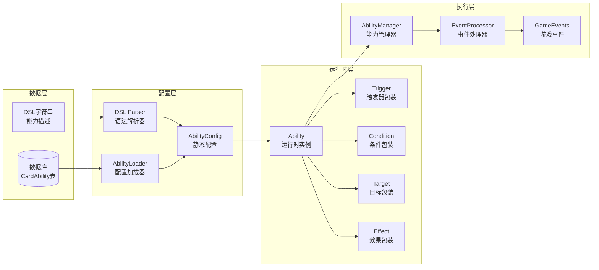
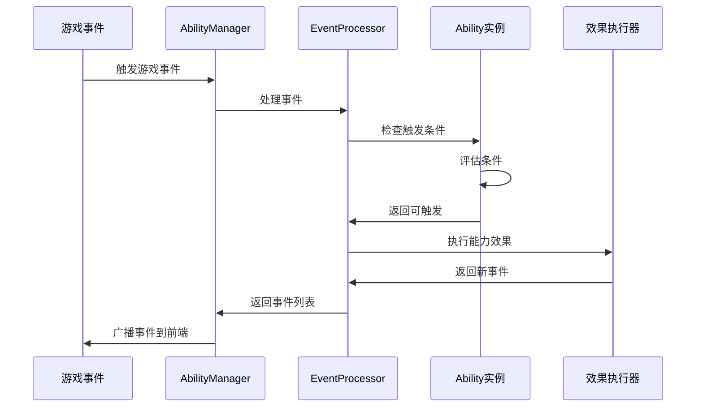

# 01-卡牌能力系统 [COMPLETED]

## 目的与范围

本文档详细说明Shadowverse-beyond项目的卡牌能力管理系统，包括从数据库配置到运行时执行的完整管道、DSL解析系统、事件驱动架构以及能力触发机制。这是游戏核心机制的技术实现指南。

## 核心概念

### 能力系统架构
- **AbilityConfig**: 静态配置，从数据库或DSL解析得到
- **Ability**: 运行时实例，包含执行状态和触发逻辑
- **Runtime Wrappers**: 运行时包装类，为静态配置添加执行上下文
- **EventProcessor**: 事件处理引擎，协调能力触发和效果执行

### 关键组件
- **Trigger**: 触发条件 (如"出牌时"、"回合开始时")
- **Condition**: 执行条件 (如"如果生命值小于5")
- **Target**: 目标选择 (如"所有敌方单位")
- **Effect**: 效果执行 (如"造成2点伤害")

## 架构概览

### 能力系统管道



### 数据库设计

<augment_code_snippet path="Server/Infrastructure/Data/ApplicationDbContext.cs" mode="EXCERPT">
````csharp
// CardAbility 实体配置
modelBuilder.Entity<CardAbility>(entity =>
{
    entity.ToTable("CardAbilities");
    entity.HasKey(e => e.Id);
    entity.HasIndex(e => new { e.CardId, e.Priority });
    
    // 支持混合存储方案
    entity.Property(e => e.DslExpression).HasMaxLength(2000);
    entity.Property(e => e.JsonConfiguration).HasColumnType("TEXT");
    entity.Property(e => e.AbilityTag).HasMaxLength(100);
});
````
</augment_code_snippet>

## 实现细节

### AbilityConfig - 静态配置

<augment_code_snippet path="Server/Domain/Abilities/AbilityConfig.cs" mode="EXCERPT">
````csharp
/// <summary>
/// 能力的静态配置，可从DSL或JSON解析得到
/// </summary>
public class AbilityConfig
{
    public string Id { get; set; } = string.Empty;
    public int CardId { get; set; }
    public string Name { get; set; } = string.Empty;
    public string AbilityTag { get; set; } = string.Empty;
    public AbilityType Type { get; set; }
    public TriggerConfig Trigger { get; set; } = new();
    public List<ConditionConfig> Conditions { get; set; } = new();
    public List<TargetConfig> Targets { get; set; } = new();
    public List<EffectConfig> Effects { get; set; } = new();
    
    // DSL支持
    public string? DslSource { get; set; }
    public DSL.AST.AbilityNode? CompiledAst { get; set; }
    
    // 静态工厂方法
    public static AbilityConfig FromDsl(string dslSource)
    {
        var parser = new AbilityDslParser();
        var ast = parser.ParseAbility(dslSource);
        return CreateFromAst(ast, dslSource);
    }
}
````
</augment_code_snippet>

### Ability - 运行时实例

<augment_code_snippet path="Server/Domain/Abilities/Ability.cs" mode="EXCERPT">
````csharp
/// <summary>
/// 运行时能力实例，包含执行状态和行为
/// </summary>
public class Ability
{
    public AbilityConfig Config { get; }
    public Trigger Trigger { get; }
    public List<Condition> Conditions { get; }
    public List<Target> Targets { get; }
    public List<Effect> Effects { get; }
    
    public CardInstance? SourceCard { get; set; }
    public bool IsActive { get; set; } = true;
    public DateTime? ActivationTime { get; private set; }
    public int TriggerCount { get; private set; }

    public Ability(AbilityConfig config, CardInstance? sourceCard = null)
    {
        Config = config;
        SourceCard = sourceCard;
        
        // 创建运行时组件
        Trigger = new Trigger(config.Trigger);
        Conditions = config.Conditions
            .Select(c => CreateRuntimeCondition(c))
            .ToList();
        Targets = config.Targets
            .Select(t => new Target(t))
            .ToList();
        Effects = config.Effects
            .Select(e => new Effect(e))
            .ToList();
    }

    public async Task<bool> CanTriggerAsync(IGameEvent gameEvent, GameContext context)
    {
        if (!IsActive) return false;
        
        // 检查触发条件
        if (!await Trigger.ShouldTriggerAsync(gameEvent, context))
            return false;
            
        // 检查所有条件
        foreach (var condition in Conditions)
        {
            if (!await condition.EvaluateAsync(context))
                return false;
        }
        
        return true;
    }
}
````
</augment_code_snippet>

### AbilityLoader - 配置加载器

<augment_code_snippet path="Server/Domain/Abilities/AbilityLoader.cs" mode="EXCERPT">
````csharp
public class AbilityLoader
{
    public async Task<List<AbilityConfig>> LoadAbilitiesForCardAsync(int cardId)
    {
        var cardAbilities = await _context.Set<CardAbility>()
            .Where(ca => ca.CardId == cardId && ca.IsActive)
            .OrderBy(ca => ca.Priority)
            .ToListAsync();

        var configs = new List<AbilityConfig>();
        await ProcessCardAbilitiesAsync(cardAbilities, configs);
        return configs;
    }

    private async Task ProcessCardAbilitiesAsync(
        List<CardAbility> cardAbilities, 
        List<AbilityConfig> configs)
    {
        foreach (var cardAbility in cardAbilities)
        {
            try
            {
                AbilityConfig? config = null;

                // 优先使用DSL解析
                if (!string.IsNullOrEmpty(cardAbility.DslExpression))
                {
                    config = AbilityConfig.FromDsl(cardAbility.DslExpression);
                }
                // 备选JSON解析
                else if (!string.IsNullOrEmpty(cardAbility.JsonConfiguration))
                {
                    config = AbilityConfig.FromJson(cardAbility.JsonConfiguration);
                }

                if (config != null)
                {
                    config.CardId = cardAbility.CardId;
                    configs.Add(config);
                }
            }
            catch (Exception ex)
            {
                _logger.LogError(ex, "Failed to load ability for card {CardId}", 
                    cardAbility.CardId);
            }
        }
    }
}
````
</augment_code_snippet>

### EventProcessor - 事件处理引擎

<augment_code_snippet path="Server/Domain/Events/EventProcessor.cs" mode="EXCERPT">
````csharp
public async Task<List<GameEventDto>> ProcessEventAsync(
    IGameEvent initialEvent, GameContext context)
{
    var processedEvents = new List<GameEventDto>();
    _eventQueue.Clear();
    _eventQueue.Enqueue(initialEvent);

    while (_eventQueue.Count > 0)
    {
        var currentEvent = _eventQueue.Dequeue();
        
        // 1. 执行事件本身
        var newEvents = await currentEvent.ExecuteAsync(context);
        
        // 2. 转换为DTO并记录
        var eventDto = ConvertEventToDto(currentEvent);
        if (eventDto != null)
        {
            processedEvents.Add(eventDto);
        }
        
        // 3. 检查触发的能力
        var triggeredAbilities = await GetTriggeredAbilitiesAsync(
            currentEvent, context);
            
        // 4. 执行触发的能力
        foreach (var ability in triggeredAbilities)
        {
            var abilityEvents = await ProcessAbilityAsync(
                ability, currentEvent, context);
            foreach (var abilityEvent in abilityEvents)
            {
                _eventQueue.Enqueue(abilityEvent);
            }
            
            // 播报能力触发事件
            var abilityTriggeredEvent = new AbilityTriggeredEvent(
                ability, currentEvent);
            _eventQueue.Enqueue(abilityTriggeredEvent);
        }
        
        // 5. 将事件本身产生的新事件加入队列
        foreach (var newEvent in newEvents)
        {
            _eventQueue.Enqueue(newEvent);
        }
    }
    
    return processedEvents;
}
````
</augment_code_snippet>

## 集成点

### DSL语法示例

#### 基础能力定义
```dsl
ABILITY "Fanfare" TAG "Fanfare" TYPE "Triggered"
TRIGGER OnPlay
CONDITION TargetExists(EnemyFollowers)
TARGET SelectRandom(EnemyFollowers, 1)
EFFECT DealDamage(2)
END_ABILITY
```

#### 复杂能力定义
```dsl
ABILITY "Storm" TAG "Storm" TYPE "Keyword"
TRIGGER OnEnterPlay
CONDITION Always
TARGET Self
EFFECT GrantKeyword("CanAttackImmediately")
END_ABILITY
```

### 运行时执行流程



## 使用模式

### 能力注册模式
```csharp
// 在游戏开始时注册卡牌能力
public async Task RegisterCardAbilitiesAsync(CardInstance cardInstance)
{
    var abilityConfigs = await _abilityLoader
        .LoadAbilitiesForCardAsync(cardInstance.DefinitionId);
        
    foreach (var config in abilityConfigs)
    {
        var ability = new Ability(config, cardInstance);
        _abilityManager.RegisterAbility(ability);
    }
}
```

### 事件处理模式
```csharp
// 在GameService中处理游戏动作
public async Task<bool> PlayCardAsync(string gameId, string playerId, 
    PlayCardActionDto actionDto, GameActionContext context)
{
    // 执行出牌逻辑
    var playCardEvent = new PlayCardEvent(cardInstance, playerId);
    
    // 通过AbilityManager处理事件
    var resultEvents = await _abilityManager
        .ProcessEventAsync(playCardEvent, gameContext);
        
    // 将事件添加到上下文中广播
    context.Events.AddRange(resultEvents);
    
    return true;
}
```

### 能力效果扩展
```csharp
// 添加新的效果类型
public class CustomDamageEffect : IEffect
{
    public async Task<List<IGameEvent>> ExecuteAsync(
        EffectExecutionContext context)
    {
        var damage = CalculateDamage(context);
        var damageEvent = new DamageEvent(context.Target, damage);
        return new List<IGameEvent> { damageEvent };
    }
}
```

## 状态标识

**[COMPLETED]** - 卡牌能力系统已完全实现，支持DSL解析、运行时执行和事件驱动架构。

### 已实现功能
- ✅ AbilityConfig静态配置系统
- ✅ Ability运行时实例管理
- ✅ DSL解析器和AST编译
- ✅ 运行时包装类 (Trigger, Effect等)
- ✅ EventProcessor事件处理引擎
- ✅ AbilityManager能力管理器
- ✅ 数据库存储和加载机制

### 技术特点
- **类型安全**: 强类型的配置和运行时系统
- **可扩展**: 支持新能力类型和效果的添加
- **高性能**: 事件驱动的异步处理
- **调试友好**: 完整的日志记录和错误处理

### 未来扩展
- 能力效果的可视化编辑器
- 更复杂的DSL语法支持
- 能力性能分析和优化工具
