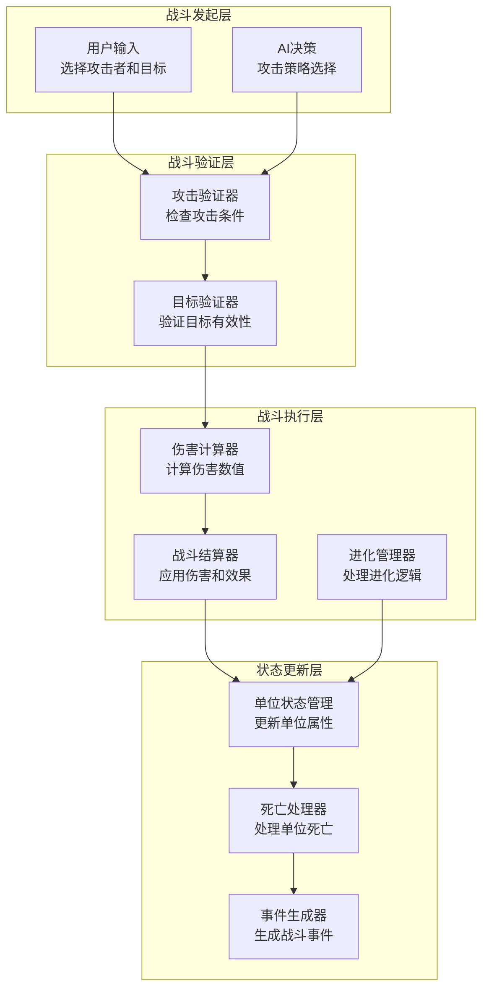
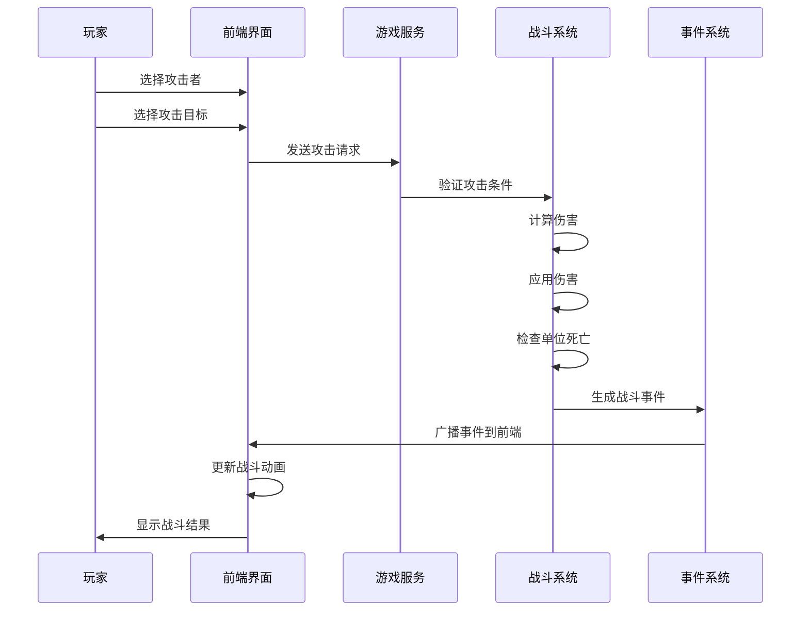

# 02-战斗系统 [COMPLETED]

## 目的与范围

本文档详细说明Shadowverse-beyond项目的战斗系统实现，包括攻击机制、进化系统、伤害计算、单位状态管理、战斗结算以及完整的前后端集成。涵盖战斗相关的所有核心机制和技术实现。

## 核心概念

### 战斗系统组成
- **攻击机制**: 单位对单位、单位对玩家的攻击系统
- **进化系统**: EP管理、进化条件、属性提升机制
- **伤害计算**: 攻击力、生命值、护甲等数值计算
- **状态效果**: 召唤疾病、攻击限制、特殊状态管理
- **战斗结算**: 伤害应用、单位死亡、连锁反应处理

### 技术术语
- **Attack**: 攻击力，决定造成的伤害
- **Health**: 生命值，归零时单位死亡
- **CanAttack**: 是否可以攻击的状态标志
- **HasAttackedThisTurn**: 本回合是否已攻击
- **EP (Evolution Point)**: 进化点数，用于单位进化的资源
- **IsEvolved**: 单位是否已经进化
- **SummoningSickness**: 召唤疾病，新召唤单位首回合不能攻击

## 架构概览

### 战斗系统架构图



### 攻击流程图



## 实现细节

### 攻击系统实现

#### 攻击验证和执行
```csharp
public async Task<bool> AttackAsync(string gameId, string playerId, 
    AttackActionDto actionDto, GameActionContext context)
{
    var gameState = await GetGameStateAsync(gameId);
    var player = GetPlayerState(gameState, playerId);
    
    // 1. 查找攻击者
    var attacker = player.Field.FirstOrDefault(u => u.InstanceId.ToString() == actionDto.AttackerUid);
    if (attacker == null)
    {
        throw new GameLogicException($"Attacker not found: {actionDto.AttackerUid}");
    }
    
    // 2. 验证攻击条件
    if (!ValidateAttackConditions(attacker, gameState))
    {
        return false;
    }
    
    // 3. 处理攻击目标
    if (string.IsNullOrEmpty(actionDto.TargetUid))
    {
        // 攻击敌方玩家
        return await AttackPlayerAsync(gameState, player, attacker, context);
    }
    else
    {
        // 攻击敌方单位
        return await AttackUnitAsync(gameState, player, attacker, actionDto.TargetUid, context);
    }
}

private bool ValidateAttackConditions(CardInstance attacker, GameStateDto gameState)
{
    // 检查是否可以攻击
    if (!attacker.CanAttack)
    {
        throw new GameLogicException("Unit cannot attack this turn");
    }
    
    // 检查是否已经攻击过
    if (attacker.HasAttackedThisTurn)
    {
        throw new GameLogicException("Unit has already attacked this turn");
    }
    
    // 检查攻击力
    if (attacker.CurrentAttack <= 0)
    {
        throw new GameLogicException("Unit has no attack power");
    }
    
    return true;
}
```

#### 单位对单位攻击
```csharp
private async Task<bool> AttackUnitAsync(GameStateDto gameState, PlayerStateDto attackingPlayer, 
    CardInstance attacker, string targetUid, GameActionContext context)
{
    // 查找目标单位
    var opponent = GetOpponentPlayer(gameState, attackingPlayer.PlayerId);
    var target = opponent.Field.FirstOrDefault(u => u.InstanceId.ToString() == targetUid);
    
    if (target == null)
    {
        throw new GameLogicException($"Target unit not found: {targetUid}");
    }
    
    // 计算伤害
    int attackerDamage = attacker.CurrentAttack;
    int targetDamage = target.CurrentAttack;
    
    // 应用伤害
    target.CurrentHealth -= attackerDamage;
    attacker.CurrentHealth -= targetDamage;
    
    // 标记已攻击
    attacker.HasAttackedThisTurn = true;
    attacker.CanAttack = false;
    
    // 生成攻击事件
    var attackEvent = new AttackDeclaredEventDto(
        attackingPlayer.PlayerId,
        MapToCardInstanceDto(attacker),
        MapToCardInstanceDto(target)
    );
    context.Events.Add(attackEvent);
    
    // 检查单位死亡
    var deadUnits = new List<CardInstance>();
    
    if (attacker.CurrentHealth <= 0)
    {
        deadUnits.Add(attacker);
        attackingPlayer.Field.Remove(attacker);
        attackingPlayer.Graveyard.Add(attacker);
        attacker.CurrentZone = CardZone.Graveyard;
    }
    
    if (target.CurrentHealth <= 0)
    {
        deadUnits.Add(target);
        opponent.Field.Remove(target);
        opponent.Graveyard.Add(target);
        target.CurrentZone = CardZone.Graveyard;
    }
    
    // 生成死亡事件
    foreach (var deadUnit in deadUnits)
    {
        var deathEvent = new UnitDestroyedEventDto(
            deadUnit.OwnerPlayerId,
            MapToCardInstanceDto(deadUnit)
        );
        context.Events.Add(deathEvent);
    }
    
    _logger.LogInformation("Unit {AttackerId} attacked unit {TargetId}", 
        attacker.InstanceId, target.InstanceId);
    
    return true;
}
```

#### 单位对玩家攻击
```csharp
private async Task<bool> AttackPlayerAsync(GameStateDto gameState, PlayerStateDto attackingPlayer, 
    CardInstance attacker, GameActionContext context)
{
    var opponent = GetOpponentPlayer(gameState, attackingPlayer.PlayerId);
    
    // 检查是否有嘲讽单位阻挡
    var taunters = opponent.Field.Where(u => HasKeyword(u, "Taunt")).ToList();
    if (taunters.Any())
    {
        throw new GameLogicException("Cannot attack player while enemy has units with Taunt");
    }
    
    // 对玩家造成伤害
    int damage = attacker.CurrentAttack;
    opponent.Health -= damage;
    
    // 标记已攻击
    attacker.HasAttackedThisTurn = true;
    attacker.CanAttack = false;
    
    // 生成攻击事件
    var attackEvent = new AttackDeclaredEventDto(
        attackingPlayer.PlayerId,
        MapToCardInstanceDto(attacker),
        null // null表示攻击玩家
    );
    context.Events.Add(attackEvent);
    
    // 生成生命值变化事件
    var healthEvent = new HealthChangedEventDto(
        opponent.PlayerId,
        opponent.Health,
        -damage
    );
    context.Events.Add(healthEvent);
    
    // 检查游戏结束
    if (opponent.Health <= 0)
    {
        gameState.IsGameOver = true;
        gameState.WinnerId = attackingPlayer.PlayerId;
        
        var gameOverEvent = new GameOverEventDto(
            attackingPlayer.PlayerId,
            opponent.PlayerId,
            "Health reached 0"
        );
        context.Events.Add(gameOverEvent);
    }
    
    _logger.LogInformation("Unit {AttackerId} attacked player {PlayerId} for {Damage} damage", 
        attacker.InstanceId, opponent.PlayerId, damage);
    
    return true;
}
```

### 进化系统实现

#### EP管理和进化处理
```csharp
public async Task<bool> EvolveAsync(string gameId, string playerId, 
    EvolveActionDto actionDto, GameActionContext context)
{
    var gameState = await GetGameStateAsync(gameId);
    var playerState = GetPlayerState(gameState, playerId);
    
    // 查找要进化的单位
    var targetUnit = playerState.Field.FirstOrDefault(u => 
        u.InstanceId.ToString() == actionDto.UnitUid);
    
    if (targetUnit == null)
    {
        throw new GameLogicException($"Unit not found: {actionDto.UnitUid}");
    }
    
    // 验证进化条件
    if (!ValidateEvolutionConditions(playerState, targetUnit))
    {
        return false;
    }
    
    // 消耗EP
    const int evolveEpCost = 1;
    playerState.CurrentEP -= evolveEpCost;
    
    // 应用进化效果
    ApplyEvolutionEffects(targetUnit);
    
    // 生成进化事件
    var evolveEvent = new UnitEvolvedEventDto(
        playerId,
        MapToCardInstanceDto(targetUnit)
    );
    context.Events.Add(evolveEvent);
    
    // 生成EP更新事件
    var epEvent = new EpUpdateEventDto(
        playerId,
        playerState.CurrentEP,
        playerState.MaxEP
    );
    context.Events.Add(epEvent);
    
    _logger.LogInformation("Player {PlayerId} evolved unit {UnitId}", 
        playerId, targetUnit.InstanceId);
    
    return true;
}

private bool ValidateEvolutionConditions(PlayerStateDto player, CardInstance unit)
{
    // 检查EP是否足够
    if (player.CurrentEP < 1)
    {
        throw new GameLogicException("Not enough EP to evolve");
    }
    
    // 检查单位是否已进化
    if (unit.IsEvolved)
    {
        throw new GameLogicException("Unit is already evolved");
    }
    
    // 检查单位是否可以进化
    if (!unit.CanEvolve)
    {
        throw new GameLogicException("Unit cannot evolve");
    }
    
    // 检查是否有进化定义
    var baseCardDef = _cardRepository.GetCardDefinitionByIdAsync(unit.DefinitionId).Result;
    if (!baseCardDef.EvolveId.HasValue)
    {
        throw new GameLogicException("This unit cannot evolve (no EvolveId defined)");
    }
    
    return true;
}

private void ApplyEvolutionEffects(CardInstance unit)
{
    // 基础进化效果：+2/+2
    unit.CurrentAttack += 2;
    unit.CurrentHealth += 2;
    unit.MaxHealth += 2;
    unit.IsEvolved = true;
    
    // 获得立即攻击能力
    unit.CanAttack = true;
    
    // 重置攻击状态
    unit.HasAttackedThisTurn = false;
}
```

### 前端战斗界面

#### 攻击交互处理
```javascript
// 攻击请求处理
export async function initiateAttack(attackerUid, targetUid = null) {
    const currentPlayer = getCurrentPlayerId();
    
    // 验证是否为当前玩家回合
    if (gameState.currentPlayerId !== currentPlayer) {
        showErrorMessage("不是您的回合");
        return false;
    }
    
    // 查找攻击者
    const player = getPlayerState(currentPlayer);
    const attacker = player.field.find(unit => unit.uid === attackerUid);
    
    if (!attacker) {
        showErrorMessage("未找到攻击单位");
        return false;
    }
    
    // 验证攻击条件
    if (!attacker.canAttack) {
        showErrorMessage("该单位本回合无法攻击");
        return false;
    }
    
    if (attacker.hasAttackedThisTurn) {
        showErrorMessage("该单位本回合已经攻击过");
        return false;
    }
    
    try {
        // 显示攻击动画预览
        showAttackPreview(attackerUid, targetUid);
        
        // 发送攻击请求
        const attackActionData = {
            actionType: "Attack",
            attackerUid: attackerUid,
            targetUid: targetUid
        };
        
        await sendGameAction(attackActionData);
        
        // 清除选择状态
        gameState.selectedAttackerUid = null;
        clearSelectionHighlights();
        
        console.log(`Attack initiated: ${attackerUid} -> ${targetUid || 'player'}`);
        return true;
        
    } catch (error) {
        console.error("Failed to initiate attack:", error);
        showErrorMessage(`攻击失败：${error.message}`);
        return false;
    }
}

// 进化请求处理
export async function evolveCard(unitUid) {
    const currentPlayer = getCurrentPlayerId();
    const player = getPlayerState(currentPlayer);
    
    // 验证EP是否足够
    if (player.ep < 1) {
        showErrorMessage("EP不足，无法进化");
        return false;
    }
    
    // 查找要进化的单位
    const unit = player.field.find(u => u.uid === unitUid);
    if (!unit) {
        showErrorMessage("未找到要进化的单位");
        return false;
    }
    
    // 验证进化条件
    if (unit.isEvolved) {
        showErrorMessage("该单位已经进化");
        return false;
    }
    
    if (!unit.canEvolve) {
        showErrorMessage("该单位无法进化");
        return false;
    }
    
    try {
        // 显示进化确认
        const confirmed = await showEvolveConfirmation(unit.name);
        if (!confirmed) return false;
        
        // 发送进化请求
        const evolveActionData = {
            actionType: "Evolve",
            unitUid: unitUid
        };
        
        await sendGameAction(evolveActionData);
        
        // 显示进化动画
        showEvolutionAnimation(unitUid);
        
        console.log(`Evolution initiated for unit: ${unitUid}`);
        return true;
        
    } catch (error) {
        console.error("Failed to evolve unit:", error);
        showErrorMessage(`进化失败：${error.message}`);
        return false;
    }
}
```

#### 战斗动画系统
```javascript
// 战斗动画管理器
class CombatAnimationManager {
    constructor() {
        this.animationQueue = [];
        this.isPlaying = false;
    }
    
    async playAttackAnimation(attackerUid, targetUid) {
        const attackerElement = document.querySelector(`[data-uid="${attackerUid}"]`);
        const targetElement = targetUid ? 
            document.querySelector(`[data-uid="${targetUid}"]`) : 
            document.querySelector('.opponent-avatar');
        
        if (!attackerElement) return;
        
        // 攻击者移动动画
        attackerElement.classList.add('attacking');
        
        // 伤害数字动画
        if (targetElement) {
            this.showDamageNumber(targetElement, attacker.currentAttack);
        }
        
        // 等待动画完成
        await this.waitForAnimation(800);
        
        // 重置攻击者位置
        attackerElement.classList.remove('attacking');
    }
    
    async playEvolutionAnimation(unitUid) {
        const unitElement = document.querySelector(`[data-uid="${unitUid}"]`);
        if (!unitElement) return;
        
        // 进化光效
        unitElement.classList.add('evolving');
        
        // 播放进化音效
        this.playSound('evolution');
        
        // 等待动画完成
        await this.waitForAnimation(1500);
        
        // 更新单位外观
        unitElement.classList.remove('evolving');
        unitElement.classList.add('evolved');
    }
    
    showDamageNumber(targetElement, damage) {
        const damageElement = document.createElement('div');
        damageElement.className = 'damage-number';
        damageElement.textContent = `-${damage}`;
        
        targetElement.appendChild(damageElement);
        
        // 动画结束后移除
        setTimeout(() => {
            if (damageElement.parentNode) {
                damageElement.parentNode.removeChild(damageElement);
            }
        }, 1000);
    }
    
    async waitForAnimation(duration) {
        return new Promise(resolve => setTimeout(resolve, duration));
    }
    
    playSound(soundName) {
        // 播放音效的实现
        const audio = new Audio(`/sounds/${soundName}.mp3`);
        audio.volume = 0.5;
        audio.play().catch(e => console.log('Audio play failed:', e));
    }
}

// 全局动画管理器
const combatAnimations = new CombatAnimationManager();
```

## 集成点

### 战斗事件DTO

#### AttackDeclaredEventDto
```csharp
public class AttackDeclaredEventDto : GameEventDto
{
    public CardInstanceDto AttackerState { get; set; } = null!;
    public CardInstanceDto? TargetState { get; set; } // null表示攻击玩家
    public int Damage { get; set; }
    
    public AttackDeclaredEventDto(string sourcePlayerId, CardInstanceDto attackerState, CardInstanceDto? targetState)
        : base(sourcePlayerId, "AttackDeclared")
    {
        AttackerState = attackerState;
        TargetState = targetState;
        Damage = attackerState.CurrentAttack;
    }
}
```

#### UnitEvolvedEventDto
```csharp
public class UnitEvolvedEventDto : GameEventDto
{
    public CardInstanceDto EvolvedUnitState { get; set; } = null!;
    
    public UnitEvolvedEventDto(string sourcePlayerId, CardInstanceDto evolvedUnitState)
        : base(sourcePlayerId, "UnitEvolved")
    {
        EvolvedUnitState = evolvedUnitState;
    }
}
```

## 使用模式

### 战斗状态管理
```csharp
public class CombatStateManager
{
    public void ResetUnitsForNewTurn(PlayerStateDto player)
    {
        foreach (var unit in player.Field)
        {
            // 重置攻击状态
            unit.HasAttackedThisTurn = false;
            
            // 治愈召唤疾病
            if (unit.TurnsOnField >= 1)
            {
                unit.CanAttack = true;
            }
            
            // 增加在场回合数
            unit.TurnsOnField++;
        }
    }
    
    public bool CanUnitAttack(CardInstance unit)
    {
        return unit.CanAttack && 
               !unit.HasAttackedThisTurn && 
               unit.CurrentAttack > 0 &&
               unit.CurrentZone == CardZone.Field;
    }
    
    public List<CardInstance> GetValidAttackTargets(GameStateDto gameState, string attackingPlayerId)
    {
        var opponent = GetOpponentPlayer(gameState, attackingPlayerId);
        var targets = new List<CardInstance>();
        
        // 检查是否有嘲讽单位
        var taunters = opponent.Field.Where(u => HasKeyword(u, "Taunt")).ToList();
        
        if (taunters.Any())
        {
            // 只能攻击嘲讽单位
            targets.AddRange(taunters);
        }
        else
        {
            // 可以攻击所有敌方单位
            targets.AddRange(opponent.Field);
        }
        
        return targets;
    }
}
```

### 伤害计算系统
```csharp
public class DamageCalculator
{
    public int CalculateDamage(CardInstance attacker, CardInstance? target, GameContext context)
    {
        int baseDamage = attacker.CurrentAttack;
        
        // 应用攻击力修正
        baseDamage = ApplyAttackModifiers(attacker, baseDamage, context);
        
        // 应用目标防御修正
        if (target != null)
        {
            baseDamage = ApplyDefenseModifiers(target, baseDamage, context);
        }
        
        return Math.Max(0, baseDamage);
    }
    
    private int ApplyAttackModifiers(CardInstance attacker, int damage, GameContext context)
    {
        // 检查攻击力增益效果
        foreach (var effect in GetActiveEffects(attacker, "AttackBonus"))
        {
            damage += effect.Value;
        }
        
        // 检查双倍伤害效果
        if (HasKeyword(attacker, "DoubleAttack"))
        {
            damage *= 2;
        }
        
        return damage;
    }
    
    private int ApplyDefenseModifiers(CardInstance target, int damage, GameContext context)
    {
        // 检查护甲效果
        var armor = GetArmorValue(target);
        damage = Math.Max(0, damage - armor);
        
        // 检查伤害减免效果
        foreach (var effect in GetActiveEffects(target, "DamageReduction"))
        {
            damage = Math.Max(0, damage - effect.Value);
        }
        
        return damage;
    }
}
```

## 状态标识

**[COMPLETED]** - 战斗系统已完全实现，包括攻击机制、进化系统、伤害计算和完整的前后端集成。

### 已实现功能
- ✅ 完整的攻击验证和执行流程
- ✅ 单位对单位、单位对玩家攻击
- ✅ EP管理和进化机制
- ✅ 伤害计算和状态更新
- ✅ 单位死亡处理
- ✅ 前端战斗动画系统
- ✅ 战斗事件广播和同步

### 技术特点
- **严格验证**: 多层次的战斗条件验证
- **精确计算**: 准确的伤害计算和状态管理
- **视觉反馈**: 丰富的战斗动画和效果
- **事件驱动**: 完整的战斗事件系统

### 扩展功能
- 特殊战斗效果 (嘲讽、潜行等)
- 复杂伤害计算 (护甲、抗性)
- 战斗回放系统
- 高级战斗动画
