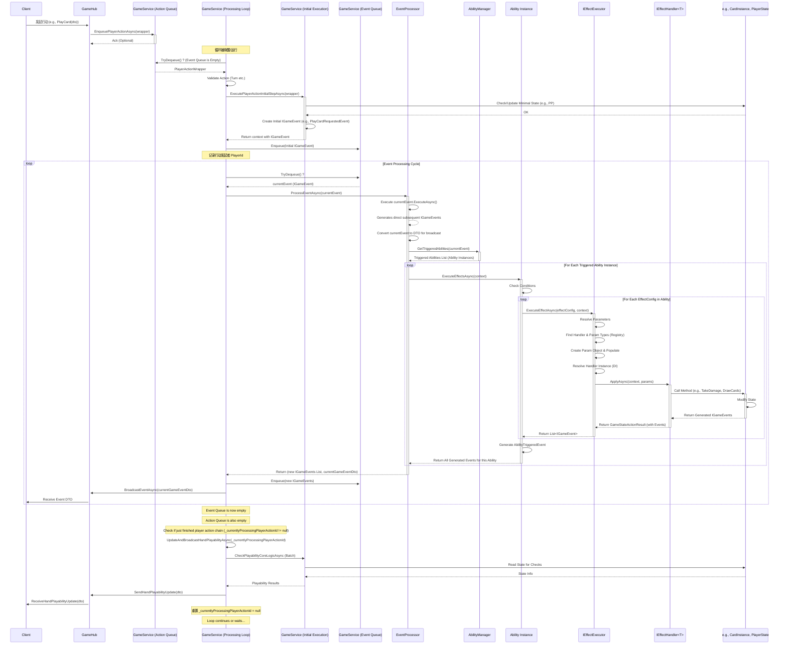

# 游戏循环与队列处理设计文档

## 1. 概述

### 1.1. 背景与目标

当前的游戏逻辑处理模式（主要在 `GameHub` 中接收请求，直接调用 `GameService` 方法完成完整动作及其事件处理）存在以下问题：

*   **行动完成点模糊:** 难以精确定义一个玩家“行动”（如出牌、攻击）何时真正完成（包括所有连锁事件），导致难以及时、准确地更新需要实时反馈的 UI 状态（如手牌可玩性）。
*   **复杂交互处理:** 卡牌游戏中常见的连锁事件（A触发B，B触发C）在现有模式下处理流程不够清晰，容易出错。
*   **潜在并发问题:** 虽然有锁机制，但直接在 Hub 请求中处理完整逻辑链条增加了并发控制的复杂性。

本设计旨在引入**双队列模式（玩家行动队列 + 事件队列）**来重构游戏的核心处理循环，以解决上述问题，主要目标包括：

1.  **精确定义行动完成点:** 一个玩家行动在其引发的所有连锁事件处理完毕后才算完成。
2.  **提升UI实时性:** 在行动完成后，能够可靠地触发需要更新的状态计算与推送（如手牌可玩性）。
3.  **有序处理复杂交互:** 清晰、有序地处理事件链。
4.  **改善并发控制:** 将玩家输入与事件处理分离，简化并发管理。

### 1.2. 核心概念

*   **玩家行动 (Player Action):** 由玩家通过 `GameHub` 发起的意图，如出牌 (`PlayCard`)、攻击 (`PerformAttack`)、结束回合 (`EndTurn`) 等。
*   **行动队列 (Action Queue):** 一个先进先出 (FIFO) 的队列，用于存储待处理的玩家行动。确保玩家的行动按顺序被接收和启动。
*   **领域事件 (Domain Event / `IGameEvent`):** 代表游戏中发生的一个有意义的状态变化或事实。由玩家行动的初始步骤或之前的事件处理（能力效果）产生。这是内部处理的核心。
*   **事件DTO (`GameEventDto`):** 用于通过 SignalR 广播给客户端的事件数据传输对象，由领域事件映射而来。
*   **事件队列 (Event Queue):** 一个队列（可能需要优先级，但初期可简化为 FIFO），用于存储待处理的**领域事件 (`IGameEvent`)**。确保事件按逻辑顺序处理。
*   **处理循环 (Processing Loop):** `GameService` 内部的核心逻辑，负责不断地从事件队列和行动队列中取出项目并进行处理。
*   **效果执行器 (`IEffectExecutor`):** 负责解析效果配置 (`EffectConfig`)，查找并调用相应的效果处理器 (`IEffectHandler`) 的服务。
*   **效果处理器 (`IEffectHandler<TParams>`):** 负责执行具体效果逻辑的类（如 `DamageEffectHandler`）。
*   **行动完成:** 当一个玩家行动被从行动队列取出并执行其初始逻辑后，其引发的所有直接和间接事件都已从事件队列中处理完毕（即事件队列暂时为空），该行动才算真正完成。

## 2. 核心组件设计

### 2.1. 队列 (`GameService` 内部)

*   **玩家行动队列 (`_playerActionQueues`)**
    *   **数据结构:** `ConcurrentDictionary<string, ConcurrentQueue<PlayerActionWrapper>>` (Key: gameId, Value: 线程安全的行动队列)
    *   **作用:** 缓存由 `GameHub` 接收到的玩家行动请求，确保按接收顺序处理每个游戏的行动。
*   **事件队列 (`_eventQueues`)**
    *   **数据结构:** `ConcurrentDictionary<string, ConcurrentQueue<IGameEvent>>` (Key: gameId, Value: 线程安全的**领域事件**队列)
    *   **作用:** 存储由玩家行动初始逻辑或 `EventProcessor` 处理事件时产生的待处理领域事件。

### 2.2. 数据结构定义

*   **`PlayerActionWrapper` (新定义)**
    *   **用途:** 封装从 `GameHub` 传入的行动请求，放入行动队列。
    *   **位置:** `Server/Models/PlayerActionWrapper.cs` (建议)
    *   **属性:**
        *   `ActionType`: 枚举或字符串，标识行动类型 (e.g., "PlayCard", "Attack", "EndTurn")。
        *   `PlayerId`: 发起行动的玩家 ID。
        *   `ActionData`: `object` 或特定基类/接口，包含行动所需的具体参数 (e.g., `PlayCardActionDto`, `AttackActionDto`)。
        *   `RequestId`: (可选) 用于追踪或幂等性检查的唯一请求 ID。
        *   `Timestamp`: (可选) 接收时间戳。

*   **`HandPlayabilityUpdateDto` (新 DTO)**
    *   **用途:** 服务器在行动完成后，主动推送给客户端，包含当前手牌所有卡牌的可玩性状态。
    *   **位置:** `Server/Dtos/SignalR/Events/HandPlayabilityUpdateDto.cs` (建议)
    *   **继承:** 可考虑继承自 `GameEventDto` 以便统一广播。
    *   **属性:**
        *   `PlayerId`: 目标玩家 ID。
        *   `PlayabilityResults`: `Dictionary<Guid, PlayabilityResultDto>`，Key 为 `CardInstance.InstanceId` (Guid)，Value 为该卡牌的 [`PlayabilityResultDto`](Server/Dtos/PlayabilityResultDto.cs)。 *(注意: Key 类型已从 int 改为 Guid)*

### 2.3. 处理循环 (`GameService` 内部)

*   **触发机制:** 需要一个机制来为每个活跃的游戏实例运行一个独立的、异步的处理循环。这可以通过 `Task.Run` 启动，或者使用更健壮的后台任务管理方式。循环在游戏开始时启动，在游戏结束时停止。
*   **方法签名 (示例):** `private async Task GameProcessingLoopAsync(string gameId, CancellationToken cancellationToken)`
*   **状态追踪:** 处理循环需要维护一个状态，记录当前正在处理哪个玩家发起的行动链 (`_currentlyProcessingPlayerActionId[gameId]`)，以便在事件链处理完毕后触发手牌更新。
### 2.4. 效果执行与领域实体职责 (推荐模式)

为了提升代码的封装性、内聚性和可维护性，推荐遵循以下模式：

**核心原则:**

*   **Executor 负责调度:** `IEffectExecutor` (实现为 `EffectExecutor`) 负责接收 `EffectConfig`，解析参数，查找并获取正确的 `IEffectHandler` 实例。
*   **Handler 负责协调:** `IEffectHandler` (如 `DamageEffectHandler`) 的 `ApplyAsync` 方法负责协调效果的执行。它**不应**直接包含大量的状态修改逻辑。
*   **实体负责状态与行为:** `IEffectHandler` 应调用相应的**领域实体类**（如 `CardInstance`, `PlayerState`）的方法来执行具体的状态修改。实体类最了解如何修改自身状态及规则。
*   **实体方法返回事件:** 实体类的方法在执行状态修改后，应负责创建并返回代表该次变更结果的领域事件 (`IGameEvent`) 列表。
*   **Handler 收集事件:** `IEffectHandler` 收集实体方法返回的事件，并将其包含在返回的 `GameStateActionResult` 中。
*   **Executor 返回事件:** `IEffectExecutor` 从 `GameStateActionResult` 中提取事件列表并返回给调用者（通常是 `Ability` 或 `EventProcessor`）。

**示例:**

*   **伤害:** `EffectExecutor` 调用 `DamageEffectHandler.ApplyAsync` -> `DamageEffectHandler` 调用 `targetCardInstance.TakeDamage(amount)` -> `TakeDamage` 方法内部处理伤害计算、生命值修改，并返回 `DamageEvent` (可能还有 `CardDestroyedEvent`) -> `DamageEffectHandler` 将事件放入 `GameStateActionResult` -> `EffectExecutor` 返回事件。
*   **破坏:** `EffectExecutor` 调用 `DestroyUnitEffectHandler.ApplyAsync` -> `DestroyUnitEffectHandler` 调用 `targetPlayerState.DestroyUnit(targetCardInstance)` -> `DestroyUnit` 方法内部处理卡牌移动、更新区域状态，并返回 `UnitDestroyedEvent`, `GraveyardUpdateEvent` -> ... (后续流程类似)
*   **抽卡:** `EffectExecutor` 调用 `DrawCardEffectHandler.ApplyAsync` -> `DrawCardEffectHandler` 调用 `targetPlayerState.DrawCards(amount)` -> `DrawCards` 方法内部处理抽卡逻辑，并返回包含 `CardDrawnEvent` 的结果 -> ...

通过这种方式，职责清晰分离：`Executor` 调度，`Handler` 协调，`Entity` 执行。代码结构更清晰，也更易于进行单元测试。

## 3. 修订后的事件处理流程详解

1.  **玩家/AI 发起行动:**
    *   **Client/AI -> `GameHub`/`AiTurnExecutor`:** 发送行动请求（如 `PlayCardActionDto`, `AttackActionDto`）。
    *   **`GameHub`/`AiTurnExecutor`:**
        *   进行基础验证。
        *   创建 `PlayerActionWrapper` 对象。
        *   调用 `GameService.EnqueuePlayerActionAsync(gameId, wrapper)`。

2.  **行动入队与循环唤醒:**
    *   **`GameService.EnqueuePlayerActionAsync`:**
        *   将 `PlayerActionWrapper` 加入对应 `gameId` 的行动队列 (`actionQueue`)。
        *   确保该 `gameId` 的 `GameProcessingLoopAsync` 正在运行或被唤醒。

3.  **核心处理循环 (`GameProcessingLoopAsync`):**
    *   **(循环开始)**
    *   **优先处理事件队列 (`eventQueue`):**
        *   **While `eventQueue` 非空:**
            *   出队一个**领域事件 (`IGameEvent`)** `currentEvent`。
            *   **调用 `IEventProcessor.ProcessEventAsync(currentEvent, context)`:**
                *   `EventProcessor` 内部处理 `currentEvent`：
                    *   执行 `currentEvent.ExecuteAsync()` -> 生成直接后续事件 (`IGameEvent`)。
                    *   **转换 `currentEvent` 为 DTO** (`currentGameEventDto`)，用于后续广播。
                    *   调用 `AbilityManager` 检查并获取触发的能力 (`Ability` 实例列表)。
                    *   对每个触发的 `Ability`：
                        *   调用 `ability.ExecuteEffectsAsync(context)`。
                        *   `Ability.ExecuteEffectsAsync` 内部：
                            *   检查能力条件。
                            *   遍历效果配置 (`EffectConfig`)。
                            *   对每个效果配置，调用 `IEffectExecutor.ExecuteEffectAsync(effectConfig, context)`。
                            *   `IEffectExecutor` 内部：
                                *   解析参数。
                                *   查找并获取对应的 `IEffectHandler` 实例。
                                *   调用 `handler.ApplyAsync(context, params)`。
                                *   `Handler` 调用领域实体方法修改状态，实体方法返回事件。
                                *   `Handler` 将事件包装在 `GameStateActionResult` 中返回。
                            *   `IEffectExecutor` 从 `GameStateActionResult` 提取事件列表并返回。
                        *   `Ability.ExecuteEffectsAsync` 收集所有效果产生的事件。
                        *   生成 `AbilityTriggeredEvent` (`IGameEvent`)。
                    *   将所有新生成的 `IGameEvent` (包括直接后续事件、效果产生的事件、能力触发事件) 加入 `EventProcessor` 内部待处理列表。
                *   `EventProcessor` 返回本次 `currentEvent` 处理过程中产生的所有**新的 `IGameEvent` 列表** `newDomainEvents`，以及用于广播的 `currentGameEventDto`。
            *   **新事件入队:** 将 `newDomainEvents` 加入到 `GameProcessingLoopAsync` 的 `eventQueue` 中。
            *   **广播当前事件:** 调用 `BroadcastEventAsync(gameId, currentGameEventDto)` 将处理完毕的事件 DTO 广播给客户端。
            *   标记 `processedItem = true`。
    *   **处理行动队列 (`actionQueue`):**
        *   **If `eventQueue` 为空 且 `actionQueue` 非空:**
            *   出队一个 `PlayerActionWrapper` `actionWrapper`。
            *   验证行动合法性（当前回合等）。
            *   **调用 `ExecutePlayerActionInitialStepAsync(gameId, actionWrapper, actionContext)`:** (这是重构后的 `GameService` 核心方法)
                *   执行最小化验证（如 PP）。
                *   执行最小化状态变更（如扣除 PP）。
                *   创建**初始领域事件 (`IGameEvent`)**（如 `PlayCardEvent`）并放入 `actionContext.DomainEvents`。
            *   **初始事件入队:** 将 `actionContext.DomainEvents` 中的所有 `IGameEvent` 加入 `eventQueue`。
            *   记录当前正在处理的行动发起者 `_currentlyProcessingPlayerActionId[gameId] = actionWrapper.PlayerId`。
            *   标记 `processedItem = true`。
    *   **行动完成与手牌更新:**
        *   **If `eventQueue` 为空 且 `actionQueue` 为空 且 `_currentlyProcessingPlayerActionId[gameId]` 非空:**
            *   这意味着由该 PlayerId 发起的行动及其所有连锁事件已处理完毕。
            *   调用 `UpdateAndBroadcastHandPlayabilityAsync(gameId, _currentlyProcessingPlayerActionId[gameId])`。
            *   重置 `_currentlyProcessingPlayerActionId[gameId] = null`。
            *   标记 `processedItem = true`。
    *   **空闲等待:**
        *   **If not `processedItem`:** `await Task.Delay(...)` 避免 CPU 空转。
    *   **(返回循环开始)**

## 4. Mermaid 流程图 (Sequence Diagram)

*注意: 上图中的广播步骤 (`BroadcastEventAsync`, `SendHandPlayabilityUpdate`) 显示由 `GameHub` 执行，但更优的实现可能是由 `GameService` 内部直接调用 `IHubContext<GameHub>` 来完成广播，以减少 `ProcessingLoop` 对 `GameHub` 的依赖。*

## 5. 重构步骤

### 5.1. `GameHub` 修改

*   **移除直接逻辑调用:** `PlayCard`, `PerformAttack`, `EndTurn`, `PerformEvolve`, `SubmitMulligan` 等方法不再直接调用 `_gameService` 的对应 `...Async` 方法来完成完整逻辑链。
*   **创建 `PlayerActionWrapper`:** 在每个 Hub 方法中，根据接收到的参数创建相应的 `PlayerActionWrapper` 对象。
*   **入队操作:** 调用一个新的 `GameService` 方法（例如 `EnqueuePlayerActionAsync(string gameId, PlayerActionWrapper action)`) 将 `PlayerActionWrapper` 加入对应游戏的行动队列。
*   **触发处理 (可选):** Hub 方法在入队后，可能需要调用一个 `GameService` 方法来确保处理循环正在运行或被唤醒（例如 `EnsureProcessingLoopRunningAsync(string gameId)`)。
*   **返回值/错误处理:** Hub 方法通常变为 `async Task`。成功时可能不返回具体结果（结果通过事件广播）。失败时（如入队失败、验证失败）应通过 `Clients.Caller.ReceiveError` 通知客户端。

### 5.2. `GameService` 修改

*   **引入队列:** 添加 `ConcurrentDictionary<string, ConcurrentQueue<PlayerActionWrapper>> _playerActionQueues` 和 `ConcurrentDictionary<string, ConcurrentQueue<IGameEvent>> _eventQueues`。
*   **修改行动方法:**
    *   `PlayCardAsync`, `AttackAsync`, `EndTurnAsync`, `EvolveAsync`, `SubmitMulliganAsync` 等方法重构为**私有**的 `ExecutePlayerActionInitialStepAsync` 的一部分或其辅助方法。
    *   这些方法只执行**初始**状态变更和验证，并将**初始领域事件 (`IGameEvent`)** 放入传入的 `GameActionContext` 中。
    *   移除方法内部对 `BroadcastEventAsync` 的调用。
*   **实现 `EnqueuePlayerActionAsync`:** 提供给 `GameHub` 调用，负责将 `PlayerActionWrapper` 放入正确的游戏队列，并触发处理循环。
*   **实现 `GameProcessingLoopAsync`:** 实现核心处理循环逻辑，包括从队列取项目、调用 `ExecutePlayerActionInitialStepAsync`、调用 `IEventProcessor`、处理手牌更新逻辑、错误处理和等待机制。
*   **实现 `UpdateAndBroadcastHandPlayabilityAsync`:** 实现批量检查手牌可玩性并推送 `HandPlayabilityUpdateDto` 的逻辑。
*   **提取 `CheckPlayabilityCoreLogicAsync` (内部方法):** 将 `CheckCardPlayabilityAsync` 中实际执行检查的部分提取出来，以便 `UpdateAndBroadcastHandPlayabilityAsync` 调用，避免代码重复。
*   **状态管理:** 确保对游戏状态的访问和修改在处理循环中是线程安全的，可能需要使用锁或并发安全的数据结构。
*   **`IEventProcessor` 依赖:** `GameService` 需要
*   移除方法内部对 `BroadcastEventAsync` 的调用。
*   **实现 `EnqueuePlayerActionAsync`:** 提供给 `GameHub` 调用，负责将 `PlayerActionWrapper` 放入正确的游戏队列，并触发处理循环。
*   **实现 `GameProcessingLoopAsync`:** 实现核心处理循环逻辑，包括从队列取项目、调用 `ExecutePlayerActionInitialStepAsync`、调用 `IEventProcessor`、处理手牌更新逻辑、错误处理和等待机制。
*   **实现 `UpdateAndBroadcastHandPlayabilityAsync`:** 实现批量检查手牌可玩性并推送 `HandPlayabilityUpdateDto` 的逻辑。
*   **提取 `CheckPlayabilityCoreLogicAsync` (内部方法):** 将 `CheckCardPlayabilityAsync` 中实际执行检查的部分提取出来，以便 `UpdateAndBroadcastHandPlayabilityAsync` 调用，避免代码重复。
*   **状态管理:** 确保对游戏状态的访问和修改在处理循环中是线程安全的，可能需要使用锁或并发安全的数据结构。
*   **`IEventProcessor` 依赖:** `GameService` 需要能够访问 `IEventProcessor` 实例（可能通过依赖注入或服务定位器）。
*   **广播依赖:** `GameService` 需要能够访问 `IHubContext<GameHub>` 以便在处理循环中广播事件和手牌更新。

### 5.3. 客户端 (`IGameClient`) 修改

*   **添加新方法:** 在 `IGameClient` 接口中添加 `Task ReceiveHandPlayabilityUpdate(HandPlayabilityUpdateDto dto);`。
*   **前端实现:** 前端需要实现 `connection.on("ReceiveHandPlayabilityUpdate", ...)` 来接收并处理手牌可玩性批量更新。

## 6. 潜在风险与考虑

*   **复杂性增加:** 引入队列和处理循环会增加代码的复杂性，需要更仔细地管理状态和并发。
*   **异步处理:** 正确处理异步事件和行动需要谨慎，避免死锁或竞态条件。
*   **错误处理:** 需要为队列处理、事件处理、行动执行等各个环节设计健壮的错误处理和恢复机制。
*   **性能调优:** 处理循环的效率、队列的性能、批量可玩性检查的开销都需要关注和调优。
*   **调试难度:** 追踪一个跨越队列和异步操作的逻辑链条可能会更困难，需要良好的日志记录。

## 7. 预期效果

*   玩家手牌的可玩性状态将在每次行动完成后自动更新，提供更流畅、实时的 UI 反馈。
*   游戏事件处理流程更加清晰、有序，易于管理复杂的卡牌交互和连锁反应。
*   通过将耗时的事件处理与玩家请求分离，有望提高系统的响应性和吞吐量。
*   代码结构更符合事件驱动原则，提高可维护性和可扩展性。