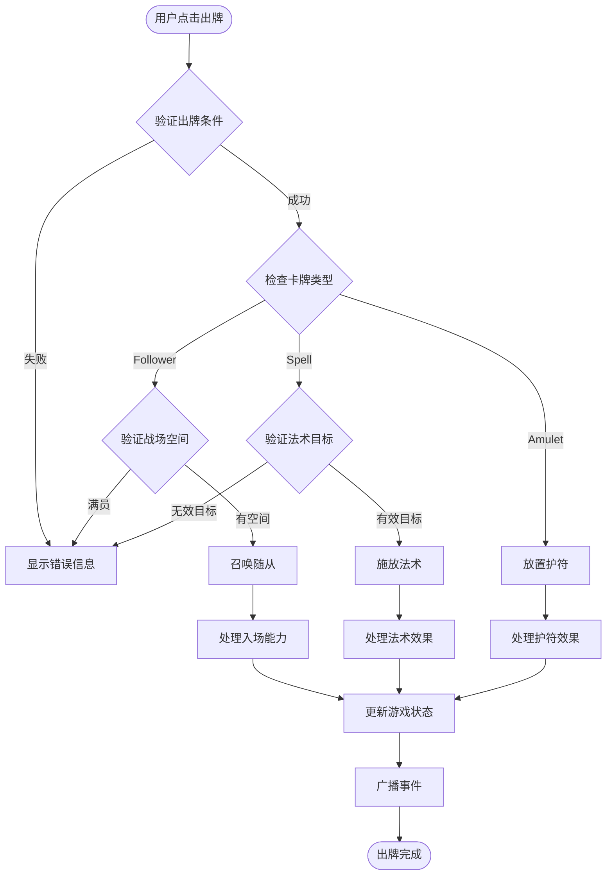
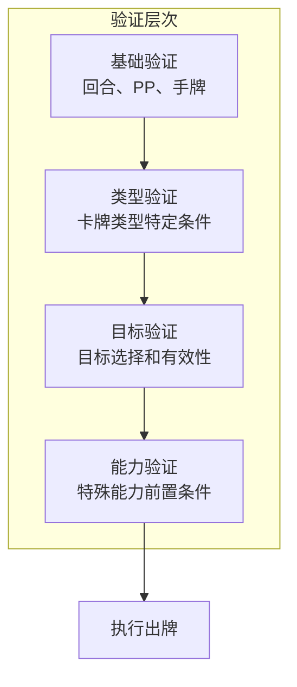

# 04-卡牌出牌系统 [COMPLETED]

## 目的与范围

本文档详细说明Shadowverse-beyond项目的卡牌出牌系统实现，包括出牌验证、目标选择、法术处理、随从召唤、护符放置以及完整的前后端交互流程。

## 核心概念

### 出牌系统原则
- **严格验证**: 多层次的出牌条件验证
- **类型区分**: 不同卡牌类型的专门处理逻辑
- **目标系统**: 灵活的目标选择和验证机制
- **事件驱动**: 完整的出牌事件链处理

### 卡牌类型
- **Follower**: 随从卡牌，召唤到战场
- **Spell**: 法术卡牌，产生即时效果
- **Amulet**: 护符卡牌，提供持续效果

## 架构概览

### 出牌流程图



### 出牌验证层次



## 实现细节

### 后端出牌处理

#### 主要出牌逻辑
```csharp
public async Task<bool> PlayCardAsync(string gameId, string playerId, 
    PlayCardActionDto actionDto, GameActionContext context)
{
    var gameState = await GetGameStateAsync(gameId);
    var player = GetPlayerState(gameState, playerId);
    
    // 1. 基础验证
    if (!ValidateBasicPlayConditions(gameState, player, actionDto))
    {
        return false;
    }
    
    // 2. 查找卡牌
    var cardToPlay = player.Hand.FirstOrDefault(c => c.InstanceId.ToString() == actionDto.CardUid);
    if (cardToPlay == null)
    {
        throw new GameLogicException($"Card not found in hand: {actionDto.CardUid}");
    }
    
    var cardDefinition = await _cardRepository.GetCardDefinitionByIdAsync(cardToPlay.DefinitionId);
    if (cardDefinition == null)
    {
        throw new GameLogicException($"Card definition not found: {cardToPlay.DefinitionId}");
    }
    
    // 3. 类型特定验证和处理
    switch (cardDefinition.CardType)
    {
        case "Follower":
            return await PlayFollowerCard(gameState, player, cardToPlay, cardDefinition, actionDto, context);
        case "Spell":
            return await PlaySpellCard(gameState, player, cardToPlay, cardDefinition, actionDto, context);
        case "Amulet":
            return await PlayAmuletCard(gameState, player, cardToPlay, cardDefinition, actionDto, context);
        default:
            throw new GameLogicException($"Unknown card type: {cardDefinition.CardType}");
    }
}

private bool ValidateBasicPlayConditions(GameStateDto gameState, PlayerStateDto player, PlayCardActionDto actionDto)
{
    // 检查是否为当前玩家回合
    if (gameState.CurrentPlayerId != player.PlayerId)
    {
        throw new GameLogicException("Not your turn");
    }
    
    // 检查游戏阶段
    if (gameState.Phase != "Main")
    {
        throw new GameLogicException("Can only play cards during main phase");
    }
    
    return true;
}
```

#### 随从卡牌处理
```csharp
private async Task<bool> PlayFollowerCard(GameStateDto gameState, PlayerStateDto player, 
    CardInstance cardToPlay, CardDefinition cardDefinition, PlayCardActionDto actionDto, GameActionContext context)
{
    // 1. 验证战场空间
    if (player.Field.Count >= 5)
    {
        throw new GameLogicException("Field is full, cannot summon more followers");
    }
    
    // 2. 验证PP消耗
    if (player.PP < cardToPlay.CurrentCost)
    {
        throw new GameLogicException($"Insufficient PP: required {cardToPlay.CurrentCost}, available {player.PP}");
    }
    
    // 3. 从手牌移除
    player.Hand.Remove(cardToPlay);
    
    // 4. 消耗PP
    player.PP -= cardToPlay.CurrentCost;
    
    // 5. 创建战场单位
    var fieldUnit = CreateFieldUnit(cardToPlay, cardDefinition);
    player.Field.Add(fieldUnit);
    
    // 6. 生成出牌事件
    var cardPlayedEvent = new CardPlayedEventDto(
        player.PlayerId,
        MapToCardInstanceDto(fieldUnit),
        "Follower"
    );
    context.Events.Add(cardPlayedEvent);
    
    // 7. 处理入场能力
    await ProcessFanfareAbilities(fieldUnit, gameState, context);
    
    _logger.LogInformation("Player {PlayerId} played follower {CardName}", 
        player.PlayerId, cardDefinition.Name);
    
    return true;
}

private CardInstance CreateFieldUnit(CardInstance handCard, CardDefinition definition)
{
    return new CardInstance
    {
        InstanceId = handCard.InstanceId,
        DefinitionId = definition.Id,
        OwnerPlayerId = handCard.OwnerPlayerId,
        CurrentZone = CardZone.Field,
        CardType = definition.CardType,
        CurrentCost = handCard.CurrentCost,
        CurrentAttack = definition.Attack,
        CurrentHealth = definition.Health,
        MaxHealth = definition.Health,
        IsEvolved = false,
        CanAttack = false, // 召唤疾病：第一回合不能攻击
        CanEvolve = true
    };
}
```

#### 法术卡牌处理
```csharp
private async Task<bool> PlaySpellCard(GameStateDto gameState, PlayerStateDto player, 
    CardInstance cardToPlay, CardDefinition cardDefinition, PlayCardActionDto actionDto, GameActionContext context)
{
    // 1. 验证PP消耗
    if (player.PP < cardToPlay.CurrentCost)
    {
        throw new GameLogicException($"Insufficient PP: required {cardToPlay.CurrentCost}, available {player.PP}");
    }
    
    // 2. 验证目标（如果需要）
    if (RequiresTarget(cardDefinition) && string.IsNullOrEmpty(actionDto.TargetUid))
    {
        throw new GameLogicException("Spell requires a target");
    }
    
    CardInstance? target = null;
    if (!string.IsNullOrEmpty(actionDto.TargetUid))
    {
        target = FindTargetInGame(gameState, actionDto.TargetUid);
        if (target == null)
        {
            throw new GameLogicException($"Target not found: {actionDto.TargetUid}");
        }
        
        if (!IsValidSpellTarget(cardDefinition, target, gameState))
        {
            throw new GameLogicException("Invalid target for this spell");
        }
    }
    
    // 3. 从手牌移除
    player.Hand.Remove(cardToPlay);
    
    // 4. 消耗PP
    player.PP -= cardToPlay.CurrentCost;
    
    // 5. 移动到墓地
    player.Graveyard.Add(cardToPlay);
    cardToPlay.CurrentZone = CardZone.Graveyard;
    
    // 6. 生成出牌事件
    var cardPlayedEvent = new CardPlayedEventDto(
        player.PlayerId,
        MapToCardInstanceDto(cardToPlay),
        "Spell"
    );
    context.Events.Add(cardPlayedEvent);
    
    // 7. 处理法术效果
    await ProcessSpellEffects(cardToPlay, target, gameState, context);
    
    _logger.LogInformation("Player {PlayerId} cast spell {CardName}", 
        player.PlayerId, cardDefinition.Name);
    
    return true;
}
```

### 前端出牌交互

#### 出牌请求处理
```javascript
// 出牌请求函数
export async function playCard(cardUid, targetUid = null) {
    const currentPlayer = getCurrentPlayerId();
    
    // 验证是否为当前玩家回合
    if (gameState.currentPlayerId !== currentPlayer) {
        showErrorMessage("不是您的回合");
        return false;
    }
    
    // 查找要出的卡牌
    const player = getPlayerState(currentPlayer);
    const cardToPlay = player.hand.find(card => card.uid === cardUid);
    
    if (!cardToPlay) {
        showErrorMessage("未找到指定卡牌");
        return false;
    }
    
    // 验证PP是否足够
    if (player.pp < cardToPlay.currentCost) {
        showErrorMessage(`PP不足：需要${cardToPlay.currentCost}，当前${player.pp}`);
        return false;
    }
    
    // 类型特定验证
    if (!validateCardPlayConditions(cardToPlay, targetUid)) {
        return false;
    }
    
    try {
        // 乐观更新：立即从手牌移除
        const cardIndex = player.hand.indexOf(cardToPlay);
        player.hand.splice(cardIndex, 1);
        updateHandDisplay(currentPlayer);
        
        // 发送出牌请求
        const playCardActionData = {
            actionType: "PlayCard",
            cardUid: cardUid,
            targetUid: targetUid
        };
        
        await sendGameAction(playCardActionData);
        
        // 清除选择状态
        gameState.selectedCardUid = null;
        clearSelectionHighlights();
        
        console.log(`Successfully played card: ${cardToPlay.name}`);
        return true;
        
    } catch (error) {
        // 回滚乐观更新
        player.hand.splice(cardIndex, 0, cardToPlay);
        updateHandDisplay(currentPlayer);
        
        console.error("Failed to play card:", error);
        showErrorMessage(`出牌失败：${error.message}`);
        return false;
    }
}

// 卡牌出牌条件验证
function validateCardPlayConditions(card, targetUid) {
    switch (card.type) {
        case 'Follower':
            return validateFollowerPlay(card);
        case 'Spell':
            return validateSpellPlay(card, targetUid);
        case 'Amulet':
            return validateAmuletPlay(card);
        default:
            showErrorMessage(`未知卡牌类型：${card.type}`);
            return false;
    }
}

function validateFollowerPlay(card) {
    const player = getPlayerState(gameState.localPlayerId);
    
    // 检查战场空间
    if (player.field.length >= 5) {
        showErrorMessage("战场已满，无法召唤更多随从");
        return false;
    }
    
    return true;
}

function validateSpellPlay(card, targetUid) {
    // 检查是否需要目标
    if (requiresTarget(card) && !targetUid) {
        showErrorMessage("该法术需要选择目标");
        highlightValidSpellTargets(card);
        return false;
    }
    
    // 验证目标有效性
    if (targetUid && !isValidSpellTarget(card, targetUid)) {
        showErrorMessage("无效的法术目标");
        return false;
    }
    
    return true;
}
```

#### 目标选择系统
```javascript
// 法术目标选择
export function isValidSpellTarget(card, targetUid) {
    const target = findCardInstanceByUid(targetUid);
    if (!target) return false;
    
    // 根据法术类型检查目标有效性
    switch (card.definitionId) {
        case 1: // 治疗术 - 只能目标友方
            return target.ownerPlayerId === gameState.localPlayerId;
        case 2: // 火球术 - 只能目标敌方
            return target.ownerPlayerId !== gameState.localPlayerId;
        case 3: // 变形术 - 只能目标随从
            return target.type === 'Follower';
        default:
            return true; // 默认允许所有目标
    }
}

// 高亮有效目标
export function highlightValidSpellTargets(card) {
    clearSelectionHighlights();
    
    // 获取所有可能的目标
    const allTargets = getAllPossibleTargets();
    
    // 筛选有效目标
    const validTargets = allTargets.filter(target => 
        isValidSpellTarget(card, target.uid)
    );
    
    // 高亮有效目标
    validTargets.forEach(target => {
        const targetElement = document.querySelector(`[data-uid="${target.uid}"]`);
        if (targetElement) {
            targetElement.classList.add('valid-target');
        }
    });
    
    // 显示目标选择提示
    showTargetSelectionHint(card.name, validTargets.length);
}

function getAllPossibleTargets() {
    const targets = [];
    
    // 添加所有战场单位
    gameState.players.forEach(player => {
        player.field.forEach(unit => {
            targets.push(unit);
        });
        
        // 添加玩家本身（某些法术可以目标玩家）
        targets.push({
            uid: `player_${player.playerId}`,
            type: 'Player',
            ownerPlayerId: player.playerId,
            name: player.name || `玩家${player.playerId}`
        });
    });
    
    return targets;
}
```

## 集成点

### 出牌事件DTO

#### CardPlayedEventDto
```csharp
public class CardPlayedEventDto : GameEventDto
{
    public CardInstanceDto PlayedCardInstance { get; set; } = null!;
    public string CardType { get; set; } = string.Empty;
    public string? TargetUid { get; set; }
    
    public CardPlayedEventDto(string sourcePlayerId, CardInstanceDto playedCardInstance, string cardType)
        : base(sourcePlayerId, "CardPlayed")
    {
        PlayedCardInstance = playedCardInstance;
        CardType = cardType;
    }
}
```

### 能力处理集成

#### 入场能力处理
```csharp
private async Task ProcessFanfareAbilities(CardInstance unit, GameStateDto gameState, GameActionContext context)
{
    // 获取卡牌的入场能力
    var abilities = await _abilityLoader.LoadAbilitiesForCardAsync(unit.DefinitionId);
    var fanfareAbilities = abilities.Where(a => a.Trigger.Type == "OnPlay").ToList();
    
    foreach (var abilityConfig in fanfareAbilities)
    {
        try
        {
            var ability = new Ability(abilityConfig, unit);
            var gameContext = new GameContext(gameState, context);
            
            // 检查能力触发条件
            if (await ability.CanTriggerAsync(new PlayCardEvent(unit), gameContext))
            {
                // 执行能力效果
                var abilityEvents = await ability.ExecuteAsync(gameContext);
                context.Events.AddRange(abilityEvents);
                
                _logger.LogInformation("Executed fanfare ability {AbilityName} for card {CardName}", 
                    abilityConfig.Name, unit.InstanceId);
            }
        }
        catch (Exception ex)
        {
            _logger.LogError(ex, "Failed to execute fanfare ability for card {CardId}", unit.DefinitionId);
        }
    }
}
```

## 使用模式

### 批量出牌验证
```csharp
public class PlayCardValidator
{
    public ValidationResult ValidatePlayCard(GameStateDto gameState, PlayerStateDto player, 
        CardInstance card, string? targetUid = null)
    {
        var result = new ValidationResult();
        
        // 基础验证
        if (!ValidateBasicConditions(gameState, player, result))
            return result;
        
        // PP验证
        if (!ValidatePPCost(player, card, result))
            return result;
        
        // 类型特定验证
        switch (card.CardType)
        {
            case "Follower":
                ValidateFollowerPlay(player, result);
                break;
            case "Spell":
                ValidateSpellPlay(gameState, card, targetUid, result);
                break;
            case "Amulet":
                ValidateAmuletPlay(player, result);
                break;
        }
        
        return result;
    }
}

public class ValidationResult
{
    public bool IsValid => !Errors.Any();
    public List<string> Errors { get; } = new();
    public List<string> Warnings { get; } = new();
    
    public void AddError(string error) => Errors.Add(error);
    public void AddWarning(string warning) => Warnings.Add(warning);
}
```

### 出牌历史记录
```javascript
class PlayCardHistory {
    constructor() {
        this.history = [];
        this.maxEntries = 100;
    }
    
    recordPlay(playerId, card, target = null) {
        const entry = {
            timestamp: Date.now(),
            playerId,
            cardName: card.name,
            cardType: card.type,
            cost: card.currentCost,
            target: target ? target.name : null,
            turnNumber: gameState.turnNumber
        };
        
        this.history.unshift(entry);
        
        // 限制历史记录数量
        if (this.history.length > this.maxEntries) {
            this.history = this.history.slice(0, this.maxEntries);
        }
        
        this.updateHistoryDisplay();
    }
    
    getRecentPlays(count = 5) {
        return this.history.slice(0, count);
    }
    
    updateHistoryDisplay() {
        const historyElement = document.getElementById('play-history');
        if (!historyElement) return;
        
        const recentPlays = this.getRecentPlays();
        historyElement.innerHTML = recentPlays.map(play => 
            `<div class="history-entry">
                <span class="player">${play.playerId}</span>
                <span class="card">${play.cardName}</span>
                <span class="cost">${play.cost}PP</span>
                ${play.target ? `<span class="target">→ ${play.target}</span>` : ''}
            </div>`
        ).join('');
    }
}

// 全局出牌历史记录器
const playCardHistory = new PlayCardHistory();
```

## 状态标识

**[COMPLETED]** - 卡牌出牌系统已完全实现，包括多层验证、类型特定处理、目标选择和能力集成。

### 已实现功能
- ✅ 完整的出牌验证流程
- ✅ 随从、法术、护符的专门处理
- ✅ 灵活的目标选择系统
- ✅ 入场能力自动触发
- ✅ 前端交互和反馈
- ✅ 乐观更新和错误回滚
- ✅ 出牌历史记录

### 技术特点
- **多层验证**: 确保出牌的合法性和一致性
- **类型安全**: 不同卡牌类型的专门处理逻辑
- **用户友好**: 直观的目标选择和错误提示
- **性能优化**: 高效的验证和处理流程

### 扩展功能
- 出牌动画效果
- 高级目标筛选
- 出牌统计分析
- 自定义出牌规则
