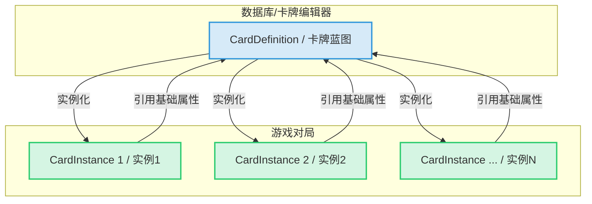

# 13. 卡牌数据结构指南

**版本: 1.0**

**作者: AI 技术总监**

**更新日期: 2025-08-10**

## 1. 概述

本文档旨在深入解析游戏中“卡牌”这一核心实体的数据结构。理解卡牌的构成方式是构建任何卡牌相关功能（尤其是卡牌编辑器）的绝对前提。

在我们的系统中，一张卡牌被分为两个核心概念：

*   **`CardDefinition` (静态定义/蓝图)**: 这是卡牌的“出厂设置”。它包含了卡牌所有不变的、基础的属性，例如它的名称、费用、卡面描述、所属职业、稀有度等。这份数据存储在数据库中，是卡牌编辑器主要打交道的对象。
*   **`CardInstance` (动态实例/活体)**: 这是卡牌在实际对局中的“活体”。它代表了在手牌、战场、墓地中的一张具体卡牌。它的状态会随着游戏进程（如受到伤害、获得Buff）而不断变化。它通过引用 `CardDefinition` 来获取其基础属性。

## 2. 核心关系

`CardDefinition` 和 `CardInstance` 之间的关系是“一对多”的“模板-实例”关系。一个 `CardDefinition` 可以被实例化为多个 `CardInstance`。

## 3. `CardDefinition`：卡牌的蓝图

这是我们在卡牌编辑器中需要配置的所有静态属性。

| 属性名 (Property) | 数据类型 | 描述 | 编辑器建议 |
| :--- | :--- | :--- | :--- |
| `Id` | `int` | 卡牌的唯一数据库ID。 | 通常由系统自动生成，编辑器中可设为只读。 |
| `Name` | `string` | 卡牌的显示名称。 | 文本输入框。 |
| `Type` | `CardType` (enum) | 卡牌类型（随从、法术、护符）。 | 下拉菜单，选项来自`CardType`枚举。 |
| `Rarity` | `CardRarity` (enum) | 卡牌稀有度（青铜、白银、黄金、传说）。 | 下拉菜单，选项来自`CardRarity`枚举。 |
| `CardSet` | `string` | 所属卡包系列（如“基础包”、“时空转生”）。 | 文本输入框，未来可改为关联卡包表的下拉菜单。 |
| `Class` | `CardClass` (enum) | 所属职业（中立、精灵、皇家等）。 | 下拉菜单，选项来自`CardClass`枚举。 |
| `Cost` | `int` | 基础 Play Point (PP) 费用。 | 数字输入框（整数）。 |
| `Attack` | `int?` | 基础攻击力。对于非法术单位是必须的。 | 数字输入框（整数）。仅在`Type`为随从时显示。 |
| `Health` | `int?` | 基础生命值。对于非法术单位是必须的。 | 数字输入框（整数）。仅在`Type`为随从时显示。 |
| `Tribe` | `List<string>` | 种族/特性（如“士兵”、“指挥官”）。 | 标签式多选输入框，允许添加多个种族。 |
| `Description` | `string` | 卡牌的效果描述文本（给玩家看的）。 | 多行文本输入框。 |
| `Keywords` | `List<string>` | 卡牌关键字（如“守护”、“突进”）。 | 标签式多选输入框，选项来自`CardKeyword`枚举。 |
| `AbilityIds` | `List<long>` | 关联的卡牌能力ID列表。 | **核心功能**：一个可添加/删除能力的列表控件。点击“添加”后，应弹出**能力编辑器**来创建一个新的能力配置，并将其ID关联至此。 |
| `IsCollectible` | `bool` | 是否为可收集卡牌。 | 复选框。勾选代表是标准卡，不勾选代表是衍生卡（如Token）。 |
| `EvolveId` | `int?` | 进化后的 `CardDefinition` ID。 | 数字输入框或一个“选择卡牌”的弹窗。仅在`Type`为随从时显示。 |

## 4. `CardInstance`：游戏中的活体

`CardInstance` 的属性是卡牌在游戏中的实时状态，它们**不应**在卡牌编辑器中直接配置，而是由游戏逻辑和卡牌能力动态改变。理解这些属性有助于我们设计能影响它们的能力。

| 关键动态属性 | 数据类型 | 描述 |
| :--- | :--- | :--- |
| `InstanceId` | `Guid` | 游戏对局中每个实例的唯一ID。 |
| `OwnerPlayerId` | `Guid` | 这张卡牌实例属于哪个玩家。 |
| `CurrentZone` | `CardZone` (enum) | 卡牌当前所在的区域（牌库、手牌、战场、墓地等）。 |
| `CurrentCost` | `int` | 当前费用，可能会被效果（如“命运的指引”）修改。 |
| `CurrentAttack` | `int` | 当前攻击力，包含了所有Buff和Debuff的计算结果。 |
| `CurrentHealth` | `int` | 当前生命值，通过 `MaxHealth - Damage` 动态计算。 |
| `MaxHealth` | `int` | 当前最大生命值，包含了所有Buff和Debuff的计算结果。 |
| `Damage` | `int` | 已承受的伤害值。 |
| `IsEvolved` | `bool` | 标记此随从实例是否已经进化。 |
| `IsSilenced` | `bool` | 标记此实例是否被沉默（失去能力和关键字）。 |
| `CanAttack` | `bool` | 标记此随从本回合是否可以攻击（处理召唤失调等）。 |
| `AttacksThisTurn` | `int` | 本回合已经攻击过的次数。 |
| `Abilities` | `IReadOnlyList<Ability>` | 挂载在此实例上的能力对象列表。 |
| `AbilityState` | `Dictionary<string, object>` | 用于存储能力需要的持久化数据（如“本回合已使用X次”的计数器）。 |

## 5. 总结

我们已经清晰地定义了卡牌的静态蓝图 (`CardDefinition`) 和动态活体 (`CardInstance`)。

*   我们的**卡牌编辑器**，其核心目标就是提供一个用户友好的图形界面，来创建和修改 `CardDefinition` 对象，并将其存入数据库。
*   我们的**能力编辑器**，则是作为卡牌编辑器的一个子模块，用于创建和配置能力，并将能力的ID关联到 `CardDefinition` 的 `AbilityIds` 列表中。

这两份文档——《卡牌数据结构指南》和《卡牌能力DSL开发指南》——共同构成了我们编辑器开发的完整技术规格书。