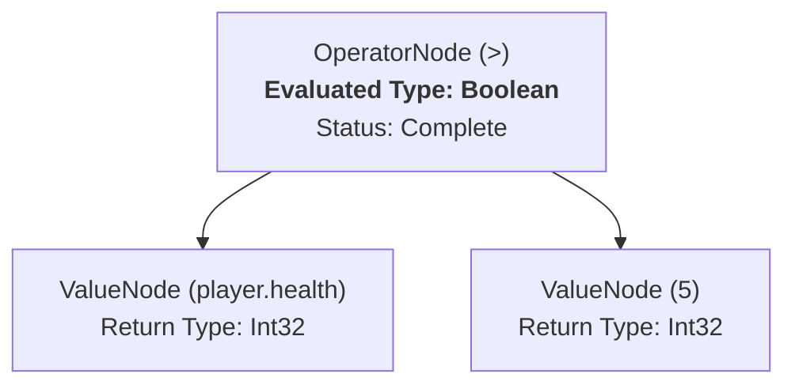

# 04. DSL节点类型与操作总览

**版本: 1.0**

**作者: AI 技术总监**

**更新日期: 2025-08-24**

## 1. 概述

本文档详细定义了DSL编辑器中所有节点类型及其对应的后续操作。这是为编程人员提供的核心实现依据。

## 2. 节点类型详解

### 2.1 抽象起点：数据源 (Data Source)

| 节点类型 | 数据源 (Data Source) |
| :--- | :--- |
| **定义** | 一个抽象的、隐含的起点，在表达式为空或等待右操作数时出现，代表所有可能的数据来源。 |
| **后续节点** | - **上下文对象 (Context Object)**: 如 `Context`，代表当前游戏状态的动态数据。 - **数据库对象 (Database Object)**: 如 `DB`，代表对数据库的访问（未来扩展）。 - **静态值 (Static Value)**: 如 `5`, `"hello"`, `true`，代表用户输入的常量。 |

### 2.2 对象类型 (Object Type)

| 节点类型 | 对象类型 (Object Type) |
| :--- | :--- |
| **定义** | 代表一个包含多个命名字段（属性）的复杂数据结构。 |
| **示例** | `Context`, `PlayerState`, `CardInstance`, `DB` |
| **来源** | 1. 从“数据源”节点选择一个上下文或数据库对象。 2. 访问另一个对象的属性，且该属性的返回类型是一个对象。 |
| **核心后续操作** | **属性访问**: 通过 `.` 操作符访问其内部的、由元数据定义的属性。 |

---

### 2.3 标量类型 (Scalar Type)

| 节点类型 | 标量类型 (Scalar Type) |
| :--- | :--- |
| **定义** | 代表一个单一的、不可再分的数据值，是构成逻辑判断和计算的基础。 |
| **分类** | - **数值类型**: `Int32`, `Int64`, `Single`, `Double` - **文本类型**: `String` - **布尔类型**: `Boolean` |
| **来源** | 1. 访问对象的属性，其返回类型是标量 (e.g., `Player.Health` 返回 `Int32`)。 2. 选择一个“静态值”数据源。 3. 一个函数或操作的返回结果是标量 (e.g., `Player.Cards.Count()` 返回 `Int32`)。 |
| **核心后续操作** | **操作符 (Operators)**: 根据具体的标量类型，连接不同的操作符。 |

#### 2.3.1 数值类型 (Numeric Types)

| 类型详情 | `Int32`, `Int64`, `Single`, `Double` |
| :--- | :--- |
| **后续操作** | **函数**: `abs()` **比较操作符**: `==`, `!=`, `>`, `>=`, `<`, `<=` **算术操作符**: `+`, `-`, `*`, `/`, `%` |

#### 2.3.2 文本类型 (Text Type)

| 类型详情 | `String`, `Guid` |
| :--- | :--- |
| **说明** | **枚举类型 (Enum Types)** 和 **标识符类型 (Guid)** 在DSL中都应被视为**文本类型**进行处理，因为它们的核心操作（比较）与字符串兼容。 |
| **后续操作** | **函数**: `contains(value)`, `isEmpty()` **比较操作符**: `==`, `!=` |

#### 2.3.3 布尔类型 (Boolean Type)

| 类型详情 | `Boolean` |
| :--- | :--- |
| **后续操作** | **作为 `if` 函数的条件**: `if(this, thenValue, elseValue)` **比较操作符**: `==`, `!=` **逻辑操作符**: `&&`, `||`, `!` |

### 2.4 集合类型 (Collection Type)

| 节点类型 | 集合类型 (Collection Type) |
| :--- | :--- |
| **定义** | 代表一组有序或无序的同类型元素的集合。 |
| **示例** | `List<CardInstance>`, `Player.Hand` |
| **来源** | 1. 访问对象的属性，其返回类型是集合 (e.g., `Player.Cards`)。 2. 一个函数或操作的返回结果是集合。 |
| **核心后续操作** | **函数**: `sum()`, `min()`, `max()`, `count()`, `isEmpty()`, `contains(value)` **列表查询**: `.query(condition)` (见下方特殊规则) |

## 3. 操作节点 (Operation Nodes)

当用户从一个数据节点（如标量、对象、集合）选择一个操作（无论是操作符还是函数）后，表达式中会创建一个新的**操作节点**。这类节点的行为定义如下。

### 3.1 操作符节点 (Operator Node)

| 节点类型 | 操作符节点 (Operator Node) |
| :--- | :--- |
| **定义** | 代表一个中缀操作，如 `+`, `-`, `>`, `==`, `&&`。 |
| **状态与后续** | **不完整 (Incomplete)**: 当节点被创建时，它拥有左操作数但缺少右操作数。 - **后续节点**: 此时应推荐**数据源 (Data Source)**，让用户为右操作数提供值。  **完整 (Complete)**: 当右操作数被填充后，节点变为完整。 |
| **返回类型** | 由操作符本身决定。详见下方的类型推断规则。 |
| **完整后的后续** | 一个完整的操作符表达式节点，其后续操作由其**返回类型**决定。 - **示例**: `player.health > 5` 的返回类型是 `Boolean`，因此其后续可用的操作是布尔类型的操作（如 `&&`, `||`）。 |

### 3.2 函数调用节点 (Function Call Node)

| 节点类型 | 函数调用节点 (Function Call Node) |
| :--- | :--- |
| **定义** | 代表一个函数调用，如 `count(player.cards)`。 |
| **状态与后续** | **不完整 (Incomplete)**: 当函数被选择后，如果其需要参数，则节点处于不完整状态。 - **后续节点**: 此时应推荐**数据源 (Data Source)**，让用户为当前参数提供值。  **完整 (Complete)**: 当所有必需的参数都被填充后，节点变为完整。 |
| **返回类型** | 由函数在后端的元数据 `ReturnType` 决定。 |
| **完整后的后续** | 一个完整的函数调用节点，其后续操作由其**返回类型**决定。 - **示例**: `count(player.cards)` 的返回类型是 `Int32`，因此其后续可用的操作是数值类型的操作（如 `>`, `<`, `+`）。 |

### 3.3 列表查询节点 (List Query Node)

| 节点类型 | 列表查询节点 (List Query Node) |
| :--- | :--- |
| **定义** | 一种特殊的操作节点，代表对集合进行筛选。它的核心特性是**改变其参数表达式的求值上下文**。 |
| **示例** | `.query(...)` |
| **状态与后续** | **不完整 (Incomplete)**: 当 `.query()` 被选择后，它需要一个返回布尔类型的**条件表达式**作为参数。 - **后续节点**: 编辑器应开始构建一个新的、独立的条件表达式。在这个新表达式的求值上下文中，必须**引入 `self` 关键字**，它代表集合中的单个元素。 |
| **返回类型** | **永远是集合类型**，且与输入集合的类型完全相同。 |
| **完整后的后续** | 一个完整的列表查询节点，其后续操作是所有**集合类型**支持的操作。 - **示例**: `Player.Cards.query(self.Cost > 5)` 的返回类型是 `List<CardInstance>`，因此可以继续链接集合操作，如 `.count()` 或另一个 `.query()`。 |

## 4. 核心机制

### 3.1 类型推断规则

为了让编辑器能够持续提供准确的后续选项，它必须能够推断出每一个完整表达式的返回类型。

| 操作类型 | 规则 | 示例 |
| :--- | :--- | :--- |
| **比较操作** | 任意两个类型进行比较操作，其表达式的返回类型**永远是 `Boolean`**。 | `Player.Health > 5` 这个完整表达式的类型是 `Boolean`。 |
| **算术操作** | 两个数值类型进行算术操作，其表达式的返回类型**永远是 `Numeric`** (通常与左操作数类型保持一致)。 | `Player.Health + 2` 这个完整表达式的类型是 `Int32`。 |

### 3.2 语法结构树 (AST) 与节点求值

DSL编辑器在内部会将用户的操作构建成一个**抽象语法树 (AST)**。这棵树的结构反映了表达式的逻辑层次，是判断节点是否完整和进行类型推断的根本依据。

*   **节点完整性判断**: 编辑器通过检查AST中节点的子节点是否满足其定义来判断表达式是否“断开”。
    *   例如，一个二元操作符（如 `>`）节点，如果缺少右子节点，则被视为**不完整**，编辑器此时需要提示用户输入（即提供“数据源”选项）。当左右子节点都被填充后，该节点变为**完整**。

*   **节点类型求值**: 一个父节点的返回类型，由其自身的操作和其子节点的返回类型共同决定。
    *   例如，一个 `>` 节点的返回类型被硬编码为 `Boolean`。一个 `+` 节点的返回类型被推断为 `Numeric`。编辑器通过递归地从树的叶子节点向上计算，最终得到整个表达式的返回类型。

**示例: `player.health > 5` 的AST**

## 4. 特殊规则与上下文

### 4.1 列表查询 (`.query`) 内部上下文

当表达式进入一个作用于集合的 `.query(condition)` 函数的条件部分时，DSL的求值上下文会发生变化：

*   **引入 `self` 关键字**: 在 `condition` 表达式内部，可以使用一个特殊的关键字 `self`。
*   **`self` 的类型**: `self` 代表该集合中的单个元素。它的类型就是该集合的泛型参数类型。
    *   **示例**: 在表达式 `Player.Cards.query(...)` 中，`Player.Cards` 的类型是 `List<CardInstance>`。因此，在 `query` 的条件内部，`self` 就是一个 `CardInstance` 类型的对象，可以访问其所有属性，例如 `self.Cost > 5`。