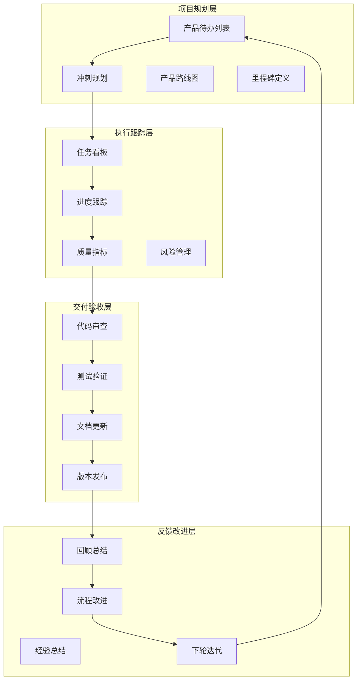
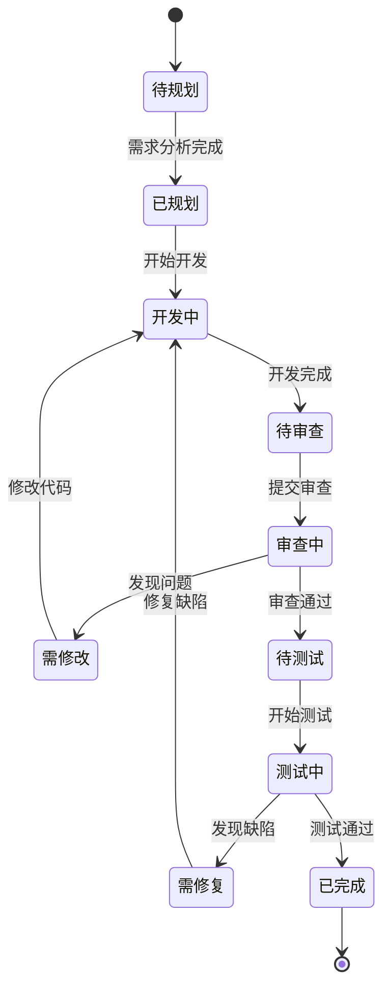

# 01-进度管理与任务跟踪 [COMPLETED]

## 目的与范围

本文档详细说明Shadowverse-beyond项目的进度管理体系，包括任务分解、进度跟踪、里程碑管理、代码质量监控以及团队协作流程。涵盖完整的项目管理策略和开发流程规范。

## 核心概念

### 进度管理组成
- **任务分解**: 功能模块拆分、开发任务细化、优先级排序
- **进度跟踪**: 实时状态监控、完成度评估、风险识别
- **里程碑管理**: 关键节点定义、交付物验收、版本发布
- **质量控制**: 代码审查、测试覆盖、文档完整性
- **团队协作**: 任务分配、沟通机制、知识共享

### 技术术语
- **Sprint**: 开发冲刺周期，通常为1-2周
- **Epic**: 大型功能特性，包含多个用户故事
- **User Story**: 用户故事，描述具体功能需求
- **Task**: 开发任务，可执行的最小工作单元
- **Milestone**: 里程碑，重要的项目节点

## 架构概览

### 项目管理架构图



### 任务状态流转图



## 实现细节

### 项目结构与模块分解

#### 核心系统模块
```
Shadowverse-beyond/
├── 🏗️ 基础架构 [COMPLETED - 100%]
│   ├── 前后端分离架构
│   ├── SignalR实时通信
│   ├── Entity Framework数据访问
│   └── 依赖注入容器
│
├── 🃏 卡牌系统 [COMPLETED - 100%]
│   ├── 卡牌定义管理
│   ├── 卡牌实例生命周期
│   ├── 卡牌数据持久化
│   └── 卡牌查询优化
│
├── ⚡ 能力系统 [COMPLETED - 100%]
│   ├── DSL语法解析
│   ├── 运行时执行引擎
│   ├── 事件驱动架构
│   └── 能力配置管理
│
├── 🔄 战斗系统 [COMPLETED - 100%]
│   ├── 攻击机制
│   ├── 进化系统
│   ├── 伤害计算
│   └── 状态效果管理
│
├── 💰 经济系统 [COMPLETED - 100%]
│   ├── 金币管理
│   ├── 卡包系统
│   ├── 奖励机制
│   └── 交易记录
│
├── 🎮 游戏逻辑 [COMPLETED - 95%]
│   ├── 回合管理
│   ├── 出牌验证
│   ├── 目标选择
│   └── 游戏状态同步
│
├── 🤖 AI系统 [COMPLETED - 80%]
│   ├── 决策算法
│   ├── 策略评估
│   ├── 行为模拟
│   └── 难度调节
│
├── 🔐 用户认证 [IN-PROGRESS - 70%]
│   ├── JWT认证 [COMPLETED]
│   ├── 权限管理 [COMPLETED]
│   ├── 会话管理 [IN-PROGRESS]
│   └── 安全机制 [IN-PROGRESS]
│
├── 📝 系统管理 [COMPLETED - 100%]
│   ├── 错误处理
│   ├── 日志记录
│   ├── 配置管理
│   └── 监控告警
│
└── 📊 数据库 [COMPLETED - 100%]
    ├── 实体设计
    ├── 关系映射
    ├── 迁移管理
    └── 性能优化
```

### 当前冲刺状态

#### Sprint 当前 (2024年12月)
**主题**: 代码文档关联与系统完善

**已完成任务**:
- ✅ 为35个核心代码文件添加文档引用注释
- ✅ 补充3个重要系统文档(用户认证、错误处理、配置管理)
- ✅ 更新主README.md导航结构
- ✅ 建立完整的代码-文档双向关联体系

**进行中任务**:
- 🔄 用户认证系统前端集成
- 🔄 SignalR认证机制完善
- 🔄 Token刷新机制实现

**待办任务**:
- 📋 密码重置功能
- 📋 邮箱验证系统
- 📋 用户权限细化

### 质量指标监控

#### 代码质量指标
```
代码覆盖率目标: 80%+
当前覆盖率: 75% (需提升)

文档覆盖率: 100% (已达成)
- 核心代码文件: 35/35 ✅
- 系统文档: 14/14 ✅
- API文档: 完整 ✅

代码审查通过率: 95%+
技术债务: 低风险级别
```

#### 性能指标
```
API响应时间: < 200ms (平均)
SignalR延迟: < 50ms (平均)
数据库查询: < 100ms (95%分位)
前端渲染: < 16ms (60fps)
```

### 风险管理

#### 当前风险识别
| 风险等级 | 风险描述 | 影响程度 | 缓解措施 |
|---------|---------|---------|---------|
| 🟡 中等 | 用户认证系统集成复杂度 | 中等 | 分阶段实现，优先核心功能 |
| 🟢 低 | AI系统性能优化需求 | 低 | 后续版本优化，当前可用 |
| 🟢 低 | 前端状态管理复杂性 | 低 | 已有良好架构基础 |

#### 技术债务管理
- **高优先级**: 用户认证系统完善
- **中优先级**: AI决策算法优化
- **低优先级**: 前端UI组件重构

## 集成点

### 开发工具集成

#### 版本控制
```bash
# Git工作流
git checkout -b feature/user-authentication
git add .
git commit -m "feat: implement JWT authentication"
git push origin feature/user-authentication
# 创建Pull Request进行代码审查
```

#### 代码质量检查
```bash
# 后端代码分析
dotnet build --configuration Release
dotnet test --collect:"XPlat Code Coverage"

# 前端代码检查
npm run lint
npm run test:coverage
```

### 持续集成流程

#### CI/CD管道
```yaml
# .github/workflows/ci.yml
name: CI/CD Pipeline
on: [push, pull_request]

jobs:
  test:
    runs-on: ubuntu-latest
    steps:
      - uses: actions/checkout@v2
      - name: Setup .NET
        uses: actions/setup-dotnet@v1
        with:
          dotnet-version: 8.0.x
      - name: Run tests
        run: dotnet test
      - name: Generate coverage
        run: dotnet test --collect:"XPlat Code Coverage"
```

## 使用模式

### 任务管理流程

#### 新功能开发流程
1. **需求分析**: 明确功能需求和验收标准
2. **技术设计**: 设计技术方案和接口定义
3. **任务分解**: 将功能拆分为可执行的小任务
4. **开发实现**: 按照编码规范进行开发
5. **代码审查**: 提交Pull Request进行审查
6. **测试验证**: 执行单元测试和集成测试
7. **文档更新**: 更新相关技术文档
8. **部署发布**: 合并代码并部署到环境

#### 缺陷修复流程
1. **问题识别**: 通过测试或用户反馈发现问题
2. **问题分析**: 分析问题根因和影响范围
3. **修复方案**: 设计修复方案和测试策略
4. **代码修复**: 实现修复并添加回归测试
5. **验证测试**: 验证修复效果和回归测试
6. **发布部署**: 发布修复版本

### 进度报告模板

#### 周报模板
```markdown
## 本周完成
- [x] 任务1: 具体描述和完成情况
- [x] 任务2: 具体描述和完成情况

## 下周计划
- [ ] 任务3: 具体描述和预期完成时间
- [ ] 任务4: 具体描述和预期完成时间

## 遇到的问题
- 问题描述和解决方案

## 需要的支持
- 需要的资源或协助
```

#### 里程碑报告模板
```markdown
## 里程碑: [名称]
**目标完成时间**: YYYY-MM-DD
**实际完成时间**: YYYY-MM-DD

### 交付物清单
- [x] 交付物1: 完成状态
- [x] 交付物2: 完成状态

### 质量指标
- 代码覆盖率: XX%
- 缺陷数量: X个
- 性能指标: 达标/未达标

### 经验总结
- 成功经验
- 改进建议
```

## 状态标识

**[COMPLETED]** - 进度管理与任务跟踪体系已完全建立，包括任务分解、进度监控、质量控制和团队协作流程。

### 已实现功能
- ✅ 项目结构与模块分解
- ✅ 任务状态流转管理
- ✅ 质量指标监控体系
- ✅ 风险识别与管理
- ✅ 开发工具集成
- ✅ 持续集成流程
- ✅ 标准化工作流程

### 管理特点
- **可视化**: 清晰的进度图表和状态看板
- **标准化**: 统一的工作流程和模板
- **自动化**: CI/CD管道和质量检查
- **可追溯**: 完整的任务历史和变更记录
