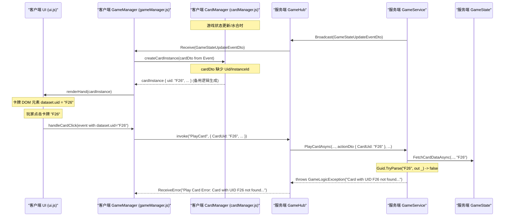

# Bug 修复计划: Play Card Error - Card with UID Fxx not found (V1.3)

**关联 Bug ID:** BUG-015

**版本:** 1.3 (聚焦客户端修复)
**日期:** 2025-06-02

## 1. 问题分析 (根本原因已确认 - 客户端水合逻辑)

*   **现象:** 客户端调用 `GameHub.PlayCard` 时，传递的 `cardUid` 参数值不是预期的 GUID 格式，而是类似 "F26" 的字符串。
*   **确认 (服务端):** 通过在 `GameHub.PlayCard` 方法入口添加日志，已确认接收到的 `cardUid` 确实是 "F26"。
*   **直接原因 (服务端):** `Guid.TryParse(cardUid, out var cardGuid)` 失败，因为 "F26" 不是有效的 GUID 格式。
*   **根本原因 (客户端确认):**
    *   客户端在从服务器接收游戏状态并进行水合（Hydration）时，相关的 DTO（如 `CardInstanceDto` 或其父级 DTO，例如 `PlayerStateDto`, `GameStateUpdateEventDto` 等）中**缺少**卡牌实例的唯一标识符 (`Uid` 或 `InstanceId`) 字段，或者该字段未被正确填充。
    *   这导致客户端的 [`src/cardManager.js`](../../src/cardManager.js:67) 中的 `createCardInstance` 函数在尝试创建卡牌实例对象时，无法从传入的 DTO 中获取到服务器生成的 GUID。
    *   因此，触发了 `createCardInstance` 函数内部的**备用 UID 生成逻辑** ([`src/cardManager.js:125`](../../src/cardManager.js:125))：`instance.uid = \`F\${instance.id}\`;`。这个逻辑基于卡牌定义 ID (`instance.id`) 生成了一个格式化字符串（如 'F26'）作为 `cardInstance.uid`。
    *   当玩家点击这张在 UI 上渲染出来的卡牌时，[`src/ui.js`](../../src/ui.js) (通过 `event.target.closest('.card').dataset.uid`) 和 [`src/gameManager.js`](../../src/gameManager.js) (在 `playCard` 函数中) 正确地读取并传递了这个错误的 'F26' UID 给服务器的 `GameHub.PlayCard` 方法。
    *   最终导致服务器解析 GUID 失败，抛出 "Card with UID F26 not found" 错误。

---

## 2. 修复计划

### 阶段一：服务端调查 (已完成)

1.  **添加日志记录:** (已完成)
    *   在 `GameHub.PlayCard` 方法入口添加详细日志，记录接收到的 `connectionId` 和 `cardUid`。
    *   **结果:** 确认客户端发送了错误格式的 UID ('F26')。
2.  **代码审查:** (已完成)
    *   审查 [`Server/Dtos/CardInstanceDto.cs`](../../Server/Dtos/CardInstanceDto.cs:0) 和 [`Server/Services/GameService.cs`](../../Server/Services/GameService.cs:0) 相关代码。
    *   **结果:** 确认服务器端在广播游戏状态时，已正确包含并填充了 `InstanceId` 属性。服务器端无需修改。

### 阶段二：客户端调查 (已完成)

1.  **代码分析:** (已完成)
    *   分析 [`src/ui.js`](../../src/ui.js) (`handleCardClick`) 和 [`src/gameManager.js`](../../src/gameManager.js) (`playCard`)，确认它们正确传递了从卡牌 DOM 元素 `dataset.uid` 获取的值。
    *   分析 [`src/cardManager.js`](../../src/cardManager.js) (`createCardInstance`)，定位到备用 UID 生成逻辑 ([`src/cardManager.js:125`](../../src/cardManager.js:125)) 被触发是问题根源。
    *   确认根源在于 `createCardInstance` 未能正确读取传入 DTO 中的 `instanceId` 属性 (服务器已确认发送)。

### 阶段三：实施修复 (下一步 - 客户端)

1.  **前端修复 (必需):**
    *   **目标:** 修正客户端卡牌水合逻辑，使其正确使用服务器提供的卡牌实例 ID。
    *   **行动:** 修改 [`src/cardManager.js`](../../src/cardManager.js:67) 中的 `createCardInstance` 函数。
        ```javascript
        // src/cardManager.js - 修改 createCardInstance 函数
        export function createCardInstance(cardData, definitionLookup) {
            // ... 获取卡牌定义等其他代码 ...
            const definition = definitionLookup[cardData.DefinitionId];
            if (!definition) {
                console.error(`Card definition not found for ID: ${cardData.DefinitionId}`);
                return null; // 或者返回一个错误状态的对象
            }

            const instance = { ...definition }; // 复制基础属性

            // !! 核心修复点 !!
            // 尝试从服务器 DTO 读取 instanceId (注意 JSON 序列化后的大小写)
            const serverUid = cardData.instanceId || cardData.InstanceId || cardData.uid || cardData.Uid;

            if (serverUid) {
                instance.uid = serverUid; // 使用服务器提供的真实 GUID
            } else {
                // 服务器未提供 UID，这是一个严重错误，记录日志
                console.error("CRITICAL: Server DTO missing instanceId/Uid for card definition ID:", cardData.DefinitionId, cardData);
                // 不应生成备用 UID，这会掩盖问题。让 uid 保持未定义或设为 null。
                instance.uid = null; // 或者 'MISSING_SERVER_UID_' + cardData.DefinitionId;
                // 移除错误的备用逻辑: instance.uid = `F${instance.id}`;
            }

            // 处理其他实例特定属性 (如果 DTO 中有的话)
            instance.currentCost = cardData.currentCost !== undefined ? cardData.currentCost : definition.cost;
            instance.currentAttack = cardData.currentAttack !== undefined ? cardData.currentAttack : definition.attack;
            instance.currentHealth = cardData.currentHealth !== undefined ? cardData.currentHealth : definition.health;
            instance.maxHealth = cardData.maxHealth !== undefined ? cardData.maxHealth : definition.health; // 假设 maxHealth 通常等于基础 health
            instance.canAttack = cardData.canAttack !== undefined ? cardData.canAttack : false; // 默认不能攻击
            instance.isEvolved = cardData.isEvolved !== undefined ? cardData.isEvolved : false;
            // ... 其他可能需要从 cardData 同步的属性 ...

            return instance;
        }
        ```
    *   **负责人:** (需要分配给前端开发)
    *   **注意:** 上述代码片段增加了对 `instanceId` (小写开头，常见于 JS 对象) 和 `InstanceId` (大写开头，可能来自 C# DTO) 的检查，并优先使用服务器 ID。同时移除了错误的备用 UID 生成逻辑。

---

## 3. 风险评估

*   **后端:** 无风险 (确认无需修改)。
*   **前端:** 低风险。修改 `createCardInstance` 是直接针对问题根源。需要测试确保 `instanceId` 被正确读取，并且移除备用逻辑后没有其他副作用。
*   **文档:** 低风险。主要是更新本文档和 [`文档/BUG追踪.md`](../BUG追踪.md)。
*   **测试:** 需要进行回归测试，确保出牌流程正常，卡牌交互（如目标选择）依赖的 UID 正确，并且卡牌在手牌、战场等区域显示正常。

## 4. 可视化流程 (错误点 - 更新)

