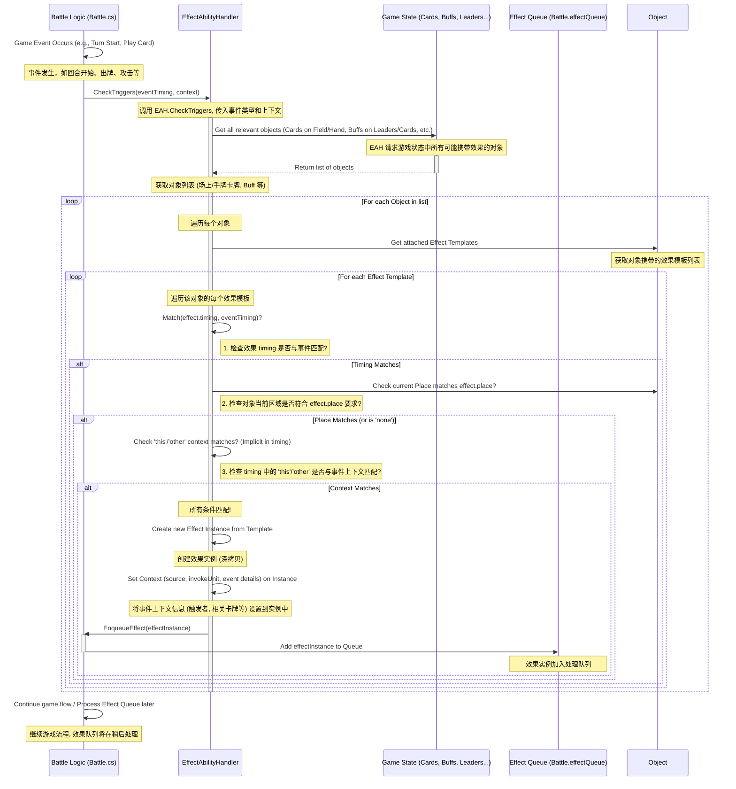

# 卡牌系统技术设计文档 V1.0

**文档目标:**

本技术设计文档 (TDD) 旨在深入剖析本项目 Unity 实现中卡牌游戏核心系统的内部机制和技术实现细节。文档聚焦于以下关键组件：

*   **Card (卡牌):** 数据结构、运行时表示及管理。
*   **Target & Filter (目标与筛选):** 目标选择规则的定义、解析与执行。
*   **Timing (时点):** 效果触发时机的定义与处理机制。
*   **Effect (效果):** 效果的生命周期、数据驱动执行引擎及能力实现。
*   **Keywords (关键字):** 关键字的定义、赋予、聚合及对游戏逻辑的影响。
*   **Buff (临时状态):** Buff 的数据结构、应用、管理及移除机制。

本文档结合了项目中的 `基沃托斯入学指南 ver1.16.pdf` (面向配置者的数据定义)、`Technical_Documentation.md` (整体架构与逻辑概述)、`AI_Function_Reference.md` (关键函数与流程参考) 以及代码结构信息，旨在为开发者（包括 AI 辅助工具）提供一份理解卡牌系统核心逻辑、数据流和代码实现的详细指南。

**与其他文档的关系:**

*   **深化:** 本文档是对 [`Technical_Documentation.md`](./Technical_Documentation.md) 中第 5 节 "游戏逻辑 (`Assets/Scripts/Game/`)" 和第 6 节 "数据结构总结" 的详细展开。
*   **参照:** 大量引用 [`基沃托斯入学指南 ver1.16.pdf`](./基沃托斯入学指南%20ver1.16.pdf) 中的 CSV 结构、能力定义、表达式/标识符/筛选器语法，以解释数据配置如何驱动代码。
*   **补充:** 利用 [`AI_Function_Reference.md`](./AI_Function_Reference.md) 中的伪代码和图表来更清晰地展示关键算法和交互流程。

---

## 1. 核心概念与数据流

本项目的卡牌系统遵循**数据驱动设计**原则。核心游戏元素（卡牌、效果、Buff 等）的属性和行为主要在外部 CSV 文件 (`Assets/StreamingAssets/Cards/`) 中定义。运行时，这些数据被加载、解析并转化为 C# 对象实例，驱动游戏逻辑的执行。

**核心数据流图:**

```mermaid
graph TD
    subgraph Data Files [CSV Data (`Assets/StreamingAssets/Cards/`)]
        direction LR
        InfoCSV[info.csv]
        EffectCSV[effect.csv]
        BuffCSV[buff.csv]
        KeywordCSV[keyword.csv]
        TraitCSV[trait.csv]
        DescCSV[description.csv]
        StatsCSV[stats.csv]
    end

    subgraph Core Systems [System Core (`Assets/Scripts/System/Core/`)]
        direction LR
        RM[ResourceManager]
        DM[DatabaseManager (Singleton)]
        ParserSys[Parser System (`Parser`, `Operator`, `Identifier`)]
    end

    subgraph Game Logic [Game Logic (`Assets/Scripts/Game/`)]
        direction TB
        CardSys[Card System (`Card`, `CardDB`, Filters)]
        EffectSys[Effect Engine (`Effect`, `EffectAbilityHandler`, etc.)]
        BuffSys[Buff System (`Buff`, `BattleCardBuffController`)]
        BattleLogic[Battle Logic (`Battle`, `BattleUnit`)]
    end

    Data Files -- Loads --> RM;
    RM -- Parses & Populates --> DM;
    DM -- Provides Static Data --> CardSys;
    DM -- Provides Static Data --> EffectSys;
    DM -- Provides Static Data --> BuffSys;

    EffectSys -- Uses --> ParserSys;
    CardSys -- Uses --> ParserSys; # For Filters
    BuffSys -- Uses --> ParserSys; # For Conditions

    CardSys -- Creates Instances --> BattleLogic;
    EffectSys -- Creates Instances & Applies --> BattleLogic;
    BuffSys -- Creates Instances & Applies --> BattleLogic;

    BattleLogic -- Reads/Modifies Runtime State & Triggers --> EffectSys;
    BattleLogic -- Manages --> CardSys; # (Runtime Card Instances)
    BattleLogic -- Manages --> BuffSys; # (Runtime Buff Instances)
```

**说明:**

1.  **数据源:** CSV 文件定义了游戏的基础数据。
2.  **加载与存储:** [`ResourceManager`](./Scripts/System/Core/ResourceManager.cs) 负责加载和初步解析 CSV 文件。解析后的静态数据（模板对象）存储在 [`DatabaseManager`](./Scripts/System/Core/DatabaseManager.cs) 中，作为全局访问点。
3.  **运行时实例化:** 游戏逻辑模块 (Card, Effect, Buff, Battle) 从 `DatabaseManager` 获取数据模板，并在需要时创建运行时实例（例如，抽到的卡牌、触发的效果）。
4.  **逻辑执行:** [`Effect Engine`](./Scripts/Game/Effect/) 是核心，它使用 [`Parser System`](./Scripts/System/Parser/) 来解析效果定义中的条件、目标和动态参数，并调用相应的能力函数修改 [`Battle`](./Scripts/Game/Battle/Battle.cs) 状态。
5.  **状态交互:** [`Battle Logic`](./Scripts/Game/Battle/Battle.cs) 管理游戏整体状态，响应玩家操作，触发效果，并管理卡牌和 Buff 的运行时实例。

---

## 2. Card (卡牌) 实现

卡牌作为游戏的核心交互单位，其实现横跨了静态数据定义与动态运行时状态管理。理解模板 (`Card.cs`) 与实例 (`BattleCard`) 的区别，以及实例如何响应游戏进程至关重要。

### 2.1 卡牌模板 (`Card.cs`) 与运行时实例 (`BattleCard`)

*   **卡牌模板 (`Card.cs`): 静态蓝图**
    *   [`Card.cs`](./Scripts/Game/Card/Card.cs) 类代表卡牌的**静态定义**，如同制造卡牌的蓝图。其实例由 [`ResourceManager`](./Scripts/System/Core/ResourceManager.cs) 在游戏启动时从 [`info.csv`](./StreamingAssets/Cards/info.csv) 加载，并存储在 [`DatabaseManager`](./Scripts/System/Core/DatabaseManager.cs) 中供全局访问。
    *   **包含信息:** 存储卡牌的基础不变属性，这些属性直接来源于 CSV 文件：
        *   `id` (int): 唯一的复合 ID，编码了元信息。
        *   `cardName` (string): 卡牌名称。
        *   `baseCost`, `baseAtk`, `baseHp` (int): **基础**消费、攻击力、生命值（注意：命名可能为 `cost`, `atk`, `hp`，但语义上是基础值）。
        *   `craft`, `cardType`, `rarity`: 职业、类型、罕度等分类枚举。
        *   `baseTraits` (List<int>): 卡牌固有的特性 ID 列表。
        *   `baseKeywords` (List<int>): 卡牌固有的关键字 ID 列表。
        *   `effectNames` (List<string>): 卡牌携带的效果名称列表，用于查找 `Effect` 模板。
        *   `options` (Dictionary<string, string>): 其他静态配置，如 `countdown`, `artId`, `nameId`。
    *   **不变性:** `Card` 模板实例在游戏运行期间通常是**只读**的，不应被修改。所有战斗中的动态变化都发生在运行时实例上。

*   **运行时实例 (`BattleCard`): 动态实体**
    *   `BattleCard` (或类似命名的类，如 `RuntimeCard`) 代表在**实际对战中**存在的卡牌实体，无论它位于手牌、战场、墓地或其他区域。
    *   **创建时机:** 当卡牌通过抽卡、召唤、衍生等方式进入游戏时，系统会基于对应的 `Card` 模板创建一个 `BattleCard` 实例。例如: `var battleCard = new BattleCard(DatabaseManager.Instance.GetCardTemplate(cardId), ownerPlayer);`
    *   **关联模板:** 每个 `BattleCard` 实例内部必须持有一个对其**模板 `Card` 对象的引用** (`baseCardData` 或 `templateCard`)，以便随时访问基础属性和定义。
    *   **动态状态:** `BattleCard` 负责存储和管理所有在战斗中可能发生变化的属性：
        *   `uniqueId` (Guid or int): 运行时唯一标识符，区分场上可能存在的多张同名卡。
        *   `ownerPlayerId` (int): 所属玩家 ID。
        *   `currentZone` (Enum: Hand, Field, Grave, Deck, Vanished...): 当前所在的区域。
        *   `currentCost` (int): 当前实际费用，可能受效果或 Buff 影响。
        *   `currentAtk` (int): 当前实际攻击力。
        *   `currentHp` (int): 当前实际生命值上限。
        *   `damageTaken` (int): 当前已承受的伤害值。**当前剩余生命值 = `currentHp` - `damageTaken`**。
        *   `turnPlayed` (int): 被打出的回合数。
        *   `attackCount` (int): 本回合已攻击次数。
        *   `canAttackFollower`, `canAttackLeader` (bool): 当前回合是否能攻击随从/主战者（受 Rush, Storm, 召唤失调等影响）。
        *   `isActive` (bool): 是否存活/有效（例如，`damageTaken >= currentHp` 时变为 `false`）。
        *   `attachedEffects` (List<`Effect`>): **运行时**附加的临时效果实例（例如，通过 `add_effect` 能力添加）。
        *   `buffController` ([`BattleCardBuffController`](./Scripts/Game/BattleCard/BattleCardBuffController.cs)): **持有一个 `BattleCardBuffController` 实例**，专门负责管理施加在该 `BattleCard` 实例上的所有 Buff 和临时关键字。
        *   `counters` (Dictionary<string, int>): 可能存在的计数器，如 `spellboostCount`。
    *   **独立性:** 对一个 `BattleCard` 实例状态的任何修改（如受到伤害、费用改变、获得 Buff）**仅影响该实例本身**，绝不会影响其 `Card` 模板或其他 `BattleCard` 实例。

### 2.2 数据加载与模板存储

*   **加载流程:** 如前所述，[`ResourceManager`](./Scripts/System/Core/ResourceManager.cs) 负责在游戏启动时解析 [`info.csv`](./StreamingAssets/Cards/info.csv) (以及其他相关 CSV，如 `effect.csv`, `buff.csv` 等)。
*   **模板创建:** `ResourceManager` 为 `info.csv` 中的每一行创建一个 `Card` 对象实例，填充其基础属性。
*   **数据库存储:** 所有创建的 `Card` 模板对象被存储在 [`DatabaseManager`](./Scripts/System/Core/DatabaseManager.cs) 的一个字典中（例如 `cardInfoDict: Dictionary<int, Card>`)，以卡牌 ID 作为键。
*   **全局访问:** `DatabaseManager` 通常实现为单例模式，使得游戏中的任何系统都可以方便地通过卡牌 ID 获取对应的 `Card` 模板信息。

### 2.3 运行时实例化与状态管理 (`BattleCard`)

*   **实例化过程:**
    1.  获取模板: 当需要创建卡牌实例时（如 `Battle.DrawCard(playerId, cardId)`），首先从 `DatabaseManager` 获取 `cardId` 对应的 `Card` 模板。
    2.  创建实例: `new BattleCard(cardTemplate, ownerPlayer)`，将模板和所有者信息传入构造函数。
    3.  初始化状态: `BattleCard` 构造函数内部：
        *   保存模板引用: `this.baseCardData = cardTemplate;`
        *   设置所有者: `this.ownerPlayerId = ownerPlayer.id;`
        *   生成唯一 ID: `this.uniqueId = Guid.NewGuid();` (或使用递增整数)
        *   初始化动态属性: `currentCost = baseCardData.baseCost`, `currentAtk = baseCardData.baseAtk`, `currentHp = baseCardData.baseHp`, `damageTaken = 0`, `attackCount = 0`, `canAttack... = false` (根据规则), `currentZone = Zone.Deck` (或初始区域)。
        *   创建 Buff 控制器: `this.buffController = new BattleCardBuffController(this);`
        *   （可选）实例化自带效果: 根据 `baseCardData.effectNames` 查找效果模板并创建效果实例，添加到 `attachedEffects` 或由特定系统管理（取决于设计，自带效果通常不直接放在 `BattleCard`）。
*   **状态变更:** `BattleCard` 提供方法来修改其动态状态，例如：
    *   `TakeDamage(int amount)`: 增加 `damageTaken`，检查是否 `isActive` 变为 `false`。
    *   `Heal(int amount)`: 减少 `damageTaken` (不能小于 0)。
    *   `ModifyCost(int change, bool temporary)`: 修改 `currentCost`。
    *   `ModifyStats(int atkChange, int hpChange, bool temporary)`: 修改 `currentAtk`, `currentHp`。
    *   `SetZone(Zone newZone)`: 更新 `currentZone`。
    *   `ResetTurnState()`: 在回合结束时重置 `attackCount`, `canAttack...` 等状态。
*   **Buff 与临时效果管理:**
    *   当效果 `EffectAbility.AddBuff` 作用于此 `BattleCard` 时，会调用其 `buffController.TakeBuff(buffId, context)`。
    *   当效果 `EffectAbility.SetKeyword` 作用于此 `BattleCard` 时，会调用 `buffController.AddTemporaryKeyword(keywordId, duration, context)` (假设有此方法)。
    *   `buffController` 内部维护 Buff 列表和临时关键字列表及其状态。

### 2.4 运行时属性访问 (`IIdentifyHandler` on `BattleCard`)

*   **实现者:** 为了让 `Parser System` 能够动态查询卡牌在战斗中的**实际状态**，[`IIdentifyHandler`](./Scripts/IClass/IIdentifyHandler.cs) 接口应该由 **`BattleCard`** 类实现。
*   **查询机制:** 当效果的条件或参数中出现涉及卡牌属性的标识符时（如 `effect.source.atk > 5`, `damage = target.cost`），[`Parser`](./Scripts/System/Parser/Parser.cs) 会调用 `Identifier.cs`，最终调用到目标 `BattleCard` 实例的 `HandleIdentifier(string identifier, ...)` 方法。
*   **处理逻辑示例:**
    *   `HandleIdentifier("atk", ...)`:
        1.  获取基础攻击力: `int baseAtk = baseCardData.baseAtk;`
        2.  获取 Buff 修正: `int buffAtkMod = buffController.AtkBuff;` (调用 Buff 控制器聚合所有 Buff 的攻击力修正)
        3.  获取其他临时修正 (如果设计中有): `int tempAtkMod = ...;`
        4.  计算最终值: `return baseAtk + buffAtkMod + tempAtkMod;`
    *   `HandleIdentifier("cost", ...)`:
        1.  获取基础费用: `int baseCost = baseCardData.baseCost;`
        2.  获取 Buff 修正: `int buffCostMod = buffController.CostBuff;`
        3.  获取 `BattleCard` 自身的临时费用修改: `int tempCostMod = this.currentCost - baseCost;` (如果 `currentCost` 直接存储最终值，则逻辑不同)
        4.  计算最终值: `return baseCost + buffCostMod + tempCostMod;` (或直接返回 `this.currentCost` 如果它已包含所有修正)
    *   `HandleIdentifier("hp", ...)`: 返回**当前生命值上限** `currentHp` (已包含 Buff 等修正)。
    *   `HandleIdentifier("currentHp", ...)` 或 `HandleIdentifier("remainingHp", ...)`: 计算并返回 `currentHp - damageTaken`。
    *   `HandleIdentifier("keywords", ...)`: 调用 `buffController.GetCurrentKeywords()` 获取聚合后的关键字列表 (包含基础、Buff 赋予、临时效果赋予)。
    *   `HandleIdentifier("hasKeyword(4)", ...)`: 检查 `buffController.GetCurrentKeywords()` 是否包含 ID 为 4 的关键字。
    *   `HandleIdentifier("isVenge", ...)`: 查询所属玩家 `ownerPlayer.IsVengeActive()`。
    *   `HandleIdentifier("boost", ...)`: 返回 `this.counters["spellboostCount"]` (如果计数器存在)。
*   **优势:** 这种方式使得效果定义 (`effect.csv`) 可以编写查询 `atk`, `cost` 等简单标识符，而 `BattleCard` 的 `HandleIdentifier` 实现则封装了获取这些属性**当前实际值**的复杂逻辑（基础值 + Buff + 临时效果），保持了数据驱动的灵活性。

### 2.5 卡牌生命周期与交互可视化

```mermaid
graph LR
    subgraph DataDefinition [1. 数据定义与加载]
        direction TB
        CSV[info.csv] --> RM[ResourceManager];
        RM --> DM[DatabaseManager];
        DM --> CardTemplate[Card Template (内存中)];
    end

    subgraph Instantiation [2. 运行时实例化]
        direction TB
        Trigger[游戏事件 (抽卡/召唤)] --> GetTemplate[从 DM 获取 Card Template];
        GetTemplate --> CreateInstance[创建 BattleCard 实例];
        CreateInstance --> InitState[初始化动态状态 (currentCost, HP, BuffController等)];
        InitState --> SetZone[设置初始区域 (Deck/Hand)];
    end

    subgraph GameplayLoop [3. 游戏循环中的交互]
        direction TB
        subgraph PlayerAction [玩家动作 (出牌/攻击)]
            Action[执行动作] --> Validate[验证 (费用/目标)];
            Validate --> UpdateBCState[更新 BattleCard 状态 (移动区域/消耗攻击次数)];
        end
        subgraph EffectResolution [效果结算]
            Resolve[处理效果] --> QueryParser[Parser 请求属性 (e.g., 'atk')];
            QueryParser --> CallHandler[调用 BattleCard.HandleIdentifier("atk")];
            CallHandler --> AccessTemplate[访问 Card Template (baseAtk)];
            CallHandler --> QueryBuffCtrl[查询 BuffController (AtkBuff)];
            QueryBuffCtrl --> BuffCtrlResponse[BuffController 返回总修正];
            AccessTemplate --> CombineValues{计算最终值};
            BuffCtrlResponse --> CombineValues;
            CombineValues --> ReturnValue[返回当前实际攻击力给 Parser];
        end
        subgraph BuffApplication [Buff/效果应用]
           ApplyBuff[效果施加 Buff/临时效果] --> CallBuffCtrlMethod[调用 BattleCard.BuffController 方法 (TakeBuff/AddTempKeyword)];
           CallBuffCtrlMethod --> UpdateInternalLists[BuffController 更新内部列表];
        end
        subgraph StateChange [状态变化 (受伤/回合结束)]
            Damage[受到伤害] --> UpdateDamageTaken[更新 BattleCard.damageTaken];
            TurnEnd[回合结束] --> ResetBCState[重置 BattleCard 回合状态 (攻击次数等)];
            TurnEnd --> BuffCtrlTurnEnd[调用 BuffController.OnTurnEnd (更新 Buff 持续时间)];
        end
    end

    subgraph Destruction [4. 离场/销毁]
        direction TB
        DestroyTrigger[破坏/消失/回手事件] --> MarkInactive[标记 BattleCard 为 Inactive/移动区域];
        MarkInactive --> TriggerLastWords[触发 LastWords (如果有时点)];
        TriggerLastWords --> RemoveInstance[从当前区域移除 BattleCard 实例 (或移至 Grave/Vanished)];
    end

    DataDefinition --> Instantiation;
    Instantiation --> GameplayLoop;
    GameplayLoop --> Destruction;

    style DataDefinition fill:#eee,stroke:#333,stroke-width:1px
    style Instantiation fill:#cfc,stroke:#333,stroke-width:1px
    style GameplayLoop fill:#ccf,stroke:#333,stroke-width:1px
    style Destruction fill:#fcc,stroke:#333,stroke-width:1px
```

### 2.6 卡牌美术

*   卡牌的插画资源路径（或 Addressable Key）通常在 `Card` 模板的 `options` 字典中通过 `artId` 指定，或者遵循一套默认的命名规则与卡牌 ID 关联。
*   UI 层负责根据 `BattleCard` 实例引用的 `Card` 模板信息，异步加载并显示对应的卡牌美术资源。使用 Unity Addressables 系统 ([`Card_System_TDD_V1.0.md:114`](./%E6%96%87%E6%A1%A3/Card_System_TDD_V1.0.md:114)) 是管理这些资源（尤其是大量卡图）的推荐方式，可以有效管理内存和加载时间。加载逻辑通常位于卡牌的视图组件 (`CardView.cs`) 中。

---

## 3. Target & Filter (目标与筛选) 实现

目标筛选系统是效果能否精确作用于预期对象的关键，它负责解析效果定义中的目标规则，并根据当前游戏状态筛选出符合条件的卡牌或玩家。其核心在于处理 [`effect.csv`](./StreamingAssets/Cards/effect.csv) 中的 `target` 字段。

### 3.1 目标规则 (`target`) 定义

`target` 字段采用一种结构化的字符串格式来描述目标选择逻辑，其完整形式为 `玩家_区域_数量_模式(_筛选条件)`。各部分详解如下 (参考 [`基沃托斯入学指南 ver1.16.pdf`](./%E6%96%87%E6%A1%A3/%E5%9F%BA%E6%B2%83%E6%89%98%E6%96%AF%E5%85%A5%E5%AD%A6%E6%8C%87%E5%8D%97%20ver1.16.pdf) 3.1.4 和 7)：

*   **玩家 (Player):** 定义目标所属的玩家范围。
    *   `me`: 效果发动方玩家。
    *   `op`: 效果发动方的对手玩家。
    *   `all`: 双方玩家。
    *   `sourceEffect.source`: 指向触发此效果的卡牌 (`BattleCard`) 实例自身。常用于描述影响自身的效果。
    *   `sourceEffect.target`: 指向触发此效果时选定的目标 `BattleCard` 实例列表。用于效果的连锁或二次处理。
    *   `sourceEffect.me` / `sourceEffect.op`: 指向触发效果时，我方/敌方被选中的目标。
    *   `self`: 特殊值，表示目标就是效果来源卡牌自身，通常不需要后续部分。

*   **区域 (Area):** 定义查找目标的具体游戏区域。可以使用 `+` 连接多个区域。
    *   `deck`: 牌库。
    *   `hand`: 手牌。
    *   `field`: 战场 (包含随从和护符)。
    *   `leader`: 主战者 (通常用于直接指定主战者为目标)。
    *   `grave`: 墓地。
    *   `token`: 特指效果生成的衍生物选择池 (如 `choose` 能力)。
    *   **示例:** `me_hand+field` 表示查找我方手牌和战场上的所有卡牌。

*   **数量 (Count):** 指定需要选择的目标数量。
    *   `all`: 选择所有满足条件的。
    *   `N` (数字): 选择 N 个目标。

*   **模式 (Mode):** 当需要从多个满足条件的候选中选择特定数量时，定义选择方式。
    *   `all`: (用于 `Count` 为 `all` 时) 选择所有。
    *   `random`: 随机选择指定数量。
    *   `first`: 按游戏内部默认顺序（如入场顺序）选择前 N 个。
    *   `last`: 按游戏内部默认顺序选择后 N 个。
    *   `index:N`: 选择指定索引的目标 (0-based)。
    *   `noindex:N`: 选择除指定索引外的所有目标。
    *   `other`: 特殊修饰符，通常附加在其他模式后 (用 `+` 连接)，表示在最终选择结果中排除效果来源卡牌自身。**示例:** `me_field_1_random+other` 表示随机选择一个除自身外的我方场上随从。

*   **筛选条件 (Filter):** 可选部分，使用 `[...]` 包裹，内含一个或多个具体的筛选规则，用于从初始候选池中进一步过滤。
    *   **语法:** `[类型:参数]` 或 `[类型:参数1|参数2...]` 或 `[类型:比较符+数值]`。
    *   **逻辑:**
        *   多个 `[...]` 之间是 **逻辑与 (AND)** 关系，目标必须满足所有 `[...]` 的条件。
        *   单个 `[...]` 内部，使用 `|` (竖线) 分隔的多个参数是 **逻辑或 (OR)** 关系，满足任意一个参数即可。
        *   在参数前使用 `!` (感叹号) 表示 **逻辑非 (NOT)**。
    *   **详细类型见 3.3 节 `BattleCardFilter`。**
    *   **示例:** `op_field_all_all_[follower][hp:<=3]` 表示选择敌方战场上所有生命值小于等于 3 的随从。`me_hand_1_random_[cost:>=5|type:spell]` 表示随机选择一张我方手牌中费用大于等于5 **或** 类型为法术的卡牌。

### 3.2 解析与执行流程

目标筛选的实现通常由两个主要组件协作完成：

1.  **`EffectTargetInfo` (或类似类): 范围与模式解析器**
    *   **职责:** 解析 `target` 字符串的第一部分 (`玩家_区域_数量_模式`)。
    *   **输入:** `target` 字符串, 当前战斗状态 `BattleState`。
    *   **处理:**
        *   根据 `玩家` 和 `区域` 部分，从 `BattleState` 中获取初始的候选对象列表（如 `List<BattleCard>` 或 `List<BattleLeader>`)。例如，`op_field` 会获取敌方战场上的所有 `BattleCard` 实例。
        *   存储解析出的 `数量` 和 `模式` 信息，供后续最终选择阶段使用。
    *   **输出:** 初始候选对象列表 (`initialPool`) 和选择参数 (数量 `count`, 模式 `mode`)。

2.  **`BattleCardFilter` (`Assets/Scripts/Game/Card/BattleCardFilter.cs`): 条件过滤器**
    *   **职责:** 解析 `target` 字符串的筛选条件部分 (`[...]`)，并对 `EffectTargetInfo` 提供的 `initialPool` 进行过滤。
    *   **输入:** 筛选规则字符串 (`filterString`, 即 `[...]` 部分), 初始候选池 (`initialPool`), 当前战斗状态 `BattleState`, 当前效果上下文 (`contextEffect`)。
    *   **处理:** 见 3.3 节。
    *   **输出:** 经过筛选后的对象列表 (`filteredPool`)。

3.  **`CardFilter.cs` (`Assets/Scripts/Game/Card/CardFilter.cs`): 静态筛选器**
    *   与 `BattleCardFilter` 类似，但用于非战斗场景（如卡组编辑器）。
    *   作用于卡牌模板 (`Card`) 而非 `BattleCard` 实例。
    *   不处理依赖于运行时状态的筛选条件（如当前生命值、Buff 等）。

4.  **整体应用流程:**
    1.  效果执行时调用 `effect.ResolveTargets(battleState)`。
    2.  `ResolveTargets` 内部实例化 `EffectTargetInfo`，传入 `effect.target` 字符串和 `battleState`。
    3.  `EffectTargetInfo` 解析范围和模式，获取 `initialPool`。
    4.  `ResolveTargets` 提取 `target` 字符串中的 `filterString`。
    5.  如果 `filterString` 非空，则调用 `BattleCardFilter.Filter(filterString, initialPool, battleState, effect)`，得到 `filteredPool`。否则 `filteredPool = initialPool`。
    6.  `ResolveTargets` 使用 `EffectTargetInfo` 中存储的 `数量` 和 `模式`，从 `filteredPool` 中进行最终选择（例如，随机抽取、按顺序选取）。
    7.  将最终确定的目标列表存入 `effect.invokeTarget` (通常是 `List<BattleCard>`)。

### 3.3 `BattleCardFilter` 内部逻辑详解

`BattleCardFilter` 的核心是 `Filter` 方法，它接收筛选规则字符串 (`filterString`) 并迭代处理其中的每一个 `[...]` 条件：

1.  **解析条件:** 将 `filterString` 按 `][` 分割成单个条件字符串，如 `[follower]`, `[hp:<=3]`。
2.  **迭代过滤:** 对当前的候选列表 `currentPool` 应用每一个条件：
    *   **识别类型:** 解析 `[...]` 内的类型（如 `follower`, `hp`, `keyword`, `random`）。
    *   **执行过滤/操作:**
        *   **类型/特性/关键字筛选 (Type/Trait/Keyword):**
            *   语法示例: `[follower]`, `[trait:1|2]`, `[keyword:!4]`, `[battleKeyword:101]`
            *   逻辑: 对于 `currentPool` 中的每个 `BattleCard`：
                *   检查其 `baseCardData.cardType` 是否匹配 (如 `follower`)。
                *   检查其 `baseCardData.baseTraits` 是否包含指定的 `traitId` (或不包含，如果用了 `!`)。
                *   检查其 `buffController.GetCurrentKeywords()` 返回的聚合关键字列表是否包含指定的 `keywordId` (或不包含)。`battleKeyword` 特指检查聚合后的运行时关键字。
            *   移除不满足条件的 `BattleCard`。
        *   **属性筛选 (Attribute):**
            *   语法示例: `[atk:>=5]`, `[cost:<=effect.source.pp]`, `[currentHp:1]`
            *   逻辑: 对于 `currentPool` 中的每个 `BattleCard`：
                1.  使用 [`Parser System`](./Scripts/System/Parser/) 的 `Identifier` 获取卡牌的**当前运行时属性值**。例如，`atk` 会调用 `battleCard.HandleIdentifier("atk", ...)` 获取考虑了 Buff 的当前攻击力；`cost` 获取当前费用；`currentHp` 获取当前剩余生命值。
                2.  如果条件中包含比较值（如 `5` 或 `effect.source.pp`），同样使用 `Parser System` (必要时调用 `Identifier` 和 `Operator`) 解析该值，得到一个数值。
                3.  使用 `Operator` 对卡牌属性值和比较值执行指定的比较运算 (`>=`, `<=`, `=`)。
                4.  移除不满足比较结果的 `BattleCard`。
        *   **列表操作 (List Operation):**
            *   语法示例: `[random:1]`, `[costOrder:1]`, `[distinct]`, `[first:3]`
            *   逻辑: 这些操作不移除元素，而是对整个 `currentPool` 列表进行排序、去重或直接选取子集。
                *   `random:N`: 从 `currentPool` 中随机选择 N 个元素，替换 `currentPool`。
                *   `first:N` / `last:N`: 选择前/后 N 个，替换 `currentPool`。
                *   `costOrder:1/-1`: 根据当前费用 (`HandleIdentifier("cost")`) 对 `currentPool` 进行升序(1)或降序(-1)排序。`atkOrder`, `hpOrder` 类似。
                *   `distinct`: 按卡牌名称 ID (`baseCardData.id`) 去重，每个 ID 只保留一个实例（通常随机保留）。`costDistinct` 等类似，按指定属性去重。
            *   这些操作通常在所有过滤条件应用完毕后，作为 `EffectTargetInfo` 最终选择步骤的一部分执行，但也可以设计为在 `BattleCardFilter` 中处理。

3.  **返回结果:** 当所有 `[...]` 条件都处理完毕后，返回最终的 `filteredPool`。

### 3.4 上下文利用

在筛选过程中，尤其是属性筛选，利用上下文信息至关重要：

*   **`BattleState`:** 提供了访问所有玩家、所有区域卡牌、PP、EP、墓地数量等全局游戏状态的途径，是 `EffectTargetInfo` 获取初始池的基础。
*   **`contextEffect` (当前效果实例):** 当筛选条件或属性比较值引用到效果来源时（如 `[atk:>=effect.source.atk]`, `[cost:<=sourceEffect.source.pp]`），`BattleCardFilter` 需要访问传入的 `contextEffect` 实例，通过其 `source` (来源 `BattleCard`) 或其他属性，再调用 `Parser System` 来获取这些动态值。

### 3.5 目标筛选流程图 (细化)

```mermaid
graph TD
    subgraph Input
        TargetRule[Target Rule String (e.g., "op_field_random_1_[follower][atk:>=effect.source.atk]")]
        State[Current BattleState]
        Context[Context Effect Instance]
    end

    subgraph Parsing [1. Rule Parsing]
        ParseTarget[Parse Target Rule String] --> SplitRule{Split into: Player/Area/Count/Mode & Filter String};
    end

    subgraph InitialPool [2. Initial Candidate Pool (EffectTargetInfo Logic)]
        SplitRule -- Player/Area --> GetCandidatesFromState[Get Candidates from BattleState (e.g., all op_field cards)];
        GetCandidatesFromState --> InitialPoolList[InitialPool List<BattleCard>];
    end

    subgraph Filtering [3. Filter Application (BattleCardFilter Logic)]
        InitialPoolList --> CurrentPool[Initialize CurrentPool = InitialPoolList];
        SplitRule -- Filter String --> FilterStringVal["[...] Filter String"];

        alt Filter String is not empty
            FilterStringVal --> ParseFilters[Parse Filter String into individual conditions];
            ParseFilters --> LoopFilters{For each Condition in Conditions};

            LoopFilters -- Next Condition --> CheckConditionType{Condition Type?};

            subgraph FilterTypes [Filter Execution]
                CheckConditionType -- Type/Keyword/Trait --> ApplyTypeFilter[Apply Type/Keyword/Trait Filter on CurrentPool];
                ApplyTypeFilter --> UpdatePool1[Update CurrentPool];

                CheckConditionType -- Attribute --> ApplyAttrFilter[Apply Attribute Filter on CurrentPool];
                ApplyAttrFilter -- Uses --> ParserSys1[Parser System (Identifier(BattleCard), Operator)];
                Note right of ApplyAttrFilter: Identifier calls BattleCard.HandleIdentifier("attr", Context)
                ParserSys1 -- Reads --> State;
                ParserSys1 -- Reads --> Context;
                ApplyAttrFilter --> UpdatePool2[Update CurrentPool];

                CheckConditionType -- List Operation --> ApplyListOp[Apply List Operation on CurrentPool (Sort/Distinct)];
                ApplyListOp --> UpdatePool3[Update CurrentPool];
            end

            UpdatePool1 --> LoopFilters;
            UpdatePool2 --> LoopFilters;
            UpdatePool3 --> LoopFilters;

            LoopFilters -- No More Conditions --> FilteredPool[Filtered Pool List<BattleCard>];
        else Filter String is empty
             InitialPoolList --> FilteredPool;
        end
    end

    subgraph FinalSelection [4. Final Selection (EffectTargetInfo/ResolveTargets Logic)]
       FilteredPool --> ApplyCountMode[Apply Count/Mode from Rule (e.g., random 1, first 2, all)];
       Note right of ApplyCountMode: May involve further sorting or selection if mode requires it (e.g., costOrder processed here)
    end

    subgraph Output
        ApplyCountMode --> FinalTargets[Final Target List (effect.invokeTarget = List<BattleCard>)];
    end

    Input --> Parsing;
    Parsing --> InitialPool;
    InitialPool --> Filtering;
    Filtering --> FinalSelection;
    FinalSelection --> Output;

    style ParserSys1 fill:#f9d,stroke:#333,stroke-width:1px;
```

**流程说明 (细化):**

1.  **输入:** 获取目标规则字符串 (`effect.target`)、当前的战斗状态对象 (`BattleState`)、以及正在处理的效果实例 (`contextEffect`)。
2.  **解析:** 解析 `target` 字符串，分离出范围/模式定义（玩家、区域、数量、模式）和筛选条件字符串 (`filterString`)。
3.  **初始池:** 根据范围定义（玩家/区域），`EffectTargetInfo` 从 `BattleState` 获取初始的候选卡牌列表 (`InitialPoolList`)。
4.  **过滤 (如果存在筛选条件):**
    *   `BattleCardFilter` 接收 `filterString` 和 `InitialPoolList`。
    *   逐个解析 `filterString` 中的 `[...]` 条件。
    *   对当前候选池 (`CurrentPool`) 应用每个条件：
        *   **类型/关键字/特性:** 直接检查 `BattleCard` 实例的模板数据 (`baseCardData`) 或调用 `BuffController` 获取运行时关键字/特性进行比较。
        *   **属性:** 调用 [`Parser System`](./Scripts/System/Parser/)。`Identifier` 会调用目标 `BattleCard` 的 `HandleIdentifier` 方法获取**当前运行时**的属性值（该方法内部会考虑基础值、Buff修正等）。如果比较值也是动态的 (如 `effect.source.atk`)，`Identifier` 会利用传入的 `contextEffect` 和 `BattleState` 来解析它。然后 `Operator` 进行比较。
        *   **列表操作:** 对整个 `CurrentPool` 进行排序或去重。
    *   每次过滤/操作后更新 `CurrentPool`。
    *   所有条件处理完后得到 `FilteredPool`。如果无筛选条件，则 `FilteredPool` 等于 `InitialPoolList`。
5.  **最终选择:** `ResolveTargets` 方法（或 `EffectTargetInfo`）根据解析出的**数量**和**模式**，对 `FilteredPool` 进行最终选择。例如，如果是 `random 1`，则从 `FilteredPool` 中随机选一个；如果是 `costOrder:1` 且数量为 2，则先按费用升序排序再取前两个。
6.  **输出:** 将最终选出的目标列表赋值给 `contextEffect.invokeTarget`，供后续效果能力 (`EffectAbilityHandler`) 使用。

---

## 4. Timing (时点) 实现

时点系统是卡牌游戏事件驱动机制的核心，它精确定义了每个效果应该在游戏流程的哪个具体时间点被触发。本节详细阐述时点的定义、触发机制以及与游戏循环的交互。

### 4.1 时点 (`timing`) 定义

效果的触发时机由 [`effect.csv`](./StreamingAssets/Cards/effect.csv) 文件中的 `timing` 列定义。其语法结构遵循 `阶段_（目标_）行动` 的模式，具体解析如下（参考 [`基沃托斯入学指南 ver1.16.pdf`](./%E6%96%87%E6%A1%A3/%E5%9F%BA%E6%B2%83%E6%89%98%E6%96%AF%E5%85%A5%E5%AD%A6%E6%8C%87%E5%8D%97%20ver1.16.pdf) 3.1.3）：

*   **阶段 (Phase):** 定义效果相对于行动发生的时间关系。
    *   `on`: 在行动**发生时**触发。这是最常用的阶段，表示效果与事件同步发生。
    *   `before`: 在行动**发生之前**触发。这类效果可以改变即将发生的行动的结果（例如，在伤害结算前触发一个减伤效果）。需要谨慎处理，以防无限循环或逻辑冲突。
    *   `after`: 在行动**完全结束之后**触发。这类效果在行动及其直接后果（如伤害计算、单位移动）完成后才检查触发条件。

*   **目标 (Source Context):** 可选部分，用于区分事件来源是效果宿主自身还是其他对象。
    *   `this`: 仅当行动的发起者/主体是**持有该效果的卡牌/Buff 自身**时触发。
        *   **示例:** `on_this_attack`: 当这张卡牌攻击时触发。`on_this_destroy`: 当这张卡牌被破坏时触发。
    *   `other`: 仅当行动的发起者/主体是**除持有该效果的卡牌/Buff 之外**的其他对象时触发。
        *   **示例:** `on_other_play`: 当其他卡牌被打出时触发。`on_other_summon`: 当其他随从/护符被召唤时触发。
    *   **省略:** 如果省略此部分（如 `on_play`），则通常表示对来源没有特殊要求，或者由“行动”部分隐含（如 `turn_start` 必然是全局事件）。

*   **行动 (Action):** 定义具体的游戏事件。系统内置了大量预定义的行动类型，涵盖了游戏进程中的关键节点：
    *   **回合流程:** `turn_start`, `turn_end`
    *   **卡牌操作:** `play` (使用卡牌), `draw` (抽取卡牌), `summon` (召唤到战场), `discard` (弃牌)
    *   **战斗相关:** `attack` (发起攻击), `defense` (被攻击), `fight` (交战，通常指随从间战斗结算完成)
    *   **状态变更:** `evolve` (进化完成), `evolve_with_ep` (使用 EP 进化完成)
    *   **区域变更:** `destroy` (从场上破坏), `vanish` (从场上消失), `return` (从场上回手), `leavefield` (任何原因离开战场)
    *   **数值变化:** `damage` (受到伤害), `heal` (受到回复), `buff` (获得属性增益), `debuff` (获得属性减益)
    *   **玩家状态变化:** `flag_change*` (例如 `flag_change_venge` 表示复仇状态激活/解除)
    *   **效果/关键字联动:** `ability*` (当名为 `ability` 的效果执行时触发，如 `ability_damage`), `keyword*` (当具有 `keyword` 的效果执行或触发时，如 `keyword_fanfare` 或 `keyword_clash`)

*   **组合示例:**
    *   `on_this_play`: 自身被打出时触发 (典型的 Fanfare 时点)。
    *   `after_other_destroy`: 其他卡牌被破坏后触发。
    *   `before_this_damage`: 自身将要受到伤害前触发。
    *   `on_turn_start`: 回合开始时触发 (无来源区分)。
    *   `on_ability_heal`: 任何治疗能力发动时触发。

*   **其他用途:**
    *   **Buff 移除:** [`buff.csv`](./StreamingAssets/Cards/buff.csv) 中的 `timing` 和 `cond_option` 列也使用类似的时点机制来定义 Buff 的自动移除条件。
    *   **能力关键字关联:** 像 `Fanfare`, `LastWords`, `Clash` 这样的能力关键字，虽然本身可能不直接定义在 `timing` 列，但它们在逻辑上与特定的时点紧密关联（[`Card_System_TDD_V1.0.md:473`](./%E6%96%87%E6%A1%A3/Card_System_TDD_V1.0.md:473)）。例如，拥有 `Fanfare` 关键字的效果，其实际触发逻辑等同于 `timing` 为 `on_this_play` 的效果。系统在处理相应事件时，会检查这些关键字并触发关联效果。

### 4.2 触发机制: `EffectAbilityHandler.CheckTriggers`

[`EffectAbilityHandler.cs`](./Scripts/Game/Effect/EffectAbilityHandler.cs) 是时点触发机制的核心实现者。其关键方法 `CheckTriggers(EffectTiming timing, TriggerContext context)` 负责在特定游戏事件发生后，扫描全局查找并准备触发相应的效果。

*   **调用时机:** [`Battle.cs`](./Scripts/Game/Battle/Battle.cs) 在其控制游戏流程的关键函数中，当一个明确的游戏事件完成后，会调用 `CheckTriggers`。例如：
    *   `Battle.OnTurnStart()` -> `CheckTriggers(EffectTiming.TurnStart, new TurnContext(currentPlayer))`
    *   `Battle.HandlePlayCardAction()` (成功处理后) -> `CheckTriggers(EffectTiming.Play, new PlayCardContext(playedCard, player))`
    *   `Battle.ProcessAttack()` (攻击结算后) -> 可能触发多次 `CheckTriggers` 分别对应 `Attack`, `Defense`, `Fight` 等时点，并传入包含攻击者、防御者、伤害等信息的 `CombatContext`。
    *   `Battle.DestroyCard()` (处理完破坏逻辑后) -> `CheckTriggers(EffectTiming.Destroy, new DestroyContext(destroyedCard, source))`

*   **`context` 参数详解:** `TriggerContext` 是一个基类或接口，根据不同的 `eventTiming` 会有具体的子类实例传入，携带该事件的详细信息，例如：
    *   `PlayerContext`: 当前回合玩家 `ActivePlayer`。
    *   `CardContext`: 触发事件的卡牌 `TriggerCard` (`BattleCard` 实例)，事件来源 `Source` (可能是卡牌、效果或系统)。
    *   `CombatContext`: 攻击者 `Attacker` (`BattleCard`), 防御者 `Defender` (`BattleCard` 或 `BattleLeader`), 造成的伤害 `DamageDealt` 等。
    *   `ValueChangeContext`: 改变的值 `Value`, 目标 `Target` (卡牌或玩家)。
    这使得后续效果在实例化时能够获取到精确的事件细节。

*   **扫描与匹配:**
    1.  **确定扫描范围:** `CheckTriggers` 首先确定需要检查哪些对象的哪些效果。通常包括：
        *   双方战场 (`field`) 上的所有 `BattleCard` 及其附着的 `Buff`。
        *   双方手牌 (`hand`) 中的所有 `BattleCard` (某些效果可能在手牌触发)。
        *   双方主战者 (`leader`) 身上的 `Buff`。
        *   （如果设计需要）墓地 (`grave`) 或牌库 (`deck`) 中的某些特殊卡牌或全局效果源。
    2.  **遍历效果模板:** 对扫描范围内的每个对象的每个效果模板 (`Effect` template) 进行匹配检查：
        *   **时点匹配:** `effect.timing` 是否等于传入的 `eventTiming`?
        *   **区域匹配:** `effect.place` 是否与对象当前所在的区域匹配 (或 `place` 为 `none`)?
        *   **来源 (`this`/`other`) 匹配:** 效果 `timing` 中定义的 `this` 或 `other` 是否与 `context` 中的事件来源信息一致？
    3.  **实例化与入队:** 如果所有条件都匹配：
        *   `new Effect(effectTemplate)`: 创建效果实例。
        *   `effectInstance.SetContext(context)`: 将传入的 `context` 对象或其关键信息注入到效果实例中（设置 `source`, `invokeUnit`, `invokeTarget` 的初始值等）。
        *   `Battle.EnqueueEffect(effectInstance)`: 将准备好的效果实例加入效果处理队列。

### 4.3 与游戏循环的交互

时点触发机制与 [`Battle.cs`](./Scripts/Game/Battle/Battle.cs) 驱动的主游戏循环紧密集成：

*   **驱动者:** `Battle.cs` 是游戏状态推进和事件发生的源头。
*   **触发点:** 在游戏循环的各个阶段（回合开始/结束、玩家行动处理、战斗结算等），`Battle.cs` 在完成一个原子性的状态变更后，**主动**调用 `EffectAbilityHandler.CheckTriggers`。
*   **响应式处理:** `CheckTriggers` 扫描并找出所有响应当前事件的效果。
*   **延迟执行:** 触发的效果实例被加入队列，并不会立即执行，而是等待 `Battle.ProcessEffectQueue()` 被调用时才按顺序处理。
*   **确保时序:** 这种“事件发生 -> 触发检查 -> 效果入队 -> 队列处理”的模式，保证了效果总是在其定义的正确时机之后被考虑和执行，维持了游戏逻辑的稳定性和可预测性。

### 4.4 时点触发检查流程图 (`CheckTriggers`)

(沿用上一版本插入的详细时序图)



**效果执行详细流程图:**

```mermaid
flowchart TD
    A[开始: Battle.ProcessEffectQueue()] --> B{检查: effectQueue 是否为空?};
    B -- 是 --> Z[结束处理];
    B -- 否 --> C{检查: IsProcessing 是否为 true?};
    C -- 是 --> Z;
    C -- 否 --> D[设置 IsProcessing = true];

    D --> E[从 effectQueue 取出 Effect 实例];
    E --> F{检查条件: effect.Condition()};
    F -- 条件不满足 --> G[跳过该效果];
    G --> X{检查: effectQueue 是否为空?};

    F -- 条件满足 --> H[解析目标: effect.ResolveTargets()];
    H -- 使用 --> FilterEngine[目标筛选引擎 (BattleCardFilter)];
    H --> I[计算参数: Parser.UpdateEffectExpressions()];
    I -- 使用 --> ParserSys[解析器系统 (Parser, Identifier, Operator)];
    I --> J[执行能力: EffectAbilityHandler.ApplyEffect()];
    J -- 修改 --> BattleState[战斗状态];
    J --> K[通知 UI: BattleManager.NotifyEffectResolved()];

    K --> L{检查: 是否有连锁触发?};
    L -- 是 --> M[触发新效果: EffectAbilityHandler.CheckTriggers()];
    M -- 添加 --> EffectQueue[(effectQueue)];
    L -- 否 --> X;
    M --> X;

    X -- 是 --> Y[设置 IsProcessing = false];
    Y --> Z;
    X -- 否 --> E; # 继续处理队列中的下一个效果
```

**流程说明:**

1.  **启动与检查:** `Battle.ProcessEffectQueue()` 启动，检查队列是否为空以及是否已在处理中。
2.  **取出效果:** 从队列取出一个效果实例。
3.  **条件检查:** 使用 `Parser` 检查效果的执行条件。不满足则跳过。
4.  **目标解析:** 使用 `FilterEngine` 确定效果的目标。
5.  **参数计算:** 使用 `Parser` 计算效果中的动态参数（如伤害值）。
6.  **能力执行:** 调用 `EffectAbilityHandler` 执行具体能力，修改战斗状态。
7.  **UI 通知:** 通过 `BattleManager` 通知 UI 更新。
8.  **连锁触发:** 检查该效果的执行是否触发了新的效果（如亡语），若是则将新效果加入队列。
9.  **循环:** 如果队列不为空，继续处理下一个效果；否则，结束处理流程。
**流程示例 (回合开始):**

```mermaid
sequenceDiagram
    participant B as Battle
    participant EAH as EffectAbilityHandler
    participant State as BattleState
    participant EffectQueue as Battle.effectQueue

    B->>B: OnTurnStart(activePlayer)
    activate B
    B->>State: Update PP, Draw Card, etc.
    B->>EAH: CheckTriggers(Timing.TurnStart, player: activePlayer, state)
    activate EAH
    EAH->>State: Find all objects with effects (Cards, Buffs)
    loop For each object and each effect
        EAH->>EAH: if effect.timing == Timing.TurnStart && effect.MeetsConditions(state, context)
            EAH->>EAH: Create effectInstance = new Effect(effectTemplate)
            EAH->>EAH: SetContext(effectInstance, ...)
            EAH->>B: EnqueueEffect(effectInstance) # Indirect call via Battle.instance
**Buff 应用与管理详细流程图:**

```mermaid
graph TD
    subgraph Trigger [Buff Addition Trigger]
        EffectExec[Effect Execution (e.g., EffectAbility.AddBuff)] --> AddBuffCall{Call BattleCardBuffController.TakeBuff(buffId, context)};
    end

    subgraph Instantiation [Buff Instantiation & Management]
        AddBuffCall --> GetTemplate[Get Buff Template from DatabaseManager];
        GetTemplate --> CreateInstance[Create Buff Instance (new Buff(template))];
        CreateInstance --> SetContext[Set Buff Context (source, etc.)];
        SetContext --> CheckDuplicate{Check Duplication Rule (isDuplicate?)};
        CheckDuplicate -- Allowed --> AddToList[Add Buff Instance to Controller's 'buffs' List];
        CheckDuplicate -- Not Allowed --> EndAdd[End Addition];
        AddToList --> EndAdd;
    end

    subgraph Application [Buff Effect Application (Runtime Queries)]
        subgraph AttributeQuery [Query Card Attributes (e.g., CurrentAtk)]
            QueryAttr[System requests Card.CurrentAtk] --> CallBuffCtrlAttr{Call BuffController.AtkBuff};
            CallBuffCtrlAttr --> IterateBuffsAttr[Iterate through 'buffs' List];
            IterateBuffsAttr --> SumAttrMods[Sum Buff.atkMod for relevant buffs];
            SumAttrMods --> ReturnTotalAttrMod[Return Total Modifier];
            ReturnTotalAttrMod --> CalcFinalAttr[Calculate Final Attribute (Base + Modifier)];
        end

        subgraph KeywordQuery [Query Card Keywords]
            QueryKW[System requests Card.CurrentKeywords] --> CallBuffCtrlKW{Call BuffController.KeywordBuff};
            CallBuffCtrlKW --> IterateBuffsKW[Iterate through 'buffs' List];
            IterateBuffsKW --> CollectKW[Collect Buff.keywords];
            CollectKW --> AggregateKW[Aggregate with Card's base keywords & temp keywords];
            AggregateKW --> ReturnFinalKW[Return Final Keyword List];
        end

         subgraph TriggeredEffect [Buff's Triggered Effects]
             GameEvent[Game Event Occurs (e.g., Turn Start, Attack)] --> TriggerCheck[EffectAbilityHandler.CheckTriggers];
             TriggerCheck --> CheckBuffEffects[Check Effects within Buff Instances in 'buffs' List];
             CheckBuffEffects -- Effect Triggered --> EnqueueEffect[Enqueue Effect Instance];
             EnqueueEffect --> EffectExecFlow(Effect Execution Flow);
         end
    end

    subgraph Lifecycle [Buff Lifecycle Management]
         subgraph TurnUpdate [Turn Update]
            TurnStartEvent[Battle triggers Turn Start] --> CallBuffCtrlTurn[Call BuffController.OnTurnStart()];
            CallBuffCtrlTurn --> IterateBuffsTurn[Iterate through 'buffs' List];
            IterateBuffsTurn --> BuffOnTurnStart[Call Buff.OnTurnStart() for each buff];
            BuffOnTurnStart --> UpdateDuration[Update Buff.StayTurn];
         end
         subgraph Removal [Buff Removal]
            CheckTime[Specific Check Time (e.g., Turn Start/End)] --> CheckBuffCond{Check Buff.Condition() for each buff};
            CheckBuffCond -- Condition Met (e.g., StayTurn <= 0 or Condition false) --> RemoveFromList1[Remove Buff from 'buffs' List];

            RemoveEffectExec[Effect Execution (e.g., EffectAbility.RemoveBuff)] --> FindBuffToRemove[Find specific Buff(s) in 'buffs' List];
            FindBuffToRemove --> RemoveFromList2[Remove Buff from 'buffs' List];
         end
    end

    Trigger --> Instantiation;
    Instantiation --> Application; # Buffs are now active and affect queries
    Application --> Lifecycle; # Buffs are subject to updates and removal
```

**流程说明:**

1.  **触发添加:** 通常由一个效果触发，调用卡牌 `BuffController` 的添加方法。
2.  **实例化与管理:** 获取 Buff 模板，创建实例，设置上下文，检查是否允许重复，然后加入 `BuffController` 的管理列表。
3.  **效果应用 (查询时):**
    *   **属性:** 查询卡牌属性时，`BuffController` 遍历列表，聚合所有相关 Buff 的修正值。
    *   **关键字:** 查询关键字时，`BuffController` 聚合卡牌自身和所有 Buff 的关键字。
    *   **触发效果:** Buff 携带的效果参与正常的时点触发检查流程。
4.  **生命周期:**
    *   **回合更新:** 回合开始时，通知所有 Buff 更新内部状态（如剩余回合）。
    *   **移除:** 在特定检查点（如回合结束）或由其他效果触发，检查 Buff 的移除条件，满足则从列表中移除。
            activate EffectQueue
            EffectQueue-->>EAH: Effect Added
            deactivate EffectQueue
        end
    end
    deactivate EAH
    B->>B: ProcessEffectQueue() # Start processing newly added effects
    deactivate B
```

*   **时点触发检查流程 (CheckTriggers) 详解:**

    ```mermaid
    sequenceDiagram
        participant BL as Battle Logic (Battle.cs)
        participant EAH as EffectAbilityHandler
*   **玩家动作处理流程示例：出牌 (Play Card)**

    效果的触发与执行往往源于玩家的动作。以最常见的“出牌”动作为例，其处理流程涉及验证、状态变更和效果触发，是理解效果生命周期的关键入口。

    ```mermaid
    graph TD
        Start[玩家发起出牌动作 (PlayCardAction)] --> ReceiveAction[Battle.cs 接收动作];

        subgraph Validation [验证阶段]
            ReceiveAction --> CheckTurn{是我的回合?};
            CheckTurn -- 否 --> EndActionFail[动作失败];
            CheckTurn -- 是 --> CheckCardInHand{手牌有此卡?};
            CheckCardInHand -- 否 --> EndActionFail;
            CheckCardInHand -- 是 --> CheckPP{PP >= 卡牌费用?};
            CheckPP -- 否 --> EndActionFail;
            CheckPP -- 是 --> CheckTarget{目标是否有效? (初步)};
            CheckTarget -- 否 --> EndActionFail;
            CheckTarget -- 是 --> CheckSpace{战场有空间? (如需)};
            CheckSpace -- 否 --> EndActionFail;
            CheckSpace -- 是 --> ValidationSuccess[验证通过];
        end

        subgraph StateUpdate [状态更新]
            ValidationSuccess --> ConsumePP[消耗玩家 PP];
            ConsumePP --> MoveCard[移动卡牌 (手牌 -> 战场/墓地)];
            MoveCard --> UpdateCounters[更新 Combo 等计数器];
        end

        subgraph Triggering [时点与效果触发]
            UpdateCounters --> TriggerOnPlay[触发 OnPlay 时点 (EAH.CheckTriggers)];
            TriggerOnPlay --> CheckFanfare{处理 Fanfare};
            CheckFanfare --> EnqueueFanfareEffects[将 Fanfare 效果加入队列 (或通过 OnPlay 时点已加入)];
        end

        subgraph Processing [后续处理]
           EnqueueFanfareEffects --> ProcessQueueLater[稍后处理效果队列 (Battle.ProcessEffectQueue)];
           ProcessQueueLater --> EndActionSuccess[出牌动作完成];
        end

        Validation --> StateUpdate;
        StateUpdate --> Triggering;
        Triggering --> Processing;

        style Validation fill:#f9f,stroke:#333,stroke-width:2px
        style StateUpdate fill:#ccf,stroke:#333,stroke-width:2px
        style Triggering fill:#ffc,stroke:#333,stroke-width:2px
        style Processing fill:#cfc,stroke:#333,stroke-width:2px
    ```

    **流程说明:**
    1.  **动作发起:** 玩家通过 UI 选择手牌中的卡牌 `cardUid`，并可能指定目标 `targetUids` (如果卡牌效果需要)。UI 将封装好的动作请求（如 `PlayCardAction` 对象）发送给游戏逻辑核心，通常是 [`Battle.cs`](./Scripts/Game/Battle/Battle.cs)。
    2.  **接收与验证:** `Battle.cs` 的 `HandlePlayerAction` (或类似) 方法接收到动作请求后，执行一系列严格的验证检查：
        *   **回合与阶段:** 确认当前是发起动作玩家的回合，并且游戏处于允许出牌的阶段。
        *   **卡牌所有权:** 验证玩家手牌 (`BattleHand`) 中确实存在 `cardUid` 对应的卡牌实例。
        *   **费用检查:** 获取卡牌当前的实际费用 (`cardInstance.CurrentCost`，考虑 Buff 和效果修正)，与玩家当前的 PP (`BattleUnit.pp`) 比较，确保 PP 足够支付。
        *   **目标合法性 (初步):** 如果动作包含了目标 `targetUids`，进行基础的目标有效性检查（例如，目标是否存在，是否可选）。更详细的目标筛选通常在效果执行阶段进行。
        *   **战场空间:** 如果打出的是随从或护符，检查己方战场 (`BattleField`) 是否已满。
        *   任何验证失败都会导致动作被拒绝，并可能向玩家反馈原因。
    3.  **状态更新:** 所有验证通过后，系统开始修改游戏状态：
        *   **消耗 PP:** 从玩家的 `BattleUnit.pp` 中扣除卡牌的费用。
        *   **移动卡牌:**
            *   将卡牌实例从玩家手牌列表 (`BattleHand.cards`) 中移除。
            *   根据卡牌类型决定去向：
                *   **随从/护符:** 将卡牌实例添加到战场列表 (`BattleField.cards`)，并触发相应的视觉效果（卡牌移动动画）。
                *   **法术:** 通常直接进入墓地 (`BattleGrave.cards`)。某些特殊法术可能有其他效果。
        *   **更新计数器:** 增加本回合已使用卡牌数 (`BattleUnit.combo` 或类似计数器)。
    4.  **触发 `OnPlay` 时点:** 核心状态更新完毕后，立即触发与“出牌”事件关联的时点。调用 [`EffectAbilityHandler.CheckTriggers()`](./Scripts/Game/Effect/EffectAbilityHandler.cs)，传入 `EffectTiming.Play` 以及包含被打出卡牌实例 (`playedCard`)、当前玩家 (`player`) 等信息的上下文 `context`。这将扫描所有相关对象，查找并实例化所有响应 `on_this_play` 或 `on_other_play` 的效果，并将它们加入效果队列。
    5.  **处理 Fanfare (入场曲):** Fanfare 效果是出牌流程中的一个特例，总是在卡牌成功打出后触发。根据系统设计（参考第 4 节 Timing 实现和第 6 节 Keywords 实现），Fanfare 效果的触发可能通过以下方式实现：
        *   **基于时点:** Fanfare 效果的 `timing` 被设置为 `on_this_play` 或专门的 `Fanfare` 时点，在步骤 4 中被 `CheckTriggers` 自动捕获。
        *   **基于关键字:** 卡牌具有 `Fanfare` 关键字，并且其效果被标记为 `Fanfare` 类型。在步骤 4 之后，`Battle.cs` 可能有特定逻辑检查被打出卡牌的 `Fanfare` 效果，并将其直接加入队列，或者触发一个 `on_fanfare` 时点由 `CheckTriggers` 处理。无论哪种方式，最终结果都是将 Fanfare 效果实例加入效果队列。
    6.  **效果队列处理:** 出牌动作本身的处理至此基本完成。系统将在合适的时机（通常是当前动作处理完毕后，或在一个集中的效果处理阶段）调用 `Battle.ProcessEffectQueue()`，按照队列顺序处理刚才加入的 `OnPlay` 和 `Fanfare` 效果，以及可能由它们连锁触发的其他效果。

    这个流程清晰地展示了玩家动作如何转化为游戏状态的改变，并最终驱动效果系统的运作。

---
        participant GS as Game State (Cards, Buffs, Leaders...)
        participant EQ as Effect Queue (Battle.effectQueue)

        BL->>BL: Game Event Occurs (e.g., Turn Start, Play Card)
        Note over BL: 事件发生，如回合开始、出牌、攻击等
        BL->>EAH: CheckTriggers(eventTiming, context)
        Note over EAH: 调用 EAH.CheckTriggers, 传入事件类型和上下文
        activate EAH

        EAH->>GS: Get all relevant objects (Cards on Field/Hand, Buffs on Leaders/Cards, etc.)
        Note over GS: EAH 请求游戏状态中所有可能携带效果的对象
        activate GS
        GS-->>EAH: Return list of objects
        deactivate GS
        Note over EAH: 获取对象列表 (场上/手牌卡牌, Buff 等)

        loop For each Object in list
            Note over EAH: 遍历每个对象
            EAH->>Object: Get attached Effect Templates
            Note over Object: 获取对象携带的效果模板列表
            loop For each Effect Template
                Note over EAH: 遍历该对象的每个效果模板
                EAH->>EAH: Match(effect.timing, eventTiming)?
                Note right of EAH: 1. 检查效果 timing 是否与事件匹配?
                alt Timing Matches
                    EAH->>Object: Check current Place matches effect.place?
                    Note right of EAH: 2. 检查对象当前区域是否符合 effect.place 要求?
                    alt Place Matches (or is 'none')
                        EAH->>EAH: Check 'this'/'other' context matches? (Implicit in timing)
                        Note right of EAH: 3. 检查 timing 中的 'this'/'other' 是否与事件上下文匹配?
                        alt Context Matches
                            Note over EAH: 所有条件匹配!
                            EAH->>EAH: Create new Effect Instance from Template
                            Note over EAH: 创建效果实例 (深拷贝)
                            EAH->>EAH: Set Context (source, invokeUnit, event details) on Instance
                            Note over EAH: 将事件上下文信息 (触发者, 相关卡牌等) 设置到实例中
                            EAH->>BL: EnqueueEffect(effectInstance)
                            activate BL
                            BL->>EQ: Add effectInstance to Queue
                            deactivate BL
                            Note over EQ: 效果实例加入处理队列
                        end
                    end
                end
            end
        end
        deactivate EAH
        BL->>BL: Continue game flow / Process Effect Queue later
        Note over BL: 继续游戏流程, 效果队列将在稍后处理
    ```

    **流程说明:**
    1.  **事件触发:** [`Battle.cs`](./Scripts/Game/Battle/Battle.cs) 在执行核心游戏逻辑（如回合开始 `OnTurnStart`, 处理玩家动作 `HandlePlayerAction`, 结算战斗 `ProcessAttack` 等）的关键节点，识别出发生的游戏事件（如 `EffectTiming.TurnStart`, `EffectTiming.Play`, `EffectTiming.Attack`）。
    2.  **调用检查器:** `Battle.cs` 调用 [`EffectAbilityHandler.CheckTriggers()`](./Scripts/Game/Effect/EffectAbilityHandler.cs)，并传入两个关键参数：
        *   `eventTiming`: 标识刚刚发生的具体事件类型（如 `EffectTiming.Play`）。
        *   `context`: 一个包含事件相关信息的对象或数据结构。这通常包括事件的发起者（`player`）、涉及的主要卡牌（`triggerCard`）、攻击者/防御者（`attacker`/`defender`）、造成的伤害/回复值（`value`）等，具体内容取决于事件类型。
    3.  **扫描对象:** `EffectAbilityHandler` 开始扫描当前游戏状态 (`BattleState`) 中所有可能携带效果的实体。这包括但不限于：
        *   双方战场上的所有随从和护符实例 (`BattleCard`)。
        *   双方手牌中的所有卡牌实例 (`Card`)。
        *   双方主战者 (`BattleLeader`)。
        *   所有附着在以上实体上的 Buff 实例 (`Buff`)。
        *   全局效果源（如果设计中有）。
    4.  **遍历效果:** 对于扫描到的每一个对象，`CheckTriggers` 会遍历其携带的所有效果模板 (`Effect` template)。这些模板通常存储在卡牌定义 (`Card.effects`) 或 Buff 定义 (`Buff.effects`) 中。
    5.  **条件匹配:** 对每个效果模板执行一系列匹配检查：
        *   **时点匹配:** 该效果模板的 `timing` 字段是否与传入的 `eventTiming` 完全一致？
        *   **区域匹配:** 效果模板的 `place` 字段（指定效果生效的区域，如 `hand`, `field`）是否与当前对象所在的实际区域匹配？如果 `place` 为 `none`，则通常认为区域条件满足或由时点隐含。
        *   **来源匹配 (隐式):** 时点定义中的 `this` 或 `other` (如 `on_this_play` vs `on_other_play`) 是否与 `context` 中提供的事件来源信息一致？例如，`on_this_play` 要求 `context.triggerCard` 就是当前正在检查效果的这张卡牌。
    6.  **实例化与上下文注入:** 如果一个效果模板通过了所有匹配检查，系统会：
        *   创建一个该效果模板的运行时实例（通常是深拷贝 `new Effect(template)`），确保后续处理不会影响模板本身。
        *   将 `context` 中的相关信息（如谁触发的、事件涉及的其他卡牌、数值等）设置到效果实例的对应字段（如 `source`, `invokeUnit`, `invokeTarget`, 甚至填充 `abilityOptionDict` 中的某些动态值）。
    7.  **加入队列:** 将填充好上下文的效果实例通过 `Battle.EnqueueEffect()` 方法添加到全局的效果处理队列 [`Battle.effectQueue`](./Scripts/Game/Battle/Battle.cs) 中。
    8.  **继续流程:** `CheckTriggers` 完成对所有对象的扫描后返回。`Battle.cs` 继续其之前的游戏逻辑。效果队列中的效果将在稍后的 `Battle.ProcessEffectQueue()` 调用中被统一处理。

    这个流程确保了所有符合条件的效果都能在正确的时机被捕获、实例化并准备好执行，实现了数据驱动的效果触发机制。
---

## 5. Effect (效果) 实现

效果是驱动游戏动态变化的核心引擎，其实现涉及数据的解析、条件的判断、目标的确定以及能力的执行。

*   **数据结构 (`Effect.cs`):**
    *   [`Effect.cs`](./Scripts/Game/Effect/Effect.cs) 类存储从 [`effect.csv`](./StreamingAssets/Cards/effect.csv) 加载的数据模板，并在运行时创建实例。
    *   关键属性包括 `id`, `effectName`, `timing`, `target` (规则字符串), `place` (生效区域), `conditionString`, `ability` (核心能力枚举 `EffectAbility`), `abilityOptionDict` (能力的具体参数，如 `damage=5`, `count=2`), `outputOptionDict` (运行时计算出的值), 以及运行时上下文 `source`, `invokeUnit`, `invokeTarget`。
*   **生命周期与处理流程 (`Battle.ProcessEffectQueue`):**
    1.  **触发与入队:** 见第 4 节 "Timing (时点) 实现"。效果实例被创建并加入 `Battle.effectQueue`。
    2.  **出队:** `Battle.ProcessEffectQueue` 从队列中取出一个效果实例。
    3.  **条件检查 (`effect.Condition()`):**
        *   调用 [`Parser.ParseCondition`](./Scripts/System/Parser/Parser.cs) (或类似方法) 解析 `effect.conditionString`。
        *   `Parser` 使用 `Identifier` 获取条件表达式中涉及的游戏状态值 (如 `me.pp`, `op.field.list[follower].count`)。
        *   `Parser` 使用 `Operator` 执行比较运算。
        *   如果条件不满足，则跳过该效果。
    4.  **目标解析 (`effect.ResolveTargets()`):**
        *   调用 [`EffectTargetInfo`](./Scripts/Game/Effect/EffectTargetInfo.cs) 和 [`BattleCardFilter`](./Scripts/Game/Card/BattleCardFilter.cs) 解析 `effect.target` 规则字符串，确定最终的目标列表。
        *   目标列表存储在 `effect.invokeTarget` 中。
    5.  **参数计算 (`Parser.UpdateEffectExpressions()`):**
        *   遍历 `effect.abilityOptionDict` 中的参数值。
        *   如果参数值是一个表达式 (如 `damage=source.atk*2`), 则调用 [`Parser.ParseEffectExpression`](./Scripts/System/Parser/Parser.cs) 计算其实际数值。
        *   计算结果存储在 `effect.outputOptionDict` 中，或者直接更新 `abilityOptionDict` (取决于实现)。这使得效果参数可以动态变化（例如，伤害值取决于来源随从当前的攻击力）。
    6.  **能力执行 (`EffectAbilityHandler.ApplyEffect()`):**
        *   [`EffectAbilityHandler.cs`](./Scripts/Game/Effect/EffectAbilityHandler.cs) 根据 `effect.ability` 枚举值，查找并调用对应的具体能力执行函数（通常是 `Effect` 的扩展方法或静态方法）。
        *   能力执行函数读取 `effect.abilityOptionDict` (或 `outputOptionDict`) 中的参数和 `effect.invokeTarget` 中的目标列表。
        *   直接修改 `BattleState` (如增减 HP/PP，移动卡牌，添加 Buff)。
        *   **核心能力列表:** `基沃托斯入学指南` 3.2 节列出了大量能力 (`damage`, `heal`, `draw`, `summon`, `set_status`, `add_buff`, `choose` 等)。这些能力都在 `EffectAbilityHandler.cs` 中有对应的实现逻辑。
    7.  **UI 通知:** 效果执行后，通常会填充 `effect.hudOptionDict` 并通过 `BattleManager` 通知 UI 进行视觉呈现（动画、音效、数值更新）。
    8.  **连锁触发:** 能力执行本身可能导致新的游戏事件发生（如随从破坏触发 `LastWords`），从而再次调用 `EffectAbilityHandler.CheckTriggers`，将新的效果加入队列，形成效果连锁。
*   **数据驱动的核心 (`Parser System`):**
    *   [`Parser.cs`](./Scripts/System/Parser/Parser.cs), [`Operator.cs`](./Scripts/System/Parser/Operator.cs), [`Identifier.cs`](./Scripts/System/Parser/Identifier.cs) 组成了强大的解析引擎。
    *   `Identifier` 负责将文本标识符 (如 "me.leader.hp", "target.list[trait:1].count", "random(1,6)") 动态地映射到当前游戏状态的具体数值。
    *   `Operator` 负责执行比较和算术运算。
    *   `Parser` 协调这两者，解析条件字符串和参数表达式。
    *   这使得策划可以通过编辑 CSV 文件来定义复杂的效果逻辑，而无需修改 C# 代码。

---

## 6. Keywords (关键字) 实现

关键字是附加在卡牌或 Buff 上的特殊标记，它们通常具有被动效果或影响卡牌如何与其他机制互动。

*   **关键字定义:**
    *   关键字的 ID、名称、描述 ID 定义在 [`keyword.csv`](./StreamingAssets/Cards/keyword.csv)。
    *   由 `ResourceManager` 加载，`DatabaseManager` 存储 (`keywordNameDict`, `keywordInfoDict`)。
*   **关键字来源:**
    *   **卡牌自带:** 定义在 [`info.csv`](./StreamingAssets/Cards/info.csv) 的 `keyword` 列，加载到 `Card.cs` 的 `keywords` 列表中。
    *   **Buff 赋予:** 定义在 [`buff.csv`](./StreamingAssets/Cards/buff.csv) 的 `keyword` 列，加载到 `Buff.cs` 的 `keywords` 列表中。当 Buff 应用到卡牌上时，这些关键字会临时生效。
    *   **效果赋予/移除 (`EffectAbility.SetKeyword`):** 效果可以直接为目标卡牌添加或移除关键字，通常是临时性的（通过 `until` 参数设定持续时间）。这些动态添加的关键字需要由 `BattleCardBuffController` 或类似机制管理。
*   **关键字聚合与查询:**
    *   卡牌在战斗中的**实际拥有**的关键字是其自身 `keywords` 列表、所有生效 `Buff` 实例的 `keywords` 列表、以及由效果临时赋予的关键字的**并集**。
    *   [`BattleCardBuffController.cs`](./Scripts/Game/BattleCard/BattleCardBuffController.cs) (推测) 负责聚合这些来源的关键字。它可能提供一个计算属性或方法 (如 `GetCurrentKeywords()`) 返回当前生效的所有关键字 ID 列表。
    *   游戏逻辑的其他部分（如效果筛选、战斗结算）需要查询卡牌当前的关键字列表。例如，`BattleCardFilter` 中的 `[keyword:id]` 筛选条件会查询这个聚合后的列表。`Identifier` 的 `card.hasKeyword(id)` (或类似) 功能也基于此。
*   **详细流程与图示:**

        ```mermaid
        graph TD
            subgraph KeywordSources [关键字来源]
                direction LR
                BaseKW[卡牌自身 Keywords (Card.keywords)]
                BuffKW[附加 Buffs 的 Keywords (Buff.keywords)]
                TempKW[临时效果赋予的 Keywords (EffectAbility.SetKeyword)]
            end

            subgraph Aggregation [聚合 (BattleCardBuffController)]
                A1(获取 BaseKW) --> A2{聚合};
                BuffKW --> A2;
                TempKW --> A2;
                A2 --> CurrentKeywordsSet(生成 当前生效关键字集合 CurrentKeywordsSet&lt;int&gt;);
            end

            subgraph Checking [检查/查询]
                direction TB
                C1[游戏逻辑请求检查关键字 (e.g., Filter, Identifier, Battle Logic)] --> C2{调用 GetCurrentKeywords()};
                C2 --> C3{检查 CurrentKeywordsSet 是否包含指定 ID?};
                C3 -- 是 --> C4[返回 True/执行相关逻辑];
                C3 -- 否 --> C5[返回 False/跳过相关逻辑];
            end

            KeywordSources --> Aggregation;
            Aggregation -- 提供查询接口 --> Checking;

            style Aggregation fill:#f9f,stroke:#333,stroke-width:2px
            style Checking fill:#ccf,stroke:#333,stroke-width:2px
        ```

        **流程说明:**
        1.  **识别来源:** 系统需要识别卡牌当前关键字的所有潜在来源：卡牌的基础定义 (`Card.keywords`)、所有当前附着的 `Buff` 实例 (`Buff.keywords`)，以及由效果（如 `EffectAbility.SetKeyword`）临时赋予的关键字列表（这些临时关键字通常也由 `BattleCardBuffController` 或类似组件管理，并记录其持续时间）。
        2.  **执行聚合:** [`BattleCardBuffController`](./Scripts/Game/BattleCard/BattleCardBuffController.cs) (或负责此功能的组件) 在被查询时执行聚合操作。它会收集所有来源的关键字 ID，并将它们合并成一个唯一的集合（例如 `HashSet<int>`)，记为 `CurrentKeywordsSet`。
        3.  **响应查询:** 当游戏的其他部分（如目标筛选器 `BattleCardFilter` 在处理 `[keyword:id]` 或 `[battleKeyword:id]` 条件时，或 `Identifier` 在处理 `card.hasKeyword(id)` 查询时，或核心战斗逻辑在判断 `Ward`/`Bane` 等时）需要检查卡牌是否拥有特定关键字时，它们会调用 [`BattleCardBuffController`](./Scripts/Game/BattleCard/BattleCardBuffController.cs) 提供的接口（如 `GetCurrentKeywords()` 或直接访问聚合后的集合）。
        4.  **返回结果:** 查询接口检查聚合后的 `CurrentKeywordsSet` 中是否存在请求的关键字 ID。如果存在，返回 `true`；否则返回 `false`。这个结果将直接影响筛选器的过滤结果、条件判断的真假或战斗逻辑的执行路径。
*   **关键字效果实现:**
    *   **被动效果 (如 `Ward`, `Bane`, `Drain`):** 这些关键字的效果通常在核心游戏逻辑中直接处理。
        *   `Ward`: 在攻击目标选择阶段 (`Battle.cs` 或相关逻辑) 检查目标是否有 `Ward`，如果有则阻止非 `Storm`/`Rush` 单位的直接攻击。
        *   `Bane`: 在战斗伤害计算后 (`Battle.cs` 或 `EffectAbilityHandler.HandleDamage`) 检查攻击方是否有 `Bane`，如果有则无视防御方生命值直接破坏。
        *   `Drain`: 在伤害计算后 (`Battle.cs` 或 `EffectAbilityHandler.HandleDamage`) 检查伤害来源是否有 `Drain`，如果有则为来源主战者回复等量生命值。
    *   **触发类效果 (如 `Fanfare`, `LastWords`, `Clash`):** 这些关键字通常不是直接实现效果，而是作为**效果的触发时点 (`Timing`) 或能力关键字 (`effect.csv` 的 `keyword` 列)** 使用。
        *   一个效果的 `timing` 设置为 `Fanfare`，意味着它会在卡牌被打出时触发。
        *   一个效果的 `keyword` 设置为 `Fanfare`，意味着这个效果本身被归类为入场曲，当它执行时，会触发 `on_fanfare` 时点，让其他监听此事件的效果得以触发。
    *   **行动修改类 (如 `Rush`, `Storm`):**
        *   `Rush`: 在卡牌召唤的回合 (`Battle.cs`)，允许其攻击敌方随从（但不允许攻击主战者）。
        *   `Storm`: 在卡牌召唤的回合 (`Battle.cs`)，允许其攻击敌方随从和主战者。这些通常通过修改卡牌的 `canAttackLeader` 和 `canAttackFollower` 状态实现。
    *   **数值修正/资源相关 (如 `Spellboost`, `Necromancy`, `Vengeance`):**
        *   这些关键字通常与特定的玩家状态或计数器关联。
        *   `Spellboost`: 卡牌持有该关键字时，当玩家使用法术，该卡牌的 `boost` 计数器增加 (`EffectAbility.Boost`)。效果参数可以引用 `source.boost`。
        *   `Necromancy`: 效果需要消耗墓地数量 (`Effect` 的 `necromancy` 参数)，在效果执行前检查 `player.graveCount`。
        *   `Vengeance`: 玩家状态，当 `player.hp <= VengeanceThreshold` 时激活。效果条件可以检查 `me.isVenge`。

---

## 7. Buff (临时状态) 实现

Buff 代表施加在卡牌或主战者身上的临时性状态改变，可以修改属性、赋予关键字/特性，甚至携带独立的效果。

*   **数据结构 (`Buff.cs`):**
    *   [`Buff.cs`](./Scripts/Game/Buff/Buff.cs) 类存储从 [`buff.csv`](./StreamingAssets/Cards/buff.csv) 加载的数据模板及运行时状态。
    *   关键属性包括 `id`, `buffName`, 属性修正 (`costMod`, `atkMod`, `hpMod`), 赋予的特性/关键字 (`traits`, `keywords`), 携带的效果列表 (`effects`), 移除条件 (`condDictList`), 移除时机 (`timing`), 来源 (`source`), 持续回合 (`StayTurn`，通常来自 `options`)。
*   **Buff 的添加:**
    *   主要通过 `EffectAbility.AddBuff` 能力触发。
    *   该能力会调用目标卡牌上的 [`BattleCardBuffController.TakeBuff`](./Scripts/Game/BattleCard/BattleCardBuffController.cs) 方法。
    *   `TakeBuff` 方法根据传入的 `buffId` 从 `DatabaseManager` 获取 Buff 模板，创建 Buff 实例 (`new Buff(...)`)，设置来源等上下文信息，然后将其添加到该 `BattleCardBuffController` 管理的 `buffs` 列表中。
    *   可以控制是否允许重复添加相同 ID 的 Buff (`isDuplicate` 参数)。
*   **Buff 效果的应用:**
    *   **属性修改:** 当查询卡牌的当前属性（如 `CurrentCost`, `CurrentAtk`, `CurrentHp`）时，`BattleCard` 会委托给其 `BattleCardBuffController`。`Controller` 通过计算属性（如 `CostBuff`, `AtkBuff`, `HpBuff`）遍历其 `buffs` 列表，使用 LINQ `Sum()` 聚合所有相关 Buff 的 `costMod`, `atkMod`, `hpMod` 值，并返回总和。
    *   **关键字/特性赋予:** 类似地，查询卡牌当前关键字/特性时，`BattleCardBuffController` 会聚合自身 `keywords` 和所有 `buffs` 列表中的 `keywords`/`traits`，返回一个包含所有临时生效项的列表。
    *   **携带的效果:** Buff 实例的 `effects` 列表中的效果会参与 `EffectAbilityHandler.CheckTriggers` 流程。当满足这些效果的 `timing` 和条件时，它们会被正常触发和执行，就像卡牌自带的效果一样。这允许 Buff 具有复杂的触发式行为。
*   **Buff 的管理与移除:**
    *   **生命周期管理:** `BattleCardBuffController` 持有卡牌身上的所有 Buff 实例。
    *   **回合更新:** `BattleCardBuffController.OnTurnStart()` 方法会通知其管理的所有 Buff 实例，调用它们的 `OnTurnStart()` 方法，用于更新内部状态，如减少剩余持续回合 (`StayTurn`)。
    *   **条件移除:** Buff 自身可以定义移除条件 (`condDictList`) 和时机 (`timing`)。在相应的时机（如回合开始/结束），`BattleCardBuffController` 或 `Battle` 逻辑会检查每个 Buff 的 `Condition()`，如果条件满足（通常是条件不再满足或持续时间结束），则将该 Buff 从 `buffs` 列表中移除。
    *   **效果移除:** 其他效果可以通过 `EffectAbility.RemoveBuff` 能力，根据 ID 或其他条件显式地移除目标卡牌上的 Buff。

---

## 8. 总结与关系图

卡牌系统的核心组件紧密协作，共同构成了游戏玩法的基础。

```mermaid
graph TD
    subgraph Data [Data (`.csv`)]
        InfoCSV[info.csv]
        EffectCSV[effect.csv]
        BuffCSV[buff.csv]
        KeywordCSV[keyword.csv]
    end

    subgraph RuntimeObjects [Runtime Objects]
        CardInst[Card Instance (`Card.cs`)]
        EffectInst[Effect Instance (`Effect.cs`)]
        BuffInst[Buff Instance (`Buff.cs`)]
        BattleState[Battle State (`Battle.cs`)]
        PlayerState[Player State (`BattleUnit.cs`)]
    end

    subgraph LogicSystems [Logic Systems]
        CardLoader[DM/RM]
        EffectEngine[Effect Engine (`EffectAbilityHandler`, `Parser`, etc.)]
        FilterEngine[Filter Engine (`BattleCardFilter`, `Parser`)]
        BuffController[`BattleCardBuffController.cs`]
        BattleLoop[`Battle.cs`]
    end

    Data -- Loads --> CardLoader;
    CardLoader -- Provides Templates --> LogicSystems;

    BattleLoop -- Manages --> CardInst;
    BattleLoop -- Manages --> PlayerState;
    BattleLoop -- Drives --> EffectEngine;

    CardInst -- Contains --> EffectInst; # (Template Refs initially, Runtime instances later)
    CardInst -- Managed By --> BuffController; # (Via BattleCard)

    EffectInst -- Targets --> CardInst;
    EffectInst -- Targets --> PlayerState;
    EffectInst -- Modifies --> BattleState;
    EffectInst -- Processed By --> EffectEngine;
    EffectInst -- Uses --> FilterEngine; # To Find Targets
    EffectInst -- Triggers --> EffectEngine; # Chain reactions

    BuffInst -- Attached To --> CardInst; # (Via BattleCardBuffController)
    BuffInst -- Managed By --> BuffController;
    BuffInst -- Modifies --> CardInst; # (Attributes, Keywords)
    BuffInst -- Contains --> EffectInst; # (Triggerable effects)

    BuffController -- Aggregates --> KeywordCSV; # And Buff Keywords
    BuffController -- Aggregates --> BuffInst; # Attribute Mods

    FilterEngine -- Reads --> CardInst; # Attributes
    FilterEngine -- Reads --> BuffController; # Current Keywords
    FilterEngine -- Reads --> BattleState;
```

**关键交互总结:**

*   **数据到对象:** CSV 数据通过加载器 (`ResourceManager`, `DatabaseManager`) 变成 C# 对象模板，运行时根据需要创建实例。
*   **效果驱动:** 游戏事件（如出牌、攻击、回合更替）触发效果查找 (`EffectAbilityHandler.CheckTriggers`)，效果实例进入处理队列 (`Battle.effectQueue`)。效果引擎 (`EffectAbilityHandler`, `Parser`, `Filter`) 负责解析效果定义、查找目标、执行能力，最终修改游戏状态 (`BattleState`)。
*   **状态反馈:** 游戏状态的实时变化（如卡牌属性、玩家状态）会动态影响后续效果的条件判断和参数计算（通过 `Identifier`）。
*   **Buff 叠加:** Buff 作为临时的状态容器，通过 `BattleCardBuffController` 动态地影响卡牌的属性和行为（赋予关键字、修改身材），并且其携带的效果也能参与主效果循环。
*   **筛选核心:** 目标筛选器 (`BattleCardFilter`, `EffectTargetInfo`) 利用解析引擎读取当前游戏状态，根据效果定义的规则精确地找到效果应该作用的目标。

---