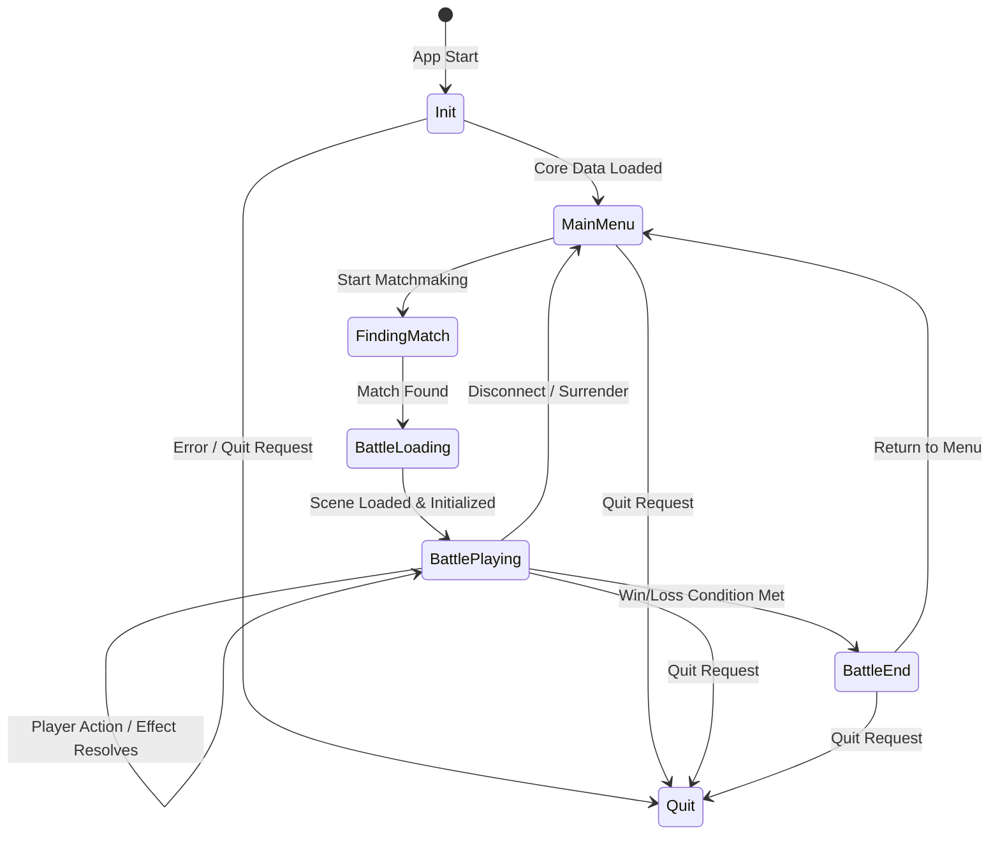
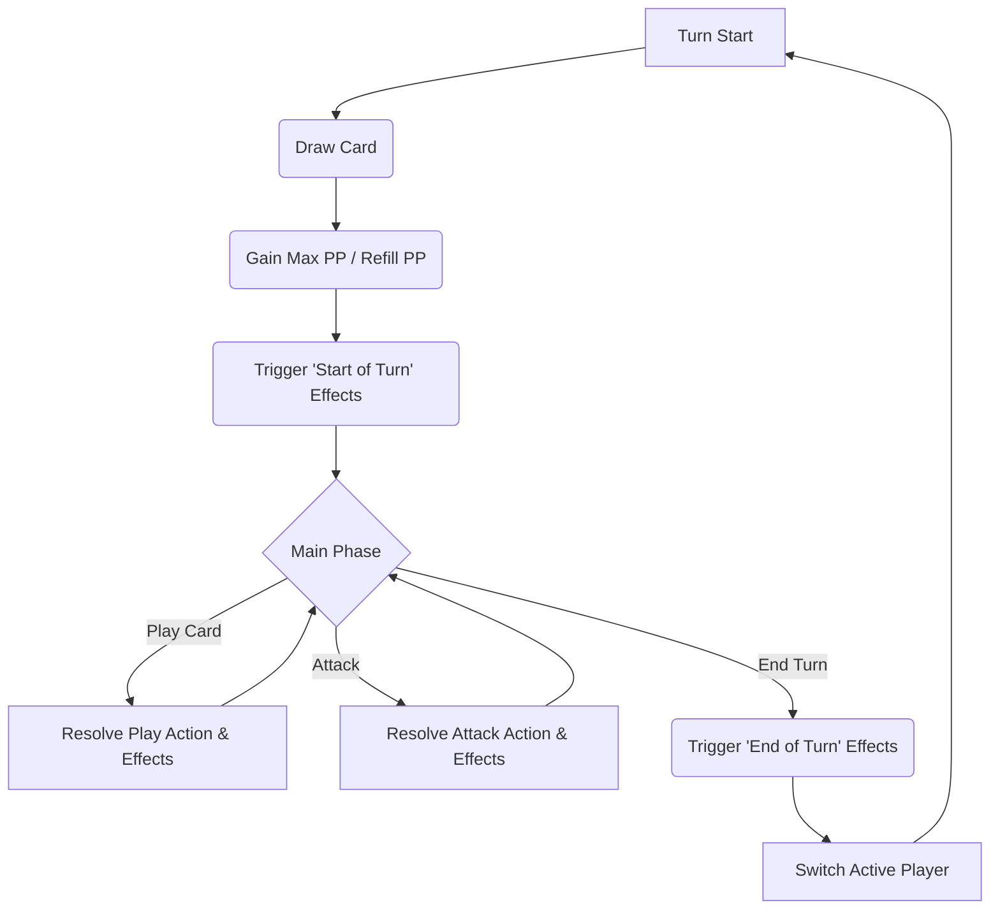

# Unity 项目 C# 脚本架构与逻辑文档 V1.3

**版本历史:**
*   V1.3 (YYYY-MM-DD): 修正 V1.2 版本丢失详细内容的问题，恢复所有描述、图表和代码示例，并使用相对路径。
*   V1.2 (YYYY-MM-DD): (错误版本) 尝试移除绝对路径，但丢失了大量内容。
*   V1.1 (YYYY-MM-DD): 补充项目概述、技术栈、目录结构；基于文件列表验证和完善细节；明确 AI 现状。
*   V1.0 (初始版本): 基础架构与核心模块分析。

**文档目标:**

*   清晰地阐述该 Unity 项目中 C# 脚本的整体架构、设计模式和技术栈。
*   详细说明核心系统、游戏逻辑、数据管理、网络和 UI 相关脚本的主要职责和工作流程。
*   解释 C# 脚本如何加载、解析和使用 `Assets/StreamingAssets/` 目录下的数据文件 (CSV/XML)，体现数据驱动设计的思想。
*   为开发者（包括 AI 辅助工具）提供一个快速理解项目代码结构、关键逻辑和技术选型的指南，以便进行评估、维护或借鉴。

---

## 1. 项目概述与目标

本项目是一个基于 Unity 引擎开发的 C# 卡牌对战游戏项目，其核心玩法和机制旨在模拟或借鉴《影之诗》(Shadowverse) 这类集换式卡牌游戏 (CCG)。

**核心特点:**

*   **类影之诗玩法:** 包含回合制、法力水晶资源、随从/法术/护符卡牌类型、进化机制、玩家主战者等典型 CCG 元素。
*   **数据驱动设计:** 游戏的核心内容（卡牌属性、效果、关键字、Buff 等）高度依赖外部数据文件（主要是位于 `Assets/StreamingAssets/Cards/` 目录下的 CSV 文件）进行定义，代码负责解析和执行这些数据。
*   **网络对战:** 集成了 Photon PUN 2，支持玩家间的在线对战。
*   **本地模式:** 支持与（目前行为较为被动的）AI 对手进行本地对战。
*   **MVC 架构 (UI):** 用户界面和部分非核心游戏流程（如卡组构建、房间管理）采用了 Model-View-Controller (MVC) 模式。

**目标:** 分析该项目的技术实现，为后续开发新的类似卡牌游戏提供参考和借鉴，特别是其架构设计、数据驱动方法和核心玩法逻辑的实现。

---

## 2. 技术栈清单

*   **游戏引擎:** Unity (具体版本需确认，但代码特性表明至少支持 C# 8.0，如 switch 表达式)
*   **编程语言:** C#
*   **网络库:** Photon Unity Networking 2 (PUN 2)
*   **UI 系统:** Unity UI (UGUI)
*   **文本渲染:** TextMesh Pro
*   **数据格式:**
    *   CSV (核心游戏数据，如卡牌、效果、Buff 等，位于 `Assets/StreamingAssets/Cards/`)
    *   XML (版本信息 `Assets/StreamingAssets/System/version.xml`, 玩家存档 `save.xml` - 位于 `Application.persistentDataPath`)
*   **资源管理:**
    *   Unity `Resources` 文件夹 (用于 Prefabs, Sprites, Fonts, Audio 等)
    *   Unity Addressables (用于异步加载卡牌美术资源，见 `Assets/Scripts/Game/Card/Card.cs`)
*   **设计模式:** 单例 (Singleton), 管理器 (Manager), 数据驱动 (Data-Driven), MVC, 接口驱动 (Interface-Driven), 观察者 (Observer - 潜在应用)

---

## 3. 整体架构与设计模式

### 3.1 核心目录结构 (`Assets/Scripts/`)

项目的 C# 脚本主要组织在 `Assets/Scripts/` 目录下，其子目录结构反映了功能和职责的划分：

*   **`Game/`**: 包含核心游戏玩法逻辑的数据结构和实现。
    *   `Battle/`: 战斗相关的状态机、核心逻辑 (`Battle.cs`)、战斗单位 (`BattleUnit.cs` - 路径待确认)、战斗中的卡牌实例 (`BattleCard.cs` - 路径待确认) 等。
    *   `Card/`: 卡牌模板数据 (`Card.cs`)、卡牌相关枚举和工具 (`CardDatabase.cs`)、目标筛选逻辑 (`CardFilter.cs`, `BattleCardFilter.cs`) 等。
    *   `Effect/`: 效果实例 (`Effect.cs`)、效果能力定义 (`EffectDatabase.cs`)、效果参数解析 (`EffectParseHandler.cs`)、效果能力执行 (`EffectAbilityHandler.cs`)、目标信息解析 (`EffectTargetInfo.cs`) 等。
    *   `Buff/`: Buff 实例 (`Buff.cs`)。
    *   `Deck/`: 卡组数据结构 (`Deck.cs`)。
    *   `BattleCard/`: 战斗中卡牌实例的视图相关逻辑 (`BattleCardView.cs`) 和 Buff 控制器 (`BattleCardBuffController.cs`)。
*   **`System/`**: 包含项目的基础设施和底层服务。
    *   `Core/`: 核心管理器单例，如资源加载 (`ResourceManager.cs`)、数据中心 (`DatabaseManager.cs`)、网络 (`NetworkManager.cs`)、存档 (`SaveSystem.cs`)、全局游戏状态 (`GameManager.cs`)、音频 (`AudioSystem.cs`) 等。
    *   `Data/`: 存档数据结构 (`GameData.cs`)、版本信息 (`VersionData.cs`)。
    *   `Parser/`: 数据驱动核心的解析器，负责解析效果/条件表达式 (`Parser.cs`)、标识符 (`Identifier.cs`) 和运算符 (`Operator.cs`)。
*   **`Manager/`**: 存放各种场景或功能的管理器单例，负责协调具体流程，如战斗场景管理器 (`BattleManager.cs`)、动画管理器 (`BattleAnimManager.cs`)、卡组构建器 (`DeckBuilderManager.cs`)、房间管理器 (`RoomManager.cs`) 等。
*   **`MVC/`**: 实现 Model-View-Controller (MVC) 模式，主要应用于 UI 界面和非核心游戏流程。
    *   `Model/`: 存储特定界面或流程所需的数据和状态 (路径待确认)。
    *   `View/`: 负责 UI 元素的展示、布局、动画触发和用户输入捕捉 (`Assets/Scripts/MVC/View/`)。
    *   `Controller/`: 作为 Model 和 View 之间的桥梁，处理用户输入，调用 Model 更新数据，并通知 View 更新显示 (路径待确认)。
*   **`IClass/`**: 定义项目中广泛使用的 C# 接口，如 `IIdentifyHandler` (提供统一标识符访问), `IDraggable` (拖拽交互), `IFilter` (筛选逻辑), `IButton`, `IToggle`, `IText` (UI 元素交互) 等，用于降低耦合度，提高代码灵活性。
*   **`Utility/`**: 存放通用的辅助脚本和工具类，如分页视图 (`PageView.cs`)、面板基类 (`Panel.cs`) 等。
*   **`Helper/`**: 可能包含静态辅助函数或扩展方法（具体内容需查阅）。

### 3.2 整体架构图

下图展示了主要模块/功能领域之间的交互关系：

```mermaid
graph TD
    A[System Core] --> B(Game Logic);
    A --> C(Network);
    A --> D(UI System - MVC);
    A --> E(Managers);

    B --> A;
    B --> E;

    C --> A;
    C --> E;

    D -- User Input --> E;
    D -- Updates based on --> B;
    D -- Updates based on --> A;

    E -- Coordinates --> A;
    E -- Coordinates --> B;
    E -- Coordinates --> C;
    E -- Coordinates --> D;


    subgraph "System Core (Assets/Scripts/System/)"
        direction LR
        Sys1[ResourceManager]
        Sys2[DatabaseManager]
        Sys3[SaveSystem]
        Sys4[Parser/Identifier/Operator]
        Sys5[GameManager]
        Sys6[NetworkManager (Photon)]
        Sys7[AudioSystem]
    end

    subgraph "Game Logic (Assets/Scripts/Game/)"
        direction LR
        Game1[Battle Logic (Battle.cs)]
        Game2[Card System (Card, CardDB)]
        Game3[Effect Engine (Effect, Handler, Filter)]
        Game4[Buff System (Buff, BuffController)]
        Game5[Player State (BattleUnit)]
    end

    subgraph "Managers (Assets/Scripts/Manager/)"
        direction LR
        Mgr1[BattleManager]
        Mgr2[BattleAnimManager]
        Mgr3[DeckBuilderManager]
        Mgr4[...]
    end

    subgraph "UI System - MVC (Assets/Scripts/MVC/)"
        direction TB
        View[Views (BattleUnitView, DeckListView, etc.)] --> Controller;
        Controller --> Model;
        Controller --> View;
        Model --> Controller;
    end

    Data[("Assets/StreamingAssets/\nCSV/XML")] -.-> Sys1;
    Sys1 -.-> Sys2;
    Sys2 -.-> Game2;
    Sys2 -.-> Game3;
    Sys2 -.-> Game4;
    Game1 -- Uses --> Game2;
    Game1 -- Uses --> Game3;
    Game1 -- Uses --> Game4;
    Game1 -- Uses --> Game5;
    Game3 -- Uses --> Sys4;
    Game3 -- Uses --> Game2;
    Game4 -- Uses --> Game3;
    Mgr1 -- Drives --> View;
    Mgr1 -- Handles Network for --> Game1;
    View -- Sends Actions via --> Mgr1;
```

**说明:**

*   **System Core**: 提供底层服务和数据管理。
*   **Game Logic**: 包含核心玩法的状态和规则。
*   **Managers**: 协调不同模块和场景流程。
*   **UI System (MVC)**: 负责用户界面展示和交互，大量使用 MVC 模式。
*   **箭头**: 表示主要的依赖或数据流向。`-->` 表示直接调用或强依赖，`-.->` 表示数据提供。

### 3.3 主要设计模式应用

项目中观察到以下主要设计模式的应用：

*   **Singleton Pattern (单例模式):** 广泛应用于 `Assets/Scripts/System/Core/` 和 `Assets/Scripts/Manager/` 目录下的核心管理器，如 `ResourceManager`, `DatabaseManager`, `NetworkManager`, `GameManager`, `BattleManager` 等。确保全局只有一个实例，方便各模块访问共享服务和状态。
*   **Manager Pattern (管理器模式):** 将特定领域（资源、数据、网络、战斗流程、动画、场景状态等）的职责封装在专门的管理器类中，集中管理和协调。
*   **Data-Driven Design (数据驱动设计):** 游戏的核心配置（卡牌、效果、Buff、关键字、特性等）主要由外部数据文件 (`Assets/StreamingAssets/Cards/*.csv`) 定义。代码（特别是 `Assets/Scripts/System/Parser/` 和 `Assets/Scripts/Game/Effect/`）负责加载、解析这些数据，并根据数据动态执行游戏逻辑。
*   **Model-View-Controller (MVC) Pattern:** 在 UI 系统和部分非核心流程（如卡组构建、房间、门户）中广泛应用 (`Assets/Scripts/MVC/`)。将数据 (Model)、显示 (View) 和控制逻辑 (Controller) 分离，提高 UI 代码的可维护性和可测试性。
*   **Interface-Driven Design (接口驱动设计):** 通过 `Assets/Scripts/IClass/` 目录下的接口（如 `IIdentifyHandler`, `IDraggable`, `IButton`) 定义协定，降低了模块间的直接依赖，提高了代码的灵活性和可扩展性。例如，`IIdentifyHandler` 允许效果系统以统一的方式查询不同对象（卡牌、Buff、玩家单位）的属性。
*   **Observer Pattern (观察者模式 - 潜在应用):**
    *   `GameManager` 的 `OnBeforeStateChanged` 和 `OnAfterStateChanged` 事件允许其他系统监听并响应游戏状态的变化。
    *   `BattleManager` 通过聚合视图的 `IsDone` 状态并使用协程等待，实现了一种观察视图完成状态的机制，以同步 UI 更新流程。

---

## 4. 核心系统 (`Assets/Scripts/System/`)

### 4.1 `ResourceManager.cs` (`Assets/Scripts/System/Core/ResourceManager.cs`)

`ResourceManager` 负责管理游戏的所有资源加载，包括 Unity 资源（如 Prefabs, Sprites, Fonts, Audio）和游戏数据（来自 `Assets/StreamingAssets/` 的 CSV/XML 文件或远程服务器）。它采用了 **Singleton (单例) 模式**。

**主要职责与机制：**

1.  **资源缓存 (Caching):** 使用内部字典 `resDict` 缓存已加载资源。
2.  **懒加载 (Lazy Loading):** 提供 `Get<T>` 方法，优先从缓存获取，否则调用 `Load<T>` 加载。
3.  **资源加载:**
    *   **Unity Assets:** 使用 `Resources.Load<T>` 从 `Resources` 文件夹同步加载。
    *   **游戏数据 (CSV/XML):**
        *   **本地 (`StreamingAssets`):** 通过 `LoadCSV` (line 150) 和 `LoadXML` (line 118) 方法，使用 `File.ReadAllText` 同步读取 `Assets/StreamingAssets/` 目录下的文件。关键数据文件包括：
            *   `Assets/StreamingAssets/Cards/info.csv` (卡牌基础信息)
            *   `Assets/StreamingAssets/Cards/effect.csv` (效果定义)
            *   `Assets/StreamingAssets/Cards/buff.csv` (Buff 定义)
            *   `Assets/StreamingAssets/Cards/description.csv` (卡牌/效果描述文本)
            *   `Assets/StreamingAssets/Cards/keyword.csv` (关键字定义)
            *   `Assets/StreamingAssets/Cards/trait.csv` (特性定义)
            *   `Assets/StreamingAssets/Cards/stats.csv` (状态/属性定义)
            *   `Assets/StreamingAssets/System/version.xml` (版本信息)
            *   玩家存档 `save.xml` (位于 `Application.persistentDataPath`，通过 `SaveSystem` 间接加载)
        *   **远程 (HTTP):** 当路径以 "http" 开头时，委托给 `RequestManager.instance.Get` (`Assets/Scripts/System/Core/RequestManager.cs`) 进行异步加载。
4.  **数据映射与处理:**
    *   **XML:** 使用 `System.Xml.Serialization.XmlSerializer` 反序列化。
    *   **CSV:** 使用 `string.Split` 分割文本，通过泛型方法 `GetInfo<T>` (line 189) 结合特定构造函数 (如 `new Card(...)`, `new Effect(...)`) 映射为 C# 对象字典。
    *   **后处理:** 包含如 `GetCardInfo` (line 253 调用链中) 这样的方法，进行数据关联（如效果关联到卡牌）。
5.  **初始化:** 在 `Start` 时调用 `InitUIResources` 预加载 UI 资源。
6.  **混合资源系统:** 注意卡牌美术（Artwork）使用 Addressables 异步加载 (`Assets/Scripts/Game/Card/Card.cs` 的 `Artwork` 属性 - line 62)，而非由 `ResourceManager` 管理。

**数据加载流程:**

```mermaid
graph TD
    subgraph Initialization
        direction LR
        GM[GameManager.Init] --> DM(DatabaseManager.Init);
    end

    subgraph Data Loading [DatabaseManager & ResourceManager]
        direction TB
        DM -- Triggers --> RM(ResourceManager);
        RM -- Loads --> CSV[CSV Files (info, effect, buff, etc.)];
        RM -- Loads --> XML[XML Files (version)];
        CSV -- Parses to --> DataDicts[Data Dictionaries (Card, Effect, Buff...)];
        XML -- Parses to --> VersionData[Version Data];
        DataDicts -- Callback --> DM_Store(DatabaseManager Stores Data);
        VersionData -- Callback --> DM_Store;
        DM_Store --> Ready[DatabaseManager.IsReady = true];
    end

    subgraph Runtime Access
        direction LR
        OtherSys[Other Systems (Game Logic, UI)] --> DM_Access(DatabaseManager.instance.GetCardInfo(...));
        DM_Access --> DM_Data[(DatabaseManager Data Stores)];
    end

    Initialization --> Data Loading;
    Data Loading --> Runtime Access;
```

**与 `DatabaseManager` 的交互:**

*   `DatabaseManager` 在初始化时 (`Init`) 触发 `ResourceManager` 加载所有必需的 CSV/XML 数据。
*   `ResourceManager` 加载并解析数据后，通过回调函数将处理好的数据字典传递给 `DatabaseManager` 存储。
*   运行时，其他系统通过 `DatabaseManager.instance` 访问这些已加载和缓存的静态数据。

### 4.2 `DatabaseManager.cs` (`Assets/Scripts/System/Core/DatabaseManager.cs`)

`DatabaseManager` (单例) 是运行时游戏静态数据的中央存储库和访问点 ("唯一真实来源")。

**主要职责与机制：**

1.  **数据存储:** 包含多个公共字典，存储由 `ResourceManager` 加载并处理好的数据，如 `cardInfoDict`, `effectInfoDict`, `buffInfoDict`, `traitNameDict`, `keywordNameDict` 等。
2.  **初始化与数据填充:** 在 `Init` (line 28) 方法中，触发 `ResourceManager` 加载各种 CSV 数据，并通过回调函数接收解析后的数据字典，填充自身。使用 `loadingProgress` 和 `IsReady` 跟踪加载状态。
3.  **数据访问接口:** 提供全局访问点 `DatabaseManager.instance` 和各种 `Get...` 方法 (如 `GetCardInfo`, `GetEffectInfo`, `GetBuffInfo`, `GetTraitName`, `GetKeywordInfo`) 供其他系统查询静态数据。

**与 `ResourceManager` 的关系总结:**

`DatabaseManager` 依赖 `ResourceManager` 来加载原始数据文件，并在加载完成后成为这些数据的权威访问点。它不直接处理文件 I/O，而是专注于存储和提供已处理的数据。

### 4.3 `SaveSystem.cs` & `GameData.cs` (数据持久化)

游戏的玩家进度、设置、卡组收藏等数据通过静态类 `SaveSystem.cs` (`Assets/Scripts/System/Core/SaveSystem.cs`) 进行持久化。

**核心机制:**

*   **管理器:** `SaveSystem.cs` 提供静态的 `SaveData()` 和 `LoadData()` 方法。
*   **数据容器:** 所有持久化数据封装在 `GameData.cs` (`Assets/Scripts/System/Data/GameData.cs`) 类中，通过 `Player.gameData` (`Assets/Scripts/System/Core/Player.cs`) 访问。
*   **序列化格式:** XML (使用 `.NET XmlSerializer`)。
*   **存储位置:** `Application.persistentDataPath + "/save.xml"`。

**保存流程 (`SaveData()`):**

1.  获取 `Player.gameData`。
2.  调用 `SaveXML()` 将对象序列化并写入 `save.xml`。

**加载流程 (`LoadData()`):**

1.  尝试调用 `LoadXML<GameData>()` 从 `save.xml` 反序列化。
2.  **成功:** 调用 `GameData.Verify()` (用于数据校验/兼容处理) 并返回。
3.  **失败:** 调用 `GameData.GetDefaultData()` 创建新默认数据，赋给 `Player.gameData`，立即调用 `SaveData()` 保存默认数据，然后返回默认数据。

**代码示例:**

```csharp
// In SaveSystem.cs (Simplified)
public static class SaveSystem
{
    private static string SavePath => Application.persistentDataPath + "/save.xml";

    public static void SaveData()
    {
        if (Player.gameData == null) return;
        SaveXML(Player.gameData, SavePath);
    }

    public static GameData LoadData()
    {
        GameData data = LoadXML<GameData>(SavePath);
        if (data == null)
        {
            data = GameData.GetDefaultData();
            Player.gameData = data; // Assign default data
            SaveData(); // Save the default data immediately
        }
        else
        {
            data.Verify(); // Verify loaded data
        }
        return data;
    }

    private static void SaveXML<T>(T data, string path)
    {
        try
        {
            using (var writer = new System.IO.StreamWriter(path))
            {
                var serializer = new System.Xml.Serialization.XmlSerializer(typeof(T));
                serializer.Serialize(writer, data);
            }
        }
        catch (System.Exception e) { Debug.LogError($"Error saving XML: {e.Message}"); }
    }

     private static T LoadXML<T>(string path) where T : class
    {
        if (!System.IO.File.Exists(path)) return null;
        try
        {
            using (var reader = new System.IO.StreamReader(path))
            {
                var serializer = new System.Xml.Serialization.XmlSerializer(typeof(T));
                return serializer.Deserialize(reader) as T;
            }
        }
        catch (System.Exception e) { Debug.LogError($"Error loading XML: {e.Message}"); return null; }
    }
}

// In GameData.cs (Simplified)
[System.Serializable]
public class GameData
{
    public int PlayerLevel;
    public List<int> CardCollection;
    public List<DeckData> Decks;
    // ... other settings ...

    public void Verify() { /* Check data integrity, handle version changes */ }
    public static GameData GetDefaultData() { /* Return new GameData with defaults */ }
}
```

**总结:** `SaveSystem` 提供了一个基于 XML 文件存储的简单持久化方案，包含默认数据生成和验证逻辑。

### 4.4 解析器系统 (`Assets/Scripts/System/Parser/`)

这是数据驱动设计的核心引擎，负责解析数据文件中定义的动态表达式和条件。

*   **`Parser.cs` (`Assets/Scripts/System/Parser/Parser.cs`)**: 通用解析器。
    *   `ParseOptions`: 解析 `key=value&...` 格式。
    *   `ParseCondition`/`ParseCondtionList`: 解析 `lhs>rhs&...` 条件字符串，依赖 `Operator`。
    *   `ParseEffectExpression`/`ParseBuffExpression`: **核心表达式求值**，解析如 `"target_count*2+1"` 的字符串，依赖 `Identifier` 获取操作数，依赖 `Operator` 执行运算（注意：简单从左到右计算，无标准优先级）。
    *   `UpdateEffectExpression(s)`: 计算表达式并将结果存回 `Effect` 的 `outputOptionDict`。
*   **`Operator.cs` (`Assets/Scripts/System/Parser/Operator.cs`)**: 运算符定义与执行。
    *   定义比较 (`condDict`)、算术/功能 (`opDict`)、逻辑 (`logDict`) 运算符及其对应的执行函数 (委托)。
    *   提供 `Condition()`, `Operate()`, `Logic()` 方法供 `Parser` 调用。
*   **`Identifier.cs` (`Assets/Scripts/System/Parser/Identifier.cs`)**: 标识符解析与状态访问。
    *   `GetIdentifier`: 将表达式中的字符串标识符 (如 "me.hp", "target_count", "effect.source.atk") 解析为实际游戏状态数值。通过前缀判断上下文 (me, op, effect, source, random 等)，并委托给具体对象 (`BattleUnit`, `Effect`, `Buff`) 或执行特定逻辑（关键字检查、随机数）。支持嵌套访问和过滤。
    *   `SetIdentifier`: 根据标识符将数值写回游戏状态。

**总结:** 解析器系统通过 `Parser`, `Operator`, `Identifier` 的协作，将数据文件中的文本定义（表达式、条件、标识符）动态地转换为游戏中的具体数值和逻辑判断，是实现灵活效果设计的关键。

---

## 5. 游戏逻辑 (`Assets/Scripts/Game/`)

### 5.1 游戏流程与状态管理

*   **`GameManager.cs` (`Assets/Scripts/System/Core/GameManager.cs`)**: (单例) 负责**应用级别**的宏观状态 (`Init`, `Play`, `Quit`) 管理和初始化协调。
    *   通过 `ChangeState` 和事件 (`OnBefore/AfterStateChanged`) 管理状态转换。
    *   在 `Init` 状态下协调初始化：设置屏幕、加载存档 (`SaveSystem.LoadData` - line 15)、加载版本文件 (`Assets/StreamingAssets/System/version.xml`)、**触发 `DatabaseManager.Init()`** 启动核心数据加载。
    *   不直接处理战斗逻辑。
*   **`Battle.cs` (`Assets/Scripts/Game/Battle/Battle.cs`)**: 代表一个具体的**战斗对局实例**。
    *   持有核心战斗状态对象 `BattleState` (`CurrentState`)。 (需要确认 `BattleState.cs` 的存在和位置)。
    *   包含核心战斗逻辑，如处理玩家动作 (`PlayerAction`)、管理效果队列 (`effectQueue`)、执行效果 (`ProcessEffect`)、回合推进逻辑 (`NextPhase`, `OnTurnStart`) 等。
    *   是游戏规则和状态变化的主要计算者。
*   **`BattleManager.cs` (`Assets/Scripts/Manager/BattleManager.cs`)**: (单例) 战斗场景的**协调器**。
    *   **UI 更新协调**: 通过 `hudQueue` 和 `ProcessQueue` 机制，按顺序将 `BattleState` 的变化同步到 UI 视图 (`Assets/Scripts/MVC/View/Battle/BattleSystemView.cs`, `Assets/Scripts/MVC/View/Battle/BattleUnitView.cs`)，并使用 `IsDone` 标志等待动画完成。
    *   **网络通信协调**: 处理玩家动作的 RPC 同步 (`EnemyPlayerAction` 发送，`BattleUnitView.RPCPlayerAction` 接收)、管理断线事件、同步胜负数据 (Photon Custom Properties)。
    *   **输入锁定**: 控制玩家输入 (`SetLock`)。
    *   **协作**: 作为 `Battle.cs` (Model/Logic) 和 UI Views 之间的桥梁。

**游戏状态 (简易)**



**战斗回合流程 (简易)**



### 5.2 卡牌系统 (`Assets/Scripts/Game/Card/`)

*   **`Card.cs` (`Assets/Scripts/Game/Card/Card.cs`)**: 卡牌数据核心。
    *   存储静态属性 (ID, 名称, 身材, 特性, 关键字, 效果名, options 字典等)，从 CSV 加载。
    *   通过复合 `id` 解析元数据。
    *   `Card.Get(id)` 获取模板，拷贝构造函数 `new Card(rhs)` 创建可变实例。
    *   `effects` 列表存储关联的 `Effect` 实例 (深拷贝)。
    *   实现 `IIdentifyHandler` 提供灵活的属性查询。
    *   `Artwork` 属性使用 Addressables 加载图画。
*   **`CardDatabase.cs` (`Assets/Scripts/Game/Card/CardDatabase.cs`)**: 枚举与辅助工具。
    *   定义核心枚举 (`CardCraft`, `CardType`, `CardRarity`, `CardTrait`, `CardKeyword` 等)。
    *   提供枚举到显示名称的映射 (部分委托给 `DatabaseManager`)。
    *   提供字符串到枚举的转换方法。
    *   提供访问 `DatabaseManager` 核心数据的静态属性 (如 `CardMaster`)。
*   **`CardFilter.cs` (`Assets/Scripts/Game/Card/CardFilter.cs`)** & **`BattleCardFilter.cs` (`Assets/Scripts/Game/Card/BattleCardFilter.cs`)**: 目标筛选逻辑。
    *   `CardFilter`: 用于静态卡牌模板筛选 (卡组编辑器等)。
    *   `BattleCardFilter`: **核心动态目标筛选引擎**，用于游戏内效果目标选择 (`BattleCard` 实例)。解析 `effect.csv` (`Assets/StreamingAssets/Cards/effect.csv`) 中 `target` 列的复杂语法 (`[type:opValue|opValue]...`, 支持比较符, 逻辑或, 列表操作如 `random`, `first`, `costOrder`)。依赖 `Operator` 和 `Identifier`。

**目标筛选代码示例 (BattleCardFilter - 简化概念):**

```csharp
// In BattleCardFilter.cs (Conceptual)
public static List<BattleCard> Filter(string filterRule, BattleState state, Effect contextEffect)
{
    List<BattleCard> potentialTargets = GetAllPotentialTargets(filterRule, state, contextEffect); // Get initial pool based on place (field, hand), owner (me, op)
    List<BattleCard> filteredTargets = new List<BattleCard>();

    // Example rule: "[follower|amulet:me_field][atk>=3][random:1]"
    string[] conditions = ParseConditions(filterRule); // -> ["[follower|amulet:me_field]", "[atk>=3]", "[random:1]"]

    List<BattleCard> currentPool = potentialTargets;
    foreach (string condition in conditions)
    {
        if (condition.Contains(":")) // Type/Place condition
        {
             currentPool = FilterByTypeAndPlace(condition, currentPool, state, contextEffect);
        }
        else if (condition.Contains(">=") || condition.Contains("<=") || ...) // Attribute condition
        {
             currentPool = FilterByAttribute(condition, currentPool, state, contextEffect); // Uses Parser/Operator/Identifier
        }
        else if (condition.Contains("random") || condition.Contains("first") || ...) // List operation
        {
             currentPool = ApplyListOperation(condition, currentPool);
        }
    }
    return currentPool;
}
```

### 5.3 效果执行引擎 (`Assets/Scripts/Game/Effect/` & `Assets/Scripts/System/Parser/`)

效果执行由多个类协作完成，将 `Assets/StreamingAssets/Cards/effect.csv` 中的定义转化为游戏行为。

*   **`Effect.cs` (`Assets/Scripts/Game/Effect/Effect.cs`)**: 效果数据实例。
    *   存储静态定义 (id, name, timing, target, place, condition, ability, abilityOptionDict) 和动态上下文 (source, invokeUnit, invokeTarget)。
    *   `Effect.Get()` 返回独立副本。
    *   `Condition()`: 调用 `Parser`/`Operator` 检查条件。
    *   `SetInvokeTarget()`: 调用 `EffectTargetInfo` (内部可能用 `BattleCardFilter`) 解析目标。
    *   `Apply()`: 执行总入口，调用 `EffectAbilityHandler` 的具体能力函数。
    *   实现 `IIdentifyHandler`。
*   **`EffectDatabase.cs` (`Assets/Scripts/Game/Effect/EffectDatabase.cs`)**: 定义 `EffectAbility` 枚举，提供 `ToEffectAbility` 将 CSV 字符串转为枚举。
*   **`EffectParseHandler.cs` (`Assets/Scripts/Game/Effect/EffectParseHandler.cs`)**: 参数解析工厂。
    *   `GetParseFunc`: 根据 `EffectAbility` 返回将 `int[] data` 解析为 `Dictionary<string, string>` (如 "target", "count") 的函数。
*   **`EffectAbilityHandler.cs` (`Assets/Scripts/Game/Effect/EffectAbilityHandler.cs`)**: **核心能力执行器**。
    *   `GetAbilityFunc`: 根据 `EffectAbility` 返回具体执行逻辑的函数 (多为 `Effect` 扩展方法)。
    *   能力实现函数: 读取 `abilityOptionDict` (可能通过 `Parser.UpdateEffectExpression` 动态计算)，修改 `BattleState`，调用 `Battle.EnqueueEffect` 触发连锁，填充 `hudOptionDict` 通知 UI。
    *   `EnqueueEffect`/`OnPhaseChange`: 核心效果触发机制，根据 `timing` 查找并检查卡牌/Buff 上的效果。
    *   `Preprocess`/`Postprocess`: 处理效果生命周期（消耗、移除、追加效果）。
    *   `HandleDamage`/`HandleHeal`/`HandleLeave`: 动作修正/拦截机制。
*   **`EffectTargetInfo.cs` (`Assets/Scripts/Game/Effect/EffectTargetInfo.cs`)**: 目标解析器，解析 `target` 字符串，结合 `BattleState` 和 `BattleCardFilter` 确定最终目标列表。
*   **解析器依赖**: `Parser.cs`, `Operator.cs`, `Identifier.cs` (见 4.4 节)。

**效果执行流程总结:**

1.  **触发 (Trigger):** 游戏事件发生 (出牌、攻击、回合开始/结束等)。
2.  **查找 (Lookup):** `EffectAbilityHandler.CheckTriggers` 查找场上/手牌/墓地等相关对象上符合 `timing` 的 `Effect` 模板。
3.  **实例化 (Instantiate):** 创建 `Effect` 实例 (深拷贝)。
4.  **设置上下文 (Set Context):** 将触发源、目标等信息设置到 `Effect` 实例中。
5.  **入队 (Enqueue):** 将 `Effect` 实例加入 `Battle.effectQueue`。
6.  **处理队列 (Process Queue):** `Battle.ProcessEffectQueue` 循环处理。
7.  **条件检查 (Condition Check):** `effect.Condition()` (内部使用 `Parser`) 检查是否满足执行条件。
8.  **目标解析 (Target Resolution):** `effect.ResolveTargets()` (内部使用 `EffectTargetInfo`/`BattleCardFilter`) 确定最终目标。
9.  **参数计算 (Parameter Calculation):** `Parser.UpdateEffectExpressions()` 计算动态参数 (如伤害值)。
10. **能力执行 (Ability Execution):** `EffectAbilityHandler.ApplyEffect()` 调用对应的能力函数，修改 `BattleState`。
11. **UI 通知 (UI Notification):** 效果执行后，通过 `BattleManager` 通知 UI 进行展示。
12. **连锁触发 (Chain Reaction):** 能力执行可能再次触发步骤 1，导致新的效果入队。

### 5.4 Buff 系统 (`Assets/Scripts/Game/Buff/` & `Assets/Scripts/Game/BattleCard/`)

*   **`Buff.cs` (`Assets/Scripts/Game/Buff/Buff.cs`)**: Buff 数据实例。
    *   存储 ID, 名称, 属性修正值 (cost, atk, hp), 赋予的特性/关键字, 携带的触发效果 (`effects`), 条件 (`condDictList`), `timing`, 来源 (`source`), 持续回合 (`StayTurn` 通过 `options["stayTurn"]`)。
    *   从 `Assets/StreamingAssets/Cards/buff.csv` 加载。
    *   实现 `IIdentifyHandler`。
    *   `Condition()` 检查自身生效条件。
    *   `OnTurnStart()` 更新持续回合。
*   **`BattleCardBuffController.cs` (`Assets/Scripts/Game/BattleCard/BattleCardBuffController.cs`)**: Buff 管理器 (附加在 `BattleCard` 上)。
    *   管理 `buffs` 列表。
    *   提供 `TakeBuff`, `AddKeyword`, `AddEffect` 方法添加 Buff (内部创建 `Buff` 实例)。
    *   提供计算属性 (`CostBuff`, `AtkBuff`, `HpBuff`, `TraitBuff`, `KeywordBuff`, `EffectBuff`) 聚合所有 Buff 效果。使用 LINQ `Sum()` 或 `SelectMany()` 聚合。
    *   `TakeDamage`/`TakeHeal` 更新卡牌受伤状态 (`damage` 字段)。
    *   `OnTurnStart` 分发回合开始事件给所有 Buff。
    *   Buff 移除主要依赖 Buff 自身条件 (`Condition`) 或效果 (`EffectAbility.RemoveBuff`)。

**Buff 系统流程总结:**

1.  **添加 (Add):** 通常由 `EffectAbility.AddBuff` 触发，调用 `BattleCardBuffController.TakeBuff`。
2.  **实例化 (Instantiate):** `TakeBuff` 创建 `Buff` 实例 (基于 `buff.csv` 数据)。
3.  **管理 (Manage):** `BattleCardBuffController` 将 `Buff` 实例加入 `buffs` 列表。
4.  **效果应用 (Apply):**
    *   **属性修改:** 卡牌访问自身属性时，通过 `BattleCardBuffController` 的计算属性 (如 `AtkBuff`) 聚合所有相关 Buff 的修正值。
    *   **关键字/特性:** 卡牌检查自身关键字/特性时，查询 `BattleCardBuffController` 的聚合列表。
    *   **触发效果:** Buff 携带的 `Effect` 参与 `EffectAbilityHandler.CheckTriggers` 流程。
5.  **更新 (Update):** `BattleCardBuffController.OnTurnStart` 通知所有 Buff 更新内部状态 (如剩余回合)。
6.  **移除 (Remove):**
    *   Buff 的 `Condition()` 在特定时机检查（如回合开始/结束），若不满足则移除。
    *   由其他 `Effect` (如 `EffectAbility.RemoveBuff`) 明确移除。

### 5.5 AI 逻辑 (本地模式)

*   通过 `BattleSettings.isLocal` 区分本地/网络模式。
*   本地模式下 `BattleManager` (`Assets/Scripts/Manager/BattleManager.cs`) 跳过网络操作。
*   调度阶段有强制 AI 执行 `KeepCard` 的同步逻辑。
*   **现状评估:** 经过对核心战斗、效果处理和管理器的分析，**目前未发现用于驱动 AI 在其主要回合中自主决策和行动（出牌、攻击、结束回合）的明确代码**。本地模式下的对手 (`opUnit`) 行为是被动的。AI 功能可能未实现或在其他未分析部分。

---

## 6. 数据结构总结

### 6.1 卡牌数据 (`Card.cs`, `Assets/StreamingAssets/Cards/info.csv`, `description.csv`)
*   核心结构: `Assets/Scripts/Game/Card/Card.cs`
*   关键信息: 复合 ID (解析出元数据), 名称, 身材, 特性, 关键字, 效果列表, options 字典, 描述。
*   来源: `Assets/StreamingAssets/Cards/info.csv` (主要属性), `Assets/StreamingAssets/Cards/description.csv` (描述文本)。
*   加载: 由 `ResourceManager` 加载，`DatabaseManager` 存储和提供访问。

### 6.2 效果数据 (`Effect.cs`, `Assets/StreamingAssets/Cards/effect.csv`)
*   核心结构: `Assets/Scripts/Game/Effect/Effect.cs`
*   关键信息: ID, 名称, 触发时机 (timing), 目标规则 (target), 生效位置 (place), 条件 (condDictList), 核心能力 (ability), 能力参数 (abilityOptionDict)。
*   来源: `Assets/StreamingAssets/Cards/effect.csv`。
*   加载: 由 `ResourceManager` 加载，`DatabaseManager` 存储和提供访问。

### 6.3 Buff 数据 (`Buff.cs`, `Assets/StreamingAssets/Cards/buff.csv`)
*   核心结构: `Assets/Scripts/Game/Buff/Buff.cs`
*   关键信息: ID, 名称, 属性修正值, 赋予的特性/关键字, 携带的效果, 条件, 时机, 持续回合。
*   来源: `Assets/StreamingAssets/Cards/buff.csv`。
*   加载: 由 `ResourceManager` 加载，`DatabaseManager` 存储和提供访问。

### 6.4 其他核心数据 (`Assets/StreamingAssets/Cards/`)
*   **关键字 (`keyword.csv`):** 定义关键字 ID、名称、描述等。由 `ResourceManager` -> `DatabaseManager` 加载和管理。
*   **特性 (`trait.csv`):** 定义特性 ID、名称等。由 `ResourceManager` -> `DatabaseManager` 加载和管理。
*   **状态/属性 (`stats.csv`):** 可能定义一些通用的状态或属性模板。由 `ResourceManager` -> `DatabaseManager` 加载和管理。

---

## 7. 资源管理与加载 (Resource Management & Loading)

项目的资源和核心游戏数据加载由 `ResourceManager.cs` (`Assets/Scripts/System/Core/ResourceManager.cs`) (单例) 统一管理。

*   **职责:** 加载 Unity 资源 (Prefabs, Sprites, Fonts, Audio), 核心游戏数据 (CSV from `Assets/StreamingAssets/`), XML 数据 (版本, 存档)。
*   **加载机制:**
    *   **Unity 资源:** `Resources.Load<T>` + 缓存 (`resDict`)。
    *   **核心游戏数据 (CSV):** `LoadCSV` (支持本地/HTTP) -> `GetInfo<T>` (泛型解析) -> 具体数据类构造函数。
    *   **XML 数据:** `LoadXML` (支持本地/HTTP) -> `XmlSerializer`。
    *   **卡牌美术:** Unity Addressables (由 `Assets/Scripts/Game/Card/Card.cs` 处理)。
*   **初始化:** `InitUIResources` 预加载 UI 资源。核心数据加载由 `DatabaseManager.Init()` 触发，通过回调填充 `DatabaseManager`。

---

## 8. UI 系统 (`Assets/Scripts/MVC/View/`, `Assets/Scripts/Manager/BattleManager.cs`, etc.)

游戏 UI 的更新和交互主要基于 MVC 模式，并由 `BattleManager` (`Assets/Scripts/Manager/BattleManager.cs`) (战斗场景) 或其他场景管理器协调。

### 8.1 UI 更新流程核心 (`BattleManager` 与 `hudQueue`)

*   **协调器:** `BattleManager.cs` 是战斗 UI 更新的核心。
*   **状态队列 (`hudQueue`):** `Queue<BattleState>` 缓存由 `Battle` 逻辑产生的状态更新。`BattleManager` 在 `Battle` 状态变化后（通过事件或直接调用）将状态快照或增量信息入队。
*   **顺序处理 (`ProcessQueue` Coroutine):**
    1.  等待 `hudQueue` 非空。
    2.  锁定玩家输入 (`SetLock(true)`).
    3.  出队一个 `BattleState` 更新信息。
    4.  重置各主要 View 的 `IsDone` 标志 (表示动画/更新未完成)。
    5.  调用主视图 (`systemView`, `myView`, `opView`) 的 `SetState(updateInfo)` 方法，将更新信息传递下去。
    6.  `yield return WaitForCondition(() => systemView.IsDone && myView.IsDone && opView.IsDone);` 等待所有主视图完成各自的更新和动画，并通过设置 `IsDone = true` 来发出信号。
    7.  解锁玩家输入 (`SetLock(false)`).
    8.  循环处理队列中的下一个更新。
*   **同步机制:** View 组件在执行完其更新逻辑（包括播放动画、更新文本等）后，必须将自身的 `IsDone` 属性设置为 `true`，以通知 `BattleManager` 可以进行下一步。

**UI 更新代码示例 (BattleManager - 简化概念):**

```csharp
// In BattleManager.cs (Conceptual Coroutine)
private IEnumerator ProcessQueue()
{
    while (true)
    {
        // Wait until there's something in the queue
        yield return new WaitUntil(() => hudQueue.Count > 0);

        SetLock(true); // Lock user input

        // Get the next state update DTO or full state snapshot
        var stateUpdate = hudQueue.Dequeue();

        // Reset completion flags for relevant views
        systemView.IsDone = false;
        myView.IsDone = false;
        opView.IsDone = false;

        // Dispatch the state update to the main views
        systemView.SetState(stateUpdate);
        myView.SetState(stateUpdate);
        opView.SetState(stateUpdate);

        // Wait for all dispatched views to complete their updates/animations
        yield return new WaitUntil(() => systemView.IsDone && myView.IsDone && opView.IsDone);

        SetLock(false); // Unlock user input

        // Optional: Signal back to Battle logic that UI is synced for this step
        // Battle.instance.OnUISynced();
    }
}

// In a View like BattleUnitView.cs (Conceptual SetState)
public bool IsDone { get; private set; } = true; // Default to true when inactive

public void SetState(BattleState update)
{
    IsDone = false; // Mark as busy
    // ... Update leader HP, PP, EP views ...
    // ... Update hand view, field view, deck view ...
    // ... Start animations ...

    // Example: If animations are involved, use a coroutine
    StartCoroutine(UpdateViewWithAnimation(update));
}

private IEnumerator UpdateViewWithAnimation(BattleState update)
{
    // ... Perform updates that require animation ...
    // yield return PlayAnimationAndWait(someAnimation);
    yield return new WaitForSeconds(0.5f); // Placeholder for animation time

    IsDone = true; // Signal completion after all updates/animations
}
```

### 8.2 主要视图与 MVC 结构

*   **视图控制器 (`BattleSystemView`, `BattleUnitView`):**
    *   `BattleSystemView.cs` (`Assets/Scripts/MVC/View/Battle/BattleSystemView.cs`): 处理系统级 UI 事件 (胜负、调度、回合开始)。
    *   `BattleUnitView.cs` (`Assets/Scripts/MVC/View/Battle/BattleUnitView.cs`): 单个玩家 UI 的聚合器 (区分本地/对手)。管理子视图 (Leader, PP, EP, Hand, Field, Deck, Corner)，并将 `BattleState` 数据分发给它们。在子视图更新后设置 `IsDone`。处理对手 RPC 动作。
*   **子视图 (如 `BattleHandView`, `BattleFieldView`):**
    *   位于 `Assets/Scripts/MVC/View/Battle/Unit/` 目录下。
    *   管理各自区域内的卡牌视图 (`Assets/Scripts/Game/BattleCard/BattleCardView.cs`)，处理区域相关的用户输入（如拖拽）。
*   **卡牌视图 (`BattleCardView.cs`):**
    *   位于 `Assets/Scripts/Game/BattleCard/`。
    *   控制单个卡牌 GameObject 的视觉呈现，根据卡牌类型激活子视图 (Follower/Amulet)，包含效果视图 (`Assets/Scripts/Game/BattleCard/Effect/BattleCardEffectView.cs`)。更新卡牌数值、状态（攻击、受伤等）。
*   **动画与音效:**
    *   动画: 由 `BattleAnimManager.cs` (`Assets/Scripts/Manager/BattleAnimManager.cs`) 统一管理和执行，可能被各 View 调用。
    *   音效: 由 `AudioSystem.cs` (`Assets/Scripts/System/Core/AudioSystem.cs`) 管理和播放，可能被各 View 或 Manager 调用。

---

## 9. 网络系统 (Network System - Photon PUN)

使用 Photon PUN 2 实现网络对战，由 `BattleManager` (`Assets/Scripts/Manager/BattleManager.cs`) 协调战斗场景的网络交互。

*   **初始化与连接:** 依赖 `NetworkManager.cs` (`Assets/Scripts/System/Core/NetworkManager.cs`) (单例) 处理 Photon 连接、大厅、房间逻辑。`BattleManager` 在场景加载时注册断线监听 (`OnDisconnected`), 查找并赋值 `PhotonView`。
*   **玩家操作同步 (RPC):**
    *   本地操作触发 (如 UI 点击攻击按钮) -> 调用 `BattleManager.EnemyPlayerAction()` -> 使用 `myPhotonView.RPC("RPCPlayerAction", RpcTarget.Others, ...)` 发送序列化后的操作数据。
    *   对手客户端 -> `BattleUnitView.RPCPlayerAction()` (`[PunRPC]`, `Assets/Scripts/MVC/View/Battle/BattleUnitView.cs` line 29) 接收 RPC -> 反序列化操作数据 -> 调用 `Battle.instance.PlayerAction()` 应用操作到本地 `Battle` 实例。
*   **数据同步 (Photon Custom Properties):** 用于同步玩家元数据，如 [`BattleManager.OnConfirmBattleResult`](line 71) 中更新胜场数 (`PhotonNetwork.LocalPlayer.SetCustomProperties(...)`)。不太用于同步核心战斗状态。

---

## 10. 依赖关系概述

*   **UI (MVC View)** -> Controller (指令), Model (读取数据展示), Manager/System (播放音效/动画)
*   **Controller** -> Model (读写数据), Manager/System (执行操作，如通过 BattleManager 发送网络消息)
*   **Game Logic (`Battle`, `Effect`, etc.)** -> System Core (`DatabaseManager`, `Parser` 获取数据和工具)
*   **Managers (`BattleManager`, etc.)** -> System Core, Game Logic, MVC (协调各方)
*   **System Core** -> (互相依赖较少，提供基础服务，如 ResourceManager 被 DatabaseManager 使用)
*   **Data Files (`Assets/StreamingAssets/`)** -> ResourceManager -> DatabaseManager -> Game Logic / UI (间接使用)

---

## 11. 附录

### 11.1 关键枚举 (部分示例)

(源自 `Assets/Scripts/Game/Card/CardDatabase.cs`)

*   `CardCraft`: 职业 (Neutral, Forest, Sword, Rune, Dragon, Shadow, Blood, Haven, Portal)
*   `CardType`: 类型 (Leader, Follower, Spell, Amulet, Field, EvolvedFollower)
*   `CardRarity`: 稀有度 (Bronze, Silver, Gold, Legendary)
*   `CardTrait`: 特性 (Soldier, Commander, EarthSigil, Artifact, Machine, Natura, etc.)
*   `CardKeyword`: 关键字 (Rush, Ward, Bane, Storm, Ambush, Drain, Countdown, Aura, Clash, Freeze, Shield, Charge, Fanfare, LastWords, Attack, Strike, Evolve, UnionBurst, Rally, Resonance, Spellboost, Overflow, Necromancy, Vengeance, Machina, Natura, Accelerate, Crystalize, BurialRite, Reanimate, Fusion, Choose, etc.)
*   `BattlePlaceId`: 区域 (Deck, Hand, Field, Grave, Banished, Playing, Choosing)
*   `EffectAbility`: 效果核心能力 (Damage, Heal, Destroy, Draw, Ramp, Summon, Return, Transform, AddBuff, SetStatus, Accelerate, Crystalize, Fusion, Choose, TurnStart, TurnEnd, Play, Evolve, Attack, etc. - 完整列表见 `Assets/Scripts/Game/Effect/EffectDatabase.cs`)
*   `EffectTiming`: 效果触发时机 (Fanfare, LastWords, Clash, Strike, Attack, TurnStart, TurnEnd, Evolve, Play, Main, etc.)

### 11.2 CSV 文件结构 (推测与示例)

**注意:** 以下结构根据代码分析推测，需查阅实际 CSV 文件确认。列名可能不完全准确。

*   **`info.csv` (卡牌基础信息):** `id, name, craft, type, rarity, cost, atk, hp, trait1, trait2, ..., keyword1, keyword2, ..., effectName1, effectName2, ..., artId, options...` (位于 `Assets/StreamingAssets/Cards/`)
*   **`effect.csv` (效果定义):** `id, name, timing, targetRule, placeCondition, conditionString, abilityName, option1, option2, ...` (option 列数可能根据 ability 不同而变化) (位于 `Assets/StreamingAssets/Cards/`)
*   **`buff.csv` (Buff 定义):** `id, name, timing, conditionString, costMod, atkMod, hpMod, trait1, ..., keyword1, ..., effectId1, ..., options...` (位于 `Assets/StreamingAssets/Cards/`)
*   **`keyword.csv` (关键字):** `id, name, descriptionId` (位于 `Assets/StreamingAssets/Cards/`)
*   **`trait.csv` (特性):** `id, name` (位于 `Assets/StreamingAssets/Cards/`)
*   **`description.csv` (描述):** `id, text` (关联卡牌、效果或关键字 ID) (位于 `Assets/StreamingAssets/Cards/`)
*   **`stats.csv` (状态):** `id, ...` (具体列未知) (位于 `Assets/StreamingAssets/Cards/`)

### 11.3 `version.xml` 结构 (推测) (位于 `Assets/StreamingAssets/System/`)

```xml
<VersionData>
  <Version>1.0.0</Version> <!-- 客户端版本 -->
  <MasterDataUrl>http://example.com/masterdata/</MasterDataUrl> <!-- 主数据服务器地址 (可能用于热更新) -->
  <!-- 其他版本或配置信息 -->
</VersionData>
