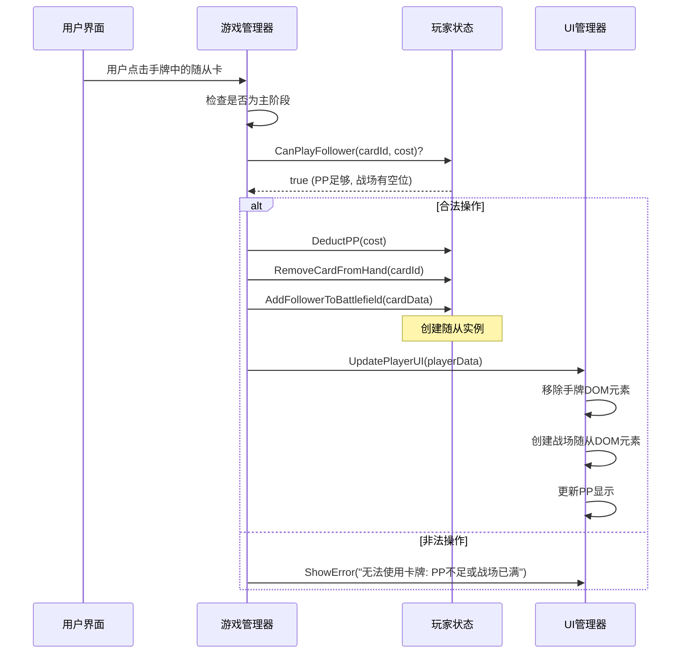

# 工作备忘录：script.js 修复

## 重要流程提醒

**核心原则：在每次尝试修改文件（特别是使用 `apply_diff`）之前，必须使用 `read_file` 重新读取目标文件 (`script.js`) 的最新内容！**

**原因：**

1.  **工具不可靠性：** 之前的经验表明，`apply_diff` 等代码修改工具可能会失败或仅部分应用更改，导致文件状态与预期不符。
2.  **并发修改风险：** 虽然目前是单人操作，但这是良好的开发习惯，防止未来可能的多人协作或后台进程修改文件。
3.  **精确匹配：** `apply_diff` 的 `SEARCH` 块需要与文件内容完全精确匹配（包括空格和换行）。任何微小的差异都会导致失败。重新读取可确保 `SEARCH` 块基于文件的最新状态生成。

## 已知问题与应对策略

记录在修复过程中遇到的主要问题及其应对方法：

1.  **`apply_diff` 问题:**

    - **失败原因：**
      - Diff 标记语法错误 (例如 `>>>>>>>>>` vs `>>>>>>>`)。
      - `SEARCH` 块与文件当前内容不完全匹配（即使看起来很像）。
      - 处理包含空行、复杂注释或跨越多行的代码块时可能不稳定。
      - 多块 diff 应用时，若中间某块失败，可能导致后续块应用在错误的位置或完全失败，造成文件损坏（需要通过 `read_file` 确认实际结果）。
    - **应对策略：**
      - **拆分！** 将复杂的修改分解为最小、最独立的步骤，每次只用 `apply_diff` 修改一小块逻辑。
      - **重读！** 严格遵守上述流程提醒，每次 `apply_diff` 前都 `read_file`。
      - **精确！** 仔细检查 `SEARCH` 块，确保与 `read_file` 的内容完全一致。
      - **简化！** 优先使用替换单行或小代码块，避免过于复杂的替换。

2.  **`insert_content` 问题:**

    - **失败原因：** 插入大块代码时（如整个函数）可能成功报告，但实际内容被截断。
    - **应对策略：** 仅用于插入较小的代码片段。对于函数等大型结构，优先考虑 `apply_diff` （拆分后）或最后的手段——手动复制代码。

3.  **`search_and_replace` 问题:**

    - **失败原因：** 简单的文本替换有时也会因空格、换行或不可见字符而匹配失败；正则表达式模式可能不够健壮。
    - **应对策略：** 尽量使用更精确的 `apply_diff` 进行替换。如果必须使用，优先用字面量搜索，并仔细检查目标文本。

4.  **`write_to_file` 问题:**
    - **失败原因：** 存在平台或工具的输出/输入大小限制，导致无法写入较大的完整文件内容，即使提供了 `line_count`。
    - **应对策略：** 避免使用此工具覆盖大型文件。坚持使用小步、精确的修改工具。

**当前主要策略：** 坚持使用小步、精确的 `apply_diff`，并在每次操作前强制使用 `read_file` 确认文件状态。

---

## 项目启动与初期文档创建 (2025-05-22)

**状态:** 项目正式启动，已完成初步规划和核心文档创建。

**已完成:**

1.  **《项目整体任务清单.md》创建:**
    - 详细分解了阶段一 (网页版核心 Demo) 的开发任务。
    - 通过分块写入 (`write_to_file` + `insert_content`) 克服了工具限制。
    - 包含了后续阶段 (二至四) 的高层目标和任务概要。
2.  **《代码结构初步设计.md》创建:**
    - 定义了阶段一 Demo 的文件结构 (HTML, CSS, JS, Data)。
    - 明确了各主要文件的职责和关键内容。
    - 考虑了初步的扩展性。

**下一步:**

1.  **回顾与确认:** 与用户一起回顾已创建的文档 ([`文档/项目整体任务清单.md`](d:\workspace\Shadowverse-beyond\文档\项目整体任务清单.md), [`文档/代码结构初步设计.md`](d:\workspace\Shadowverse-beyond\文档\代码结构初步设计.md))，确保理解一致。
2.  **环境准备:** 确认开发环境已就绪 (代码编辑器, 浏览器)。
3.  **启动开发 (阶段一):** 根据任务清单，开始实现 `index.html`, `style.css`, `data/card_data.json` 和 [`script.js`](d:\workspace\Shadowverse-beyond\script.js) 的基础结构和功能。优先完成项目设置和基础结构部分。

---

    ## 核心逻辑调试与修复 (2025-05-23)

    **状态:** 解决了游戏初始化后玩家 PP/EP 显示不正确的问题。

    **已完成:**

    1.  **问题定位:** 通过分析代码和浏览器控制台日志，发现问题源于 [`script.js`](d:\workspace\Shadowverse-beyond\script.js) 中的 `updatePlayerInfo` 函数未能正确读取和显示 `gameManager.js` 中 `Player` 对象的 `pp`, `maxPp`, `ep`, `maxEp` 属性。根源在于 `gameManager.js` 中错误地将 `Player` 实例直接赋值给了 `gameState.players` 中的玩家 ID，而非使用 `new Player()` 创建新实例。
    2.  **代码修复:**
        - 修改 [`script.js`](d:\workspace\Shadowverse-beyond\script.js) (后被拆分为多个模块): 将涉及游戏状态和逻辑的代码移至独立的 JS 模块 (`gameManager.js`, `player.js`, `cardManager.js`, `ui.js`, `turnManager.js`, `ai.js`)。
        - 修正 `gameManager.js` 中的 `initGame` 函数，确保使用 `new Player(PLAYER1_ID)` 和 `new Player(PLAYER2_ID, true)` 创建玩家实例。
        - 确保 `startTurn` 函数在回合开始时正确设置 `currentPlayer.pp = currentPlayer.maxPp = 1` (对于第一回合) 并在 `ui.js` 的 `renderGame` 中正确显示。
        - 确保初始 EP 在 `initGame` 中根据先后手正确设置 `maxEp`，并在 `renderGame` 中显示。
    3.  **测试验证:** 使用 `npx http-server` 启动本地服务器，并通过浏览器或 Playwright 访问游戏页面，确认玩家信息（包括 PP 和 EP）在游戏开始时正确显示为 1/1 PP 和 0/2 (先手) 或 0/3 (后手) EP。

    **下一步:**

    1.  **更新任务清单:** 在 [`文档/项目整体任务清单.md`](d:\workspace\Shadowverse-beyond\文档\项目整体任务清单.md) 中标记相关初始化任务为完成。
    2.  **继续调试:** 根据用户选择，进行下一步功能测试 (如点击手牌、出牌、结束回合等)。

---

## UI 交互修复：卡牌点击逻辑 (2025-05-23)

**状态:** 进行中

**问题描述:** [`src/ui.js`](d:\workspace\Shadowvision\Shadowverse-beyond\src\ui.js) 中的 `handleGameClick` 函数未能正确调用 `handleCardClick` 来处理玩家从手牌出牌的动作。代码块被注释，临时 alert 存在，且 `handleCardClick` 函数体为空。

**尝试修复 (自动化工具):** 多次尝试使用 `apply_diff` 和 `write_to_file` 工具自动修复代码，但因工具错误（格式无效、内容截断、行号计算复杂）而失败。

**当前计划:** 由于自动化工具在此复杂修改场景下不可靠，将遵循“文档先行”原则记录此计划，然后提供详细的手动修改说明，指导用户在编辑器中直接修改 [`src/ui.js`](d:\workspace\Shadowvision\Shadowverse-beyond\src\ui.js) 文件，以实现以下目标： 1. 在 `handleGameClick` 中解除对 `findCardInstanceByUid` 和 `handleCardClick` 调用的注释，并加入正确的逻辑。 2. 在 `handleGameClick` 中移除临时的 `alert` 语句。 3. 为 `handleCardClick` 函数提供完整的实现逻辑（处理手牌出牌，检查 PP）。

**下一步:** 在此备忘录更新后，将 **再次读取** [`src/ui.js`](d:\workspace\Shadowvision\Shadowverse-beyond\src\ui.js) 以获取最新状态，然后提供手动修改代码片段和说明。

**更新 (2025-05-23):**
**状态:** 进行中 (发现新问题)
**新问题:** 用户按照手动说明修改 `ui.js` 后进行测试，浏览器控制台报告错误：`Uncaught SyntaxError: The requested module './gameManager.js' does not provide an export named 'findCardInstanceByUid'`。这确认了 [`src/gameManager.js`](d:\workspace\Shadowverse-beyond\src\gameManager.js) 缺少必要的 `findCardInstanceByUid` 函数实现和导出。

**修复计划:**

1.  读取 [`src/gameManager.js`](d:\workspace\Shadowverse-beyond\src\gameManager.js)。
2.  在 [`src/gameManager.js`](d:\workspace\Shadowverse-beyond\src\gameManager.js) 中添加 `findCardInstanceByUid(uid)` 函数的实现（逻辑：遍历 `gameState` 中双方玩家的 `hand` 和 `field`，查找指定 `uid` 的卡牌实例）。
3.  使用 `export` 关键字从 [`src/gameManager.js`](d:\workspace\Shadowverse-beyond\src\gameManager.js) 导出该函数。
4.  要求用户刷新页面并重新测试卡牌点击功能。

**下一步:** 读取 [`src/gameManager.js`](d:\workspace\Shadowverse-beyond\src\gameManager.js) 以准备实施修复。

**更新 (2025-05-23, 第二次更新):**
**状态:** 进行中 (再次发现新问题)
**新问题:** 在 `gameManager.js` 中添加并导出了 `findCardInstanceByUid` 后重新测试，浏览器报告了新的错误：`Uncaught SyntaxError: The requested module './gameManager.js' does not provide an export named 'getCurrentPlayerId'`。分析代码发现 [`src/ui.js`](d:\workspace\Shadowverse-beyond\src\ui.js) 的 `handleCardClick` 函数还依赖 `getCurrentPlayerId` 和 `getPlayerState` 两个从 [`src/gameManager.js`](d:\workspace\Shadowverse-beyond\src\gameManager.js) 导入的函数，这两个函数同样尚未实现或导出。

**修复计划:**

1.  读取 [`src/gameManager.js`](d:\workspace\Shadowverse-beyond\src\gameManager.js)。
2.  在 [`src/gameManager.js`](d:\workspace\Shadowverse-beyond\src\gameManager.js) 中实现 `getCurrentPlayerId()` 函数（返回 `gameState.currentPlayerId`）。
3.  在 [`src/gameManager.js`](d:\workspace\Shadowverse-beyond\src\gameManager.js) 中实现 `getPlayerState(playerId)` 函数（返回 `gameState.players.find(p => p.id === playerId)`）。
4.  从 [`src/gameManager.js`](d:\workspace\Shadowverse-beyond\src\gameManager.js) 中导出这两个新函数。
5.  要求用户强制刷新页面并再次重新测试卡牌点击功能。

**下一步:** 读取 [`src/gameManager.js`](d:\workspace\Shadowverse-beyond\src\gameManager.js) 以准备实施修复。

---

## 功能实现计划：玩家打出随从牌 (2025-05-23)

**目标:** 实现玩家从手牌打出基础随从到战场的核心交互功能。

**状态:** 已完成 (2025-05-23)。
**测试结果:** 用户确认基础随从（哥布林）可以成功从手牌打出到战场，PP 正确扣除。

**核心步骤:**

1.  **事件处理:** 为手牌卡牌元素添加点击事件监听器 ([`src/ui.js`](d:\workspace\Shadowverse-beyond\src\ui.js))。
2.  **合法性检查:** 点击时，由 [`src/gameManager.js`](d:\workspace\Shadowverse-beyond\src\gameManager.js) 检查是否为主阶段、PP 是否足够、战场是否有空位。
3.  **状态更新:** 若合法，[`src/gameManager.js`](d:\workspace\Shadowverse-beyond\src\gameManager.js) 调用 [`src/player.js`](d:\workspace\Shadowverse-beyond\src\player.js) 更新玩家状态（扣除 PP、从手牌移除卡牌、向战场添加随从实例）。
4.  **UI 更新:** [`src/ui.js`](d:\workspace\Shadowverse-beyond\src\ui.js) 负责移除手牌 DOM 元素、添加战场随从 DOM 元素、更新 PP 显示。

**简化:** 暂时不处理入场曲或复杂的卡牌效果，仅实现放置动作。

**涉及模块:**

- `src/ui.js` (用户界面交互与更新)
- `src/gameManager.js` (核心游戏流程控制与验证)
- `src/player.js` (玩家数据管理)
- `data/card_data.json` (提供卡牌数据)

**交互流程 (Sequence Diagram):**



**下一步:** 切换到 `code` 模式开始编码实现。

---

## 关于 apply_diff 工具使用的经验总结 (2025-05-23)

近期在使用 `apply_diff` 工具修改代码时，多次遇到因格式错误导致的失败。最终成功应用修改（例如对 `src/ui.js` 中 `handleGameClick` 和 `renderHighlights` 的部分修改）的关键在于：

1.  **严格遵守 Diff 格式:** 确保 diff 字符串完全符合规范，包含正确的 `:start_line:`、`-------`、单一的 `=======` 以及 `>>>>>>> REPLACE` 标记。标记前后不能有额外的空行或字符。
2.  **精确匹配 `SEARCH` 内容:** `<<<<<<< SEARCH` 和 `=======` 之间的内容必须与目标文件中对应行号开始的原始内容 **完全一致**，包括所有的空格、缩进和换行符。任何细微差别都可能导致匹配失败。建议在不确定时先使用 `read_file` 获取准确内容。
3.  **确保 `REPLACE` 内容完整:** `=======` 和 `>>>>>>> REPLACE` 之间是完整的替换后内容。
4.  **优先小范围修改:** 相比于替换整个大型函数，优先尝试针对性地修改函数内的特定代码块。这降低了因 `SEARCH` 内容过长或复杂而引入格式或匹配错误的风险。例如，先成功修改了 `handleGameClick` 的一小部分，再成功修改了 `renderHighlights` 的一个特定区域。

---

## 备用排错方案：搜索 RooCode GitHub Issues (2025-05-23)

当遇到工具（如 `apply_diff`, `write_to_file` 等）反复失败或行为异常时，可以尝试使用 `github` MCP 服务在官方 `RooCodeInc/Roo-Code` 仓库中搜索相关的 Issues，以查找已知问题、讨论或潜在的解决方案。

**方法:**

1.  确保 `github` MCP 服务已连接。
2.  使用 `use_mcp_tool` 调用 `github` 服务器的 `search_issues` 工具。
3.  构造查询参数 `q`，**必须** 包含 `is:issue`，并指定仓库 `repo:RooCodeInc/Roo-Code`，以及与问题相关的关键词。

**示例查询 (针对 apply_diff 格式错误):**

```json
{
  "q": "repo:RooCodeInc/Roo-Code apply_diff format error is:issue"
}
```

**注意:** 此方法依赖于 `github` MCP 服务的可用性以及相关问题是否已在 Issues 中被报告和讨论。

---

## 基本对战流程完成与 Bug 修复 (2025-05-23)

**状态:** 完成

**近期完成:**

- 实现了完整的调度 (Mulligan) 阶段交互与逻辑。
- 添加了基础的进化 (Evolve) 按钮界面元素 (功能待后续实现)。
- **核心 Bug 修复:**
  - 解决了后手玩家在第一回合只能抽 1 张牌的问题，通过修正 `src/turnManager.js` 中 `endTurn` 函数的回合数递增条件实现。
  - 解决了攻击对方英雄时必须精确点击血量数字的问题，通过修改 `src/ui.js` 的事件监听器，现在点击对方头像 (`#player2-avatar`) 区域即可触发攻击。
- 确认了游戏的基础对战流程（包括初始化、调度、回合轮换、PP 管理、出牌、基础攻击）现在能够正常运行。

**下一步计划:**

- 开始实现核心卡牌能力（Keywords & Effects），优先处理 **守护 (Ward)**, **疾驰 (Storm)**, 和 **战吼 (Fanfare)**。

---

## 功能实现与调试：法术目标选择 (“天使的狙击”, S002/S004) (2025-05-24)

**目标:** 实现基础的法术目标选择机制，允许玩家使用“天使的狙击”指定一个有效的敌方目标（随从或主战者）并造成伤害。

**状态:** 已完成。

**核心实现步骤:**

1.  **UI 交互 (`src/ui.js`):**

    - 在 `handleCardClick` 中添加逻辑：如果点击的是法术牌，并且 PP 足够，则进入“目标选择模式”。
    - 新增模块级状态变量 `isTargetingSpell` 和 `targetingSpellUid` 来跟踪目标选择状态。
    - 创建辅助函数 `startSpellTargeting(spellUid)` 和 `endSpellTargeting()` 来封装对上述状态变量的修改。
    - 修改 `renderHighlights`，根据 `isTargetingSpell` 状态调用 `renderSpellTargetHighlights` 来高亮有效目标。
    - 修改 `handleGameClick`，在目标选择模式下，如果点击了有效目标，则调用 `gameManager.playCard`；如果点击了其他地方，则调用 `endSpellTargeting` 取消选择。

2.  **游戏逻辑 (`src/gameManager.js`):**
    - 实现 `isValidSpellTarget(cardInstance, targetInstance)` 函数，用于验证目标是否符合法术的要求（例如，“天使的狙击”要求目标是敌方单位）。
    - 修改 `playCard(cardUid, targetUid)` 函数，接收目标 UID，查找卡牌和目标实例，执行法术效果（例如，调用 `targetInstance.takeDamage(1)`），消耗 PP，从手牌移除卡牌，并最终调用 `ui.renderGame()` 更新界面。

**遇到的主要挑战与解决方案:**

1.  **`handleCardClick` 结构问题:** 早期版本逻辑混乱，未能正确处理法术牌的点击和状态转换。通过重构，明确了检查卡牌类型、PP、进入目标选择状态的流程。
2.  **参数与选择器错误:** 在实现 `isValidSpellTarget` 和 `renderSpellTargetHighlights` 时，遇到了参数传递错误和 CSS 选择器定位不准确的问题。通过仔细检查代码和 DevTools 逐步修复。
3.  **`currentPlayerId` 引用错误:** 在 `ui.js` 的 `handleCardClick` 中尝试访问 `currentPlayerId` 时出现 `ReferenceError`。通过在该函数作用域内重新获取当前玩家 ID 解决。
4.  **关键 Bug - 状态同步问题:**
    - **现象:** 即使在 `handleCardClick` 中调用 `playCard` _之后_ 立刻用 `endSpellTargeting()` 重置了 UI 的目标选择状态，但在 `playCard` 内部调用 `ui.renderGame()` 时，UI 的 `renderHighlights` 函数仍然读取到**旧的** `isTargetingSpell = true` 状态。这导致了控制台警告（尝试渲染不存在的目标高亮）和错误的 UI 表现（其他可出卡牌失去高亮）。
    - **根源分析:** 推测是由于 `ui.js` 和 `gameManager.js` 之间的交互（`ui` 调用 `gameManager`，`gameManager` 再回调 `ui` 渲染）导致的状态更新时序问题。`endSpellTargeting()` 的调用相对于渲染时机“太晚”。
    - **解决方案:** **调整了状态重置的时机**。在 `handleCardClick` 中，当用户成功选择了有效目标后，**先调用 `endSpellTargeting()`** 重置 UI 状态，然后再调用 `gameManager.playCard()` 执行游戏逻辑。这样确保了在 `playCard` 回调 `renderGame` 时，UI 状态已经是最新的。

**验证:** 通过测试，确认“天使的狙击”可以正确地以敌方主战者为目标打出，PP 扣除，卡牌消失，目标受到伤害（通过控制台日志确认），并且没有出现之前的控制台警告或 UI 渲染异常。

**下一步计划:** 等待用户确认下一步开发任务。

---

## 补充文档：关键字实现确认 (守护, 疾驰, 战吼) (2025-05-24)

**目标:** 根据用户反馈，检查代码库确认 守护(Ward), 疾驰(Storm), 战吼(Fanfare) 关键字的实现状态，并补充文档记录。
**状态:** 信息收集完成，文档已补充。
**验证:** 通过代码审查 [`data/card_data.json`](data/card_data.json), [`src/gameManager.js`](src/gameManager.js), [`src/player.js`](src/player.js)。
**实现细节确认:**

1.  **数据定义 ([`data/card_data.json`](data/card_data.json)):**

    - `keywords` 数组用于标记卡牌具有的静态关键字 (如 `"Ward"`, `"Storm"`)。
    - `effects` 数组用于定义触发式效果，其中 `trigger: "Fanfare"` 用于标记战吼效果，并包含相应的 `action` 和 `value`。

2.  **战吼 (Fanfare):**

    - **触发时机:** 在 [`src/gameManager.js`](src/gameManager.js:409) 的 `playCard` 函数中，当一个随从成功从手牌进入战场后触发。
    - **实现方式:** 调用 [`resolveEffects`](src/gameManager.js:279) 函数，传入卡牌实例和触发类型 "Fanfare"。该函数会查找卡牌 `effects` 数组中 `trigger` 为 "Fanfare" 的效果并执行。
    - **示例:** "摇铃天使" (F006) 的 `drawCards` 效果在此流程中执行。

3.  **疾驰 (Storm):**

    - **触发时机:** 随从进入战场时。
    - **实现方式:** 在 [`src/gameManager.js`](src/gameManager.js:409) 的 `playCard` 函数中，检查被打出随从的 `keywords` 数组。如果包含 "Storm"，则将其 `canAttack` 实例属性立即设为 `true` ([line 481](src/gameManager.js:481))。
    - **效果体现:** [`initiateAttack`](src/gameManager.js:597) 函数会检查随从的 `canAttack` 属性，允许带有此属性的随从在登场回合即可发起攻击。进化时也会获得攻击能力 ([line 1031](src/gameManager.js:1031))。

4.  **守护 (Ward):**
    - **触发时机:** 玩家选择攻击目标时。
    - **实现方式:** 在 [`src/gameManager.js`](src/gameManager.js:649) 的 `selectAttackTarget` 函数中进行检查 ([lines 698-726](src/gameManager.js:698-726))。
    - **规则:** 如果防守方战场上存在至少一个具有 "Ward" 关键字的随从，则攻击方必须选择这些具有 "Ward" 的随从之一作为攻击目标。对其他随从或主战者的攻击选择将被拒绝。
    - **效果体现:** 强制攻击方优先处理守护随从。

**结论:** 经代码审查确认，守护、疾驰、战吼关键字的核心功能逻辑均已在 [`src/gameManager.js`](src/gameManager.js) 中实现，并通过 [`data/card_data.json`](data/card_data.json) 中的 `keywords` 和 `effects` 字段进行驱动。

---

---

## 任务完成：创建项目文件结构与用途说明文档 (2025-05-24)

**状态:** 完成

**描述:** 为了提高项目文档的清晰度和可维护性，根据用户要求，完成了对项目当前文件结构的分析，并创建了详细说明文档。

**已完成:**

- 分析了根目录文件 (`index.html`, `style.css`, `script.js` (废弃))。
- 分析了 `src/` 目录下的模块化 JS 文件结构 (基于 `代码结构初步设计.md`)。
- 分析了 `data/` 目录 (`card_data.json`)。
- 分析了 `info/` 目录 (`keyword.csv`)。
- 确认了项目未使用 `package.json`。
- 创建并写入了文档：[`文档/项目文件结构与用途说明.md`](文档/项目文件结构与用途说明.md:0)。

**下一步:** 等待用户确认后续开发任务。

---

## AI 功能改进：攻击逻辑 V0.1 设计 (2025-05-24)

**状态:** 已实现并测试通过 (2025-05-24)

**描述:** 为 AI 实现基础的随从攻击逻辑，使其能够利用场上随从进行攻击。

**设计要点:**

1.  **核心策略 (V0.1):** 采用简单的贪心策略（优先打守护，优先打低血量随从，最后打主战者）。
2.  **实现方式:**
    - 在 [`src/ai.js`](src/ai.js:0) 中新增 `aiDecideAndAttack` 函数，负责决策和发起攻击。
    - 该函数将调用 [`src/gameManager.js`](src/gameManager.js:0) 中已有的 `executeAttack` 函数来执行攻击动作，以复用核心战斗逻辑和规则检查（如守护判断）。
3.  **设计文档:** 详细设计方案及流程图已记录在 [`文档/AI设计文档_攻击逻辑V0.1.md`](文档/AI设计文档_攻击逻辑V0.1.md:0)。

**下一步:**

- **Workflow Step 3: 编码实现 (Implementation)**。将请求切换到 `code` 模式，在 [`src/ai.js`](src/ai.js:0) 中实现 `aiDecideAndAttack` 函数，并确保能正确调用 [`src/gameManager.js`](src/gameManager.js:0) 的 `executeAttack` 函数（可能需要检查并添加导出）。

---

## AI 功能改进：进化逻辑 V0.1 设计与实现 (2025-05-24)

**状态:** 已实现并通过测试 (V0.1)

**描述:** 为 AI 添加基础的随从进化决策和执行能力。

**已完成:**

- **Workflow Step 1:** 任务理解、信息收集、影响分析、制定计划 (V0.1: 优先进化第一个符合条件的随从)、设计可视化 (Mermaid 流程图) 并获得用户批准。
- **Workflow Step 2a:** 创建设计文档 [`文档/AI设计文档_进化逻辑V0.1.md`](文档/AI设计文档_进化逻辑V0.1.md:0) (通过分块写入方式完成)。

**下一步计划 (Workflow):**

1.  **Step 3: 编码实现 (Implementation):**
    - 请求切换到 `code` 模式。
    - 根据 [`文档/AI设计文档_进化逻辑V0.1.md`](文档/AI设计文档_进化逻辑V0.1.md:0)，在 [`src/ai.js`](src/ai.js:0) 中实现 `aiDecideAndEvolve` 函数。
    - 修改 [`src/ai.js`](src/ai.js:0) 中的 `runAILogic` 函数，添加对 `aiDecideAndEvolve` 的调用。
    - 确保从 [`src/gameManager.js`](src/gameManager.js:0) 和 [`src/cardManager.js`](src/cardManager.js:0) 导入所需的函数 (`evolveCard`, `getCardDefinition`)。
2.  **Step 4: 测试与验证 (Testing & Verification):**
    - 按照设计文档中的测试策略进行测试。
3.  **Step 5: 最终文档定稿与状态更新 (Final Documentation & Status Update):**
    - 根据测试结果更新所有相关文档。
    - 报告任务完成情况。

---

## 文档结构优化 (2025-05-24)

**状态:** 已完成 (2025-05-24)

**目标:** 整理 `文档/` 目录，归档旧文件，合并 AI 设计文档，并将活跃文档分类存放，提高可维护性。

**最终方案 (基于用户选择的选项 3 并调整):**

1.  **创建目录:**
    - `文档/archive/`
    - `文档/设计文档/`
    - `文档/技术文档/`
    - `文档/需求与分析/`
2.  **合并与归档:**
    - 读取 [`文档/AI设计文档_攻击逻辑V0.1.md`](文档/AI设计文档_攻击逻辑V0.1.md:0) 和 [`文档/AI设计文档_进化逻辑V0.1.md`](文档/AI设计文档_进化逻辑V0.1.md:0) 的内容。
    - 创建新文件 `文档/设计文档/AI设计文档_整体V1.0.md` 并写入合并后的内容。
    - 将两个旧 AI 文档移动到 `文档/archive/`。
3.  **重置位活跃文档:**
    - 将 [`影之诗系统结构分析_V0.3.1.md`](文档/影之诗系统结构分析_V0.3.1.md:0) 移动到 `文档/需求与分析/`。
    - 将 [`代码结构初步设计.md`](文档/代码结构初步设计.md:0) 移动到 `文档/技术文档/`。
    - 将 `文档/核心玩法/` 目录整体移动到 `文档/设计文档/` 下 (成为 `文档/设计文档/核心玩法/`)。
4.  **保持不变:**
    - 根 `文档/` 目录下的项目管理文件（项目初步构想、任务清单、工作备忘录、文件结构说明）。
    - `文档/已解决问题归档/` 目录。

**预期结构图:**

```mermaid
graph TD
    subgraph 文档
        direction LR
        A(项目初步构想与范围定义书.md)
        B(项目整体任务清单.md)
        C(工作备忘录.md)
        D(项目文件结构与用途说明.md)

        subgraph 设计文档
            direction TB
            AA(AI设计文档_整体V1.0.md)
            BB[核心玩法/] --&gt; BB1(回合与PP流程.md)
            BB[核心玩法/] --&gt; BB2(完整游戏流程图.md)
        end

        subgraph 技术文档
            direction TB
            CC(代码结构初步设计.md)
        end

         subgraph 需求与分析
             direction TB
             DD(影之诗系统结构分析_V0.3.1.md)
         end

        E[已解决问题归档/] --&gt; E1(任务清单_script修复_已解决.md)

        F[archive/] --&gt; F1(AI设计文档_攻击逻辑V0.1.md)
        F --&gt; F2(AI设计文档_进化逻辑V0.1.md)
    end
```

**下一步 (Workflow Step 3):**

- 执行文件操作：创建目录、读取旧 AI 文档、创建合并后的 AI 文档、移动文件。

---

## 功能实现计划：伤害数字 UI 效果 (2025-05-24)

**目标:** 在单位（随从或英雄）受到伤害时，在其位置上方显示一个短暂、醒目的伤害数值动画，以提升战斗反馈和视觉冲击力。

**状态:** 计划中

**技术方案:**

1.  **CSS 定义 ([`style.css`](style.css:0)):**
    - 创建 `.damage-number` 类：负责基础样式 (绝对定位, 颜色, 字体, 层级, 初始透明度等) 和动画触发。
    - 创建 `@keyframes damage-animation`：定义动画细节 (向上移动, 放大, 淡出)。
2.  **UI 元素标记 ([`src/ui.js`](src/ui.js:0)):**
    - 修改 `renderCard` 和渲染英雄的函数，为相关 DOM 元素添加 `data-uid` 属性，用于定位。
3.  **UI 功能实现 ([`src/ui.js`](src/ui.js:0)):**
    - 创建并导出 `showDamageNumber(targetUid, damageAmount)` 函数：
      - 根据 `targetUid` 查找目标 DOM 元素。
      - 动态创建伤害数字 `div` 元素，应用 `.damage-number` 类，设置内容和初始位置。
      - 添加到 DOM 中 (e.g., `document.body`)。
      - 监听 `animationend` 事件，在动画结束后移除该 `div`。
4.  **逻辑触发 ([`src/gameManager.js`](src/gameManager.js:0)):**
    - 导入 `showDamageNumber`。
    - 在 `resolveEffects` 和 `executeAttack` 中实际造成伤害的代码之后，调用 `showDamageNumber`，传递目标 UID 和伤害数值。

**影响分析:**

- `src/gameManager.js`: 低风险，仅添加函数调用。
- `src/ui.js`: 中风险，涉及 DOM 操作和事件监听，需仔细实现定位和元素移除。
- `style.css`: 低风险，添加新样式。

**可视化设计:**

- **交互流程:**

  ```mermaid
  sequenceDiagram
      participant GM as gameManager.js
      participant UI as ui.js
      participant DOM as Browser DOM
      participant CSS as style.css

      alt Attack/Effect Causes Damage
          GM->>GM: targetInstance.takeDamage(damage)
          GM->>UI: showDamageNumber(targetInstance.uid, damage)
      end

      UI->>DOM: document.querySelector(`[data-uid='targetUid']`)
      activate DOM
      DOM-->>UI: targetElement
      deactivate DOM
      UI->>DOM: Create div.damage-number
      activate DOM
      DOM-->>UI: damageElement
      deactivate DOM
      UI->>damageElement: Set textContent, style.top/left
      UI->>DOM: document.body.appendChild(damageElement)
      activate DOM
      Note over CSS, DOM: CSS applies animation via .damage-number class
      UI->>damageElement: addEventListener('animationend', removeSelf)
      deactivate DOM

      Note right of DOM: Damage number animates

      damageElement->>damageElement: 'animationend' event fires
      damageElement->>DOM: remove()
      activate DOM
      Note right of DOM: Damage number disappears
      deactivate DOM
  ```

- **元素状态:**
  ```mermaid
  stateDiagram-v2
      [*] --> Created: JS creates element
      Created --> Animating: Added to DOM,\nCSS animation starts
      Animating --> Removed: 'animationend' event
      Removed --> [*]: Element removed from DOM
  ```

**测试策略:**

- 手动测试各种伤害场景（随从互殴、随从打脸、法术打随从、法术打脸）。
- 检查数字位置、动画效果、消失逻辑、控制台报错。

**下一步 (Workflow Step 3):**
请求切换到 `code` 模式进行编码实现。

---

---

## 功能实现与调试：伤害数字 UI 效果 (2025-05-24)

**状态:** 已完成 (2025-05-24)

**描述:** 在单位（随从或英雄）受到伤害时，在其位置上方显示一个短暂、醒目的伤害数值动画，以提升战斗反馈和视觉冲击力。

**已完成:**

- **CSS 定义 ([`style.css`](style.css:0)):** 添加了 `.damage-number` 类和 `@keyframes damage-animation` 动画。
- **UI 功能实现 ([`src/ui.js`](src/ui.js:0)):**
  - 添加并导出了 `showDamageNumber(targetUid, damageAmount)` 函数，负责动态创建、定位、显示和移除伤害数字 DOM 元素。
  - **错误修复:** 通过“删除并重新插入” `showDamageNumber` 函数块，解决了导致其无法被正确解析的隐藏语法/编码错误。
- **逻辑触发 ([`src/gameManager.js`](src/gameManager.js:0)):**
  - 在 `resolveEffects` 和 `executeAttack` 函数中处理伤害逻辑后，成功导入并调用了 `showDamageNumber` 函数。

**测试结果:** 用户确认添加成功，Demo 基本完成。

**下一步:** 更新项目文档，讨论后续开发方向（语言选择、下一阶段任务）。

---

---

## 后端迁移启动与架构设计 (2025-05-24)

**状态:** 后端架构设计已完成并获得确认。

**描述:** 在完成 V0.2 Demo 功能（含伤害数字 UI）后，与用户讨论了后续方向，并决定进行技术升级，将游戏后端迁移至 C# (ASP.NET Core)，以提高可维护性、可扩展性，并为未来可能的 Unity 迁移做准备。

**已完成:**

1.  **技术选型确认:** 确定使用 C# 作为后端语言，ASP.NET Core 作为 Web 框架，SQLite 作为初期数据库，Entity Framework Core 作为 ORM，SignalR 处理实时通信。
2.  **迁移计划制定 (M1-M6):** 制定了分六个阶段的迁移计划，旨在逐步将纯前端 JS 逻辑替换为 C# 后端 API + 前端 JS 调用。
3.  **分层架构设计:** 根据用户对低耦合、清晰结构的要求，设计并确认了详细的后端分层架构方案 (表现层, 应用层, 领域层, 基础设施层)，并明确了关键设计模式 (DI, Repository, UoW, DTOs)。
4.  **架构文档创建:** 创建了详细的后端架构设计文档：[`文档/技术文档/后端架构设计_V1.0.md`](文档/技术文档/后端架构设计_V1.0.md:0)。

**下一步 (Workflow Step 2.b):**

- 更新项目任务清单 ([`文档/项目整体任务清单.md`](文档/项目整体任务清单.md:0))，加入详细的后端迁移任务 (M1-M6) 并标记架构设计完成。

---

## 后端迁移 M1: 基础后端搭建与静态文件服务 (2025-05-24)

**状态:** 已完成 (2025-05-24)

**目标:** 搭建基础的 ASP.NET Core 后端项目，并配置其能够成功提供现有的前端静态文件 (HTML, CSS, JS, Data)。

**已完成:**

1.  **项目创建:** 使用 `dotnet new webapi` 创建 C# 项目于 `Server/` 目录。
2.  **目录结构:** 在 `Server/` 下创建了分层架构所需的空目录 (`Presentation`, `Application`, `Domain`, `Infrastructure`)。
3.  **静态文件配置 (`Server/Program.cs`):**
    - 添加了 `UseStaticFiles` 中间件，并使用 `PhysicalFileProvider` 指向项目根目录 (`d:/workspace/Shadowverse-beyond`)，使其能找到 `.css`, `.js`, `.json` 等文件。
    - 修改了 `UseDefaultFiles` 中间件的选项，使其同样使用 `PhysicalFileProvider` 从项目根目录查找 `index.html`。
    - 暂时禁用了 `UseHttpsRedirection` 以简化 HTTP 测试。
4.  **端口配置 (`Server/Properties/launchSettings.json`):** 修改了默认端口，解决了端口 5094 被占用的问题，改为使用 5100 (HTTP) 和 7097 (HTTPS)。
5.  **进程问题解决:** 使用 `taskkill` 强制终止了因未能正确退出而锁定文件的残留 `dotnet` 进程。
6.  **测试验证:** 成功启动 C# 服务器 (`dotnet run`)，并通过浏览器访问 `http://localhost:5100` 确认前端页面能够完全正常加载。

**结论:** M1 阶段目标达成，C# 后端现在可以作为前端 Demo 的基础 Web 服务器。

**下一步:** 更新项目任务清单，准备进入 M2 阶段 (API 端点实现 - 基础)。

---

## 后端迁移 M2: API 端点实现 (基础) (2025-05-24)

**状态:** 已完成 (2025-05-24)

**目标:** 创建 `/api/cards` 端点，取代静态 JSON 文件，用于提供卡牌定义数据给前端，并修改前端以使用此 API。

**已完成:**

1.  **API 端点创建 ([`Server/Program.cs`](Server/Program.cs:0)):**
    - 添加了 `app.MapGet("/api/cards", ...)` 端点。
    - 实现了端点逻辑：读取项目根目录下的 `data/card_data.json` 文件；使用 `System.Text.Json.JsonSerializer.DeserializeAsync` 将 JSON 数据反序列化为 C# 对象列表；实现了简单的首次读取后内存缓存；处理了文件未找到 (`FileNotFoundException`) 和 JSON 解析错误 (`JsonException`)，并返回适当的 HTTP 状态码 (500)。
2.  **C# 数据模型 ([`Server/Program.cs`](Server/Program.cs:0)):**
    - 定义了 `public record CardEffect(...)` 和 `public record CardDefinition(...)` 来精确匹配 `data/card_data.json` 中的结构，利用 `[JsonPropertyName]` 属性处理 C# 命名 (PascalCase) 与 JSON 命名 (snake_case/camelCase) 的差异。
    - 通过将 `record` 定义移至 `app.Run();` 之后，解决了反复出现的 `CS8803` (顶级语句位置) 编译错误。
3.  **前端集成 ([`src/cardManager.js`](src/cardManager.js:0)):**
    - 修改了 `loadCards` 函数，将其中的 `fetch` 请求目标从 `'./data/card_data.json'` 更改为 `/api/cards`。
4.  **测试验证:**
    - 通过浏览器直接访问 `http://localhost:5100/api/cards`，确认后端能成功返回卡牌数据的 JSON 格式。
    - 刷新 C# 服务器提供的 `http://localhost:5100` 主页面，确认前端游戏能够正常加载并显示卡牌，证明前后端已通过 API 成功对接。

**结论:** M2 阶段目标达成，基础的卡牌数据 API 已成功实现并与前端集成。

## **下一步:** 更新项目任务清单，准备进入 M3 阶段 (API 端点 - 游戏状态)。
