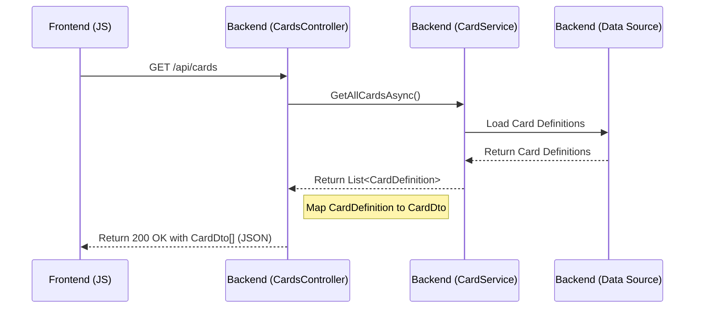

# API 文档: CardsController V1.0

**版本:** 1.0
**日期:** 2025-05-26
**作者:** Roo (AI Assistant)

## 1. 概述

该 API Controller 旨在提供一个标准化的接口，供前端或其他客户端获取游戏中的卡牌定义数据。这有助于将静态卡牌数据的检索与实时的游戏逻辑（通过 SignalR 处理）分离开来。

## 2. 设计目标

- 提供一个简单、高效的方式来获取所有可用的卡牌定义。
- 遵循 RESTful API 设计原则。
- 易于前端调用和处理返回的数据。

## 3. 端点定义

### 3.1 获取所有卡牌定义

- **HTTP 方法:** `GET`
- **路径:** `/api/cards`
- **认证:** 无 (当前阶段)
- **描述:** 返回系统中所有卡牌的定义列表。
- **请求参数:** 无
- **成功响应:**
  - **状态码:** `200 OK`
  - **内容类型:** `application/json`
  - **响应体 (示例):**
    ```json
    [
      {
        "id": "card001",
        "name": "哥布林",
        "cost": 1,
        "attack": 1,
        "health": 2,
        "rarity": "Bronze",
        "type": "Follower",
        "trait": "Goblin",
        "description": "一个普通的哥布林。",
        "flavorText": "嘎！"
      },
      {
        "id": "card002",
        "name": "天使的祝福",
        "cost": 2,
        "attack": 0, // 法术通常没有攻击力
        "health": 0, // 法术通常没有生命值
        "rarity": "Silver",
        "type": "Spell",
        "trait": "",
        "description": "使一个友方随从获得+0/+1。",
        "flavorText": "愿圣光忽悠着你。"
      }
      // ... more cards
    ]
    ```
  - **注意:** 响应体中的具体字段将基于 `Shared/Dtos/CardDto.cs` (或类似的 DTO) 定义。我们需要确保有一个合适的 `CardDto` 来表示返回给前端的卡牌信息。
- **失败响应:**
  - **状态码:** `500 Internal Server Error` (如果后端服务出错)
  - **响应体 (示例):**
    ```json
    {
      "message": "An error occurred while retrieving card definitions."
    }
    ```

## 4. 后端实现细节

- 创建一个新的 Controller 类 `CardsController` 在 `Server/Controllers` 目录下。
- 该 Controller 继承自 `ControllerBase`。
- 使用构造函数注入 `ICardService`。
- 实现一个名为 `GetAllCards` 的 `async Task<ActionResult<IEnumerable<CardDto>>>` 方法，并用 `[HttpGet]` 属性标记。
- 在方法内部，调用 `_cardService.GetAllCardsAsync()`。
- **重要:** 需要将 `CardDefinition` (领域模型) 映射到 `CardDto` (数据传输对象)。这可能需要 AutoMapper 或手动映射。如果 `CardDto` 不存在或不合适，需要创建/修改它。
- 处理可能的异常，并返回适当的 HTTP 状态码。

## 5. 交互流程图 (Mermaid)



## 6. 前端调用示例 (JavaScript)

```javascript
async function fetchCardDefinitions() {
  try {
    const response = await fetch("/api/cards"); // Adjust path based on actual routing
    if (!response.ok) {
      throw new Error(`HTTP error! status: ${response.status}`);
    }
    const cards = await response.json();
    console.log("Card definitions:", cards);
    // Process card data (e.g., update UI)
    return cards;
  } catch (error) {
    console.error("Failed to fetch card definitions:", error);
    // Handle error (e.g., show message to user)
    return null;
  }
}

// Call the function when needed, e.g., on page load
// fetchCardDefinitions();
```
