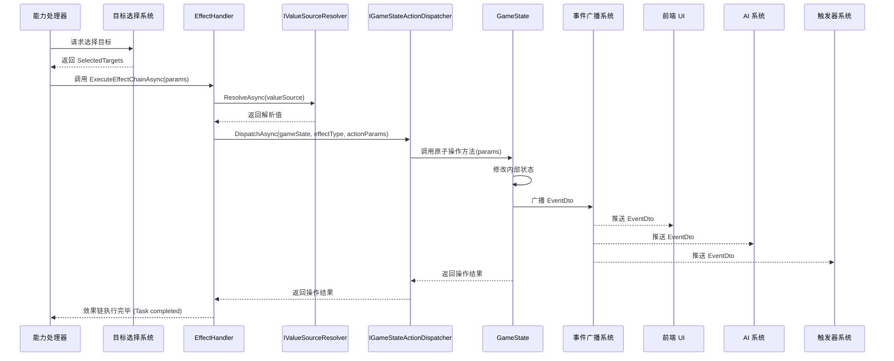

# M12: 效果系统设计 V1.1 (修订版)

## 1. 概述

本文档旨在详细描述卡牌能力系统中 **效果 (Effect)** 部分的设计。效果系统是卡牌能力产生实际游戏影响的核心机制。它接收由目标选择系统确定的目标，并根据预定义的规则，**通过调用游戏状态 (`GameState`) 的原子操作方法来修改状态，并触发相应的事件广播**。

本设计遵循反馈意见，将效果的执行直接映射到游戏的核心原子操作上，强调事件驱动和 `GameState` 的核心职责。

效果系统的主要目标是：

*   **定义标准效果意图:** 通过 JSON 配置中的 `effectType` 来清晰地表达卡牌能力想要执行的游戏操作意图（如造成伤害、抽牌、召唤等）。
*   **配置驱动:** 允许通过数据配置（如 JSON）灵活地定义和组合效果意图，便于卡牌设计和平衡。
*   **可扩展性:** 易于通过添加新的 `GameState` 原子操作方法和更新效果处理器来支持新的效果类型。
*   **状态管理中心化:** 确保所有状态修改都通过 `GameState` 的方法进行，保证状态一致性和封装性。
*   **事件驱动:** `GameState` 的原子操作方法负责在状态修改后触发精确的 `EventDto`，供前端 UI 和后端其他系统（如触发器）响应。
*   **流程控制:** 处理好单个能力包含多个效果时的执行顺序和失败处理。

## 2. 核心概念与设计原则 (修订)

### 2.1 核心概念 (修订)

*   **效果配置 (Effect Configuration):** 描述效果意图的数据结构，通常使用 JSON 定义。包含效果类型 (`effectType`) 和该类型所需的参数（如伤害值、召唤的卡牌 ID、要修改的属性等）。能力的 `effects` 字段是一个效果配置对象的数组。
*   **效果处理器 (Effect Handler):** 负责解析效果配置数组，计算动态参数（如 `valueSource`），并将每个效果意图映射到对 `GameState` 原子操作方法的调用。它是连接能力定义和游戏状态修改的桥梁。
*   **效果执行参数 (Effect Execution Parameters / Context):** 执行效果链时所需的环境信息，传递给 `EffectHandler`，至少包含当前游戏状态引用、能力来源卡牌、来源玩家、已选定的目标列表 (`IEnumerable<TargetId>`) 以及可能的中间变量 (`AbilityVariables`)。
*   **游戏状态原子操作 (`GameState` Atomic Action Method):** `GameState` 对外提供的、用于执行单一、不可分割的游戏逻辑操作的方法。例如 `DealDamage()`, `PlayerDrawCard()`, `SummonUnit()`, `ModifyStats()`。这些方法内部负责状态修改和触发相应的 `EventDto`。
*   **状态变更事件 DTO (`EventDto`):** 由 `GameState` 原子操作方法触发并广播的数据传输对象，用于通知前端和其他后端系统发生了具体的状态变化。例如 `DamageDealtEventDto`, `CardDrawnEventDto`, `CardSummonedEventDto`。

### 2.2 设计原则 (修订)

*   **配置驱动 (Configuration-Driven):** 效果意图通过 JSON 配置定义。
*   **原子操作封装 (Atomic Action Encapsulation):** 核心游戏逻辑（状态修改 + 事件广播）封装在 `GameState` 的原子操作方法中。
*   **关注点分离 (Separation of Concerns):**
    *   能力定义（JSON）与效果执行逻辑分离。
    *   `EffectHandler` 负责解析、参数计算、流程控制和方法映射。
    *   `GameState` 负责具体的状态修改和事件广播。
*   **可扩展性 (Extensibility):** 通过添加 `GameState` 原子操作方法和更新 `EffectHandler` 来扩展。
*   **状态一致性 (State Consistency):** 所有状态修改通过 `GameState` 进行，保证一致性。
*   **事件驱动 (Event-Driven):** 游戏逻辑的推进和系统解耦依赖于 `GameState` 触发的 `EventDto`。
*   **明确性与健壮性 (Explicitness & Robustness):** 效果配置应清晰。`EffectHandler` 和 `GameState` 方法需要处理无效参数或执行失败的情况。
*   **顺序与依赖处理 (Order & Dependency Handling):** `EffectHandler` 负责按顺序处理效果数组，并可以通过 `AbilityVariables` 处理效果间的依赖。

## 3. 数据结构定义 (修订)

本节定义效果系统相关的核心数据结构。**注意：不再定义 `IEffect` 接口。**

### 3.1 效果执行参数 (EffectExecutionParams - 示例)

这是一个可能的参数对象，用于将上下文信息传递给 `EffectHandler`。具体结构可根据实现调整。

```csharp
using System;
using System.Collections.Generic;

/// <summary>
/// 传递给效果处理器以执行效果链的参数集合。
/// </summary>
public class EffectExecutionParams
{
    /// <summary>
    /// 当前的游戏状态引用。
    /// </summary>
    public GameState CurrentGameState { get; }

    /// <summary>
    /// 触发此效果的能力来源卡牌实例。
    /// </summary>
    public CardInstance SourceCard { get; }

    /// <summary>
    /// 控制来源卡牌的玩家控制器引用。
    /// </summary>
    public PlayerController SourcePlayerController { get; }

    /// <summary>
    /// 由目标选择系统确定的目标列表。
    /// </summary>
    public IEnumerable<TargetId> SelectedTargets { get; }

    /// <summary>
    /// 要执行的效果配置数组 (来自卡牌定义)。
    /// </summary>
    public IReadOnlyList<object> EffectConfigurations { get; } // 使用 object 或 JObject/JsonElement

    /// <summary>
    /// 触发此能力链的原始游戏事件 (可能为 null)。
    /// </summary>
    public IGameEvent? TriggeringEvent { get; }

    /// <summary>
    /// 与当前能力实例相关的变量集合 (可能为 null)。
    /// </summary>
    public AbilityVariables? AbilityVariables { get; }

    public EffectExecutionParams(
        GameState gameState,
        CardInstance sourceCard,
        PlayerController sourcePlayerController,
        IEnumerable<TargetId> selectedTargets,
        IReadOnlyList<object> effectConfigurations,
        IGameEvent? triggeringEvent = null,
        AbilityVariables? abilityVariables = null)
    {
        CurrentGameState = gameState ?? throw new ArgumentNullException(nameof(gameState));
        SourceCard = sourceCard ?? throw new ArgumentNullException(nameof(sourceCard));
        SourcePlayerController = sourcePlayerController ?? throw new ArgumentNullException(nameof(sourcePlayerController));
        SelectedTargets = selectedTargets ?? throw new ArgumentNullException(nameof(selectedTargets));
        EffectConfigurations = effectConfigurations ?? throw new ArgumentNullException(nameof(effectConfigurations));
        TriggeringEvent = triggeringEvent;
        AbilityVariables = abilityVariables;
    }
}
```

### 3.2 效果处理器 (EffectHandler - 概念)

`EffectHandler` 是一个逻辑组件（可以是一个类或一组方法），负责执行效果链。它不是一个简单的接口，而是包含具体处理逻辑的单元。

```csharp
// 概念性定义，具体实现可能不同
public class EffectHandler
{
    private readonly IValueSourceResolver _valueSourceResolver; // 用于解析 valueSource
    private readonly IGameStateActionDispatcher _gameStateDispatcher; // 用于调用 GameState 方法

    public EffectHandler(IValueSourceResolver valueSourceResolver, IGameStateActionDispatcher gameStateDispatcher)
    {
        _valueSourceResolver = valueSourceResolver;
        _gameStateDispatcher = gameStateDispatcher;
    }

    /// <summary>
    /// 异步执行效果链。
    /// </summary>
    public async Task ExecuteEffectChainAsync(EffectExecutionParams executionParams)
    {
        foreach (var effectConfig in executionParams.EffectConfigurations)
        {
            // 1. 解析 effectType 和参数 (包括 valueSource)
            string effectType = ParseEffectType(effectConfig); // 假设方法
            Dictionary<string, object> parameters = await ResolveParametersAsync(effectConfig, executionParams); // 假设方法

            // 2. 构造调用 GameState 原子操作所需的参数
            GameStateActionParameters actionParams = BuildActionParameters(
                effectType, parameters, executionParams.SelectedTargets,
                executionParams.SourceCard, executionParams.SourcePlayerController,
                executionParams.AbilityVariables); // 假设方法

            // 3. 调用 GameState 的原子操作方法 (通过调度器)
            bool success = await _gameStateDispatcher.DispatchAsync(
                                    executionParams.CurrentGameState,
                                    effectType, // 使用 effectType 作为方法标识
                                    actionParams);

            // 4. 处理 onFailure 策略
            if (!success)
            {
                string onFailure = ParseOnFailure(effectConfig); // 假设方法
                if (onFailure == "AbortChain")
                {
                    // Log failure
                    break; // 中断循环
                }
                // Handle Continue / LogWarning (可能记录日志)
            }
             // 注意：事件广播由 GameState 内部完成
        }
    }

    // --- 内部辅助方法 (示例) ---
    private string ParseEffectType(object config) { /* ... */ return ""; }
    private async Task<Dictionary<string, object>> ResolveParametersAsync(object config, EffectExecutionParams execParams)
    {
        // 这里会用到 _valueSourceResolver 来解析 config 中的 valueSource
        /* ... */
        return new Dictionary<string, object>();
    }
    private GameStateActionParameters BuildActionParameters(...) { /* ... */ return new GameStateActionParameters(); }
    private string ParseOnFailure(object config) { /* ... */ return "Continue"; }
}

// --- 辅助接口/类 (示例) ---

/// <summary>
/// 解析 ValueSource 配置以获取运行时值。
/// </summary>
public interface IValueSourceResolver
{
    Task<T> ResolveAsync<T>(object valueSourceConfig, EffectResolutionContext context);
}

/// <summary>
/// 解析 ValueSource 所需的上下文。
/// </summary>
public class EffectResolutionContext
{
     public GameState CurrentGameState { get; }
     public CardInstance SourceCard { get; }
     public PlayerController SourcePlayerController { get; }
     public IEnumerable<TargetId> SelectedTargets { get; }
     public AbilityVariables? AbilityVariables { get; }
     // ... 可能需要的其他信息
}


/// <summary>
/// 负责将 EffectHandler 的请求分派到具体的 GameState 方法。
/// 可以使用反射、字典映射或 Source Generators 实现。
/// </summary>
public interface IGameStateActionDispatcher
{
    Task<bool> DispatchAsync(GameState gameState, string actionName, GameStateActionParameters parameters);
}

/// <summary>
/// 传递给 GameState 原子操作方法的参数。
/// </summary>
public class GameStateActionParameters
{
    public IEnumerable<TargetId> Targets { get; set; }
    public CardInstance SourceCard { get; set; }
    public PlayerController SourcePlayer { get; set; }
    public AbilityVariables? Variables { get; set; }
    public Dictionary<string, object> ActionSpecificParams { get; set; } = new();
    // ... 可能需要的其他通用参数
}
```

--- (后续章节待补充) ---

## 4. JSON 配置结构 (基本不变)

JSON 配置结构的核心保持不变，`effects` 仍然是一个数组，每个元素是一个效果配置对象。

```json
// 示例：一个包含两个效果的能力配置片段
"abilities": [
  {
    "trigger": { ... },
    "condition": { ... },
    "targetSelector": { ... },
    "effects": [ // 效果数组，由 EffectHandler 按顺序处理
      {
        "effectType": "Damage", // 映射到 GameState.DealDamage(...)
        "description": "对目标造成等同于此卡牌攻击力的伤害",
        "amount": { // 由 EffectHandler 解析
          "type": "SourceCardProperty",
          "property": "Attack"
        },
        "damageType": "Effect", // 作为参数传递给 GameState.DealDamage
        "onFailure": "Continue" // 效果执行失败时的策略
      },
      {
        "effectType": "DrawCard", // 映射到 GameState.PlayerDrawCard(...)
        "description": "抽一张牌",
        "count": 1, // 作为参数传递
        "onFailure": "AbortChain" // 如果抽牌失败，中止后续效果
      }
    ]
  }
]
```

**关键变化:** `effectType` 现在直接关联到一个 `GameState` 的原子操作方法，而不是一个 `IEffect` 实现。

通用字段如 `description`, `valueSource`, `onFailure` 的定义和作用保持不变，但它们的处理者现在是 `EffectHandler`。

### 4.1 通用能力/效果链控制字段 (新增)

除了每个具体效果 (`effectType`) 自身的参数外，可以在能力级别或效果链的顶层定义以下通用控制参数，由卡牌设计者填写，使用更符合编程习惯的命名：

*   **`executionContext`** (string, optional, default: `"Self"`): 指定能力执行的上下文视角。
    *   `"Self"`: 表示由拥有该卡牌能力的角色（或其控制器）作为基准视角。
    *   `"Opponent"`: 表示由对手作为基准视角。
    *   **处理:** 该参数主要影响能力处理器构建 `EffectExecutionParams` 时的上下文（如确定 `SourcePlayerController`），并可能影响目标选择和 `ValueSource` 中对“我方”/“敌方”的解析。`EffectHandler` 本身通常不直接处理此参数，而是依赖传入的上下文。
*   **`suppressLog`** (boolean, optional, default: `false`): 控制此能力产生的效果相关的事件是否应抑制日志记录或前端显示。
    *   `true`: 抑制。
    *   `false`: 不抑制。
    *   **处理:** 此标志应随上下文传递，最终由 `GameState` 的原子操作方法在生成 `EventDto` 时包含进去，供日志系统或 UI 判断是否显示。
*   **`repeatCount`** (integer or ValueSource, optional, default: 1): 指定整个效果链需要重复执行的次数。
    *   值必须大于等于 1。
    *   **处理:** 由 `EffectHandler` 在 `ExecuteEffectChainAsync` 的外层处理。它会循环执行效果链 `repeatCount` 次。需要明确每次重复时，上下文（特别是目标 `SelectedTargets` 和 `AbilityVariables`）是否需要重新评估（这会显著增加复杂性，初始可假定不重评，使用首次确定的目标和累积的变量）。
*   **`chainedAbilityId`** (string or int, optional, default: null): 指定当前效果链成功执行完毕后要接续触发的另一个能力的 ID。
    *   当当前效果链成功执行完毕后（未被 `AbortChain` 中断），如果 `chainedAbilityId` 有效，`EffectHandler` (或能力处理器) 会尝试触发并执行 ID 对应的附加能力/效果链。
    *   **处理:** 由 `EffectHandler` 或更高层级的能力处理器在主效果链成功结束后处理。需要定义如何查找和执行附加能力，以及如何传递上下文（是沿用当前上下文，还是重新触发完整的能力流程？初始可假定沿用大部分上下文，但可能需要重新选择目标）。

**注意:** 这些通用控制参数通常定义在卡牌 JSON 的能力对象层级，与 `trigger`, `condition`, `targetSelector`, `effects` 平级，或者作为 `effects` 数组的元数据。具体放置位置需在整体卡牌数据结构中统一规定。

### 4.2 单个效果的通用字段

以下字段定义在 `effects` 数组内的每个效果对象上：

*   `effectType` (string, required): 效果的类型标识符。**必须**对应一个 `GameState` 中的原子操作方法或 `EffectHandler` 中可识别的特殊处理逻辑。
*   `description` (string, optional): 效果的文本描述，用于卡牌描述生成或调试。
*   `parameters` (object, optional): 包含效果所需的具体参数。参数的结构和内容由 `effectType` 决定。**推荐将所有效果特定参数放入此对象内**，以保持结构清晰。
*   `valueSource` (object, optional): 用于动态计算 `parameters` 中某个参数值的配置。详见 M10 条件系统中的 `ValueSource` 设计。由 `EffectHandler` 在调用 `GameState` 方法前解析。
*   `onFailure` (string, optional): 当此效果执行失败时（例如，`GameState` 方法返回 `false` 或抛出异常），`EffectHandler` 应采取的策略。
    *   `Continue` (默认): 记录警告日志，继续执行效果链中的下一个效果。
    *   `AbortChain`: 记录错误日志，并立即停止执行当前能力效果链中的所有后续效果。
    *   `AbortAbility`: (未来可能) 记录错误日志，并中止整个能力的执行（可能涉及回滚等复杂逻辑，暂不实现）。

### 4.3 常见效果类型示例 (映射至 GameState 方法)

以下是一些常见效果类型及其可能的参数，以及它们预期映射到的 `GameState` 原子操作方法：

*   **`Damage`**: 对目标造成伤害。
    *   `amount` (int or ValueSource): 伤害数值。
    *   `damageType` (string, e.g., "Attack", "Effect", "Spell"): 伤害类型。
    *   **映射:** `GameState.DealDamage(target, amount, damageType, sourceCard, ...)`
*   **`Heal`**: 恢复目标生命值。
    *   `amount` (int or ValueSource): 治疗数值。
    *   **映射:** `GameState.RestoreHealth(target, amount, sourceCard, ...)`
*   **`DrawCard`**: 使玩家抽牌。
    *   `player` ("Source", "Opponent"): 指定哪个玩家抽牌。
    *   `count` (int or ValueSource): 抽牌数量。
    *   **映射:** `GameState.PlayerDrawCard(player, count, sourceCard, ...)`
*   **`Summon`**: 召唤单位到战场。
    *   `cardId` (int or ValueSource): 要召唤的卡牌定义 ID。
    *   `zone` ("PlayerBoard", "OpponentBoard"): 召唤到哪个区域。
    *   `position` (int, optional): 召唤位置（如果需要）。
    *   **映射:** `GameState.SummonUnit(cardId, ownerPlayer, zone, position, sourceCard, ...)`
*   **`ModifyStats`**: 修改单位或玩家的属性。
    *   `targetProperty` (string, e.g., "Attack", "MaxHealth", "CurrentHealth", "MaxPP", "CurrentPP"): 要修改的属性。
    *   `modificationType` ("Set", "Add", "Subtract"): 修改方式。
    *   `value` (int or ValueSource): 修改的值。
    *   `duration` ("Permanent", "EndOfTurn", ...): 效果持续时间（如果不是永久）。
    *   **映射:** `GameState.ModifyStat(target, property, modType, value, duration, sourceCard, ...)`
*   **`Destroy`**: 破坏目标单位。
    *   **映射:** `GameState.DestroyUnit(target, sourceCard, ...)`
*   **`Discard`**: 使玩家弃牌。
    *   `player` ("Source", "Opponent"): 指定玩家。
    *   `targetCards` ("Random", "LowestCost", "HighestCost", "Selected"): 弃牌目标选择方式。
    *   `count` (int or ValueSource): 弃牌数量。
    *   **映射:** `GameState.PlayerDiscardCard(player, targetType, count, sourceCard, ...)`
*   **`AddKeyword` / `RemoveKeyword`**: 添加或移除关键词（如守护、突进）。
    *   `keyword` (string): 关键词标识。
    *   `duration` ("Permanent", "EndOfTurn", ...): 持续时间。
    *   **映射:** `GameState.AddKeyword(target, keyword, duration, sourceCard, ...)` / `GameState.RemoveKeyword(target, keyword, sourceCard, ...)`
*   **`Transform`**: 将一个单位变形为另一个单位。
    *   `targetCardId` (int or ValueSource): 变形后的卡牌定义 ID。
    *   **映射:** `GameState.TransformUnit(target, targetCardId, sourceCard, ...)`
*   **`ReturnToHand`**: 将战场上的单位移回手牌。
    *   **映射:** `GameState.ReturnUnitToHand(target, sourceCard, ...)`
*   **`Banish`**: 将单位或护符移出游戏。
    *   **映射:** `GameState.BanishEntity(target, sourceCard, ...)`

**注意:** 上述 `GameState` 方法签名仅为示例，实际实现需要根据 `GameState` 的具体设计来确定。`EffectHandler` 的职责是根据 `effectType` 和参数，正确地调用这些方法。

## 5. 效果执行流程与实现策略 (修订)

本节描述效果系统处理和执行效果配置的修订后流程。

### 5.1 整体流程 (修订)

能力处理器在条件满足、目标选定后，将效果配置数组 (`effects`) 和必要的上下文信息打包成 `EffectExecutionParams`，传递给 `EffectHandler`。`EffectHandler` 负责驱动整个效果链的执行。

```mermaid
graph TD
    A[能力触发/条件满足/目标选定] --> B{构建 `EffectExecutionParams` (含通用控制参数)};
    B --> C[调用 `EffectHandler.ExecuteEffectChainAsync(params)`];
    C --> C_Repeat{`EffectHandler`: 处理 `repeatCount` 循环};
    C_Repeat -- 开始/继续循环 --> D{`EffectHandler`: 遍历 `effects` 数组};
    D --> E{`EffectHandler`: 对当前 `effectConfig`};
    E --> F[`EffectHandler`: 解析 `effectType`];
    F --> G[`EffectHandler`: 解析参数 (含 `valueSource` 解析)];
    G --> H[`EffectHandler`: 构建 `GameStateActionParameters` (含 `suppressLog` 标志)];
    H --> I[`EffectHandler`: 调用 `IGameStateActionDispatcher.DispatchAsync(gameState, effectType, actionParams)`];
    I --> J{`GameStateDispatcher`: 查找并调用对应的 `GameState` 原子操作方法};
    J --> K[`GameState`: 执行原子操作 (修改状态)];
    K --> L[`GameState`: 创建 `EventDto` (考虑 `suppressLog` 标志)];
    L --> L_Broadcast[`GameState`: 触发事件广播 (可能根据 `suppressLog` 决定是否广播给特定监听者)];
    L_Broadcast --> M{`GameState`: 返回操作结果 (成功/失败)};
    M --> N{`GameStateDispatcher`: 返回结果给 `EffectHandler`};
    N --> O{`EffectHandler`: 检查结果和 `onFailure` 策略};
    O -- Success or Continue --> P{还有下一个效果?};
    P -- Yes --> D;
    P -- No --> C_Repeat_Next{当前循环结束，还有下一次循环?};
    C_Repeat_Next -- Yes --> D;  // 开始下一次循环
    C_Repeat_Next -- No --> C_Chain{`EffectHandler`: 检查 `chainedAbilityId`};
    C_Chain -- 有 Chained Ability --> C_Chain_Exec[触发执行 Chained Ability (新流程)];
    C_Chain -- 无 Chained Ability --> Q[效果链执行完毕];
    O -- Failure and AbortChain --> Q; // 中断整个循环和后续 Chained Ability

    subgraph ValueSource 解析
        direction LR
        G_Resolve[`EffectHandler`: 调用 `IValueSourceResolver.ResolveAsync`]
        G_Resolve --> G_Context[构建 `EffectResolutionContext`]
        G_Context --> G_Resolver[执行 `ValueSource` 逻辑]
        G_Resolver --> G_Result[返回值]
    end
    G --> G_Resolve;
    G_Result --> H;

    subgraph GameState 原子操作内部
        direction TB
        K_State[修改内部状态变量]
        K_State --> K_Event[创建 `EventDto` 实例 (包含 `suppressLog` 标志)]
        K_Event --> K_Broadcast[调用事件总线/SignalR广播 `EventDto` (广播器可根据标志过滤)]
        K_Broadcast --> K_Return[返回操作结果]
    end
    K --> K_State;
    K_Return --> M;

    style K fill:#ccffcc,stroke:#333
    style L fill:#ccffcc,stroke:#333
    style M fill:#ccffcc,stroke:#333
```

### 5.2 `EffectHandler` 实现策略 (修订)

*   **核心职责:**
    *   **处理 `repeatCount`:** 在外层循环中执行效果链 `repeatCount` 次 (次数可能由 `ValueSource` 解析得到)。需要确定每次循环是否重新评估上下文（目标、变量）。
    *   **迭代效果数组:** 在每次循环内部，按顺序迭代处理 `EffectExecutionParams.EffectConfigurations`。
    *   **解析与计算:** 对每个 `effectConfig`，解析 `effectType` 和所有参数，使用 `IValueSourceResolver` 解析 `valueSource`。
    *   **构建参数:** 构建 `GameStateActionParameters`，**包含从 `AbilityControlParams` 传入的 `suppressLog` 标志**。
    *   **分派执行:** 使用 `IGameStateActionDispatcher` 将请求分派给 `GameState` 原子操作。
    *   **处理失败:** 根据返回值和 `onFailure` 策略决定是继续、中止当前循环，还是中止整个 `repeatCount` 循环 (`AbortChain` 会中止整个循环)。
    *   **处理 `chainedAbilityId`:** 在所有 `repeatCount` 循环成功完成后（未被 `AbortChain` 中断），检查是否存在 `chainedAbilityId`。如果存在，则触发执行后续的能力链（这可能需要调用能力处理器或自身递归，需明确上下文传递规则）。
    *   (可选) 维护 `AbilityVariables`。
*   **依赖注入:** `EffectHandler` 应通过依赖注入获取 `IValueSourceResolver` 和 `IGameStateActionDispatcher` 的实例 (以及可能的 `IAbilityRepository` 用于查找 Chained Ability)。
*   **错误处理:** 需要健壮地处理各种错误，并根据 `onFailure` 策略执行。

### 5.3 `IValueSourceResolver` 实现

*   职责是根据 `valueSource` 配置和当前的 `EffectResolutionContext` 计算出具体的值。
*   需要支持 M10 中定义的各种 `ValueSource` 类型（如 `Constant`, `SourceCardProperty`, `TargetProperty`, `PlayerProperty`, `Variable`, `Calculation` 等）。
*   实现应是异步的 (`Task<T> ResolveAsync<T>(...)`)，因为某些值的获取可能涉及异步操作（虽然在此模型下可能性较小）。

### 5.4 `IGameStateActionDispatcher` 实现

*   **职责:** 解耦 `EffectHandler` 和具体的 `GameState` 类。接收 `effectType` (作为动作名称) 和参数，找到并调用 `GameState` 上对应的原子操作方法。
*   **实现方式:**
    *   **字典映射 (推荐):** 在启动时构建一个 `Dictionary<string, Func<GameState, GameStateActionParameters, Task<bool>>>`。Key 是 `effectType`，Value 是一个委托，该委托封装了对相应 `GameState` 方法的调用。这是类型安全且性能较好的方式。
    *   **反射:** 在运行时根据 `effectType` 查找 `GameState` 上的方法并调用。性能较差，且容易出错。
    *   **Source Generators (高级):** 在编译时生成调度代码，性能最好，但实现复杂度较高。
*   **参数传递:** 需要将通用的 `GameStateActionParameters` 适配到具体 `GameState` 方法所需的参数列表。Dispatcher 或映射委托需要处理这个转换。

### 5.5 `GameState` 原子操作方法实现

*   **核心职责:**
    *   接收来自 `Dispatcher` 的调用和 `GameStateActionParameters`。
    *   执行单一、不可分割的游戏逻辑，直接修改 `GameState` 的内部状态。
    *   **创建 `EventDto` 时，应包含从 `GameStateActionParameters` 传入的 `suppressLog` 标志**。
    *   **调用事件广播器广播 `EventDto`。广播器或监听者可以根据 `suppressLog` 标志决定是否处理该事件（例如，日志系统或前端 UI 可以选择忽略 `suppressLog` 为 `true` 的事件）**。
    *   返回一个布尔值表示操作是否成功。失败的原因可能包括无效参数、不满足执行条件（如 PP 不足、目标无效）等。
    *   应尽量保持幂等性（如果可能且有意义），或者至少有明确的失败处理逻辑。
    *   方法应是同步或异步的 (`void` 或 `Task`)，取决于内部逻辑是否需要异步操作。Dispatcher 需要能处理这两种情况。
*   **示例 (`DealDamageEvent` 修订)**:
    ```csharp
    public partial class GameState // 使用 partial class 方便组织
    {
        // 假设注入了事件广播器
        // private readonly IEventBroadcaster _eventBroadcaster;

        // 示例原子操作
        public async Task<bool> DealDamageEvent(GameStateActionParameters actionParams)
        {
            // 1. 解析具体参数
            if (!actionParams.ActionSpecificParams.TryGetValue("amount", out var amountObj) || !(amountObj is int amount) || amount <= 0) return false; // 参数校验
            if (!actionParams.ActionSpecificParams.TryGetValue("damageType", out var damageTypeObj) || !(damageTypeObj is string damageType)) damageType = "Unknown";
            var targets = actionParams.Targets;
            var sourceCard = actionParams.SourceCard;
            bool suppressLog = actionParams.SuppressLog; // 获取 suppressLog 标志

            bool operationPerformed = false; // 标记是否至少执行了一次有效操作

            foreach (var targetId in targets)
            {
                // 2. 查找目标实体
                var targetEntity = FindEntityById(targetId); // 假设方法
                if (targetEntity == null || !targetEntity.IsDamageable()) continue; // 目标无效或不可伤害

                // 3. 计算最终伤害 (考虑护甲、效果等)
                int finalDamage = CalculateFinalDamage(amount, damageType, sourceCard, targetEntity); // 假设方法

                // 4. 修改目标状态 (例如扣血)
                int actualDamageDealt = targetEntity.TakeDamage(finalDamage); // 假设方法返回实际伤害

                if (actualDamageDealt > 0)
                {
                    operationPerformed = true; // 标记发生了有效伤害

                    // 5. 创建并广播 EventDto (包含 suppressLog 标志)
                    var eventDto = new DamageDealtEventDto
                    {
                        TargetId = targetId.Value,
                        Amount = actualDamageDealt,
                        SourceId = sourceCard?.InstanceId.Value ?? -1,
                        DamageType = damageType,
                        SuppressLog = suppressLog, // 传递标志
                        Timestamp = DateTime.UtcNow
                        // ... 可能还有剩余血量等信息
                    };
                    // 广播器或监听者可以根据 SuppressLog 决定如何处理
                    await _eventBroadcaster.BroadcastEventAsync(eventDto);
                }

                // 6. 检查目标是否死亡等后续处理 (可能触发其他事件)
                // 注意：死亡事件等也应考虑 suppressLog
                await CheckAndHandleDeath(targetEntity, sourceCard, suppressLog); // 假设方法也接收标志
            }
            // 返回 true 表示方法成功执行（即使没有造成伤害，只要流程没出错）
            // 或者可以根据 operationPerformed 返回，取决于业务定义
            return true;
        }

        // ... 其他原子操作方法 (同样需要考虑接收和处理 suppressLog) ...

        // 假设的死亡处理方法签名
        private async Task CheckAndHandleDeath(GameEntity targetEntity, CardInstance sourceCard, bool suppressLog)
        {
            if (targetEntity.IsDead()) // 假设方法
            {
                // ... 处理死亡逻辑 ...

                // 创建并广播死亡事件 DTO
                var deathEvent = new UnitDiedEventDto { /* ..., */ SuppressLog = suppressLog };
                await _eventBroadcaster.BroadcastEventAsync(deathEvent);
            }
        }
    }
    ```

## 6. 效果链的事务性与回滚

*   **当前设计不保证事务性:** 每个效果映射到的 `GameState` 原子操作是独立执行和提交的。如果效果链中间某个效果失败并选择 `AbortChain`，已经执行成功的效果**不会**自动回滚。

## 7. 与其它系统的交互 (修订)

效果系统作为能力执行的核心，与多个系统紧密交互：

*   **能力处理器 (Ability Processor):** 调用 `EffectHandler` 来执行效果链，并传递 `EffectExecutionParams`。
*   **目标选择系统 (Target Selection System):** 为 `EffectExecutionParams` 提供 `SelectedTargets`。
*   **条件系统 (Condition System):** (间接) 触发能力的条件判断发生在效果执行之前。`EffectHandler` 可能需要访问 `AbilityVariables`，这些变量可能由条件系统或之前的效果设置。
*   **游戏状态 (`GameState`):** `EffectHandler` 通过 `IGameStateActionDispatcher` 调用其原子操作方法来修改状态。`GameState` 是所有状态变更的最终执行者。
*   **事件广播系统 (Event Broadcasting System):** `GameState` 的原子操作方法在修改状态后，负责触发相应的 `EventDto`，通过此系统（如 SignalR Hub 或内部事件总线）广播出去。
*   **前端 UI:** 监听 `EventDto` 来更新界面显示。UI 可以检查 `EventDto.SuppressLog` 标志，并据此决定是否播放动画或更新特定显示元素（例如，某些内部机制或隐藏效果可能不需要对玩家可见的视觉反馈）。
*   **AI 系统:** (可能) 监听 `EventDto` 来更新其对游戏状态的认知。AI 也可以检查 `SuppressLog` 标志，以决定是否将该事件纳入其决策模型或内部日志。
*   **触发器系统 (Trigger System):** 监听 `EventDto`，作为触发新能力的输入（如“当一个友方随从死亡时...”）。触发器系统通常**应该忽略** `SuppressLog` 标志，因为它关心的是游戏状态的实际变化，无论该变化是否需要对外显式通知。
*   **(新增) 日志系统:** 监听 `EventDto` 用于记录游戏进程。日志系统可以配置为根据 `SuppressLog` 标志过滤日志条目，例如，将 `SuppressLog` 为 `true` 的事件记录为 Debug 或 Trace 级别，或者完全忽略它们，以保持核心游戏日志的清晰性。



## 8. 扩展性 (修订)

此设计的扩展性主要体现在以下方面：

*   **添加新效果类型:**
    1.  在 `GameState` 中实现新的原子操作方法，负责处理新效果的逻辑（状态修改 + 事件广播）。
    2.  (如果需要) 定义新的 `EventDto` 来表示新效果产生的状态变化。
    3.  更新 `IGameStateActionDispatcher` 的实现（例如，在字典映射中添加新的 `effectType` 到新 `GameState` 方法的映射）。
    4.  在卡牌定义的 JSON 中使用新的 `effectType` 和相应的参数。
    5.  (如果需要) 更新 `IValueSourceResolver` 以支持新效果可能需要的特殊值来源。
*   **修改现有效果:**
    *   如果只是调整参数或 `valueSource`，只需修改 JSON 配置。
    *   如果需要改变效果的核心逻辑，则修改 `GameState` 中对应的原子操作方法。确保修改后的方法仍然正确地触发事件。
*   **添加新的 `ValueSource` 类型:**
    *   在 `IValueSourceResolver` 接口和实现中添加对新类型的支持。
    *   更新 `EffectResolutionContext` 以包含解析新类型可能需要的额外信息。
*   **改进 `EffectHandler`:**
    *   可以增加更复杂的流程控制逻辑（如条件分支效果、循环效果等），但这会增加 `EffectHandler` 的复杂度。需要谨慎评估。
    *   可以引入插件式架构，允许动态加载处理特定 `effectType` 的逻辑（如果 `GameState` 原子操作不足以表达所有意图），但这会偏离当前设计的核心思想。

## 9. 未来考虑与优化方向 (修订)

*   **事务性与回滚:** 当前设计不支持效果链的原子性回滚。如果需要严格的事务性（例如，一个复杂能力要求所有效果要么全成功，要么全失败回滚），需要引入更复杂的机制，如命令模式 (Command Pattern) 结合 Memento 模式，或者状态快照与回滚。这会显著增加系统复杂度，需要根据实际需求权衡。
*   **性能优化:**
    *   `IGameStateActionDispatcher` 的实现对性能有影响。基于字典映射或 Source Generators 的方式优于反射。
    *   `IValueSourceResolver` 的实现也需要高效，避免在效果执行期间进行昂贵的计算。可以考虑缓存某些常用的计算结果。
    *   JSON 解析的开销：可以考虑在服务器启动时预解析卡牌定义，或使用更高性能的 JSON 库。
*   **复杂效果组合:** 对于需要多个原子操作组合才能实现的复杂效果（例如，“造成伤害，如果目标存活，则抽一张牌”），当前模型依赖于在 `effects` 数组中按顺序配置 "Damage" 和 "DrawCard"，并可能需要通过 `AbilityVariables` 传递中间状态（如目标是否存活）。或者，可以考虑在 `GameState` 中创建更高级别的、封装了这种组合逻辑的原子操作方法。
*   **可视化调试工具:** 开发一个工具，可以输入卡牌 ID 和模拟的游戏状态，可视化地展示能力触发、条件检查、目标选择和效果执行的完整流程及中间结果，将极大地帮助设计和调试。
*   **与动画系统的集成:** `EventDto` 是连接后端逻辑和前端动画的关键。需要确保 `EventDto` 包含了足够的信息，供前端精确地触发对应的视觉效果和时序。可能需要定义更细粒度的事件或在事件中加入动画提示。
*   **效果的并发处理:** 当前假设效果链是顺序执行的。如果未来需要支持并发效果（例如，多个单位同时触发亡语），需要仔细设计并发控制和状态同步机制。

## 6. 与其它系统的交互 (修订)

效果系统作为能力执行的核心，与多个系统紧密交互：

*   **能力处理器 (Ability Processor):** 调用 `EffectHandler` 来执行效果链，并传递 `EffectExecutionParams`。
*   **目标选择系统 (Target Selection System):** 为 `EffectExecutionParams` 提供 `SelectedTargets`。
*   **条件系统 (Condition System):** (间接) 触发能力的条件判断发生在效果执行之前。`EffectHandler` 可能需要访问 `AbilityVariables`，这些变量可能由条件系统或之前的效果设置。
*   **游戏状态 (`GameState`):** `EffectHandler` 通过 `IGameStateActionDispatcher` 调用其原子操作方法来修改状态。`GameState` 是所有状态变更的最终执行者。
*   **事件广播系统 (Event Broadcasting System):** `GameState` 的原子操作方法在修改状态后，负责触发相应的 `EventDto`，通过此系统（如 SignalR Hub 或内部事件总线）广播出去。
*   **前端 UI:** 监听 `EventDto` 来更新界面显示（如生命值变化、卡牌绘制动画、单位召唤/破坏特效）。
*   **AI 系统:** (可能) 监听 `EventDto` 来更新其对游戏状态的认知，或在某些事件发生时（如对手使用特定效果）调整策略。
*   **触发器系统 (Trigger System):** 监听 `EventDto`，作为触发新能力（如“当一个友方随从死亡时...”）的输入。


## 7. 扩展性 (修订)

此设计的扩展性主要体现在以下方面：

*   **添加新效果类型:**
    1.  在 `GameState` 中实现新的原子操作方法 `Event `，负责处理新效果的逻辑（状态修改 + 事件广播）。
    2.  (如果需要) 定义新的 `EventDto` 来表示新效果产生的状态变化。
    3.  更新 `IGameStateActionDispatcher` 的实现（例如，在字典映射中添加新的 `effectType` 到新 `GameState` 方法的映射）。
    4.  在卡牌定义的 JSON 中使用新的 `effectType` 和相应的参数。
    5.  (如果需要) 更新 `IValueSourceResolver` 以支持新效果可能需要的特殊值来源。
*   **修改现有效果:**
    *   如果只是调整参数或 `valueSource`，只需修改 JSON 配置。
    *   如果需要改变效果的核心逻辑，则修改 `GameState` 中对应的原子操作方法。确保修改后的方法仍然正确地触发事件。
*   **添加新的 `ValueSource` 类型:**
    *   在 `IValueSourceResolver` 接口和实现中添加对新类型的支持。
    *   更新 `EffectResolutionContext` 以包含解析新类型可能需要的额外信息。
*   **改进 `EffectHandler`:**
    *   可以增加更复杂的流程控制逻辑（如条件分支效果、循环效果等），但这会增加 `EffectHandler` 的复杂度。需要谨慎评估。
    *   可以引入插件式架构，允许动态加载处理特定 `effectType` 的逻辑（如果 `GameState` 原子操作不足以表达所有意图），但这会偏离当前设计的核心思想。

## 9. 未来考虑与优化方向 (修订)

*   **事务性与回滚:** 当前设计不支持效果链的原子性回滚。如果需要严格的事务性（例如，一个复杂能力要求所有效果要么全成功，要么全失败回滚），需要引入更复杂的机制，如命令模式 (Command Pattern) 结合 Memento 模式，或者状态快照与回滚。这会显著增加系统复杂度，需要根据实际需求权衡。
*   **性能优化:**
    *   `IGameStateActionDispatcher` 的实现对性能有影响。基于字典映射或 Source Generators 的方式优于反射。
    *   `IValueSourceResolver` 的实现也需要高效，避免在效果执行期间进行昂贵的计算。可以考虑缓存某些常用的计算结果。
    *   JSON 解析的开销：可以考虑在服务器启动时预解析卡牌定义，或使用更高性能的 JSON 库。
*   **复杂效果组合:** 对于需要多个原子操作组合才能实现的复杂效果（例如，“造成伤害，如果目标存活，则抽一张牌”），当前模型依赖于在 `effects` 数组中按顺序配置 "Damage" 和 "DrawCard"，并可能需要通过 `AbilityVariables` 传递中间状态（如目标是否存活）。或者，可以考虑在 `GameState` 中创建更高级别的、封装了这种组合逻辑的原子操作方法。
*   **可视化调试工具:** 开发一个工具，可以输入卡牌 ID 和模拟的游戏状态，可视化地展示能力触发、条件检查、目标选择和效果执行的完整流程及中间结果，将极大地帮助设计和调试。
*   **与动画系统的集成:** `EventDto` 是连接后端逻辑和前端动画的关键。需要确保 `EventDto` 包含了足够的信息，供前端精确地触发对应的视觉效果和时序。可能需要定义更细粒度的事件或在事件中加入动画提示。
*   **效果的并发处理:** 当前假设效果链是顺序执行的。如果未来需要支持并发效果（例如，多个单位同时触发亡语），需要仔细设计并发控制和状态同步机制。
