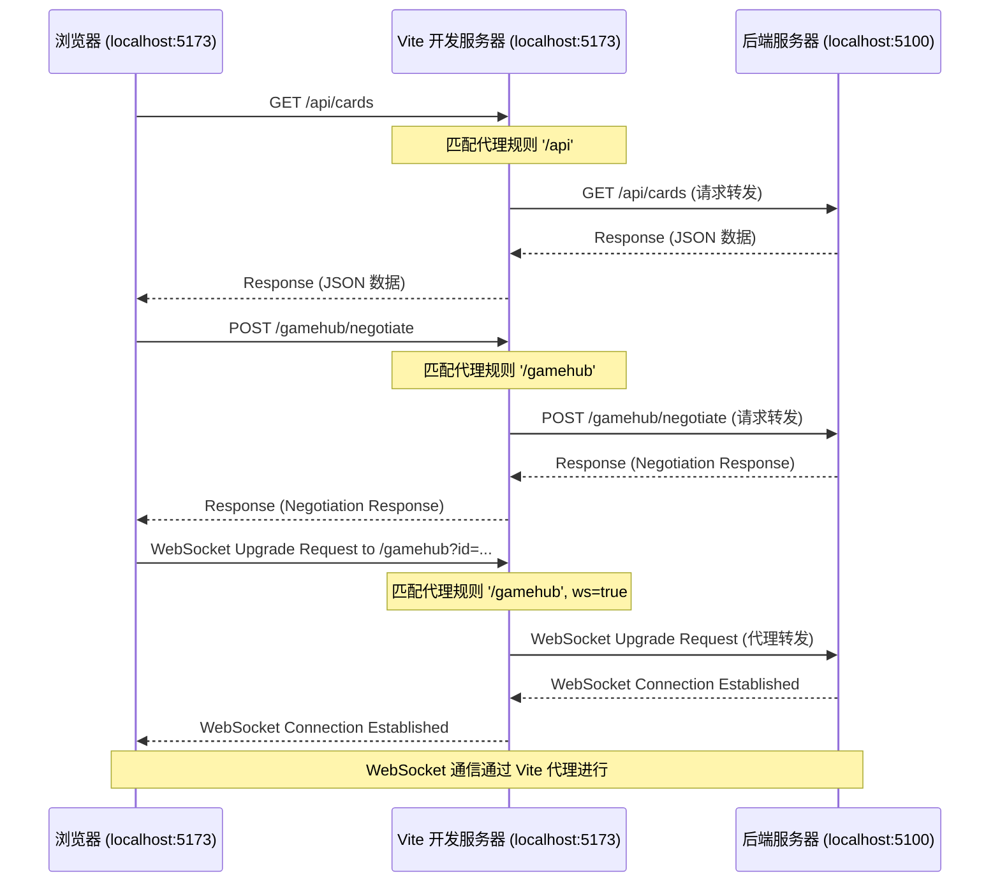

# M6: 构建工具与开发流程 - Vite 集成 V1.0

## 1. 背景与目标

随着项目发展，我们决定从 CDN 引入 SignalR 客户端库切换为使用 npm 包 `@microsoft/signalr`。然而，浏览器本身无法直接解析 `import * as signalR from "@microsoft/signalr";` 这样的裸模块导入语句（Bare Module Specifiers）。为了解决这个问题，并为未来可能的代码打包、优化、热更新等需求打下基础，我们引入了现代化的前端构建工具 Vite。

**目标:**

*   解决浏览器无法处理 npm 包导入的问题。
*   提供一个高效的本地开发服务器，支持快速的热模块替换 (HMR)。
*   建立代理机制，解决开发环境下前端（运行在 Vite Dev Server）访问后端 API 和 SignalR Hub（运行在 ASP.NET Core 服务器）时的跨域问题。
*   规范化前端开发流程。

## 2. 技术选型：Vite

Vite 是一个由 Vue.js 作者尤雨溪开发的下一代前端构建工具，以其 **极速的冷启动** 和 **闪电般的热更新** 而闻名。它利用了浏览器原生 ES Modules 支持和 esbuild（一个用 Go 编写的极速 JavaScript 打包器）来实现高性能。对于本项目，选择 Vite (Vanilla JS 模板) 的主要优势是：

*   **开箱即用:** 提供了合理的默认配置，上手简单。
*   **性能优异:** 开发服务器启动快，热更新迅速。
*   **强大的插件生态:** 未来可以方便地扩展功能。
*   **完善的代理支持:** 内建了强大的开发服务器代理功能，非常适合前后端分离的开发模式。

## 3. 集成步骤

### 3.1 初始化 Vite 项目

在项目根目录下执行以下命令，使用 Vite 的脚手架创建项目（我们选择原生 JavaScript 模板 `vanilla`）：

```bash
# 导航到项目根目录 (d:\workspace\Shadowverse-beyond)
npm create vite@latest . --template vanilla
# 或者（如果根目录已有文件会提示，可加 --force 覆盖，但需谨慎）
# npm create vite@latest frontend --template vanilla # 创建在 frontend 子目录中
# （根据实际操作调整，本项目是在根目录创建的）
```

这会生成或修改以下关键文件/目录：

*   `package.json`: 添加 Vite 相关的依赖和脚本。
*   `vite.config.js`: Vite 的主配置文件（如果不存在则创建）。
*   `index.html`: 项目的入口 HTML 文件（移到根目录）。
*   `main.js`: JavaScript 的入口文件（移到 `src` 目录）。
*   `style.css`: 默认样式文件（移到 `src` 目录）。
*   `public/`: 存放静态资源的目录（如 `favicon.ico`）。
*   `src/`: 存放源代码的目录。

*(注意: 上述文件结构变动基于将 Vite 直接初始化在项目根目录下的情况，如果选择创建在子目录如 `frontend`，则文件路径会有所不同。根据本项目实际情况，我们已将 `index.html` 放在根目录，`main.js` 和 `style.css` 放在 `src` 目录下)*

### 3.2 配置 `package.json`

确保 `package.json` 的 `scripts` 部分包含 Vite 的开发和构建命令：

```json
// package.json (部分)
"scripts": {
  "dev": "vite", // 启动开发服务器
  "build": "vite build", // 构建生产版本
  "preview": "vite preview" // 本地预览生产构建产物
},
"devDependencies": {
  "vite": "^5.x.x" // 确保已安装 Vite
},
"dependencies": {
  "@microsoft/signalr": "^8.x.x" // 确认 SignalR 客户端已作为依赖安装
  // ... 其他依赖
}
```

### 3.3 修改 `index.html`

将 `index.html` 中引用 JavaScript 的方式从传统的 `<script>` 改为指向 `src/main.js` 的 ES Module 类型脚本：

```html
<!doctype html>
<html lang="en">
  <head>
    <!-- ... meta tags, title, link to css ... -->
    <link rel="stylesheet" href="/src/style.css" /> <!-- Vite 会处理路径 -->
  </head>
  <body>
    <div id="app">
      <!-- 游戏界面元素 -->
    </div>
    <script type="module" src="/src/main.js"></script> <!-- 关键改动 -->
  </body>
</html>
```

### 3.4 配置开发服务器代理 (`vite.config.js`)

这是解决跨域问题的关键。我们需要配置 Vite 开发服务器，将特定路径的请求转发给实际的后端服务器。

**路径:** `vite.config.js`

**最终配置:**

```javascript
import { defineConfig } from 'vite';

export default defineConfig({
  server: {
    proxy: {
      // 规则 1: 代理所有以 /api 开头的请求到后端 API 服务器
      '/api': {
        target: 'http://localhost:5100', // 后端实际运行的 HTTP 地址
        changeOrigin: true, // 建议开启，应对虚拟主机场景
        // secure: false, // 由于目标是 HTTP，此选项不再需要且不应设置
        // 可选：重写路径 (如果前端路径与后端不完全一致)
        // rewrite: (path) => path.replace(/^\/api/, '')
      },
      // 规则 2: 代理 SignalR Hub (/gamehub) 的请求
      '/gamehub': {
        target: 'http://localhost:5100', // 同样指向后端 HTTP 地址
        ws: true, // **关键**: 必须设为 true 才能代理 WebSocket 连接
        changeOrigin: true,
        // secure: false, // 同样不需要
      }
    }
  }
});
```

**配置说明:**

*   `server.proxy`: 定义代理规则的对象。
*   **Key (`'/api'`, `'/gamehub'`):** 匹配请求路径的前缀。所有匹配此前缀的请求都会被代理。
*   **`target`**: 后端服务器的地址（协议 + 主机名 + 端口）。**务必确保这里填写的地址是后端 *实际* 监听的地址**。我们在调试中发现后端实际运行在 `http://localhost:5100` 而非最初假设的 `https://localhost:7097`。
*   **`changeOrigin: true`**: 修改请求头中的 `Origin` 字段，通常建议开启以避免某些服务器基于 Origin 的安全限制。
*   **`ws: true`**: **对于 SignalR 或其他 WebSocket 通信至关重要**。Vite 需要显式开启此选项才能正确代理 WebSocket 连接请求（包括初始的 `/negotiate` HTTP 请求和后续的 WS/WSS 连接）。

**请求流程 (启用代理后):**



## 4. 启动开发服务器

配置完成后，使用以下命令启动 Vite 开发服务器：

```bash
npm run dev
```

Vite 会启动一个本地服务器（通常在 `http://localhost:5173`），打开这个地址即可访问你的应用。任何对 `src/` 目录下文件的修改都会触发快速的热更新。

## 5. 遇到的问题及解决

*   **PowerShell 执行策略:** 在 Windows 上首次运行 npm 脚本可能遇到 PowerShell 执行策略限制，通过将 VS Code 默认终端切换到 Command Prompt (cmd.exe) 解决。
*   **代理目标地址错误:** 最初 `vite.config.js` 中 `target` 配置为 `https://localhost:7097`，导致 `ECONNREFUSED` 错误。通过检查确认后端实际运行地址为 `http://localhost:5100` 并修改配置解决。
*   **SignalR 连接 404:** 解决了 API 代理后，SignalR 连接失败（404 on `/gamehub/negotiate`）。原因是缺少针对 `/gamehub` 路径的代理规则。添加相应规则并设置 `ws: true` 解决。

## 6. 结论

通过引入 Vite 并正确配置其开发服务器代理，我们成功解决了前端使用 npm 包和与后端通信（包括 API 和 SignalR WebSocket）的问题，为后续开发奠定了更现代、更高效的基础。