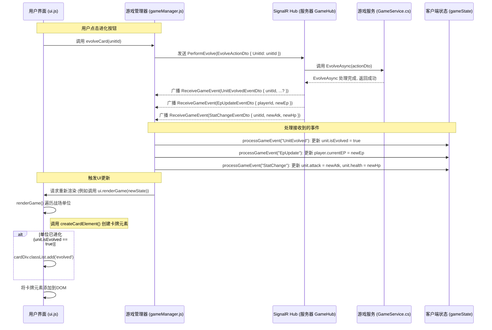

# M7.3 EvolveAsync 前端实现计划 V1.0

**目标:** 在前端实现单位进化 (Evolve) 功能的用户界面反馈和状态更新。

**关联任务:** M7.3 (项目整体任务清单)

**前置条件:**

- 后端 `EvolveAsync` 接口已实现并测试通过。
- SignalR 连接已建立，`ReceiveGameEvent` 和 `ReceiveError` 事件处理器已在 `src/main.js` 中注册。
- `src/gameManager.js` 中已存在 `evolveCard` 函数用于调用后端 `PerformEvolve` Hub 方法。
- `src/ui.js` 中已存在 `createCardElement` 函数用于动态生成卡牌 DOM，并存在触发进化的 UI 元素（如进化按钮）。
- 相关文件 (`src/main.js`, `src/gameManager.js`, `src/ui.js`, `index.html`, `style.css`, `文档/技术文档/M5_SignalR通信设计_V1.0.md`) 已分析。

**实现计划:**

1.  **处理 `UnitEvolved` 及相关事件 (`src/gameManager.js`)**:

    - **位置:** `processGameEvent` 函数。
    - **逻辑:**
      - 增加 `case` 处理 `eventType` 为 `"UnitEvolved"` 的事件。
      - 根据事件中的 `unitId` 在客户端 `gameState` (玩家或对手的 `field`) 中查找对应单位。
      - 更新单位状态: `unit.isEvolved = true`。
      - 增加 `case` 处理 `eventType` 为 `"EpUpdate"` 的事件。根据 `playerId` 和 `newEpValue` 更新 `gameState.players[playerId].currentEP`。
      - 增加 `case` 处理 `eventType` 为 `"StatChange"` 的事件（_假设后端会发送此事件来更新进化后的属性_）。根据 `unitId`, `newAttack`, `newHealth` 更新 `gameState` 中对应单位的 `attack` 和 `health`。
      - **注意:** 需要确认后端实际发送的事件类型和结构，特别是进化后属性更新的方式。如果 `UnitEvolvedEventDto` 本身就包含新属性，则合并处理逻辑。
    - **触发更新:** 确保在 `gameState` 更新后，调用 UI 渲染函数 (如 `ui.renderGame(gameState)`)。

2.  **添加 `.evolved` CSS 类 (`src/ui.js`)**:

    - **位置:** `createCardElement` 函数。
    - **逻辑:**
      - 在函数内部获取 `cardInstance` 数据后。
      - 添加判断: `if (cardInstance.isEvolved) { cardDiv.classList.add('evolved'); }`。

3.  **定义 `.evolved` 视觉样式 (`style.css`)**:

    - **位置:** 文件末尾添加新规则。
    - **目标:** 提供清晰的视觉区分。
    - **实现:**

      ```css
      /* 进化单位样式 */
      .card.evolved {
        border: 2px solid #8a2be2; /* 亮紫色边框 */
        box-shadow: 0 0 10px #8a2be2, inset 0 0 5px rgba(138, 43, 226, 0.3); /* 紫色辉光 + 轻微内阴影 */
        /* 可选：添加背景或图标 */
      }

      /* 可选：调整进化后属性显示样式 */
      .card.evolved .attack,
      .card.evolved .health {
        background-color: rgba(200, 150, 255, 0.9); /* 淡紫色背景 */
        color: #301934; /* 深紫色文字 */
        font-weight: bold; /* 确保加粗 */
      }
      ```

**设计可视化 (Sequence Diagram):**



**测试策略 (初步):**

- 启动后端服务。
- 启动前端页面。
- 手动操作使场上存在可进化的随从，并确保有足够的 EP。
- 点击进化按钮。
- **验证:**
  - 单位卡牌视觉效果是否按 `.evolved` 样式改变。
  - 单位卡牌上显示的攻击力/生命值是否更新。
  - 玩家信息区的 EP 显示是否减少。
  - 浏览器开发者工具控制台是否有错误。
  - (可选) 检查 SignalR 消息流。
