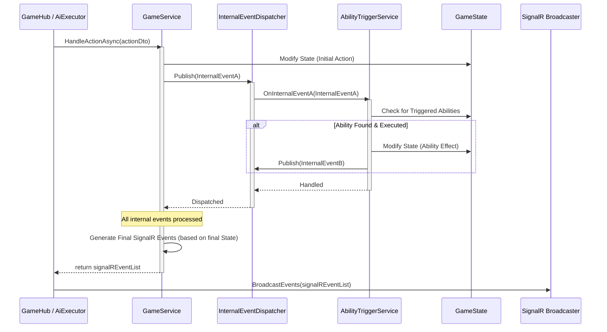
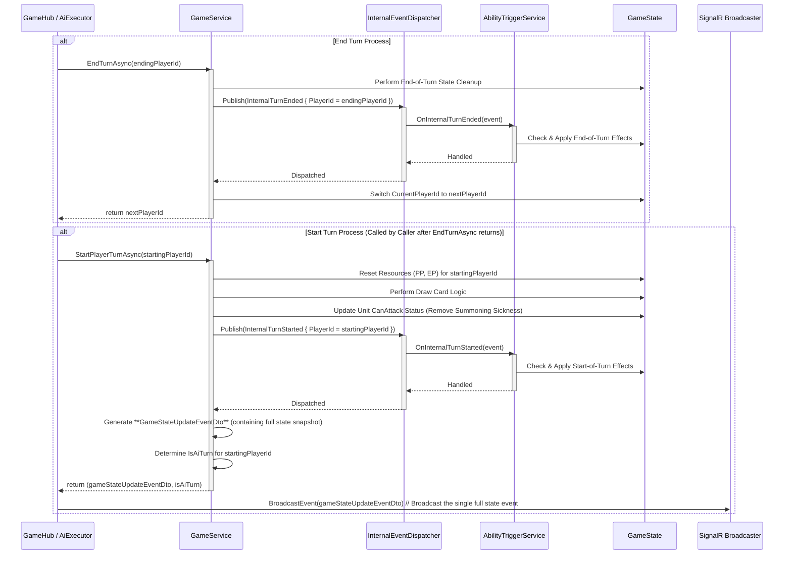

# M7: 核心动作处理与事件广播设计 V1.1

**版本:** 1.1 (引入混合同步策略相关调整)
**日期:** 2025-05-26
**负责人:** @Roo

## 1. 任务目标

本任务 (M7) 的目标是在 ASP.NET Core 后端实现游戏的核心玩家动作处理逻辑，包括**打出卡牌 (Play Card)**、**随从攻击 (Attack)**、**随从进化 (Evolve)** 和**结束回合 (End Turn)**。同时，建立一套基于离散事件的广播机制，通过 SignalR (`GameHub`) 将这些动作引发的游戏状态变更精确地通知给客户端，以替代之前可能存在的全量状态推送，提高系统的响应性、可扩展性和性能。

该任务是完成 M5 (SignalR 集成) 中“服务器动作处理待实现”部分的关键步骤，旨在恢复原版 JS Demo 的核心交互功能，并在新的技术架构下进行优化。

## 2. 影响范围

本次修改主要涉及以下组件：

- **Application Layer:**
  - [`Server/Application/Services/GameService.cs`](Server/Application/Services/GameService.cs): 将包含处理核心动作的核心逻辑，并负责生成事件列表。
  - [`Server/Application/Services/IGameService.cs`](Server/Application/Services/IGameService.cs): 需要添加处理新动作（攻击、进化）的方法。
- **Presentation Layer (SignalR):**
  - [`Server/Presentation/Hubs/GameHub.cs`](Server/Presentation/Hubs/GameHub.cs): 需要添加处理新动作 (`Attack`, `Evolve`) 的 `Invoke` 方法，并修改现有方法以接收和广播 `GameEventDto` 列表。
- **Domain/Application Layer (DTOs):**
  - `Server/Dtos/SignalR/Actions/`: 需要创建新的 Action DTO (`AttackActionDto.cs`, `EvolveActionDto.cs`) 并可能调整现有 DTO (`PlayCardActionDto.cs`, `EndTurnActionDto.cs`)。
  - `Server/Dtos/SignalR/Events/`: 需要创建或完善一系列 Event DTO (`GameEventDto.cs` 的子类) 以表示各种游戏状态变化 (e.g., `UnitAttackedEventDto.cs`, `DamageDealtEventDto.cs`, `UnitDestroyedEventDto.cs`, `UnitEvolvedEventDto.cs`, `PlayerHealthChangedEventDto.cs`, `EpChangedEventDto.cs` 等)。
- **相关文档:**
  - [`文档/项目整体任务清单.md`](文档/项目整体任务清单.md): 需要添加 M7 任务条目并更新状态。
  - [`文档/技术文档/M5_SignalR通信设计_V1.0.md`](文档/技术文档/M5_SignalR通信设计_V1.0.md): 可能需要更新以反映最终的事件驱动模型。
  - 各 AI 设计文档 (攻击、进化): 后续 AI 迁移时需参考此处的后端实现。
## 3. 核心架构修订 V1.1: 内部事件总线与能力触发

在 V1.0 的基础上，为了更好地实现卡牌能力（如入场曲、亡语、回合开始效果等）的触发机制，并将其与核心游戏动作逻辑解耦，我们引入**服务器内部事件总线 (Server-Internal Event Bus)** 架构。

**核心思想:**

1.  **内部事件 (Internal Events):** 当 `GameService` 执行核心动作（如出牌、攻击、回合转换）并改变游戏状态时，它会发布细粒度的、仅在服务器内部流转的“内部事件”（例如 `InternalUnitPlayed`, `InternalDamageDealt`, `InternalTurnStarted`）。这些事件封装了刚刚发生的游戏行为及其上下文信息。
2.  **事件分发器 (InternalEventDispatcher):** 一个中心化的服务，负责接收 `GameService` 发布的内部事件，并将它们分发给所有已注册的监听器。
3.  **事件监听器/能力触发服务 (Listeners / AbilityTriggerService):** 一个或多个服务（统称为 `AbilityTriggerService`）订阅它们感兴趣的内部事件。当接收到事件时，它们会检查当前游戏状态，查找是否有卡牌能力需要被触发。
4.  **能力执行与状态变更:** 如果监听到需要触发的能力，`AbilityTriggerService` 会执行该能力的效果。这可能直接修改游戏状态（通过 `GameActionContext` 或再次调用 `GameService` 的特定方法），或者发布新的内部事件（用于处理连锁触发）。
5.  **SignalR 事件广播:** 只有当一个核心动作及其引发的所有内部事件处理（包括所有能力触发和连锁反应）**全部完成**后，`GameService` 才会最终确定需要通知客户端的状态变化，并将这些变化聚合成一个或多个 SignalR 事件 DTO (`GameEventDto` 的子类，如 `GameStateUpdateEventDto`, `UnitAttackedEventDto` 等) 返回给调用者 (`GameHub` 或 `AiTurnExecutor`) 进行广播。SignalR 事件的主要目的是**通知客户端**发生了什么以及最终的游戏状态。

**优势:**

*   **解耦:** 将能力触发逻辑从核心动作处理中分离出来，使得 `GameService` 更专注于核心规则执行，`AbilityTriggerService` 专注于能力实现。
*   **可扩展性:** 添加新的能力或触发条件时，只需创建新的监听器或修改现有监听器，对 `GameService` 的改动较小。
*   **清晰性:** 事件驱动的模式更符合“当 X 发生时，执行 Y”的直观逻辑。
*   **服务器权威:** 所有逻辑和状态变更仍在服务器端完成，客户端仅接收通知。

**高层流程示意图:**



**后续章节将详细说明此架构如何应用于各个核心动作。**

## 4. 核心动作处理详解 (`GameService.cs`)

`GameService` 是游戏核心规则执行的中枢。它负责接收来自 `GameHub` 或 `AiTurnExecutor` 的动作请求（包装在 `GameActionContext` 中），验证动作合法性，修改核心游戏状态 (`GameStateDto`)，**发布内部事件**到 `InternalEventDispatcher`，并最终返回需要广播给客户端的 SignalR 事件列表 (`List<GameEventDto>`)。能力的触发和效果处理由监听内部事件的 `AbilityTriggerService` 负责。

### 4.1 结束回合与开始新回合 (`EndTurnAsync`, `StartPlayerTurnAsync`)

**注意:** 此处描述的是结合了内部事件总线架构后的设计。原 V2 计划中关于 `EndTurnAsync` 返回 `nextPlayerId` 和 `StartPlayerTurnAsync` 返回 `isAiTurn` 的设计，以及 `GameHub` 和 `AiTurnExecutor` 的调用流程，仍然有效，但 `GameService` 内部实现将调整为发布内部事件。

-   **`EndTurnAsync(context)`**:
    -   执行回合结束的必要状态清理。
    -   **发布 `InternalTurnEnded` 事件** (包含 `endingPlayerId`)，供 `AbilityTriggerService` 处理“回合结束时”效果。
    -   切换 `gameState.CurrentPlayerId` 到下一位玩家。
    -   **返回:** 下一位玩家的 ID (`nextPlayerId`)。 (此返回值主要用于 `GameHub` 或 `AiTurnExecutor` 判断下一步操作)
-   **`StartPlayerTurnAsync(context)`**:
    -   重置新回合玩家 (`startingPlayerId`) 的资源 (PP/EP)。
    -   执行抽卡逻辑。
    -   **更新单位攻击状态 (CanAttack 标志):** 在回合开始处理流程中，遍历当前回合玩家 (`startingPlayerId`) 战场上的所有单位 (`unit` in `PlayerState.Field`)。根据以下规则更新其 `CanAttack` 标志，此标志直接反映单位是否因召唤失调或其他持续效果而无法攻击：
        - **基础规则 (基于登场回合):**
            - 如果 `unit.TurnPlayed < currentGameTurnNumber` (单位在之前回合登场)，则该单位在本回合**失去召唤失调**，初步将 `CanAttack` 设为 `true`。
            - 如果 `unit.TurnPlayed == currentGameTurnNumber` (单位在本回合登场)，则该单位**具有召唤失调**，初步将 `CanAttack` 设为 `false`。
        - **特殊能力修正 (突进/疾驰):** 如果单位具有【突进】或【疾驰】能力，其 `CanAttack` 标志应被设置为 `true`，覆盖基础规则。（此修正可能在召唤时或此处应用）。
        - **负面效果修正:** 检查是否有效果（如“无法攻击”debuff）作用于单位。如果有，将 `CanAttack` 强制设置为 `false`，覆盖之前的状态。
    - **(建议) 日志记录:** 添加详细日志，记录每个单位 `CanAttack` 状态的最终确定值及其主要原因。
    -   **发布 `InternalTurnStarted` 事件** (包含 `startingPlayerId`)，供 `AbilityTriggerService` 处理“回合开始时”效果（例如，特定卡牌的回合开始抽卡、回费等）。
    -   **返回:** `(GameEventDto Event, bool IsAiTurn)`。**[修改]** `Event` 现在是单个 `GameStateUpdateEventDto` 实例，包含了回合开始时的完整游戏状态快照。客户端将使用此快照完全替换本地状态。`IsAiTurn` 指示新回合的玩家是否为 AI。
- **重要实现细节 (状态持久化):** 在方法返回前，必须确保对 `gameState` 对象及其内部状态（如单位的 `CanAttack` 标志）所做的所有修改都已显式地写回（持久化）到 `GameService` 的中央状态存储 (`_gameStates` 字典) 中。这通常需要在获取游戏锁 (`_gameLocks`) 的代码块内完成，以保证线程安全。**忽略此步骤是导致 BUG-017 的根本原因**，会导致后续操作（如 `AttackAsync`）读取到过时的状态。
**流程图 (结合内部事件总线):**



### 4.2 打出卡牌 (Play Card)
**注意:** 此处描述的是结合了内部事件总线架构后的 `HandlePlayCardAsync` 设计。

- **输入 DTO:** `PlayCardActionDto` (包含 `PlayerId`, `CardInstanceId` [修改], `TargetUid` (可选), `BoardIndex` (可选))
- **核心逻辑:**
  1.  **验证:**
      - 基础验证 (回合、PP、手牌存在性、战场空间、目标有效性等，与 V0.1 类似)。
  2.  **消耗 PP & 移除手牌:**
      - 修改 `PlayerState`。
      - **发布 `InternalPpChanged` 事件**。
      - **发布 `InternalCardRemovedFromHand` 事件**。
  3.  **根据卡牌类型处理:**
      - **随从 (Follower):**
          - 创建代表随从的 `CardInstance` 实例。
          - 添加到 `PlayerState.Field`。 [修改] 与 M5 DTO 对齐
          - **发布 `InternalCardSummoned` 事件** (包含 `CardInstance`, `PlayerId`, `Zone = Field`)。 [修改] 统一事件
            *   `AbilityTriggerService` 监听此事件，处理随从的“入场曲 (Fanfare)”效果。
            *   能力执行可能修改 `CardInstance` 或其他游戏状态，并可能发布新的内部事件 (如 `InternalDamageDealt`, `InternalStatChanged`)。 [修改]
      - **法术 (Spell):**
          - **发布 `InternalSpellPlayed` 事件** (包含 `CardDefinition`, `PlayerId`, `TargetInstanceId` (可选))。 [修改] 使用 InstanceId
            *   `AbilityTriggerService` 监听此事件，执行法术效果。
            *   法术效果执行可能修改游戏状态，并可能发布新的内部事件。
          - 将卡牌移至墓地。
          - **发布 `InternalCardMovedToGraveyard` 事件**。
      - **护符 (Amulet):**
          - 创建代表护符的 `CardInstance` 实例。
          - 添加到 `PlayerState.Field`。 [修改] 与 M5 DTO 对齐
          - **发布 `InternalCardSummoned` 事件** (包含 `CardInstance`, `PlayerId`, `Zone = Field`)。 [修改] 统一事件
            *   `AbilityTriggerService` 监听此事件，处理护符的入场效果或持续效果的启动。
  4.  **聚合 SignalR 事件:**
      - 在所有内部事件处理完毕后，根据最终的游戏状态，生成需要广播给客户端的 SignalR 事件列表 (`List<GameEventDto>`)。这可能包括 `PpUpdate`, `CardDrawn`, `CardSummonedEvent`, `SpellResolved`, `DamageDealt`, `StatChange`, `CardDestroyed`, `GraveyardUpdate`, `EpUpdate`, `CardEvolved` 等。 [修改] 更新事件列表
  5.  **返回:** `List<GameEventDto>`。

**流程图:**

```mermaid
sequenceDiagram
    participant Client // Renamed for clarity from Caller
    participant GameHub
    participant GameService
    participant InternalEventBus // Renamed for consistency
    participant AbilityTriggerService
    participant GameState
    participant SignalR as SignalR Broadcaster

    Client->>+GameHub: SendAction("PlayCard", { CardUid: "uid1", TargetInstanceId: "instanceId2" }) // Use CardUid for hand card, TargetInstanceId for target
    activate GameHub // Activate GameHub first
    GameHub->>+GameService: HandlePlayCardAsync(playCardDto { PlayerId="player1", CardUid="uid1", TargetInstanceId="instanceId2" }) // Pass DTO
    activate GameService
    GameService->>State: Validate Action (PP, Hand, Target, etc.)
    alt Action Valid
        GameService->>State: Consume PP, Remove Card from Hand
        GameService->>InternalEventBus: Publish(InternalPpChanged) // Use consistent name
        GameService->>InternalEventBus: Publish(InternalCardRemovedFromHand) // Add this event
        GameService->>State: Create CardInstance (based on CardUid, includes type) // Create instance early
alt 卡牌是随从或护符 (进入战场) // Unified path
        GameService->>State: 放入战场 (获取 InstanceId)
        GameService->>+InternalEventBus: Dispatch(new CardPlayedInternalEvent("player1", cardInstance, "instanceId2")) // 统一事件
        activate InternalEventBus
        InternalEventBus->>+AbilityTriggerService: Handle(event) // 处理入场效果等
        activate AbilityTriggerService
        AbilityTriggerService->>GameService: (可能触发其他效果) ApplyEffect(...)
        GameService->>State: (更新状态)
        AbilityTriggerService-->>-InternalEventBus: Done
        deactivate AbilityTriggerService
        InternalEventBus-->>-GameService: Done
        deactivate InternalEventBus
        GameService->>GameHub: Broadcast(new CardSummonedEventDto("player1", cardInstanceDto, CardZone.Field)) // M5 定义, 统一广播
    else 卡牌是法术 (结算效果) // Spell path
        GameService->>+InternalEventBus: Dispatch(new SpellPlayedInternalEvent("player1", cardDefinition, targetInstanceId)) // Use InstanceId
        activate InternalEventBus
        InternalEventBus->>+AbilityTriggerService: Handle(event) // 处理法术效果
        activate AbilityTriggerService
        AbilityTriggerService->>GameService: ApplyEffect(...) // 可能修改状态
        GameService->>State: (更新目标状态等)
        AbilityTriggerService-->>-InternalEventBus: Done
        deactivate AbilityTriggerService
        InternalEventBus-->>-GameService: Done
        deactivate InternalEventBus
        GameService->>State: 将卡牌移至墓地
        GameService->>InternalEventBus: Publish(InternalCardMovedToGraveyard)
        GameService->>GameHub: Broadcast(new SpellResolvedEventDto("player1", cardDefId, targetInstanceId)) // M7 定义
GameService->>GameService: Generate Final SignalR Events (PpUpdate, CardRemovedFromHand, CardEnteredField/SpellResolved, etc.)
    end // End of the main 'alt Action Valid' block


## 5. SignalR 事件 DTO 设计 (Event DTO Design)

SignalR 事件 DTO (`GameEventDto` 的子类) 是服务器向客户端传达游戏状态最终变化的载体。它们在 `GameService` 处理完一个核心动作及其引发的所有内部事件和能力触发后生成。

**设计原则:**
### 4.3 随从攻击 (Attack Unit / Player)
**注意:** 此处描述的是结合了内部事件总线架构后的 `HandleAttackAsync` 设计。

- **输入 DTO:** `AttackActionDto` (包含 `PlayerId`, `AttackerInstanceId` [修改], `DefenderInstanceId` (可选) [修改], `DefenderPlayerId` (可选)) - `DefenderInstanceId` 和 `DefenderPlayerId` 互斥。
- **核心逻辑:**
  1.  **验证:**
      - **验证攻击者状态:**
          - 攻击者 (`attacker`) 必须存在于场上且属于当前玩家。
          - **检查攻击许可:** 攻击者的 `CanAttack` 标志必须为 `true`。此标志已包含了召唤失调及其他相关效果的判断结果。
          - **检查攻击次数:** 攻击者的剩余攻击次数 (`attacker.AttacksMade`) 必须小于其每回合最大攻击次数 (`attacker.MaxAttacksPerTurn`)。
          - (可选) 检查是否有临时的、在攻击宣告时才生效的攻击限制效果。
      - **验证目标状态:**
          - 目标必须有效（存在于场上或为对方玩家）。
          - 如果目标是随从，检查【守护 (Ward)】。如果场上存在其他具有【守护】的敌方随从，则不能以非【守护】随从或玩家为目标（除非攻击者具有无视守护的能力）。
  2.  **标记已攻击:**
      - 修改攻击者 `CardInstance.CanAttack = false` (通常情况，除非有【突进】后可再动等特殊能力)。
  3.  **发布攻击前内部事件:**
      - **发布 `InternalBeforeAttack` 事件** (包含 `AttackerInstance`, `DefenderInstance` 或 `DefenderPlayerId`)。
        *   `AbilityTriggerService` 监听此事件，处理“攻击时”触发的能力（例如，增加攻击力）。能力执行可能修改攻击者/防御者状态。
  4.  **计算战斗伤害:**
      - 获取攻击者和防御者（随从或玩家）的当前攻击力和生命值（可能已被 `InternalBeforeAttack` 事件的能力修改）。
      - **防御者是随从:**
          - 防御者受到伤害 = 攻击者攻击力。
          - 攻击者受到伤害 = 防御者攻击力。
          - **发布 `InternalDamageDealt` 事件** (来源: 攻击者, 目标: 防御者, 数值: 攻击者攻击力)。
          - **发布 `InternalDamageDealt` 事件** (来源: 防御者, 目标: 攻击者, 数值: 防御者攻击力)。
      - **防御者是玩家:**
          - 玩家受到伤害 = 攻击者攻击力。
          - **发布 `InternalDamageDealt` 事件** (来源: 攻击者, 目标: 玩家, 数值: 攻击者攻击力)。
  5.  **处理伤害与状态变更 (由 `AbilityTriggerService` 监听 `InternalDamageDealt`):**
      - `AbilityTriggerService` 监听 `InternalDamageDealt` 事件。
      - 根据伤害数值修改目标 (`CardInstance` 或 `PlayerState`) 的生命值。
      - 检查是否有卡牌被破坏 (`Health <= 0`)。
      - **如果卡牌被破坏，发布 `InternalCardDestroyed` 事件** (包含被破坏的 `CardInstance`)。
      - 检查是否有玩家战败 (`Health <= 0`)。
      - **如果玩家战败，发布 `InternalPlayerDefeated` 事件**。
      - 处理其他伤害触发效果（例如，“受到伤害时...”）。
  6.  **发布攻击后内部事件:**
      - **发布 `InternalAfterAttack` 事件** (包含攻击者、防御者最终状态)。
        *   `AbilityTriggerService` 监听此事件，处理“攻击后”触发的能力。
  7.  **处理卡牌破坏 (由 `AbilityTriggerService` 监听 `InternalCardDestroyed`):**
      - `AbilityTriggerService` 监听 `InternalCardDestroyed` 事件。
      - 将被破坏的 `CardInstance` 从战场移除。
      - 将卡牌信息添加到墓地。
      - **发布 `InternalCardMovedToGraveyard` 事件**。
      - 处理“亡语 (Last Words)”效果。
  8.  **聚合 SignalR 事件:**
      - 在所有内部事件处理完毕后，根据最终的游戏状态，生成需要广播给客户端的 SignalR 事件列表。这可能包括 `StatChange`, `HealthChanged`, `CardAttacked` (包含双方最终状态), `PlayerAttacked` (包含最终状态), `CardDestroyed`, `GraveyardUpdate`, `PlayerDefeated` 等。
  9.  **返回:** `List<GameEventDto>`。

**流程图:**

```mermaid
sequenceDiagram
    participant Caller as GameHub / AiExecutor
    participant GameSvc as GameService
    participant Dispatcher as InternalEventDispatcher
    participant AbilitySvc as AbilityTriggerService
    participant State as GameState
    participant SignalR as SignalR Broadcaster

    Caller->>GameSvc: HandleAttackAsync(attackDto { AttackerInstanceId, DefenderInstanceId/PlayerId })
    activate GameSvc
    GameSvc->>State: Validate Action (CanAttack, Target Valid, Ward, etc.)
    alt Action Valid
        GameSvc->>State: Mark Attacker CanAttack = false
        GameSvc->>Dispatcher: Publish(InternalBeforeAttack { Attacker, Defender })
        activate Dispatcher
        Dispatcher->>AbilitySvc: OnInternalBeforeAttack(event) // Handle "Attack:" effects
        activate AbilitySvc
        AbilitySvc->>State: (Modify Attacker/Defender State if needed)
        AbilitySvc-->>Dispatcher: Handled
        deactivate AbilitySvc
        Dispatcher-->>GameSvc: Dispatched
        deactivate Dispatcher

        GameSvc->>GameSvc: Calculate Damage (Attacker vs Defender)
        alt

*   **反映最终状态:** DTO 应包含动作执行完毕后的最终相关状态，而不是中间过程。
*   **客户端友好:** DTO 的结构应便于客户端 (JavaScript) 解析和更新 UI。
*   **必要性:** 只包含客户端需要知道并据此更新 UI 的信息。避免发送不必要的内部细节。
*   **可扩展性:** 使用基类 `GameEventDto` 和清晰的命名，方便未来添加新的事件类型。

**关键事件 DTO 列表 (初步):**

以下是根据已讨论的核心动作和潜在能力效果初步设计的关键 SignalR 事件 DTO 列表。具体字段和结构可能在实现过程中进一步细化。所有 DTO 假定继承自一个包含 `EventType` 字符串或枚举的基础 `GameEventDto`。

*   **回合与资源:**
    *   `GameStateUpdateEventDto`: **[新增]** `FullGameState` (`GameStateDto`)。用于回合开始时发送完整状态快照。继承自 `GameEventDto`，`EventType` 为 "GameStateUpdate"。
    *   `TurnStartedEventDto`: **[弃用]** 由 `GameStateUpdateEventDto` 替代。
    *   `TurnEndedEventDto`: `PlayerId` (结束回合的玩家) (保留，用于标记回合结束动作)
    *   `PpUpdateEventDto`: `PlayerId`, `CurrentPP`, `MaxPP` (保留，用于回合中 PP 变化)
    *   `EpUpdateEventDto`: `PlayerId`, `CurrentEP`, `MaxEP` (保留，用于回合中 EP 变化)
*   **卡牌移动与状态:**
    *   `HandUpdateEventDto`: **[弃用]** 手牌状态包含在 `GameStateUpdateEventDto` 中。回合中的抽卡/弃牌由 `CardDrawnEventDto` / `CardDiscardedEventDto` (如果需要) 处理。
    *   `CardDrawnEventDto`: `PlayerId`, `DrawnCard` (`CardDto`, 仅对抽卡玩家可见), `IsMulliganPhase` (bool) (保留)
    *   `OpponentCardDrawnEventDto`: `PlayerId` (抽卡玩家), `IsMulliganPhase` (bool) (保留)
    *   `DeckUpdateEventDto`: `PlayerId`, `CurrentDeckCount` (int) (保留)
    *   `GraveyardUpdateEventDto`: `PlayerId`, `AddedCardUid` (string, 可选), `CurrentGraveyardCount` (int) (保留)
*   **卡牌使用:**
    *   `UnitPlayedEventDto`: **[弃用]** 由 `CardSummonedEventDto` (见 M5) 替代。`PlayerId`, `PlayedUnit` (`CardInstanceDto`)
    *   `SpellResolvedEventDto`: `PlayerId`, `CardDefinitionId` (string), `TargetInstanceId` (string, 可选) [修改] 重命名并更新字段
    *   `AmuletPlayedEventDto`: **[弃用]** 由 `CardSummonedEventDto` (见 M5) 替代。`PlayerId`, `PlayedAmulet` (`CardInstanceDto`) // 确认 CardInstanceDto 包含护符信息
*   **战斗与伤害:**
    *   `CardAttackedEventDto`: `AttackerInstanceId` (string), `DefenderInstanceId` (string), `AttackerFinalState` (`CardInstanceDto`), `DefenderFinalState` (`CardInstanceDto`) [修改] 重命名并更新Payload，提供更完整的状态
    *   `PlayerAttackedEventDto`: `AttackerInstanceId` (string), `DefenderPlayerId` (string), `AttackerFinalState` (`CardInstanceDto`), `DefenderFinalHealth` (int) [修改] 更新Payload
    *   `HealthChangedEventDto`: `TargetInstanceId` (string, 随从实例 ID), `TargetPlayerId` (string, 玩家 ID, 两者互斥), `NewHealth` (int), `OldHealth` (int), `SourceInstanceId` (string, 可选, 来源实例 ID), `SourceCardDefId` (string, 可选, 来源卡牌定义 ID) [修改] 细化目标和来源
    *   `CardDestroyedEventDto`: `DestroyedInstanceId` (string), `Zone` (`CardZone`, e.g., Field, Hand) [修改] 重命名并添加区域上下文
*   **状态与效果:** [新增分类]
### 4.4 随从进化 (Evolve Unit)
**注意:** 此处描述的是结合了内部事件总线架构后的 `HandleEvolveAsync` 设计。

- **输入 DTO:** `EvolveActionDto` (包含 `PlayerId`, `TargetInstanceId` [修改])
- **核心逻辑:**
  1.  **验证:**
      - 基础验证 (玩家回合、玩家有剩余进化点 `EP > 0`、目标随从存在且属于该玩家、目标随从可进化 `CanEvolve=true`、目标随从本回合未进化过)。
  2.  **消耗进化点:**
      - 玩家 `EP -= 1`。
      - **发布 `InternalEpChanged` 事件**。
  3.  **标记已进化:**
      - 修改目标 `CardInstance.HasEvolvedThisTurn = true`。
      - 修改目标 `CardInstance.CanEvolve = false` (通常进化后不能再进化)。
  4.  **发布进化前内部事件:**
      - **发布 `InternalBeforeEvolve` 事件** (包含即将进化的 `CardInstance`)。
        *   `AbilityTriggerService` 监听此事件，处理“进化时”触发的能力（例如，获得【突进】）。能力执行可能修改目标状态。
  5.  **应用进化效果:**
      - 根据卡牌定义，获取进化后的属性（攻击力、生命值）和可能获得的新能力。
      - 修改目标 `CardInstance` 的当前攻击力、生命值、最大生命值。
      - **发布 `InternalStatChanged` 事件** (包含修改后的属性)。
      - 添加进化获得的新能力到 `CardInstance.Abilities`。
      - **发布 `InternalAbilityGained` 事件** (如果需要)。
  6.  **发布进化后内部事件:**
      - **发布 `InternalAfterEvolve` 事件** (包含进化后的 `CardInstance`)。
        *   `AbilityTriggerService` 监听此事件，处理“进化后”触发的能力（例如，对敌方随从造成伤害）。
  7.  **聚合 SignalR 事件:**
      - 在所有内部事件处理完毕后，生成需要广播给客户端的 SignalR 事件列表。主要包括 `EpChanged`, `CardEvolved` (包含进化后的完整 `CardInstanceDto`), `StatChange` (如果属性变化需要单独通知), `AbilityGained` (如果需要) 等。
  8.  **返回:** `List<GameEventDto>`。

**流程图:**

```mermaid
sequenceDiagram
    participant Caller as GameHub / AiExecutor
    participant GameSvc as GameService
    participant Dispatcher as InternalEventDispatcher
    participant AbilitySvc as AbilityTriggerService
    participant State as GameState
    participant SignalR as SignalR Broadcaster

    Caller->>GameSvc: HandleEvolveAsync(evolveDto { TargetInstanceId })
    activate GameSvc
    GameSvc->>State: Validate Action (Has EP, Target Valid, Can Evolve, etc.)
    alt Action Valid
        GameSvc->>State: Consume EP (Player.EP -= 1)
        GameSvc->>Dispatcher: Publish(InternalEpChanged { PlayerId, NewEP })
        GameSvc->>State: Mark Target HasEvolvedThisTurn = true, CanEvolve = false

        GameSvc->>Dispatcher: Publish(InternalBeforeEvolve { TargetInstance })
        activate Dispatcher
        Dispatcher->>AbilitySvc: OnInternalBeforeEvolve(event) // Handle "Evolve:" effects (e.g., gain Rush)
        activate AbilitySvc
        AbilitySvc->>State: (Modify Target State if needed)
        AbilitySvc-->>Dispatcher: Handled
        deactivate AbilitySvc
        Dispatcher-->>GameSvc: Dispatched
        deactivate Dispatcher

        GameSvc->>State: Apply Evolved Stats & Abilities (based on CardDefinition)
        GameSvc->>Dispatcher: Publish(InternalStatChanged { TargetInstance, NewStats }) // For stat changes
        GameSvc->>Dispatcher: Publish(InternalAbilityGained { TargetInstance, NewAbilities }) // If needed

        GameSvc->>Dispatcher: Publish(InternalAfterEvolve { EvolvedInstance }) // Handle "After Evolve:" effects
        activate Dispatcher
        Dispatcher->>AbilitySvc: OnInternalAfterEvolve(event)
        activate AbilitySvc
        AbilitySvc->>State: (Apply After Evolve effects, e.g., deal damage)
        AbilitySvc-->>Dispatcher: Handled
        deactivate AbilitySvc
        Dispatcher-->>GameSvc: Dispatched
        deactivate Dispatcher

        GameSvc->>GameSvc: Generate Final SignalR Events (CardEvolved, EpChanged, StatChange, etc.)
        GameSvc-->>Caller: return signalREventList
    else Action Invalid
        GameSvc->>GameSvc: Generate Error Event
        GameSvc-->>Caller: return errorEventList
    end
    deactivate GameSvc
    Caller->>SignalR: BroadcastEvents(signalREventList / errorEventList)

```
    *   `StatChangeEventDto`: `TargetInstanceId` (string), `NewAttack` (int), `OldAttack` (int), `NewHealth` (int), `OldHealth` (int), `SourceInstanceId` (string, 可选), `SourceCardDefId` (string, 可选) [新增]
    *   `CardEvolvedEventDto`: `EvolvedInstanceId` (string), `EvolvedState` (`CardInstanceDto`) [新增]
    *   `AbilityResolvedEventDto`: `SourceInstanceId` (string, 可选), `SourceCardDefId` (string), `Targets` (`List<string>`, InstanceIds or PlayerIds), `Description` (string, 描述效果) [新增]
*
