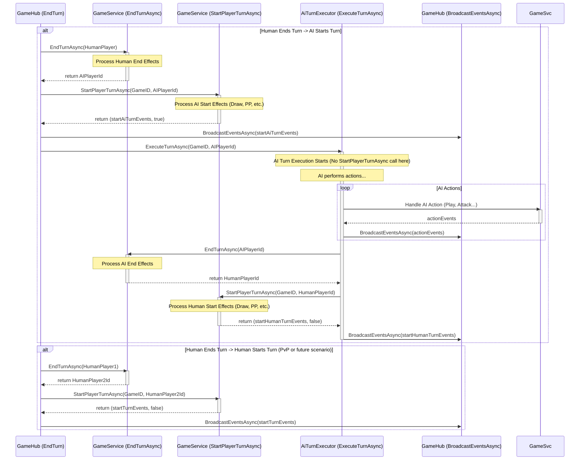
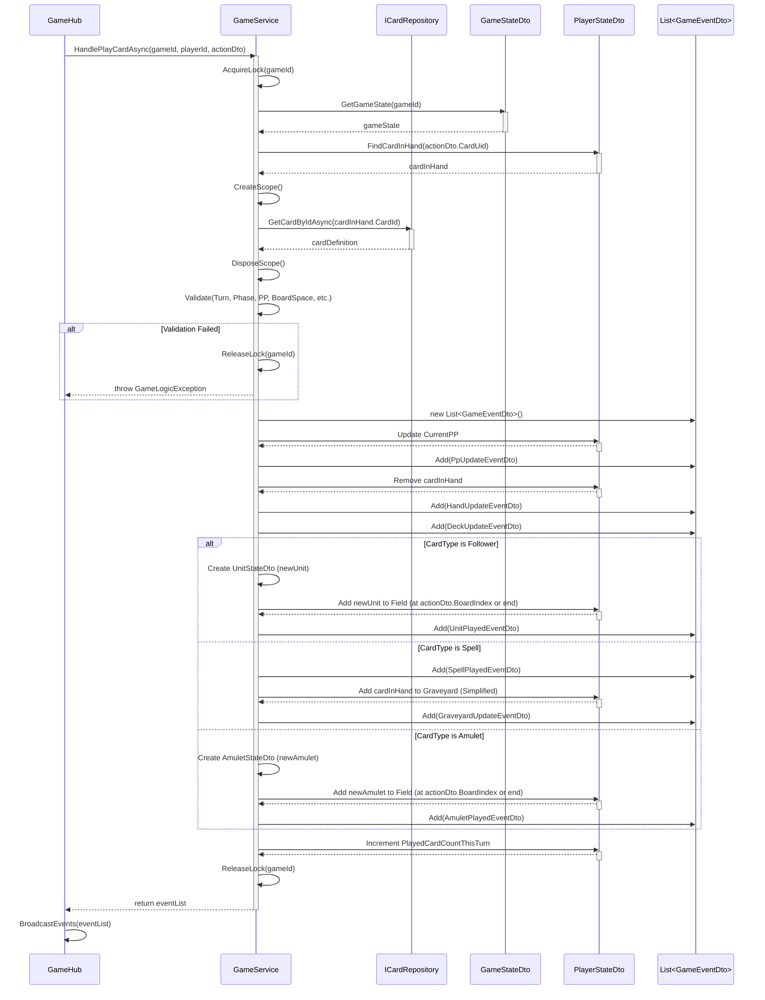
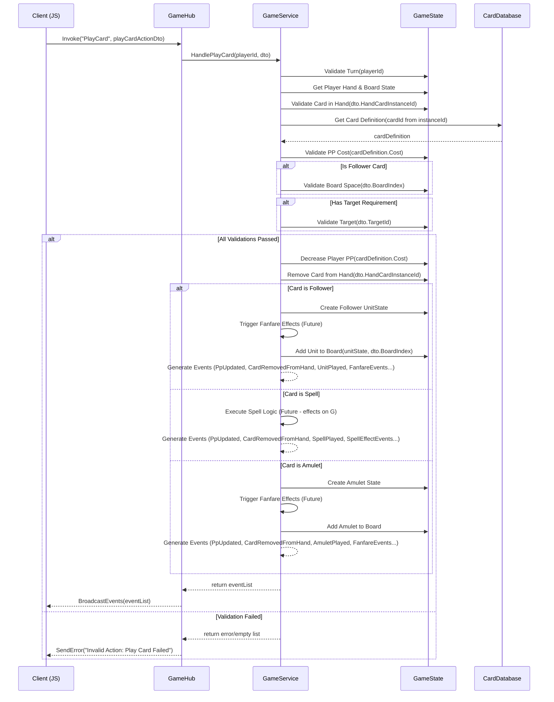
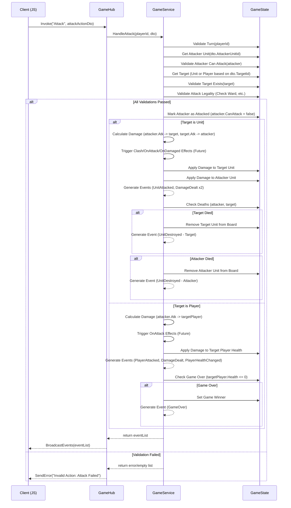

# M7: 核心动作处理与事件广播设计 V1.0

**版本:** 1.0
**日期:** 2025-05-26
**负责人:** @Roo

## 1. 任务目标

本任务 (M7) 的目标是在 ASP.NET Core 后端实现游戏的核心玩家动作处理逻辑，包括**打出卡牌 (Play Card)**、**随从攻击 (Attack)**、**随从进化 (Evolve)** 和**结束回合 (End Turn)**。同时，建立一套基于离散事件的广播机制，通过 SignalR (`GameHub`) 将这些动作引发的游戏状态变更精确地通知给客户端，以替代之前可能存在的全量状态推送，提高系统的响应性、可扩展性和性能。

该任务是完成 M5 (SignalR 集成) 中“服务器动作处理待实现”部分的关键步骤，旨在恢复原版 JS Demo 的核心交互功能，并在新的技术架构下进行优化。

## 2. 影响范围

本次修改主要涉及以下组件：

- **Application Layer:**
  - [`Server/Application/Services/GameService.cs`](Server/Application/Services/GameService.cs): 将包含处理核心动作的核心逻辑，并负责生成事件列表。
  - [`Server/Application/Services/IGameService.cs`](Server/Application/Services/IGameService.cs): 需要添加处理新动作（攻击、进化）的方法。
- **Presentation Layer (SignalR):**
  - [`Server/Presentation/Hubs/GameHub.cs`](Server/Presentation/Hubs/GameHub.cs): 需要添加处理新动作 (`Attack`, `Evolve`) 的 `Invoke` 方法，并修改现有方法以接收和广播 `GameEventDto` 列表。
- **Domain/Application Layer (DTOs):**
  - `Server/Dtos/SignalR/Actions/`: 需要创建新的 Action DTO (`AttackActionDto.cs`, `EvolveActionDto.cs`) 并可能调整现有 DTO (`PlayCardActionDto.cs`, `EndTurnActionDto.cs`)。
  - `Server/Dtos/SignalR/Events/`: 需要创建或完善一系列 Event DTO (`GameEventDto.cs` 的子类) 以表示各种游戏状态变化 (e.g., `UnitAttackedEventDto.cs`, `DamageDealtEventDto.cs`, `UnitDestroyedEventDto.cs`, `UnitEvolvedEventDto.cs`, `PlayerHealthChangedEventDto.cs`, `EpChangedEventDto.cs` 等)。
- **相关文档:**
  - [`文档/项目整体任务清单.md`](文档/项目整体任务清单.md): 需要添加 M7 任务条目并更新状态。
  - [`文档/技术文档/M5_SignalR通信设计_V1.0.md`](文档/技术文档/M5_SignalR通信设计_V1.0.md): 可能需要更新以反映最终的事件驱动模型。
  - 各 AI 设计文档 (攻击、进化): 后续 AI 迁移时需参考此处的后端实现。

## 3. 动作处理设计 (`GameService.cs`)

`GameService` 将负责接收来自 `GameHub` 的动作请求 DTO，执行游戏逻辑，并返回一个包含所有引发事件的 `List<GameEventDto>`。

### 3.1 结束回合与回合开始 (End Turn & Start Turn) - (修订版 V2 - 解决 BUG-004)

**问题回顾:**

原有的回合转换逻辑（主要在 `EndTurnAsync` 中混合处理回合结束和下一回合开始）存在严重的**事件广播时序冲突**问题 (BUG-004)。当人类玩家结束回合触发 AI 回合时，`GameHub` 和异步执行的 `AiTurnExecutor` 可能会在短时间内都尝试广播事件（特别是回合开始事件），导致客户端接收顺序混乱，状态被错误覆盖，引发 UI 冻结或逻辑错误。

**重构目标:**

彻底分离“回合结束”和“回合开始”的逻辑与事件广播，明确各自职责，确保事件按正确的顺序由单一责任源（`GameHub` 或 `AiTurnExecutor`）广播，并优化 AI 触发机制。

**核心设计 (V2 Plan):**

1.  **`EndTurnAsync` 职责调整:**
    *   **签名:** `Task<string> EndTurnAsync(string gameId, string endingPlayerId)`
    *   **职责:**
        *   严格处理 `endingPlayerId` 的**回合结束**逻辑（触发回合结束效果、状态清理等）。
        *   确定下一位玩家 (`nextPlayerId`)。
        *   **不再**处理下一位玩家的回合开始逻辑。
        *   **不再**返回任何事件。
        *   仅返回 `nextPlayerId`。
2.  **`StartPlayerTurnAsync` 职责调整:**
    *   **签名:** `Task<(List<GameEventDto> Events, bool IsAiTurn)> StartPlayerTurnAsync(string gameId, string startingPlayerId)`
    *   **职责:**
        *   处理 `startingPlayerId` 的**回合开始**逻辑（资源回复、抽卡、触发回合开始效果等）。
        *   生成并返回所有与回合开始相关的事件 (`TurnStarted`, `PpUpdate`, `EpUpdate`, `CardDrawn` 等)。
        *   同时返回一个布尔值 `IsAiTurn`，指示 `startingPlayerId` 是否为 AI 玩家。
3.  **调用流程调整 (V2 Plan):**
    *   **`GameHub.EndTurn` (人类结束回合):**
        1.  调用 `nextPlayerId = await _gameService.EndTurnAsync(gameId, humanPlayerId)`。
        2.  调用 `(startTurnEvents, isAiTurn) = await _gameService.StartPlayerTurnAsync(gameId, nextPlayerId)`。
        3.  **广播回合开始事件:** `await BroadcastEventsAsync(startTurnEvents)`。**Hub 负责广播回合开始事件。**
        4.  **If `isAiTurn` is true:** 异步触发 `_aiTurnExecutor.ExecuteTurnAsync(gameId, nextPlayerId)`。**AI 执行器在此之后才开始工作。**
    *   **`AiTurnExecutor.ExecuteTurnAsync` (AI 回合执行器):**
        1.  **不再**需要在开始时调用 `StartPlayerTurnAsync` (Hub 已处理)。
        2.  **AI 决策与行动:** 执行 AI 逻辑，调用 `GameService` 处理动作并**立即广播**每个动作的事件。
        3.  **结束 AI 回合:** 调用 `nextPlayerId = await _gameService.EndTurnAsync(gameId, aiPlayerId)`。
        4.  **开始下一玩家 (人类) 回合:** 调用 `(startHumanTurnEvents, isAiTurn) = await _gameService.StartPlayerTurnAsync(gameId, nextPlayerId)`。
        5.  **广播下一玩家回合开始事件:** 调用 `await BroadcastEventsAsync(startHumanTurnEvents)`。

**重构后的流程图 (V2 Plan):**
```

**受影响文件:**

*   [`Server/Services/GameService.cs`](Server/Services/GameService.cs)
*   [`Server/Services/IGameService.cs`](Server/Services/IGameService.cs)
*   [`Server/Presentation/Hubs/GameHub.cs`](Server/Presentation/Hubs/GameHub.cs)
*   [`Server/Services/AiTurnExecutor.cs`](Server/

- **输入 DTO:** `EndTurnActionDto` (可能为空，只需知道哪个玩家 `playerId` 结束回合)
- **核心设计思想 (修订):** 为了更好地分离职责并处理各自阶段的效果，`HandleEndTurnAsync` 将协调两个内部私有辅助方法：`ProcessEndOfTurn` 负责处理当前玩家回合结束的逻辑，`ProcessStartOfTurn` 负责处理下一位玩家回合开始的逻辑。`HandleEndTurnAsync` 本身负责验证、协调调用并合并返回最终的事件列表。
- **依赖 DTO 修改:** 需要在 `PlayerStateDto` 中添加 `public bool HasTakenFirstTurn { get; set; } = false;` 用于处理后手第一回合抽 2 张牌的逻辑。


### 3.2 打出卡牌 (Play Card)
### 3.2.1 简化版实现计划 (V0.1 - 待实施)

**注意:** 本节描述的是 `HandlePlayCardAsync` 方法的 **首次简化实现** 方案，旨在快速搭建核心流程框架。完整的卡牌效果（如入场曲、法术效果、亡语等）将在后续迭代中添加。下方第 3.2 节描述的是包含完整效果的目标设计。

**详细步骤 (Simplified):**

1.  **方法签名与职责:**
    -   修改方法签名为 `async Task<List<GameEventDto>> HandlePlayCardAsync(string gameId, PlayCardActionDto actionDto)`。
    -   移除方法内部直接的 SignalR 广播调用 (`_hubContext.Clients...`)。
    -   职责：处理打牌逻辑，返回引发的事件列表。
2.  **锁定与状态获取:**
    -   (假设已有 `_lockProvider` 和 `_gameStateService`) 使用 `_lockProvider.AcquireLockAsync(gameId)` 获取游戏锁。
    -   在 `lock` 块内，通过 `_gameStateService.GetGameStateAsync(gameId)` 获取 `GameStateDto gameState`。
    -   根据 `actionDto.PlayerId` 获取 `PlayerStateDto currentPlayerState` 和 `opponentPlayerState`。
    -   处理获取失败或游戏不存在的情况 (例如抛出异常)。
3.  **查找手牌:**
    -   在 `currentPlayerState.Hand` 中查找 `CardDto cardInHand`，其 `Uid` 等于 `actionDto.CardUid`。
    -   如果未找到，抛出 `GameLogicException("Card not found in hand.")`。
4.  **获取卡牌定义:**
    -   (假设已有 `_scopeFactory`) 使用 `_scopeFactory.CreateScope()` 创建作用域。
    -   在作用域内获取 `ICardRepository` 实例 `cardRepository`。
    -   调用 `cardRepository.GetCardByIdAsync(cardInHand.CardId)` 获取 `CardDefinition cardDefinition`。
    -   如果未找到定义，抛出 `GameLogicException("Card definition not found.")`。
5.  **核心验证:**
    -   **回合/阶段检查:** 验证 `gameState.CurrentPlayerId == currentPlayerState.PlayerId` 且游戏阶段允许出牌 (例如 `gameState.Phase == GamePhase.Main`)。
    -   **PP 检查:** 验证 `currentPlayerState.CurrentPP >= cardDefinition.Cost`。
    -   **目标验证 (简化):** 暂时忽略 `actionDto.TargetUid` 的验证。
    -   **战场空间检查 (随从/护符):**
        -   如果 `cardDefinition.Type` 是 `Follower` 或 `Amulet`，检查 `currentPlayerState.Field.Count < GameConstants.MaxFieldSize` (假设为 5)。
    -   如果验证失败，抛出相应的 `GameLogicException` (例如 "Not your turn.", "Not enough PP.", "Field is full.")。
6.  **初始化事件列表:**
    -  `List<GameEventDto> eventList = new List<GameEventDto>();`
7.  **消耗 PP:**
    -   `currentPlayerState.CurrentPP -= cardDefinition.Cost`。
    -   创建 `PpUpdateEventDto { PlayerId = currentPlayerState.PlayerId, CurrentPp = currentPlayerState.CurrentPP }` 并添加到 `eventList`。
8.  **移除手牌:**
    -   从 `currentPlayerState.Hand` 移除 `cardInHand`。
    -   创建 `HandUpdateEventDto { PlayerId = currentPlayerState.PlayerId, RemovedCardUid = cardInHand.Uid, NewHandCount = currentPlayerState.Hand.Count }` 并添加到 `eventList`。
    -   (可选) 创建 `DeckUpdateEventDto { PlayerId = currentPlayerState.PlayerId, DeckCount = currentPlayerState.DeckCount, HandCount = currentPlayerState.Hand.Count }` (如果客户端需要用此事件同步手牌数) 并添加到 `eventList`。
9.  **处理卡牌类型:**
    -   **Switch (cardDefinition.Type):**
        *   **Case CardType.Follower:**
            *   创建 `UnitStateDto newUnit` 实例，填充来自 `cardDefinition` 的基础属性 (Id, Name, BaseAttack, BaseHealth, Cost, Type, Keywords)。
            *   设置 `CurrentAttack = cardDefinition.Attack`, `CurrentHealth = cardDefinition.Health`, `MaxHealth = cardDefinition.Health`。
            *   设置 `Uid = Guid.NewGuid().ToString()`。
            *   设置 `IsEvolved = false`。
            *   设置 `CanAttack = false` (**简化:** 暂时忽略 Rush)。
            *   设置 `AttackCountThisTurn = 0`。
            *   **战场放置:**
                *   (验证已在步骤 5 完成)
                *   如果 `actionDto.BoardIndex.HasValue` 且 `actionDto.BoardIndex.Value >= 0 && actionDto.BoardIndex.Value <= currentPlayerState.Field.Count`，则在指定位置 `actionDto.BoardIndex.Value` 插入 `newUnit` 到 `currentPlayerState.Field`。
                *   否则，将 `newUnit` 添加到 `currentPlayerState.Field` 的末尾。
            *   创建 `UnitPlayedEventDto { PlayerId = currentPlayerState.PlayerId, Unit = newUnit, PlayedCardUid = cardInHand.Uid }` 并添加到 `eventList`。
        *   **Case CardType.Spell:**
            *   创建 `SpellPlayedEventDto { PlayerId = currentPlayerState.PlayerId, PlayedCardUid = cardInHand.Uid, CardDefinitionId = cardDefinition.Id, TargetUid = actionDto.TargetUid }` 并添加到 `eventList`。
            *   **简化:** 不执行任何法术效果。
            *   将 `cardInHand` 添加到 `currentPlayerState.Graveyard` (假设 `Graveyard` 是 `List<CardDto>`)。
            *   创建 `GraveyardUpdateEventDto { PlayerId = currentPlayerState.PlayerId, NewGraveyardCount = currentPlayerState.Graveyard.Count }` 并添加到 `eventList`。
        *   **Case CardType.Amulet:**
            *   创建 `AmuletStateDto newAmulet` 实例，填充来自 `cardDefinition` 的属性 (Id, Name, Cost, Type, Keywords)，设置 `Uid = Guid.NewGuid().ToString()`。
            *   **战场放置:**
                *   (验证已在步骤 5 完成)
                *   如果 `actionDto.BoardIndex.HasValue` 且 `actionDto.BoardIndex.Value >= 0 && actionDto.BoardIndex.Value <= currentPlayerState.Field.Count`，则在指定位置 `actionDto.BoardIndex.Value` 插入 `newAmulet` 到 `currentPlayerState.Field`。
                *   否则，将 `newAmulet` 添加到 `currentPlayerState.Field` 的末尾。
            *   创建 `AmuletPlayedEventDto { PlayerId = currentPlayerState.PlayerId, Amulet = newAmulet, PlayedCardUid = cardInHand.Uid }` 并添加到 `eventList`。
        *   **Default:**
            *   (假设有 `_logger`) `_logger.LogWarning($"Attempted to play card with unknown type: {cardDefinition.Type}, CardId: {cardDefinition.Id}")`。
            *   抛出 `GameLogicException($"Unknown card type: {cardDefinition.Type}")`。
10. **更新玩家状态:**
    *   `currentPlayerState.PlayedCardCountThisTurn++`。
11. **墓地处理:** (已合并到步骤 9 Case Spell)
12. **触发效果 (简化):** 跳过。
13. **返回事件:**
    *   在 `lock` 块结束前，准备好 `eventList`。
    *   在 `finally` 块中释放锁 `_lockProvider.ReleaseLock(gameId)`。
    *   返回 `Task.FromResult(eventList)`。
14. **错误处理:**
    *   在 `catch (GameLogicException ex)` 中: 记录日志 `_logger.LogError(ex, "Game logic error during PlayCard...")` 并重新抛出 `throw;`。
    *   在 `catch (Exception ex)` 中: 记录日志 `_logger.LogError(ex, "Unexpected error during PlayCard...")` 并抛出包装后的异常 `throw new GameLogicException("An unexpected error occurred.", ex);`。

**序列图 (Simplified Flow):**



- **输入 DTO:** `PlayCardActionDto` (包含 `PlayerId`, `HandCardInstanceId`, `TargetId` (可选，用于指向性法术或战吼), `BoardIndex` (可选，用于随从放置位置))
- **核心逻辑:**
  1.  验证:
      - 是否为该玩家的回合。
      - 手牌中是否存在该 `HandCardInstanceId`。
      - 玩家 PP 是否足够支付卡牌费用 (`card.Cost <= player.Pp`)。
      - 如果是随从牌，战场区域是否有空位 (如果 `BoardIndex` 未指定，则添加到末尾；如果指定，验证该位置是否合法且空闲)。
      - 如果卡牌有目标要求（法术或战吼），验证 `TargetId` 是否提供且目标有效 (存在、可选类型匹配等)。
  2.  消耗 PP: `player.Pp -= card.Cost`。
  3.  移除手牌: 从 `player.Hand` 移除该卡。
  4.  **处理卡牌效果 (关键):**
      - **如果是随从 (Follower):**
        - 创建新的 `UnitState` 实例。
        - 添加到战场的指定/默认位置 (`player.Board`)。
        - 触发“入场曲 (Fanfare)”效果 (TBD - 需要效果系统支持)。
        - 生成 `UnitPlayedEvent` 事件 (包含随从的完整初始状态)。
        - 触发其他相关事件 (如 PP 变更 `PpUpdatedEvent`)。
      - **如果是法术 (Spell):**
        - 执行法术逻辑 (TBD - 需要效果系统支持)，可能涉及目标选择、伤害计算、状态修改等。
        - 生成 `SpellPlayedEvent` 事件。
        - 根据法术效果生成其他事件 (如 `DamageDealtEvent`, `UnitDestroyedEvent`, `PlayerHealthChangedEvent` 等)。
      - **如果是护符 (Amulet):**
        - 添加到战场。
        - 触发“入场曲”效果（如有）。
        - 生成 `AmuletPlayedEvent` 事件。
        - (暂不考虑倒数和破坏效果)。
  5.  检查战场上限（如果适用）。
- **输出:** `List<GameEventDto>` 包含卡牌打出及效果引发的所有事件。



### 3.3 单位攻击 (Unit Attack)

- **输入 DTO:** `AttackActionDto` (包含 `PlayerId`, `AttackerUnitId`, `TargetId` (目标单位 ID 或 对方玩家 ID))
- **核心逻辑:**
  1.  验证:
      - 是否为该玩家的回合。
      - 玩家战场是否存在 `AttackerUnitId` 的单位 (`attacker`)。
      - **攻击者是否准备就绪:**
        - **`attacker.CanAttack` 必须为 `true`**:
          - 单位通常在召唤的回合处于“召唤失调”状态 (`CanAttack = false`)，直到其操控者的下一个回合开始时才变为 `true`。
          - 具有突进 (Rush) 或疾驰 (Storm) 关键字的单位可能在召唤的回合就能攻击 (具体逻辑待效果系统实现)。
          - 单位可能因为某些效果（如“无法攻击”）导致 `CanAttack` 为 `false`。
        - **攻击次数检查:** `attacker.AttacksMadeThisTurn < attacker.MaxAttacksPerTurn`。
          - `AttacksMadeThisTurn` 记录本回合已攻击次数。
          - `MaxAttacksPerTurn` 定义单位每回合最大攻击次数（默认为 1，可被效果修改）。
      - 目标是否存在 (`TargetId`)：
        - 如果是敌方单位 ID (`targetUnit`)，验证其是否存在于对方战场。
        - 如果是敌方玩家 ID (`targetPlayer`)，验证 ID 是否正确。
      - 攻击目标是否合法:
        - 如果对方场上有守护 (Ward) 单位，则只能选择守护单位作为攻击目标 (除非攻击者具有无视守护的能力)。
        - 通常不能直接攻击敌方玩家，除非对方战场为空，或者攻击者有特殊能力（如疾驰）。(此条简化，允许直接打脸，优先打守护)
  2.  **记录攻击次数:** `attacker.AttacksMadeThisTurn++;` (注意：不再直接设置 `CanAttack = false`，该状态通常在回合开始/结束时管理)。
  3.  **执行战斗:**
      - **攻击目标是单位 (`targetUnit`):**
        - `targetUnit` 受到 `attacker.Attack` 点伤害。
        - `attacker` 受到 `targetUnit.Attack` 点伤害 (如果目标能反击)。
        - 生成 `UnitAttackedEvent` (包含攻击者、目标、攻击前状态)。
        - 生成 `DamageDealtEvent` (分别记录对目标和攻击者的伤害)。
        - 检查双方生命值，如果小于等于 0，则标记为死亡。
        - 如果 `targetUnit` 死亡，生成 `UnitDestroyedEvent`。
        - 如果 `attacker` 死亡，生成 `UnitDestroyedEvent`。
        - 触发“交战时 (Clash)”效果 (TBD)。
        - 触发“攻击时 (On Attack)”效果 (TBD)。
        - 触发“被攻击时 (On Damaged)”效果 (TBD)。
      - **攻击目标是玩家 (`targetPlayer`):**
        - `targetPlayer` 受到 `attacker.Attack` 点伤害。
        - 生成 `PlayerAttackedEvent`。
        - 生成 `DamageDealtEvent` (记录对玩家的伤害)。
        - 生成 `PlayerHealthChangedEvent`。
        - 检查玩家生命值，如果小于等于 0，则标记游戏结束状态。
        - 触发“攻击时 (On Attack)”效果 (TBD)。
  4.  处理战斗后的状态变化（如移除死亡单位，检查胜利条件）。
- **输出:** `List<GameEventDto>` 包含攻击、伤害、死亡、玩家状态变更等所有相关事件。

  **攻击准备状态详细说明 (Attack Readiness - Summoning Sickness & Multi-Attack):**

  为了实现召唤失调和多段攻击机制，对单位状态和相关逻辑进行如下扩展：

  - **`UnitState` 新增属性:**
    - `public bool CanAttack { get; set; } = false;`: 标记单位当前回合是否可以发动攻击。默认为 `false` (召唤失调)。在单位操控者的回合开始时，通常会为非召唤失调状态的单位设置为 `true`。具有 Rush/Storm 关键字或受其他效果影响的单位此状态可能不同。
    - `public int MaxAttacksPerTurn { get; set; } = 1;`: 单位每回合最大可攻击次数。默认为 1，可被卡牌效果修改（例如实现“连击”）。
    - `public int AttacksMadeThisTurn { get; set; } = 0;`: 单位在本回合已发动的攻击次数。

  - **`UnitStateDto` 同步:** `UnitStateDto` 也需要添加相应的 `CanAttack`, `MaxAttacksPerTurn`, `AttacksMadeThisTurn` 属性，以便将这些状态同步给客户端进行显示和逻辑判断。

  - **核心逻辑集成:**
    - **攻击验证:** 如上文 Validation 部分所述，攻击前必须同时检查 `CanAttack` 状态和 `AttacksMadeThisTurn < MaxAttacksPerTurn`。
    - **攻击后处理:** 每次攻击成功后，增加 `AttacksMadeThisTurn` 计数。
    - **回合管理:**
      - 在玩家回合开始时 (`ProcessStartOfTurn`)：需要为战场上**所有**该玩家控制的、非特殊状态（如无法攻击）的单位设置 `CanAttack = true`，并将 `AttacksMadeThisTurn` 重置为 0。
      - 在玩家回合结束时 (`ProcessEndOfTurn`)：可能需要处理一些与攻击状态相关的回合结束效果（TBD）。`AttacksMadeThisTurn` 的重置更适合在回合开始时进行。
      - **召唤处理:** 当一个单位被召唤到战场时 (`HandlePlayCardAsync` 或其他召唤效果)，其初始状态应为 `CanAttack = false`, `AttacksMadeThisTurn = 0`, `MaxAttacksPerTurn` (根据卡牌定义，通常为 1)。

  - **状态转换图 (简化):**

    ```mermaid
    stateDiagram-v2
        [*] --> Summoned: Unit Played
        Summoned: CanAttack = false\nAttacksMade = 0
        Summoned --> Ready: Controller's Turn Start
        Ready: CanAttack = true\nAttacksMade = 0
        Ready --> Attacking : Attack Action (if AttacksMade < MaxAttacks)
        Attacking: AttacksMade++
        Attacking --> Ready: More attacks possible
        Attacking --> Exhausted: AttacksMade == MaxAttacks
        Ready --> Exhausted: Cannot attack (e.g. Effect)
        Exhausted: CanAttack = true (potentially)\nAttacksMade = MaxAttacks
        Ready --> TurnEnd
        Attacking --> TurnEnd
        Exhausted --> TurnEnd
        TurnEnd --> Ready: Next Turn Start (Reset AttacksMade, Set CanAttack=true)
        TurnEnd --> [*]: Unit Destroyed
    ```



### 3.4 单位进化 (Evolve Unit) - (实现于 2025-05-26)

- **方法签名:** `async Task<List<GameEventDto>> EvolveAsync(string gameId, EvolveActionDto actionDto)`
- **输入 DTO:** `EvolveActionDto` (包含 `PlayerId`, `UnitId`)
- **核心逻辑:**

  1.  获取 `GameStateDto gameState`, `PlayerStateDto playerState`, `OpponentStateDto opponentState`。
  2.  查找需要进化的单位: 在 `playerState.Board` 中查找 `UnitState unitToEvolve`，其 `InstanceId` 等于 `actionDto.UnitId`。
  3.  验证:
      - 游戏和玩家状态是否有效。
      - 是否为该 `playerState.PlayerId` 的回合 (`gameState.CurrentPlayerId`)。
      - `unitToEvolve` 是否存在且不为 null。
      - 单位是否未进化 (`!unitToEvolve.IsEvolved`)。
      - 玩家是否有进化点 (`playerState.CurrentEP > 0`)。
      - 是否达到可使用进化点的回合 (`playerState.CanUseEvolutionPoint()`，此方法封装了回合数和先后手判断逻辑)。
      - 本回合进化次数是否未达上限 (`playerState.EvolutionsThisTurn < GameConstants.MaxEvolutionsPerTurn`)。
      - 单位本身是否允许进化 (检查其 `CardDefinition.CanEvolve` 标志)。
  4.  获取进化后卡牌定义: 使用 `unitToEvolve.EvolveId` 从 `_cardRepository` 获取 `evolvedCardDefinition`。验证 `evolvedCardDefinition` 是否存在。
  5.  消耗进化点: `playerState.CurrentEP--`。
  6.  增加本回合进化次数: `playerState.EvolutionsThisTurn++`。
  7.  更新单位状态:
      - 标记已进化: `unitToEvolve.IsEvolved = true`。
      - 更新攻防:
        - `unitToEvolve.Attack = evolvedCardDefinition.Attack;`
        - `unitToEvolve.Health = evolvedCardDefinition.Health;`
        - `unitToEvolve.MaxHealth = evolvedCardDefinition.Health;` (假设进化重置血量上限)
      - 授予突进/疾驰 (通常规则): `unitToEvolve.CanAttack = true;` (注意：需确保此操作不覆盖单位因其他效果无法攻击的状态，并考虑单位本回合是否已攻击过)。
      - (占位符) 应用其他进化时获得的能力或效果 (需要效果系统支持)。
  8.  创建事件列表 `eventList`:
      - `EpUpdateEventDto { PlayerId = playerState.PlayerId, CurrentEp = playerState.CurrentEP }`
      - `StatChangeEventDto { TargetUnitId = unitToEvolve.InstanceId, NewAttack = unitToEvolve.Attack, NewHealth = unitToEvolve.Health, NewMaxHealth = unitToEvolve.MaxHealth }`
      - `UnitEvolvedEventDto { PlayerId = playerState.PlayerId, Unit = _mapper.Map<UnitStateDto>(unitToEvolve) }` // 发送进化后的完整状态
      - (占位符) 根据进化时效果添加其他事件。
  9.  返回 `eventList`。
  10. 如果任何验证失败，则抛出 `GameLogicException`。

- **输出:** `List<GameEventDto>` 包含进化相关的核心事件 (`EpUpdate`, `StatChange`, `UnitEvolved`) 以及可能由进化时效果触发的其他事件。
- **异常:** 如果验证失败，抛出 `GameLogicException`。

```mermaid
sequenceDiagram
    participant Client
    participant GameHub
    participant GameService
    participant ICardRepository as Repo
    participant IHubContext as HubContext

    Client->>+GameHub: PerformEvolve(EvolveActionDto: { UnitId })
    GameHub->>+GameService: EvolveAsync(playerId, actionDto.UnitId)
    GameService->>+Repo: GetCardDefinitionAsync(evolvedCardDefId)
    Repo-->>-GameService: evolvedCardDefinition
    GameService->>GameService: Validate Evolve (EP cost, target exists, etc.)
    alt Validation Fails
        GameService-->>-GameHub: Throw GameLogicException
        GameHub-->>-Client: Send Error Message (e.g., via specific event)
    else Validation Succeeds
        GameService->>GameService: Update PlayerState (Decrement EP)
        GameService->>GameService: Update UnitState (Apply evolved stats/effects, set IsEvolved=true)
        GameService->>+HubContext: Send EpUpdateEventDto(PlayerId=playerState.PlayerId, CurrentEp=playerState.CurrentEP) to Player Group
        HubContext-->>-GameService: (Ack)
        GameService->>+HubContext: Send StatChangeEventDto(TargetUnitId=unitToEvolve.InstanceId, NewAttack=unitToEvolve.Attack, NewHealth=unitToEvolve.Health, NewMaxHealth=unitToEvolve.MaxHealth) to All Group
        HubContext-->>-GameService: (Ack)
        GameService->>+HubContext: Send UnitEvolvedEventDto(PlayerId=playerState.PlayerId, Unit=evolvedUnitState) to All Group
        HubContext-->>-GameService: (Ack)
        GameService-->>-GameHub: Return eventList
        GameHub-->>-Client: BroadcastEvents(eventList) # Broadcast events to clients
    end
```

## 4. 事件 DTO 设计 (`Server/Dtos/SignalR/Events/`)

所有事件 DTO 均继承自基类 `GameEventDto` (包含事件类型 `EventType` 和时间戳 `Timestamp`)。

- **`TurnEndedEventDto`**: 包含结束回合的 `PlayerId`。
- **`TurnStartedEventDto`**: 包含开始回合的 `PlayerId`, 新回合的 PP/EP 上限 (`MaxPp`, `MaxEp`)。
- **`PpUpdatedEventDto`**: 包含 `PlayerId`, `CurrentPp`。
- **`EpUpdatedEventDto`**: 包含 `PlayerId`, `CurrentEp`。
- **`CardDrawnEventDto`**: 包含 `PlayerId`, `DrawnCardInstanceId`, `DrawnCardDefinitionId` (或完整 `CardDto`), `DeckCount`。 (注意：只发送给抽卡玩家)
- **`CardRemovedFromHandEventDto`**: 包含 `PlayerId`, `HandCardInstanceId`。
- **`UnitPlayedEventDto`**: 包含 `PlayerId`, `PlayedUnitStateDto` (包含单位 ID, 卡牌 ID, 当前攻防, 位置, 是否可攻击等完整状态)。
- **`SpellPlayedEventDto`**: 包含 `PlayerId`, `SpellCardInstanceId`, `TargetId` (可选)。
- **`AmuletPlayedEventDto`**: 包含 `PlayerId`, `PlayedAmuletStateDto` (包含护符 ID, 卡牌 ID, 倒数等)。
- **`UnitAttackedEventDto`**: 包含 `AttackerPlayerId`, `AttackerUnitId`, `TargetId` (单位或玩家), `TargetPlayerId` (如果目标是玩家)。
- **`PlayerAttackedEventDto`**: 包含 `AttackerPlayerId`, `AttackerUnitId`, `TargetPlayerId`。
- **`DamageDealtEventDto`**: 包含 `SourceId` (可选，造成伤害的单位或法术 ID), `TargetId` (单位或玩家), `DamageAmount`, `NewHealth` (目标剩余血量)。
- **`UnitDestroyedEventDto`**: 包含 `PlayerId` (单位所属玩家), `UnitId`。
- **`PlayerHealthChangedEventDto`**: 包含 `PlayerId`, `NewHealth`, `ChangeAmount`。
- **`UnitEvolvedEventDto`**: 包含 `PlayerId`, `EvolvedUnitStateDto` (包含进化后的完整状态)。
- **`GameOverEventDto`**: 包含 `WinnerId`, `LoserId`, `Reason`。

**注意:** 客户端需要根据 `EventType` 来解析具体的事件 DTO。
