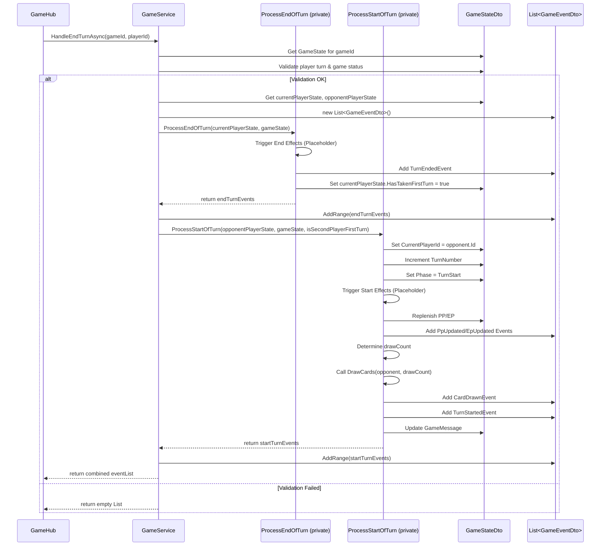
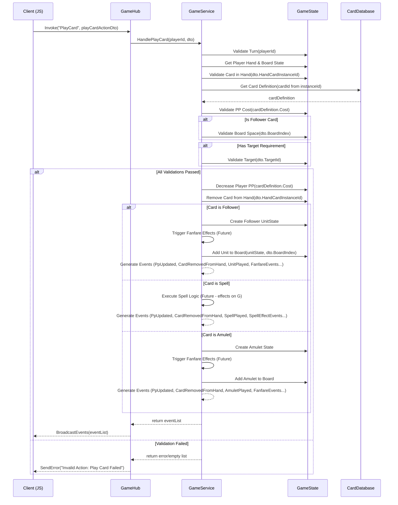
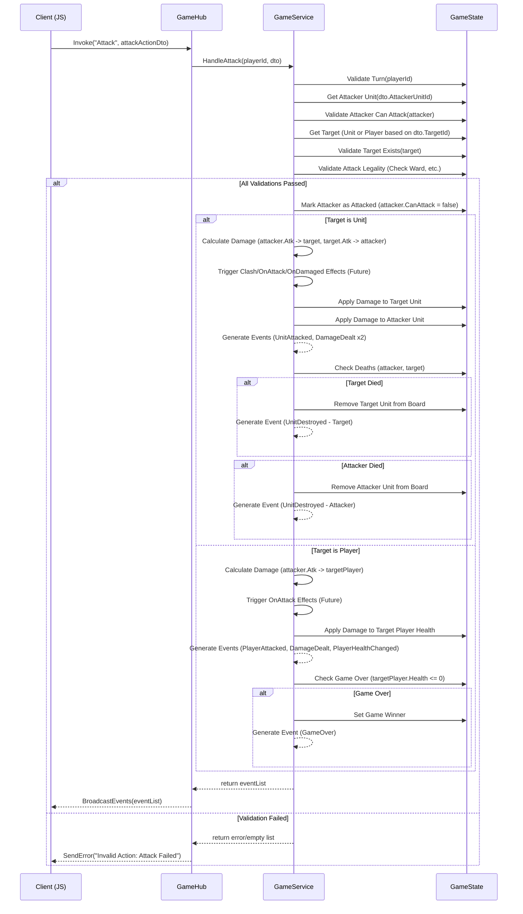

# M7: 核心动作处理与事件广播设计 V1.0

**版本:** 1.0
**日期:** 2025-05-26
**负责人:** @Roo

## 1. 任务目标

本任务 (M7) 的目标是在 ASP.NET Core 后端实现游戏的核心玩家动作处理逻辑，包括**打出卡牌 (Play Card)**、**随从攻击 (Attack)**、**随从进化 (Evolve)** 和**结束回合 (End Turn)**。同时，建立一套基于离散事件的广播机制，通过 SignalR (`GameHub`) 将这些动作引发的游戏状态变更精确地通知给客户端，以替代之前可能存在的全量状态推送，提高系统的响应性、可扩展性和性能。

该任务是完成 M5 (SignalR 集成) 中“服务器动作处理待实现”部分的关键步骤，旨在恢复原版 JS Demo 的核心交互功能，并在新的技术架构下进行优化。

## 2. 影响范围

本次修改主要涉及以下组件：

- **Application Layer:**
  - [`Server/Application/Services/GameService.cs`](Server/Application/Services/GameService.cs): 将包含处理核心动作的核心逻辑，并负责生成事件列表。
  - [`Server/Application/Services/IGameService.cs`](Server/Application/Services/IGameService.cs): 需要添加处理新动作（攻击、进化）的方法。
- **Presentation Layer (SignalR):**
  - [`Server/Presentation/Hubs/GameHub.cs`](Server/Presentation/Hubs/GameHub.cs): 需要添加处理新动作 (`Attack`, `Evolve`) 的 `Invoke` 方法，并修改现有方法以接收和广播 `GameEventDto` 列表。
- **Domain/Application Layer (DTOs):**
  - `Server/Dtos/SignalR/Actions/`: 需要创建新的 Action DTO (`AttackActionDto.cs`, `EvolveActionDto.cs`) 并可能调整现有 DTO (`PlayCardActionDto.cs`, `EndTurnActionDto.cs`)。
  - `Server/Dtos/SignalR/Events/`: 需要创建或完善一系列 Event DTO (`GameEventDto.cs` 的子类) 以表示各种游戏状态变化 (e.g., `UnitAttackedEventDto.cs`, `DamageDealtEventDto.cs`, `UnitDestroyedEventDto.cs`, `UnitEvolvedEventDto.cs`, `PlayerHealthChangedEventDto.cs`, `EpChangedEventDto.cs` 等)。
- **相关文档:**
  - [`文档/项目整体任务清单.md`](文档/项目整体任务清单.md): 需要添加 M7 任务条目并更新状态。
  - [`文档/技术文档/M5_SignalR通信设计_V1.0.md`](文档/技术文档/M5_SignalR通信设计_V1.0.md): 可能需要更新以反映最终的事件驱动模型。
  - 各 AI 设计文档 (攻击、进化): 后续 AI 迁移时需参考此处的后端实现。

## 3. 动作处理设计 (`GameService.cs`)

`GameService` 将负责接收来自 `GameHub` 的动作请求 DTO，执行游戏逻辑，并返回一个包含所有引发事件的 `List<GameEventDto>`。

### 3.1 结束回合 (End Turn) - (修订于 2025-05-26)

- **输入 DTO:** `EndTurnActionDto` (可能为空，只需知道哪个玩家 `playerId` 结束回合)
- **核心设计思想 (修订):** 为了更好地分离职责并处理各自阶段的效果，`HandleEndTurnAsync` 将协调两个内部私有辅助方法：`ProcessEndOfTurn` 负责处理当前玩家回合结束的逻辑，`ProcessStartOfTurn` 负责处理下一位玩家回合开始的逻辑。`HandleEndTurnAsync` 本身负责验证、协调调用并合并返回最终的事件列表。
- **依赖 DTO 修改:** 需要在 `PlayerStateDto` 中添加 `public bool HasTakenFirstTurn { get; set; } = false;` 用于处理后手第一回合抽 2 张牌的逻辑。

- **`HandleEndTurnAsync(string gameId, string playerId)` 核心逻辑:**

  1.  验证: 确保是该 `playerId` 的回合且游戏未结束。
  2.  获取 `GameStateDto gameState`, `currentPlayerState`, `opponentPlayerState`。
  3.  初始化 `eventList = new List<GameEventDto>()`。
  4.  **调用 `ProcessEndOfTurn`:**
      `eventList.AddRange(ProcessEndOfTurn(currentPlayerState, gameState));`
  5.  **调用 `ProcessStartOfTurn`:**
      `bool isSecondPlayerFirstTurn = gameState.TurnNumber == 0 && !opponentPlayerState.IsFirst;`
      `eventList.AddRange(ProcessStartOfTurn(opponentPlayerState, gameState, isSecondPlayerFirstTurn));`
  6.  返回 `eventList`。

- **`ProcessEndOfTurn(PlayerStateDto endingPlayer, GameStateDto gameState)` (私有方法) 核心逻辑:**

  1.  初始化 `endTurnEvents = new List<GameEventDto>()`。
  2.  (占位符) 触发 `endingPlayer` 的回合结束效果。
  3.  添加 `TurnEndedEventDto { PlayerId = endingPlayer.PlayerId }` 到 `endTurnEvents`。
  4.  设置 `endingPlayer.HasTakenFirstTurn = true;`
  5.  返回 `endTurnEvents`。

- **`ProcessStartOfTurn(PlayerStateDto startingPlayer, GameStateDto gameState, bool isSecondPlayerFirstTurn)` (私有方法) 核心逻辑:**

  1.  初始化 `startTurnEvents = new List<GameEventDto>()`。
  2.  设置 `gameState.CurrentPlayerId = startingPlayer.PlayerId;`
  3.  **增加回合数:** `gameState.TurnNumber++;`
  4.  设置 `gameState.Phase = GamePhase.TurnStart;`
  5.  (占位符) 触发 `startingPlayer` 的回合开始效果。
  6.  **回复资源:**
      - PP: 计算并设置 `startingPlayer.MaxPP`, `startingPlayer.CurrentPP`。添加 `PpUpdatedEventDto` 到 `startTurnEvents`。
      - EP: (占位符逻辑) 计算并设置 `startingPlayer.CurrentEP`。如果变化，添加 `EpUpdatedEventDto` 到 `startTurnEvents`。
  7.  **抽卡:**
      - 计算 `drawCount = isSecondPlayerFirstTurn ? 2 : 1;`
      - 调用 `var drawnInfo = DrawCards(startingPlayer, drawCount);` (需要实现 `DrawCards` 辅助方法)。
      - 如果 `drawnInfo.DrawnCount > 0`，添加 `CardDrawnEventDto { PlayerId = startingPlayer.PlayerId, DrawnCardCount = drawnInfo.DrawnCount, DeckCount = startingPlayer.DeckCount }` 到 `startTurnEvents`。
  8.  添加 `TurnStartedEventDto { PlayerId = startingPlayer.PlayerId, TurnNumber = gameState.TurnNumber }` 到 `startTurnEvents`。
  9.  更新 `gameState.GameMessage = $"Turn {gameState.TurnNumber} - {gameState.CurrentPlayerId}'s turn."`;
  10. 返回 `startTurnEvents`。

- **输出:** `List<GameEventDto>` 包含该回合结束和下回合开始引发的所有事件。

**修订后的流程图:**



### 3.2 打出卡牌 (Play Card)

- **输入 DTO:** `PlayCardActionDto` (包含 `PlayerId`, `HandCardInstanceId`, `TargetId` (可选，用于指向性法术或战吼), `BoardIndex` (可选，用于随从放置位置))
- **核心逻辑:**
  1.  验证:
      - 是否为该玩家的回合。
      - 手牌中是否存在该 `HandCardInstanceId`。
      - 玩家 PP 是否足够支付卡牌费用 (`card.Cost <= player.Pp`)。
      - 如果是随从牌，战场区域是否有空位 (如果 `BoardIndex` 未指定，则添加到末尾；如果指定，验证该位置是否合法且空闲)。
      - 如果卡牌有目标要求（法术或战吼），验证 `TargetId` 是否提供且目标有效 (存在、可选类型匹配等)。
  2.  消耗 PP: `player.Pp -= card.Cost`。
  3.  移除手牌: 从 `player.Hand` 移除该卡。
  4.  **处理卡牌效果 (关键):**
      - **如果是随从 (Follower):**
        - 创建新的 `UnitState` 实例。
        - 添加到战场的指定/默认位置 (`player.Board`)。
        - 触发“入场曲 (Fanfare)”效果 (TBD - 需要效果系统支持)。
        - 生成 `UnitPlayedEvent` 事件 (包含随从的完整初始状态)。
        - 触发其他相关事件 (如 PP 变更 `PpUpdatedEvent`)。
      - **如果是法术 (Spell):**
        - 执行法术逻辑 (TBD - 需要效果系统支持)，可能涉及目标选择、伤害计算、状态修改等。
        - 生成 `SpellPlayedEvent` 事件。
        - 根据法术效果生成其他事件 (如 `DamageDealtEvent`, `UnitDestroyedEvent`, `PlayerHealthChangedEvent` 等)。
      - **如果是护符 (Amulet):**
        - 添加到战场。
        - 触发“入场曲”效果（如有）。
        - 生成 `AmuletPlayedEvent` 事件。
        - (暂不考虑倒数和破坏效果)。
  5.  检查战场上限（如果适用）。
- **输出:** `List<GameEventDto>` 包含卡牌打出及效果引发的所有事件。



### 3.3 单位攻击 (Unit Attack)

- **输入 DTO:** `AttackActionDto` (包含 `PlayerId`, `AttackerUnitId`, `TargetId` (目标单位 ID 或 对方玩家 ID))
- **核心逻辑:**
  1.  验证:
      - 是否为该玩家的回合。
      - 玩家战场是否存在 `AttackerUnitId` 的单位 (`attacker`)。
      - 攻击者是否能攻击 (`attacker.CanAttack`)：
        - 非刚召唤的回合 (除非有突进/疾驰 Rush/Storm)。
        - 本回合尚未攻击过。
        - 没有无法攻击的状态效果。
      - 目标是否存在 (`TargetId`)：
        - 如果是敌方单位 ID (`targetUnit`)，验证其是否存在于对方战场。
        - 如果是敌方玩家 ID (`targetPlayer`)，验证 ID 是否正确。
      - 攻击目标是否合法:
        - 如果对方场上有守护 (Ward) 单位，则只能选择守护单位作为攻击目标 (除非攻击者具有无视守护的能力)。
        - 通常不能直接攻击敌方玩家，除非对方战场为空，或者攻击者有特殊能力（如疾驰）。(此条简化，允许直接打脸，优先打守护)
  2.  标记攻击者已行动: `attacker.CanAttack = false` (或 `attacker.AttacksThisTurn += 1`)。
  3.  **执行战斗:**
      - **攻击目标是单位 (`targetUnit`):**
        - `targetUnit` 受到 `attacker.Attack` 点伤害。
        - `attacker` 受到 `targetUnit.Attack` 点伤害 (如果目标能反击)。
        - 生成 `UnitAttackedEvent` (包含攻击者、目标、攻击前状态)。
        - 生成 `DamageDealtEvent` (分别记录对目标和攻击者的伤害)。
        - 检查双方生命值，如果小于等于 0，则标记为死亡。
        - 如果 `targetUnit` 死亡，生成 `UnitDestroyedEvent`。
        - 如果 `attacker` 死亡，生成 `UnitDestroyedEvent`。
        - 触发“交战时 (Clash)”效果 (TBD)。
        - 触发“攻击时 (On Attack)”效果 (TBD)。
        - 触发“被攻击时 (On Damaged)”效果 (TBD)。
      - **攻击目标是玩家 (`targetPlayer`):**
        - `targetPlayer` 受到 `attacker.Attack` 点伤害。
        - 生成 `PlayerAttackedEvent`。
        - 生成 `DamageDealtEvent` (记录对玩家的伤害)。
        - 生成 `PlayerHealthChangedEvent`。
        - 检查玩家生命值，如果小于等于 0，则标记游戏结束状态。
        - 触发“攻击时 (On Attack)”效果 (TBD)。
  4.  处理战斗后的状态变化（如移除死亡单位，检查胜利条件）。
- **输出:** `List<GameEventDto>` 包含攻击、伤害、死亡、玩家状态变更等所有相关事件。



### 3.4 单位进化 (Evolve Unit) - (实现于 2025-05-26)

- **方法签名:** `async Task<List<GameEventDto>> EvolveAsync(string gameId, EvolveActionDto actionDto)`
- **输入 DTO:** `EvolveActionDto` (包含 `PlayerId`, `UnitId`)
- **核心逻辑:**

  1.  获取 `GameStateDto gameState`, `PlayerStateDto playerState`, `OpponentStateDto opponentState`。
  2.  查找需要进化的单位: 在 `playerState.Board` 中查找 `UnitState unitToEvolve`，其 `InstanceId` 等于 `actionDto.UnitId`。
  3.  验证:
      - 游戏和玩家状态是否有效。
      - 是否为该 `playerState.PlayerId` 的回合 (`gameState.CurrentPlayerId`)。
      - `unitToEvolve` 是否存在且不为 null。
      - 单位是否未进化 (`!unitToEvolve.IsEvolved`)。
      - 玩家是否有进化点 (`playerState.CurrentEP > 0`)。
      - 是否达到可使用进化点的回合 (`playerState.CanUseEvolutionPoint()`，此方法封装了回合数和先后手判断逻辑)。
      - 本回合进化次数是否未达上限 (`playerState.EvolutionsThisTurn < GameConstants.MaxEvolutionsPerTurn`)。
      - 单位本身是否允许进化 (检查其 `CardDefinition.CanEvolve` 标志)。
  4.  获取进化后卡牌定义: 使用 `unitToEvolve.EvolveId` 从 `_cardRepository` 获取 `evolvedCardDefinition`。验证 `evolvedCardDefinition` 是否存在。
  5.  消耗进化点: `playerState.CurrentEP--`。
  6.  增加本回合进化次数: `playerState.EvolutionsThisTurn++`。
  7.  更新单位状态:
      - 标记已进化: `unitToEvolve.IsEvolved = true`。
      - 更新攻防:
        - `unitToEvolve.Attack = evolvedCardDefinition.Attack;`
        - `unitToEvolve.Health = evolvedCardDefinition.Health;`
        - `unitToEvolve.MaxHealth = evolvedCardDefinition.Health;` (假设进化重置血量上限)
      - 授予突进/疾驰 (通常规则): `unitToEvolve.CanAttack = true;` (注意：需确保此操作不覆盖单位因其他效果无法攻击的状态，并考虑单位本回合是否已攻击过)。
      - (占位符) 应用其他进化时获得的能力或效果 (需要效果系统支持)。
  8.  创建事件列表 `eventList`:
      - `EpUpdateEventDto { PlayerId = playerState.PlayerId, CurrentEp = playerState.CurrentEP }`
      - `StatChangeEventDto { TargetUnitId = unitToEvolve.InstanceId, NewAttack = unitToEvolve.Attack, NewHealth = unitToEvolve.Health, NewMaxHealth = unitToEvolve.MaxHealth }`
      - `UnitEvolvedEventDto { PlayerId = playerState.PlayerId, Unit = _mapper.Map<UnitStateDto>(unitToEvolve) }` // 发送进化后的完整状态
      - (占位符) 根据进化时效果添加其他事件。
  9.  返回 `eventList`。
  10. 如果任何验证失败，则抛出 `GameLogicException`。

- **输出:** `List<GameEventDto>` 包含进化相关的核心事件 (`EpUpdate`, `StatChange`, `UnitEvolved`) 以及可能由进化时效果触发的其他事件。
- **异常:** 如果验证失败，抛出 `GameLogicException`。

```mermaid
sequenceDiagram
    participant Client
    participant GameHub
    participant GameService
    participant ICardRepository as Repo
    participant IHubContext as HubContext

    Client->>+GameHub: PerformEvolve(EvolveActionDto: { UnitId })
    GameHub->>+GameService: EvolveAsync(playerId, actionDto.UnitId)
    GameService->>+Repo: GetCardDefinitionAsync(evolvedCardDefId)
    Repo-->>-GameService: evolvedCardDefinition
    GameService->>GameService: Validate Evolve (EP cost, target exists, etc.)
    alt Validation Fails
        GameService-->>-GameHub: Throw GameLogicException
        GameHub-->>-Client: Send Error Message (e.g., via specific event)
    else Validation Succeeds
        GameService->>GameService: Update PlayerState (Decrement EP)
        GameService->>GameService: Update UnitState (Apply evolved stats/effects, set IsEvolved=true)
        GameService->>+HubContext: Send EpUpdateEventDto(PlayerId=playerState.PlayerId, CurrentEp=playerState.CurrentEP) to Player Group
        HubContext-->>-GameService: (Ack)
        GameService->>+HubContext: Send StatChangeEventDto(TargetUnitId=unitToEvolve.InstanceId, NewAttack=unitToEvolve.Attack, NewHealth=unitToEvolve.Health, NewMaxHealth=unitToEvolve.MaxHealth) to All Group
        HubContext-->>-GameService: (Ack)
        GameService->>+HubContext: Send UnitEvolvedEventDto(PlayerId=playerState.PlayerId, Unit=evolvedUnitState) to All Group
        HubContext-->>-GameService: (Ack)
        GameService-->>-GameHub: Return eventList
        GameHub-->>-Client: BroadcastEvents(eventList) # Broadcast events to clients
    end
```

## 4. 事件 DTO 设计 (`Server/Dtos/SignalR/Events/`)

所有事件 DTO 均继承自基类 `GameEventDto` (包含事件类型 `EventType` 和时间戳 `Timestamp`)。

- **`TurnEndedEventDto`**: 包含结束回合的 `PlayerId`。
- **`TurnStartedEventDto`**: 包含开始回合的 `PlayerId`, 新回合的 PP/EP 上限 (`MaxPp`, `MaxEp`)。
- **`PpUpdatedEventDto`**: 包含 `PlayerId`, `CurrentPp`。
- **`EpUpdatedEventDto`**: 包含 `PlayerId`, `CurrentEp`。
- **`CardDrawnEventDto`**: 包含 `PlayerId`, `DrawnCardInstanceId`, `DrawnCardDefinitionId` (或完整 `CardDto`), `DeckCount`。 (注意：只发送给抽卡玩家)
- **`CardRemovedFromHandEventDto`**: 包含 `PlayerId`, `HandCardInstanceId`。
- **`UnitPlayedEventDto`**: 包含 `PlayerId`, `PlayedUnitStateDto` (包含单位 ID, 卡牌 ID, 当前攻防, 位置, 是否可攻击等完整状态)。
- **`SpellPlayedEventDto`**: 包含 `PlayerId`, `SpellCardInstanceId`, `TargetId` (可选)。
- **`AmuletPlayedEventDto`**: 包含 `PlayerId`, `PlayedAmuletStateDto` (包含护符 ID, 卡牌 ID, 倒数等)。
- **`UnitAttackedEventDto`**: 包含 `AttackerPlayerId`, `AttackerUnitId`, `TargetId` (单位或玩家), `TargetPlayerId` (如果目标是玩家)。
- **`PlayerAttackedEventDto`**: 包含 `AttackerPlayerId`, `AttackerUnitId`, `TargetPlayerId`。
- **`DamageDealtEventDto`**: 包含 `SourceId` (可选，造成伤害的单位或法术 ID), `TargetId` (单位或玩家), `DamageAmount`, `NewHealth` (目标剩余血量)。
- **`UnitDestroyedEventDto`**: 包含 `PlayerId` (单位所属玩家), `UnitId`。
- **`PlayerHealthChangedEventDto`**: 包含 `PlayerId`, `NewHealth`, `ChangeAmount`。
- **`UnitEvolvedEventDto`**: 包含 `PlayerId`, `EvolvedUnitStateDto` (包含进化后的完整状态)。
- **`GameOverEventDto`**: 包含 `WinnerId`, `LoserId`, `Reason`。

**注意:** 客户端需要根据 `EventType` 来解析具体的事件 DTO。
