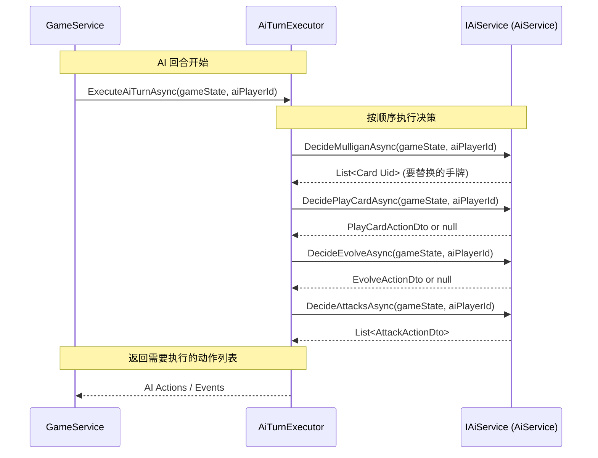

# M9: AI 设计文档 V1.0

**版本:** 1.0
**日期:** 2025-05-29
**作者:** Roo (AI Assistant)

## 1. 概述

本文档描述了《影之诗》仿作项目后端服务器中 AI 对手的设计与实现。当前版本 (V1.0) 实现了一套基础的、基于规则的决策逻辑，旨在提供一个可交互的游戏对手，为后续的功能迭代和 AI 复杂度提升打下基础。

## 2. AI 系统架构

AI 的核心逻辑被封装在 `AiService` 类中，该类实现了 `IAiService` 接口。为了解耦 `GameService` 和 AI 的具体执行流程，引入了 `AiTurnExecutor` 服务。

**核心组件:**

*   **`IAiService` / `AiService`:** 负责具体的 AI 决策计算（Mulligan、出牌、进化、攻击）。它接收游戏状态 (`GameStateDto`) 和 AI 玩家 ID 作为输入，并返回相应的决策动作 DTO。
*   **`AiTurnExecutor`:** 负责协调 AI 在其回合内的完整行动流程。它调用 `IAiService` 的各个决策方法，并可能与 `GameService` 交互以执行动作或获取额外信息（虽然当前 V1 实现中，交互较少）。
*   **`GameService`:** 在轮到 AI 回合时，调用 `AiTurnExecutor` 来执行 AI 的回合逻辑。

**组件交互流程:**



## 3. AI 决策逻辑 (V1.0)

V1.0 版本的 AI 遵循一套简单的启发式规则。

### 3.1. Mulligan 决策 (`DecideMulliganAsync`)

*   **目标:** 保留低费用的初始手牌。
*   **逻辑:** 遍历初始手牌，将所有费用 **大于 3** 的卡牌加入替换列表。

### 3.2. 出牌决策 (`DecidePlayCardAsync`)

*   **目标:** 尽可能利用当前 Play Points (PP) 打出卡牌，优先随从。
*   **逻辑:**
    1.  获取所有当前 PP 可支付的手牌 (`GetPlayableCards`)。
    2.  **优先随从:** 如果场上随从数量未满 (`MaxFieldSize`)，选择其中 **费用最高** 的 **随从** 卡牌打出。V1 不考虑随从的战吼（Fanfare）目标。
    3.  **其次法术:** 如果无法打出随从（例如费用不足、场地已满或无可打出的随从），选择其中 **费用最高** 的 **法术** 卡牌打出。
        *   **法术目标:**
            *   优先选择敌方场上 **当前攻击力最高** 的随从作为目标。
            *   如果敌方场上没有随从，则选择 **敌方主战者** 作为目标。
    4.  **无牌可出:** 如果没有可打出的随从或法术，则不执行任何操作。

### 3.3. 进化决策 (`DecideEvolveAsync`)

*   **目标:** 在有机会时进化场上最有价值的随从。
*   **逻辑:**
    1.  检查 AI 是否拥有进化点 (`CurrentEP > 0`) 并且当前回合允许进化 (`CanEvolve`)。
    2.  如果可以进化，查找场上所有 **未进化** 且 **可进化** 的随从。
    3.  选择其中 **当前攻击力最高** 的随从进行进化。V1 不考虑进化效果的目标选择。

### 3.4. 攻击决策 (`DecideAttacksAsync`)

*   **目标:** 使用所有可攻击的随从进行攻击，优先处理威胁（守护）或高价值目标。
*   **逻辑:**
    1.  获取场上所有 **可攻击** (`CanAttack`) 的 AI 随从，按 **当前攻击力** 降序排序。
    2.  遍历每个可攻击的随从，为其选择目标 (`SelectAttackTarget`)：
        *   **优先守护:** 如果敌方场上存在具有 **守护 (Ward)** 关键字的随从，必须优先攻击它们。在所有守护随从中，选择 **当前攻击力最高** 的作为目标。
        *   **其次高攻:** 如果没有守护随从，选择敌方场上 **当前攻击力最高** 的随从作为目标。
        *   **最后主战者:** 如果敌方场上没有任何随从，则攻击 **敌方主战者**。
    3.  为每个确定了目标的攻击生成一个 `AttackActionDto`。

## 4. 辅助方法

`AiService` 包含以下私有辅助方法：

*   **`GetPlayerStates`:** 从 `GameStateDto` 中提取 AI 自身和对手的 `PlayerStateDto`。
*   **`GetPlayableCards`:** 根据 AI 当前的 PP，从手牌中筛选出可打出的卡牌列表。
*   **`SelectAttackTarget`:** 根据上述攻击决策逻辑，为指定的攻击随从选择一个目标 UID（随从 UID 或 玩家 ID）。

**`SelectAttackTarget` 逻辑流程图:**

```mermaid
graph TD
    A[SelectAttackTarget(attacker, opponentState)] --> B{对手状态 OpponentState 为空?};
    B -- 是 --> C[返回 Null (无法攻击)];
    B -- 否 --> D{对手场面 OpponentField 为空?};
    D -- 是 --> E[目标: 对手主战者 (PlayerId)];
    E --> G[返回 目标Id (String)];
    D -- 否 --> F{场上是否存在<br/>守护 (Ward) 单位?};
    F -- 是 --> H[选择攻击力最高的<br/>守护单位];
    H --> G;
    F -- 否 --> I[选择攻击力最高的<br/>非守护单位];
    I --> G;
    G --> J[结束];
```

## 5. 未来改进方向

V1.0 AI 非常基础，未来可以从以下方面进行增强：

*   **更智能的目标选择:** 考虑随从血量、攻击力交换、效果威胁等。
*   **卡牌效果利用:** 理解并利用卡牌的特殊效果（战吼、亡语、光环等）。
*   **资源管理:** 更有效地规划 PP 和 EP 的使用。
*   **场面评估:** 基于场面情况做出更复杂的决策（解场、铺场、斩杀）。
*   **手牌协同:** 考虑卡牌之间的配合。
*   **预测与规划:** 预测对手可能的行动，进行多回合规划。
*   **可配置性:** 允许通过配置调整 AI 的行为模式或难度。
*   **机器学习:** 探索使用机器学习模型进行决策。