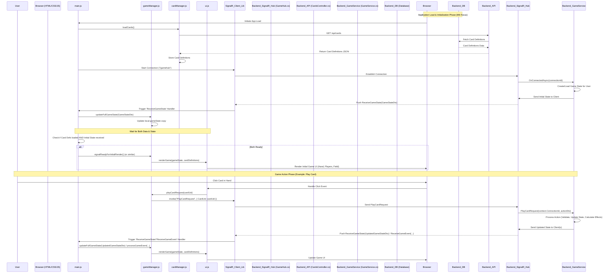

# 代码逻辑概览 (V1.0)

## 1. 文档目的

本文档旨在提供当前“类影之诗”网页版 Demo 项目的代码结构和核心逻辑的概览，帮助开发者理解各模块的功能、职责以及它们之间的交互关系。本文档基于对 `src/` 目录下所有 JavaScript 文件和 `Server/Program.cs` 文件的分析得出。

## 2. 整体架构

项目采用前后端分离架构：

- **前端:** 使用原生 HTML, CSS 和 JavaScript (ES Modules) 构建，负责游戏界面的渲染、用户交互处理和游戏核心逻辑的执行。
- **后端:** 使用 C# ASP.NET Core Minimal API 构建，负责提供静态文件服务和必要的 API 接口（如获取卡牌数据、处理游戏动作）。
- **数据:** 卡牌定义通过 EF Core 从数据库读取 (`Infrastructure/Data/ApplicationDbContext.cs`, `CardDefinition` Entity), 并通过 API (`CardService`, `/api/cards`) 提供给前端。
- **实时通信:** 使用 SignalR (`Server/Hubs/GameHub.cs`) 实现后端到前端的游戏状态实时推送 (服务器端基础已实现)。

## 3. 模块交互图 (Mermaid)

## 4. 模块详解

### 4.1 前端 (`src/` 目录)

- **[`src/main.js`](src/main.js:0)**

  - **职责:** 项目入口文件。负责加载卡牌数据，建立 SignalR 连接，设置 SignalR 事件处理器，并将连接实例传递给 `gameManager`，最后调用 `gameManager.initializeGame()` 初始化本地逻辑结构。
  - **依赖:** `gameManager.js`, `cardManager.js`, SignalR library.
  - **关键逻辑:**
    - `initializeApp()`: 整体初始化流程。需要确保 `cardManager.loadCards()` 完成 **并且** SignalR 的 `ReceiveGameState` 事件被处理后，才触发初始的 `ui.renderGame()` 调用（可以通过 `gameManager` 或直接调用）。例如，`initializeApp` 可以返回一个 Promise，该 Promise 在卡牌数据加载完成和收到初始游戏状态后才 resolve，然后调用 `gameManager.signalReadyForInitialRender()`。
    - `setupSignalRConnection()`: 建立和管理 SignalR 连接。
    - `registerSignalREventHandlers()`: 设置 SignalR 事件监听器，特别是：
      - `ReceiveGameState`: 接收服务器完整的初始状态，并调用 `gameManager.updateFullGameState()` 进行处理。
      - 其他事件监听器 (如 `ReceiveGameEvent`, `ReceiveError` 等)。
    - `setupEventListeners()`: 绑定 UI 核心事件 (如结束回合按钮)。

- **[`src/gameManager.js`](src/gameManager.js:0)**

  - **职责:** 游戏的核心协调器和状态管理器。维护本地的全局游戏状态 (`gameState`) 的*副本*，处理用户输入（通过 `ui.js` 调用），将玩家动作通过 SignalR 发送给服务器进行处理，并根据服务器通过 SignalR 推送的完整状态 (`ReceiveGameState`) 或增量事件 (如 `TurnEnded`) 更新本地状态和 UI。
  - **依赖:** `cardManager.js` (用于获取卡牌定义), `ui.js` (用于渲染), SignalR connection (from `main.js`). 不再直接依赖 `player.js`, `turnManager.js`, `ai.js` 进行状态修改，这些逻辑由服务器处理。
  - **关键数据:** `gameState` 对象 (镜像服务器状态)。
  - **关键逻辑:**
    - `setSignalRConnection()`: 接收来自 `main.js` 的 SignalR 连接实例。
    - `initializeGame()`: 设置本地游戏上下文 (GameID, PlayerID)，等待 `cardManager` 加载数据和 SignalR 的初始状态。
    - `updateFullGameState()`: **(逻辑变更)** 接收 `main.js` 转发的完整游戏状态 DTO。不再直接覆盖本地状态，而是采用**“智能水合 (Smart Hydration)”**策略：遍历 DTO，使用 `createPlayer` 和 `createCardInstance` 等工厂函数查找或创建具有方法的本地对象实例，并仅更新其数据属性，确保 `gameState` 中始终是功能完整的对象。详细策略请参考 M8 文档：[`文档/技术文档/M8_领域模型重构计划_V1.0.md#6-客户端状态同步与水合策略`](文档/技术文档/M8_领域模型重构计划_V1.0.md#6-客户端状态同步与水合策略)。处理后调用 `ui.renderGame()`。
    - `getPlayerState()`: **(修正)** 根据 `playerId` 在 `gameState.players` 数组中查找玩家状态 (使用正确的 `playerId` 键)。
    - `playCardRequest()`, `initiateAttackRequest()`, `selectAttackTargetRequest()`, `evolveCardRequest()`, `endTurnRequest()`, `submitMulliganRequest()`: (函数名建议加后缀 Request) 将用户或 AI 的动作请求（包含必要参数如 Card UID, Target UID）通过 SignalR 连接的 `invoke` 方法发送给服务器 (`GameHub`) 进行处理。这些函数不再直接修改本地状态，而是等待服务器通过 SignalR 事件返回结果。
    - 不再管理卡牌 UID，由服务器生成。
    - 不再管理游戏结束条件判断，由服务器判断并通过 `GameOver` 事件通知。
    - `processGameEvent()`: (内部逻辑，或被特定事件处理器取代) 处理服务器推送的*增量*游戏事件 DTO。同样采用**“智能水合”**策略，查找受影响的本地对象实例 (Player, CardInstance)，仅更新其相关数据属性，或根据事件类型创建新的实例（如抽卡事件需用 `createCardInstance` 创建新手牌）。处理后调用 `ui.renderGame()`。

- **[`src/cardManager.js`](src/cardManager.js:0)**

  - **职责:** 负责卡牌数据的加载、存储和实例创建。
  - **依赖:** Backend API (`/api/cards`).
  - **关键数据:** `cardDefinitions` (从 API 获取的卡牌模板数据)。
  - **关键逻辑:**
    - `loadCards()`: 异步从 `/api/cards` 获取卡牌定义。
    - `createCardInstance()`: 根据卡牌定义和唯一 ID 创建具体的卡牌对象实例（包含动态状态如当前攻击力/生命值、是否可攻击等）。
    - `getCardDefinition()`: 提供卡牌定义查询。

- **[`src/player.js`](src/player.js:0)**

  - **职责:** 管理单个玩家的状态和资源。使用工厂函数 `createPlayer` 创建玩家对象。
  - **依赖:** `cardManager.js`, `gameManager.js` (间接通过 `gameState` 操作)。
  - **关键数据 (通过 `createPlayer` 返回的对象管理):** `pp`, `maxPp`, `ep`, `maxEp`, `hand`, `deck`, `field`, `graveyard`, `leaderCardUid`, `health` (通过关联的 Leader 卡牌)。
  - **关键逻辑:**
    - `drawCard()`: 从牌库抽卡到手牌。
    - `performMulligan()`: 执行玩家的调度换牌选择。
    - EP 点数获取逻辑 (游戏开始和后续回合)。
    - 管理与玩家关联的 Leader 卡牌实例。

- **[`src/turnManager.js`](src/turnManager.js:0)**

  - **职责:** 控制游戏的回合流程和阶段转换。
  - **依赖:** `gameManager.js`, `ui.js`, `ai.js`, `player.js` (通过 `gameState` 访问)。
  - **关键数据:** `turnNumber`, `activePlayerIndex`, `currentPhase`.
  - **关键逻辑:**
    - `startTurn()`: 开始新回合的逻辑（重置 PP, 增加 Max PP, 抽卡, 触发回合开始效果 - 待实现）。
    - `endTurn()`: 结束当前回合，切换玩家，触发回合结束效果（待实现），并为下一个玩家调用 `startTurn` 或触发 AI。
    - 管理 PP/EP 的恢复和上限增长。
    - 协调 AI 在其回合的行动 (`runAILogic`)。

- **[`src/ui.js`](src/ui.js:0)**

  - **职责:** 负责将 `gameManager.js` 中的 `gameState` 渲染到 HTML DOM，并处理用户的界面交互（点击）。
  - **依赖:** `gameManager.js` (调用其**动作请求函数**如 `playCard`, `initiateAttack` 等)。 **不再直接依赖** `turnManager.js` 或 `cardManager.js` (卡牌数据由 `gameState` 提供)。
  - **关键逻辑:**
    - `renderGame()`: 主渲染函数，根据 `gameManager` 提供的 `gameState` **和** `cardManager` 提供的 `cardDefinitions` 更新整个游戏界面。通常在 M6 初始化完成或处理完服务器事件后被调用。
    - Helper 渲染函数 (如 `createCardElement`, `renderPlayerHand`, `renderPlayerField` 等)。
    - 事件监听 (主要通过事件委托在游戏容器上监听 `click`)。
    - `handleGameClick()`, `handleCardClick()`: 解析用户点击事件，判断意图（点击手牌、点击战场单位、点击英雄），并调用 `gameManager` 中相应的**动作请求函数** (如 `gameManager.playCardRequest(cardUid)` 或 `gameManager.initiateAttackRequest(attackerUid)`)。
    - 管理临时的 UI 状态 (如 `selectedAttackerUid` 用于攻击目标选择高亮，Spell targeting 待实现)。
    - 提供视觉反馈 (如可播放卡牌高亮、攻击目标高亮、伤害数字动画 - 部分待实现)。

- **[`src/ai.js`](src/ai.js:0)**
  - **职责:** 实现 AI 对手的决策逻辑。
  - **依赖:** `gameManager.js`, `cardManager.js`, `turnManager.js` (获取游戏状态和执行动作)。
  - **关键逻辑:**
    - `runAILogic()`: AI 回合的入口点，按顺序执行决策 (Mulligan, 出牌, 进化, 攻击)。
    - `performAIMulligan()`: AI 的调度换牌策略。
    - `aiDecideAndPlayCard()`: AI 的出牌决策 (当前为简单地出最高费随从)。
    - `aiDecideAndEvolve()`: AI 的进化决策 (当前为进化第一个可进化的随从)。
    - `aiDecideAndAttack()`: AI 的攻击决策 (考虑嘲讽，优先攻击随从)。

### 4.2 后端 (`Server/Program.cs`)

- **[`Server/Program.cs`](Server/Program.cs:0)**
  - **职责:** ASP.NET Core Minimal API 服务器配置与运行。负责提供静态文件（HTML, CSS, JS, JSON）和 API 端点。
  - **依赖:** .NET 库, [`data/card_data.json`](data/card_data.json:0).
  - **关键逻辑:**
    - 配置静态文件服务，从项目根目录 (`d:/workspace/Shadowverse-beyond`) 提供服务。
    - 定义 API 端点:
      - `GET /api/cards`: 读取并缓存 `data/card_data.json`，返回卡牌定义列表。
      - `POST /api/game/playCard`: **(占位符)** 接收出牌请求，当前仅打印日志，未实现游戏逻辑。
    - 定义 C# Record 类型 (`CardDefinition`, `CardEffect`, `PlayCardRequest`) 用于 JSON 序列化/反序列化。

### 4.3 数据 (`data/`)

- 配置 SignalR: - 添加 SignalR 服务 (`builder.Services.AddSignalR()`). - 映射 SignalR Hub (`app.MapHub&lt;GameHub&gt;("/gameHub")`). - 定义 Hub (`Server/Hubs/GameHub.cs`) 和客户端接口 (`Server/Hubs/ClientInterfaces/IGameClient.cs`). - 在服务 (如 `GameService`) 中注入 `IHubContext&lt;GameHub, IGameClient&gt;` 以便推送消息。
- **[`data/card_data.json`](data/card_data.json:0)**
  - **职责:** 存储所有卡牌的静态定义数据（ID, 名称, 费用, 类型, 攻击力, 生命值, 描述, 关键字, 效果等）。
  - **使用者:** 由后端 [`Server/Program.cs`](Server/Program.cs:0) 读取，并通过 `/api/cards` 接口提供给前端的 [`src/cardManager.js`](src/cardManager.js:0)。
  - **结构:** 一个包含多个卡牌对象的 JSON 数组，每个对象的结构对应 C# 中的 `CardDefinition` Record。

## 5. API 接口 (辅助性)

- **`GET /api/cards`**

  - **描述:** 获取所有卡牌的定义数据。
  - **请求:** 无参数。
  - **响应:** JSON 数组，包含所有卡牌的 `CardDefinition` 对象。
  - **状态:** 已实现，包含简单缓存和错误处理。 **(核心数据获取接口)**

- **`POST /api/game/playCard` (及其他潜在动作 API)**
  - **描述:** (原计划) 处理玩家或 AI 的游戏动作。
  - **请求:** (原计划) JSON 对象，包含动作所需参数。
  - **响应:** (原计划) JSON 对象，包含动作结果。
  - **状态:** **已废弃/待重新评估。** 核心游戏逻辑和状态同步已迁移至 SignalR。此类 API 未来可能用于非实时操作、调试或管理员功能，但不再是主要的游戏交互方式。

## 6. 实时通信 (SignalR)

- **Hub:** `GameHub` ([`Server/Hubs/GameHub.cs`](Server/Hubs/GameHub.cs:0), 映射至 `/gameHub`)
  - **职责:** 接收客户端的游戏动作请求 (`Invoke` 调用，如 `PlayCardRequest`)，处理玩家连接/断开事件，并由后端服务 (`GameService`) 调用以向客户端推送游戏状态 (`ReceiveGameState`) 或增量游戏事件 (待实现)。
- **客户端接口:** `IGameClient` ([`Server/Hubs/ClientInterfaces/IGameClient.cs`](Server/Hubs/ClientInterfaces/IGameClient.cs:0))
  - **职责:** 定义了服务器可以调用的客户端方法。
  - **关键方法:**
    - `ReceiveGameState(GameStateDto state)`: 接收完整的游戏状态快照。
    - `ReceiveError(string message)`: (已定义，待使用) 接收错误消息。
    - (未来可能增加): `ReceiveGameEvent(GameEventDto event)`, etc.
- **服务器端服务:** [`GameService`](Server/Services/GameService.cs:0) 负责核心游戏逻辑，并通过注入的 `IHubContext<GameHub, IGameClient>` 向特定客户端 (`Clients.Client(connectionId).Receive...`) 或所有客户端 (`Clients.All.Receive...`) 发送消息。
- **客户端:**
  - [`src/main.js`](src/main.js:0): 负责建立 SignalR 连接 (`setupSignalRConnection`) 并注册事件处理器 (`registerSignalREventHandlers`)。
  - [`src/gameManager.js`](src/gameManager.js:0): 负责调用 `connection.invoke()` 向服务器 Hub 发送动作请求 (如 `playCard`, `endTurnRequest`)。
- **状态:**
  - **服务器端:** 基础结构 (`GameHub`, `IGameClient`, `GameService` 注入 `IHubContext`) 已完成。Hub 接收方法 (`PlayCardRequest`, `EndTurnRequest` 等) 框架已搭建，但对应的 `GameService` 处理逻辑尚未完全实现（例如，实际处理卡牌效果、攻击结算等）。
  - **客户端:** 连接建立 (`setupSignalRConnection` in [`src/main.js`](src/main.js:0)) 和初始完整状态接收与处理 (`ReceiveGameState` -> `updateFullGameState`) 已实现并调试完成。动作请求发送 (`invoke` in [`src/gameManager.js`](src/gameManager.js:0)) 已实现。
  - **待办:**
    - 实现服务器端对客户端动作请求的完整处理逻辑。
    - 设计并实现增量游戏事件的推送和客户端处理。
    - 实现更健壮的错误处理机制 (例如使用 `ReceiveError`)。

## 7. 结论

当前代码库成功建立了基于 SignalR 的实时游戏通信框架，**并通过 M6 阶段的实现，整合了 API 卡牌数据获取与 SignalR 初始状态接收，确保了客户端能够在游戏开始时正确、完整地渲染初始界面**。同时，客户端向服务器发送动作请求 (`invoke`) 的机制也已打通。近期调试修复了若干关键的客户端 Bug，确保了基础交互的稳定性。

架构上，核心游戏交互逻辑已明确转移至 SignalR 通道，传统的 API 端点 (`/api/game/*`) 主要用于辅助或非实时功能。

后续开发重点将是：

1.  服务器端 (`GameService`) 完整实现对客户端动作请求 (如出牌、攻击、结束回合) 的处理逻辑，包括卡牌效果结算、战斗计算等。
2.  设计并实现增量游戏事件的 SignalR 推送模型，以优化状态同步效率。
3.  进一步完善错误处理和 UI 反馈。

本文档已更新以反映最新架构和代码状态，可作为后续开发的可靠参考。
