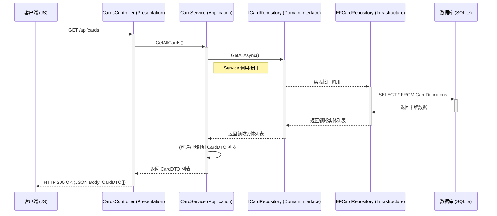

# 后端架构设计文档 V1.0

**版本:** 1.0
**日期:** 2025-05-24
**作者:** AI 技术顾问

## 1. 介绍

本文档定义了《影之诗》网页版项目从纯 JavaScript Demo 迁移至 C# 后端的技术架构。此架构旨在实现一个清晰、低耦合、可扩展且易于维护的后端系统，为当前 Web 应用提供服务，并为未来可能的 Unity 客户端集成奠定基础。

**核心目标:**

- **关注点分离 (Separation of Concerns):** 将表现逻辑、业务逻辑和数据访问逻辑清晰分开。
- **低耦合 (Loose Coupling):** 各层之间通过接口和依赖注入进行交互，减少直接依赖。
- **可测试性 (Testability):** 易于对业务逻辑和数据访问进行单元测试和集成测试。
- **可维护性 (Maintainability):** 结构清晰，便于理解、修改和扩展。
- **可扩展性 (Scalability):** 为未来功能增加（如多人对战、更复杂 AI）和潜在性能优化提供良好基础。

## 2. 架构概览

我们采用基于 ASP.NET Core 的**分层架构 (Layered Architecture)**，主要包含以下四个逻辑层：

1.  **表现层 (Presentation Layer):** 处理与客户端的直接交互。
2.  **应用层 / 服务层 (Application / Service Layer):** 编排业务流程和用例。
3.  **领域层 (Domain Layer):** 包含核心业务概念、规则和实体。
4.  **基础设施层 (Infrastructure Layer):** 处理技术细节，如数据持久化、外部服务集成。

### 2.1 架构图 (Mermaid)

```mermaid
graph TD
    subgraph Client [客户端 (JS/Unity)]
        direction LR
        ClientApp([用户界面 App])
    end

    subgraph Server [服务器 (ASP.NET Core Backend)]
        direction TB
        subgraph Presentation [表现层]
            Controllers[API Controllers\n(接收 HTTP 请求)]
            Hubs[SignalR Hubs\n(处理实时连接)]
        end
        subgraph Application [应用层/服务层]
            Services[业务逻辑服务\n(GameService, TurnService...)]
            DTOs[数据传输对象\n(用于 API 输入/输出)]
            AppInterfaces[应用层接口\n(e.g., IGameService)]
        end
        subgraph Domain [领域层]
            Entities[领域实体/值对象\n(Game, Player, Card...)]
            DomainInterfaces[领域接口\n(e.g., IRepository)]
        end
        subgraph Infrastructure [基础设施层]
            Repositories[数据仓库实现\n(EF Core Repositories)]
            DbContext[EF Core DbContext]
            ExternalServices[外部服务/工具\n(e.g., Logging, Caching)]
        end
    end

    ClientApp -- HTTP/SignalR --> Presentation
    Presentation -- Calls --> Application
    Application -- Uses --> DomainInterfaces
    Application -- Uses --> Entities
    Infrastructure -- Implements --> DomainInterfaces
    Infrastructure -- Implements --> AppInterfaces # Infrastructure can implement App interfaces too, e.g., caching
    Infrastructure -- Uses --> Entities
    Infrastructure -- Accesses --> ExternalServices
    Repositories -- Uses --> DbContext

    classDef layer fill:#f9f,stroke:#333,stroke-width:2px;
    class Presentation,Application,Domain,Infrastructure layer;

    note right of Server "依赖方向: 上层 -> 下层 (通过接口)\nInfrastructure 实现上层接口"
```

## 3. 各层详解

### 3.1 表现层 (Presentation Layer)

- **目的:** 作为应用程序的入口点，处理所有来自客户端的传入请求和连接。
- **组件:**
  - **API 控制器 (API Controllers):** 使用 ASP.NET Core MVC/API 功能。每个 Controller 负责处理一组相关的 HTTP 请求 (e.g., `CardsController`, `GameActionsController`)。它们接收请求，验证输入 DTOs，调用应用层服务，并将服务返回的结果映射为响应 DTOs 返回给客户端。
  - **SignalR 集线器 (SignalR Hubs):** 使用 ASP.NET Core SignalR。负责管理 WebSocket 连接，处理来自客户端的实时消息，并将服务器端事件（如状态更新）实时推送给客户端。
- **关键原则:**
  - 保持“瘦” (Thin): 不包含业务逻辑。
  - 依赖应用层服务来执行操作。
  - 使用 DTOs 与客户端交互。

### 3.2 应用层 / 服务层 (Application / Service Layer)

- **目的:** 实现应用程序的用例和业务流程。这是协调领域层和基础设施层以完成特定任务的地方。
- **组件:**
  - **服务类 (Services):** (e.g., `GameService`, `PlayerService`, `CardService`) 封装特定的业务功能。一个服务可能调用其他服务或领域层对象来完成其任务。
  - **数据传输对象 (DTOs):** 定义用于 API 输入和输出的数据结构。
  - **接口 (Interfaces):** (e.g., `IGameService`) 定义服务的契约，供表现层或其他服务注入和调用。
- **关键原则:**
  - 包含业务流程编排逻辑。
  - 不包含数据访问或 UI 逻辑。
  - 通过仓储接口 (IRepository) 与基础设施层交互。
  - 可能包含应用级别的验证逻辑。

### 3.3 领域层 (Domain Layer)

- **目的:** 代表应用程序的核心业务逻辑和知识。这是系统中最稳定、最少变化的部分。
- **组件:**
  - **领域实体 (Entities):** 具有唯一标识符并包含业务状态和行为的对象 (e.g., `Player` 可能有 `TakeDamage(int amount)` 方法)。
  - **值对象 (Value Objects):** 没有唯一标识符，通过其属性值定义的不可变对象 (e.g., `CardCost`, `PlayerStats`)。
  - **聚合根 (Aggregate Roots):** (可选，适用于复杂领域) 特定实体作为数据一致性的边界。
  - **领域服务 (Domain Services):** (可选) 当某个业务逻辑不适合放在单个实体中时使用。
  - **仓储接口 (Repository Interfaces):** (e.g., `ICardRepository`, `IGameStateRepository`) 定义数据持久化的契约，由基础设施层实现。
- **关键原则:**
  - 包含核心业务规则和逻辑。
  - **技术无关性:** 不应依赖任何特定的框架或数据库技术。
  - 是整个架构的核心。

### 3.4 基础设施层 (Infrastructure Layer)

- **目的:** 提供技术能力，支持其他层。处理所有与外部世界的交互。
- **组件:**
  - **数据仓库实现 (Repositories):** 实现领域层定义的仓储接口，使用 EF Core 与数据库交互。
  - **数据库上下文 (DbContext):** EF Core 的核心类，管理数据库连接、实体跟踪和事务。
  - **数据库迁移 (Migrations):** EF Core Migrations 用于管理数据库 Schema 的演变。
  - **外部服务集成:** (未来可能) 如日志框架、缓存、消息队列等。
- **关键原则:**
  - 封装所有技术细节。
  - 实现上层定义的接口。
  - 依赖具体的技术库 (e.g., `Microsoft.EntityFrameworkCore.Sqlite`)。

## 4. 关键设计模式应用

- **依赖注入 (DI):**
  - **作用:** 解耦组件，提高灵活性和可测试性。
  - **应用:** 使用 ASP.NET Core 内建的 DI 容器。在 `Program.cs` (或 `Startup.cs`) 中注册服务和仓库接口及其实现。构造函数注入是最常用的方式 (e.g., Controller 注入 Service, Service 注入 Repository)。
- **仓储模式 (Repository Pattern):**
  - **作用:** 隔离数据访问逻辑，使应用层不直接依赖 EF Core 或特定数据库。
  - **应用:** 在领域层定义接口 (e.g., `ICardRepository`)，在基础设施层提供具体实现 (`EFCardRepository`)，应用层通过接口访问数据。
- **工作单元模式 (Unit of Work Pattern):**
  - **作用:** 确保一组操作的原子性（事务性）。
  - **应用:** EF Core 的 `DbContext.SaveChanges()` / `SaveChangesAsync()` 方法天然实现了此模式。通常在一个业务事务结束时调用一次 `SaveChanges`。可以封装一个显式的 UoW 类，或者直接依赖 `DbContext`。
- **数据传输对象 (DTOs):**
  - **作用:** 隔离内部领域模型和外部 API 契约，防止暴露内部细节，并允许为特定 API 定制数据。
  - **应用:** 为 API 的输入参数和返回值定义专门的 DTO 类。可以使用 AutoMapper 或手动映射在 Service 层或 Controller 层进行 Domain Model 与 DTO 之间的转换。

## 5. 技术栈总结

- **后端框架:** ASP.NET Core 8 (或届时最新 LTS 版本)
- **语言:** C#
- **数据库:** SQLite (初期，易于迁移至 PostgreSQL/SQL Server 等)
- **ORM:** Entity Framework Core 8
- **实时通信:** ASP.NET Core SignalR
- **API:** RESTful JSON API

## 6. 项目结构推荐 (C# Solution)

建议采用清晰的多项目解决方案结构来反映分层架构：

```
/ShadowverseBackend/ (Solution Root)
├── ShadowverseGame.sln
├── /src/
│   ├── Core/                      # 核心项目 (可进一步拆分 Domain/Application)
│   │   ├── ShadowverseGame.Domain/       # 领域层: Entities, Value Objects, Domain Interfaces (IRepositories)
│   │   └── ShadowverseGame.Application/  # 应用层: Services, DTOs, Application Interfaces (IServices)
│   ├── Infrastructure/
│   │   └── ShadowverseGame.Infrastructure/ # 基础设施层: EF Core DbContext, Repositories Impl, Migrations
│   ├── Presentation/
│   │   └── ShadowverseGame.WebAPI/       # 表现层: Controllers, Hubs, Program.cs (DI Setup)
│   └── SharedKernel/ (可选)          # 共享内核: 跨项目共享的基础代码或类型
│       └── ShadowverseGame.SharedKernel/
└── /tests/                         # 测试项目 (按层或功能组织)
    ├── ShadowverseGame.Domain.Tests/
    ├── ShadowverseGame.Application.Tests/
    └── ShadowverseGame.Infrastructure.Tests/
    └── ShadowverseGame.WebAPI.Tests/ (集成测试)
```

- **依赖关系:** `WebAPI` -> `Application` -> `Domain`。`Infrastructure` -> `Domain`。 `Application` & `Infrastructure` 都可能依赖 `DomainInterfaces`。测试项目依赖它们所测试的项目。

## 7. 数据流示例 (简化: 获取卡牌列表)



## 8. 后续步骤

本架构设计将指导后续的 M1-M6 迁移阶段。每个阶段的具体实现都应遵循本架构定义的原则和分层。我们将同步创建或更新其他相关技术文档，如 API 接口文档、数据库设计文档等。
